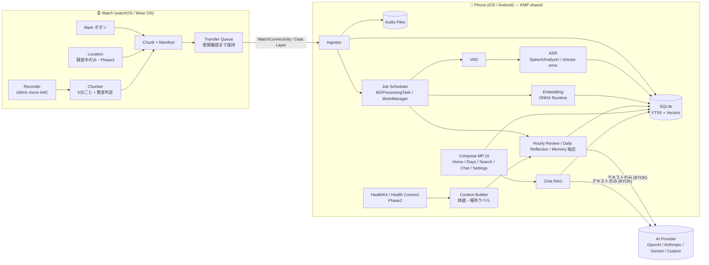
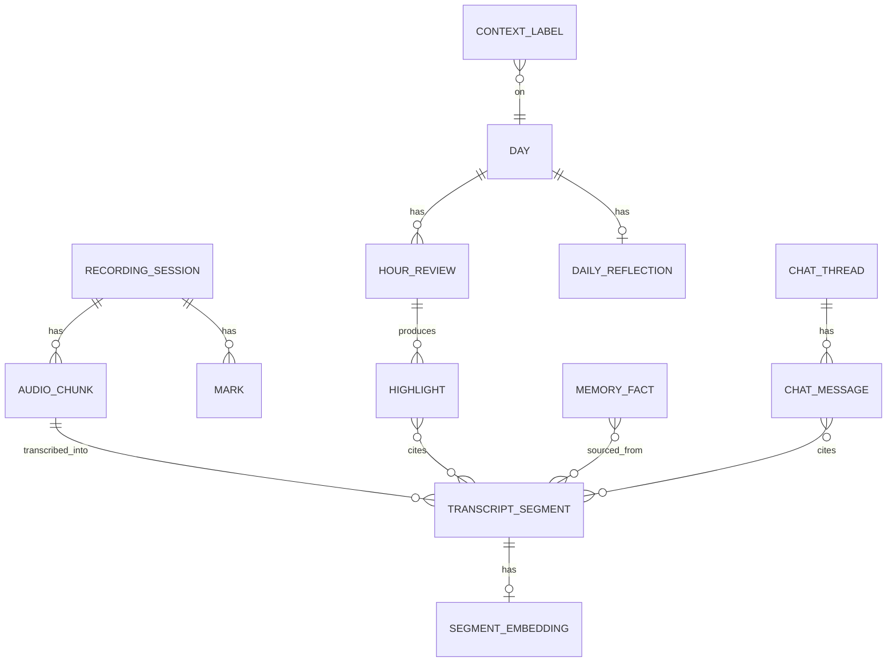
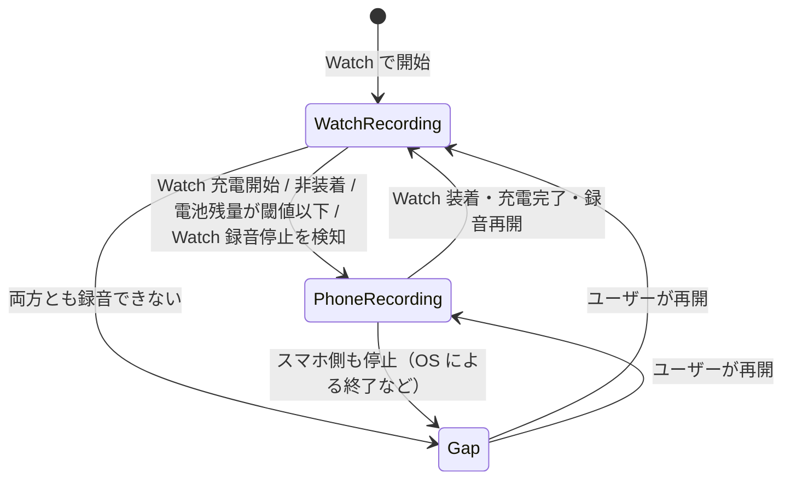

# 02. 全体構成（アーキテクチャ）

## 1. 設計方針

1. **ローカルファースト / サーバーレス** — 音声・文字起こし・索引はすべて端末内。外部送信は「ユーザーが設定した AI プロバイダへのテキスト」と「OS のジオコーディング」のみ。
2. **Watch は薄く、スマホが頭脳** — Watch は「録音・Mark・チャンク化・転送」に専念し、重い処理（ASR・埋め込み・LLM）はスマホで後追い実行する。
3. **ロジック共有、プラットフォーム固有部はアダプタ** — ドメイン/データ/パイプライン/AI クライアントは Kotlin Multiplatform で 1 本化。録音・ASR・Health・セキュアストレージなど OS 依存部は `expect/actual` かインターフェース経由で差し替える。
4. **劣化動作（Graceful degradation）** — HRV がない、AI キーがない、オフライン等でも、録音・文字起こし・検索は必ず動く。

## 2. 技術スタック選定

| レイヤ | 採用 | 理由 |
| --- | --- | --- |
| スマホ共通ロジック | **Kotlin Multiplatform (KMP)** | パイプラインは iOS の `BGProcessingTask` や Android の WorkManager から **UI なしで** 起動される。KMP は iOS ではネイティブフレームワークとして Swift から直接呼べるため、Flutter/RN のような「バックグラウンドでエンジンを立てる」問題がない。さらに **Wear OS アプリ（Kotlin）とチャンク形式・同期プロトコルのコードを共有**できる |
| スマホ UI | **Compose Multiplatform** | Android/iOS で UI を 1 本化。iOS 固有画面が必要なら SwiftUI を部分的に混在可能 |
| watchOS アプリ | **SwiftUI + AVFoundation**（ネイティブ必須） | watchOS はクロスプラットフォーム FW 非対応 |
| Wear OS アプリ | **Kotlin + Compose for Wear OS** | 前景サービス・Ongoing Activity・Data Layer はネイティブ API |
| DB | **SQLDelight + SQLite（FTS5 trigram）** | KMP 対応。trigram トークナイザで日本語の部分一致検索が可能 |
| ベクトル検索 | 埋め込みを int8 BLOB で保存し総当たり cosine | 依存を増やさず十分高速。規模が増えたら sqlite-vec 等へ移行 |
| 埋め込みモデル | multilingual-e5-small（ONNX, int8）を ONNX Runtime で実行 | 日英対応・軽量。M0 スパイクで最終決定 |
| ASR | iOS: `SpeechAnalyzer`/`SpeechTranscriber`（iOS 26+）<br>Android: sherpa-onnx + ReazonSpeech Zipformer（int8）+ Silero VAD | iOS はモデルが OS 管理でアプリが軽い。Android は日本語対応の高速 OSS。M0-5 の精度比較で Zipformer を採用（モデルは初回にダウンロード、[実装メモ](impl/android-phone.md)） |
| HTTP / LLM | Ktor Client + 自前の Provider 抽象 | OpenAI 互換 / Anthropic / Gemini を BYOK で直接呼ぶ |
| DI / 非同期 | Koin、Kotlin Coroutines / Flow | KMP 定番 |
| 秘密情報 | iOS Keychain（device-only）/ Android Keystore + EncryptedFile | API キー保管 |
| Health（Phase 2） | HealthKit / Health Connect | 読み取りのみ |
| CI | GitHub Actions（Android/Wear: ubuntu、iOS/watchOS: macOS） | |

**代替案**: Flutter（UI 開発速度は高いが、iOS バックグラウンド処理と Wear OS 連携でネイティブ実装比率が高くなる）。チームが Dart に強い場合のみ再検討。

**最小 OS**: iOS 26 / watchOS 26（SpeechAnalyzer 利用のため）、Android 10 (API 29) / Wear OS 4 以上を想定。

## 3. システム全体図



## 4. リポジトリ構成（モノレポ）

```
watch-audio/
├── docs/                      # 調査・設計・ロードマップ
├── shared/                    # KMP: 全プラットフォーム共通ロジック
│   ├── core-model/            #   エンティティ・値オブジェクト
│   ├── core-protocol/         #   チャンク/マニフェスト形式、転送プロトコル（Wear OS とも共有）
│   ├── core-db/               #   SQLDelight スキーマ、Repository
│   ├── core-pipeline/         #   取り込み → VAD → ASR → 埋め込み → AI レビューのジョブ
│   ├── core-search/           #   FTS + ベクトルのハイブリッド検索
│   ├── core-ai/               #   LLM Provider 抽象、プロンプト、RAG
│   ├── core-platform/         #   expect/actual: Transcriber, Embedder, SecureStore, HealthSource, Geocoder
│   └── feature-*/             #   画面ごとの ViewModel（Home, Days, Search, Chat, Settings）
├── composeApp/                # Compose Multiplatform UI（Android/iOS 共通）
├── androidApp/                # Android スマホアプリ（エントリ、WorkManager、Data Layer 受信）
├── wearApp/                   # Wear OS アプリ（録音 FGS、Ongoing Activity、Data Layer 送信）
└── iosApp/                    # Xcode プロジェクト
    ├── iosApp/                #   iOS ホスト（Compose 埋め込み、BGTask、WatchConnectivity 受信、Speech）
    └── WatchApp/              #   watchOS アプリ（SwiftUI、録音、WatchConnectivity 送信）
```

## 5. データモデル（概要）



| テーブル | 主なカラム |
| --- | --- |
| `recording_session` | id, device, started_at, ended_at, end_reason(user/interrupt/battery) |
| `audio_chunk` | id(UUID, Watch 採番), session_id, start_at, duration_ms, file_path, codec, silent_ranges, state(received/transcribing/transcribed/failed/no_audio), audio_purged_at（保持期間で音声を削除した時刻。文字起こしは残る） |
| `transcript_segment` | id, chunk_id, start_at, end_at, text, lang, confidence |
| `segment_fts` | FTS5(trigram) 仮想テーブル |
| `segment_embedding` | segment_id, model_id, vector(int8 BLOB), scale |
| `mark` | id, session_id, at |
| `hour_review` | day, hour, density_score, summary, state, provider, model |
| `highlight` | id, hour_review_id, title, body, cited_segment_ids |
| `daily_reflection` | day, body |
| `memory_fact` | id, kind(person/preference/plan/…), text, active, source_segment_ids |
| `chat_thread` / `chat_message` | role, content, cited_segment_ids |
| `context_label`（Phase 2） | kind(body/place/activity), start_at, end_at, label, confidence |
| `app_setting` | key, value（音声の保持期間など。`CREATE TABLE IF NOT EXISTS` で冪等に作成） |

## 6. 主要フロー

### 6.1 録音（Watch）

- **開始**: ユーザーが Watch アプリでタップ（前景）。watchOS は `AVAudioSession(.record)` + background audio、Wear OS は `foregroundServiceType=microphone` の前景サービス + Ongoing Activity。
- **エンコード**: 16kHz / mono / AAC-LC 約 24〜32kbps（8 時間 ≈ 90〜115MB）。
- **チャンク化**: 5 分ごと（Mark/停止/正時で即時クローズ）にファイルをローテーション。各チャンクに `manifest.json`（UUID、開始時刻、長さ、Mark 時刻、無音区間、デバイス情報、ハッシュ）を付与。
- **無音スキップ**: RMS エネルギーで「確実に無音」と判断した区間のみ音声を捨て、タイムライン上の区間は manifest に残す。
- **割り込み**: 電話/Siri で停止した場合は終了理由を記録し、復帰時にユーザーへ再開を促す通知/ハプティクス。

### 6.2 転送（Watch → Phone）

- **iOS**: `WCSession.transferFile(_:metadata:)`。Phone 側で保存完了後、`sendMessage`/`transferUserInfo` で ACK → Watch がファイル削除。
- **Android**: `ChannelClient` でファイルストリーム送信（`ChunkFrame`: 4 byte 長 + manifest JSON + 音声）→ Phone 側で保存・ハッシュ検証後に `MessageClient` で ACK。直接接続（`isNearby`）のノードとだけやり取りし、Data Layer のクラウド経路は使わない。フレームが壊れている・転送が途切れた場合は ACK を返さず、Watch の再送に任せる。
- **冪等性**: チャンク UUID で重複受信を無視。ACK 未着のチャンクは Watch 側で再送キューに残す。
- **プロトコル定義**は `shared/core-protocol` に置き、Wear OS とスマホ側で同一コードを使う（watchOS 側は同仕様を Swift で実装し、テストベクタで互換性を保証）。

### 6.3 処理パイプライン（Phone）

```
received → vad → transcribed → embedded → (hour closed) reviewed → (day closed) reflected
                                                            ↘ memory extraction
```

- ジョブはべき等・再開可能（各チャンクの `state` で進捗管理）。
- iOS: 前景時は即時処理、バックグラウンドは `BGProcessingTask`（充電中に大量処理）+ `BGAppRefreshTask`（少量）。
- Android: WorkManager。チャンク受信ごとに unique な 1 回限りジョブ（実行中なら後続を 1 つだけ追加）、保険として充電中に 6 時間ごとの定期ジョブ。プロセス起動時に中断チャンクを再キュー（詳細は [docs/impl/android-phone.md](impl/android-phone.md)）。
- 音声の保持期間ポリシー（#33）: 文字起こし完了済みのチャンクのみ削除対象。文字起こしの後に同じバックグラウンド処理（Android `TranscriptionWorker`、iOS `BGProcessingTask` / 前面実行）で `StorageManager.applyRetention()` を実行する。詳細は §9.3。
- 文字起こしエンジンは共通インターフェース `Transcriber`（`core-pipeline`）の裏に置く。入力は「音声パーツ（ファイル + 範囲 `[fromMs, toMs)`）のリスト」で、エンジンはそれを連結した 1 本の録音として認識し、連結先頭からの相対時刻で発話を返す（各パーツはちょうど `toMs - fromMs` の長さにする。ファイルが短ければ無音で埋める）。実装: Android = sherpa-onnx（各ファイルを `MediaCodec` でデコードして PCM を連結）、iOS = SpeechAnalyzer（Swift 側で一時 CAF ファイルに連結）、JVM ハーネス = sherpa-onnx（ffmpeg でデコード）。

#### チャンク境界をまたぐ発話（#45）

Watch は発話に関係なく約 5 分ごとにチャンクを区切るので、境界をまたぐ発話を別々に認識すると前後で単語が切れて誤認識する（ハーネスの例: 「持ち主とはぐれた / そして傘が風で舞い」「バルクイ / 十八歳の時だった」）。そこで `TranscriptionPipeline` は、チャンクを**隣のチャンクの境界付近の音声と連結して**認識する（`core-pipeline/BoundaryJoin.kt`）。

```
  前のチャンク                    このチャンク                   次のチャンク
  … ▕最後の発話▏|…………………………………………………………………|▕最初の発話▏ …
     └ tail ┘ +              チャンク全体              + └ head ┘
```

1. **連結する条件**: 隣が同じセッション・同じデバイスで、前側の終了理由が `ROTATION` / `MARK`（ギャップなし）、前の終了と後の開始の差が 1 秒以内、両方に音声があり、隣が**文字起こし済み**で、境界から 1.5 秒以内に発話（保存済みセグメント）があること。
2. **範囲**: 前のチャンクは「境界に達している発話の開始 − 0.5 秒（ただしその前の発話の終わりより前には戻らない）」から終わりまで（tail）。次のチャンクは開始から「先頭の発話の終わり + 0.5 秒（次の発話の開始まで）」まで（head）。どちらも最大 30 秒で、それより長いと連結しない。
3. **帰属と置き換え**: 認識結果は**開始時刻が入っているチャンク**のセグメントとして絶対時刻で保存する（境界をまたぐセグメントは前のチャンクに属し、`end_at` がそのチャンクの終了を越える）。隣のチャンクの、再認識した範囲内で始まるセグメントは新しい結果で置き換える（`StoreTransaction.replaceSegments`）。このチャンク自身の結果と合わせて 1 トランザクションで保存するので、重複も欠落も起きない。
4. **到着順**: 境界の 2 つのチャンクのうち**後から文字起こしされる方**が連結を行う。通常は古い順に処理するので後のチャンクが前の tail を使い、後のチャンクが先に届いて処理済みなら、前のチャンクの処理時に後の head を使って直す。欠けていたチャンクが後から届けば両側を連結する。同じチャンクを再処理しても結果は同じ（冪等）。
5. **失敗時**: 連結した認識が失敗したら（隣の音声が読めない等）、そのチャンク単体で認識し直す。

**コスト**: 追加で認識するのは発話のある境界ごとに「その発話 + 余白」（最大 30 秒）だけ。ハーネスの例（36 秒の録音、境界 2 か所）では順番どおり 39.8 秒、逆順到着 43.4 秒分を認識した。1 日 16 時間（境界 192 か所）で境界の半分に 5 秒程度の発話があると仮定すると追加は約 9 分の音声で、処理時間の増加は 1 日数分以内に収まる見込み（Android は隣のファイルを丸ごとデコードしてから切り出すので、そのデコード時間も加わる）。

**残る制約**:

- 境界付近の発話が 30 秒より長い、または隣が別セッション・別デバイス（ハンドオフ）・ギャップ（停止や割り込み）の場合は連結しない。隣が `FAILED` のまま、または音声が削除済みの場合も単体で認識する。
- 境界をまたぐ発話をタップして再生すると、属するチャンクの音声の終わりで止まる（次のチャンクへ続けて再生しない）。
- 連結の判定は保存済みセグメント（VAD / SpeechTranscriber の結果）に依存する。境界直前の発話を VAD が取りこぼした場合（0.25 秒未満など）は連結されない。
- 隣のチャンクの境界付近のセグメントは後から書き換わる（タイムライン・検索結果がそのぶん変わる）。

### 6.4 検索・Chat（RAG）

1. クエリを埋め込み → ベクトル上位 K 件 + FTS5 上位 K 件を RRF（Reciprocal Rank Fusion）で統合。
2. 日付/時間帯フィルタ（「先週の火曜」など）は LLM の関数呼び出しで抽出（AI 未設定時は UI フィルタ）。
3. 前後の文脈セグメント + 関連 Memory + Hour Summary をコンテキストにして LLM へ。
4. 回答中の引用 `[seg:123]` を UI で原文・音声再生へのリンクに変換。

### 6.5 AI プロバイダ（BYOK）

```kotlin
interface LlmProvider {
    suspend fun complete(request: LlmRequest): LlmResponse          // 構造化出力(JSON)対応
    fun stream(request: LlmRequest): Flow<LlmDelta>
    suspend fun listModels(): List<ModelInfo>
}
// 実装: OpenAiCompatibleProvider（OpenAI / ローカル LLM / 任意エンドポイント）, AnthropicProvider, GeminiProvider
// Phase 2: OnDeviceProvider（Apple Foundation Models / Gemini Nano）
```

- 送信前に `PrivacyFilter` を必ず通す（音声・生の心拍値・正確な座標は型レベルで送れない設計にする）。
- 自動レビューは「1 日あたりの上限回数/トークン」を設定可能にし、想定外の課金を防ぐ。

## 7. セキュリティ・プライバシー

| 項目 | 方針 |
| --- | --- |
| 保存 | アプリサンドボックス内。iOS は `Application Support/WatchAudio`（ファイル保護は既定の `CompleteUntilFirstUserAuthentication`。ロック中の BGTask からも読める）、Android は内部ストレージ（`files/`） |
| バックアップ | MVP では OS バックアップ対象外（Auday と同方針）。Phase 2 で E2E 暗号化バックアップを提供 |
| API キー | Keychain（`ThisDeviceOnly`）/ Android Keystore |
| 外部送信 | AI プロバイダ（テキストのみ）、OS ジオコーダ（Phase 2）。解析 SDK・広告 SDK は入れない |
| 同意 | 初回オンボーディングで「録音対象者への告知」の注意喚起。Watch に録音中インジケータを常時表示 |
| 削除 | 「この日のデータを削除」（その日に始まったチャンクの音声・文字起こし・マーク）と「すべてのデータを削除」（全録音・文字起こし・音声ファイル。DB は `VACUUM` で縮める）。どちらもアプリ内の確認ステップ必須（全削除は「削除」と入力）。システムダイアログは使わない。AI 設定・API キーは実装時に全削除の対象に加える |

## 8. 非機能目標（MVP）

| 指標 | 目標 |
| --- | --- |
| Watch 連続録音 | Apple Watch Series 10 以降で 10 時間以上、Pixel Watch 3 / Galaxy Watch 7 以降で 8 時間以上（M0 で実測し確定） |
| 転送遅延 | 接続中は録音から 20 分以内に Phone 着 |
| 文字起こし | 充電中なら 1 日分（8h 録音）を 1 時間以内に処理 |
| 検索応答 | 1 年分のデータで 300ms 以内（50 万セグメントの JVM ベンチマークで最悪 p95 約 150ms: [04 §5](04-dev-environment.md#5-検索の性能ベンチマーク23)。実機は未計測） |
| ストレージ | 8h/日で 1 日 ≈ 120MB 以下（音声）|

## 9. 24 時間連続録音の設計

テーマ「常に起動しっぱなしで 24 時間録音し、会話をすべて残す」を満たすための設計。

### 9.1 録音ソースのハンドオフ



- **主ソースは Watch**（常に身につけていて口元に近い）。**スマホは補助ソース**として、Watch が録れない時間を埋める。
- スマホ録音: iOS は background audio（録音中はオレンジのインジケータ）、Android は `microphone` 前景サービス。どちらも**アプリが前景にある間に開始**しておく必要があるので、「24 時間モード」を ON にした時点でスマホ側も待機状態にしておく。
- 切り替えの合図: Watch → スマホに「充電開始/非装着/停止」のイベントを送る。スマホ側はチャンクの到着が途絶えたことでも検知する。
- 両方が同時に録っている時間帯は、品質のよい方（Watch 優先）を正とし、もう一方は破棄する。

### 9.2 連続性の監視

- スマホ側で「最後にチャンクが届いた時刻」を監視し、N 分（既定 10 分）途絶えたらローカル通知を出す。
- タイムラインに**欠損区間とその理由**（充電中・割り込み・電池切れ・OS による終了・ユーザー停止）を表示する。
- 1 日ごとの「録音カバー率」（録れていた時間 ÷ 24h）を計測し、改善の指標にする。

### 9.3 データ量の見積もり

| 条件 | 1 日 | 1 年 |
| --- | --- | --- |
| 24h × AAC 32kbps（無音も保存） | 約 345MB | 約 126GB |
| 24h、無音区間を捨てる（音声 8h 相当） | 約 115MB | 約 42GB |
| 同上 + Opus 16kbps | 約 58MB | 約 21GB |
| 文字起こし + 索引（ベクトル int8 256 次元を含む） | 約 2〜4MB | 約 1〜1.5GB |

→ 文字起こしは無期限に保存しても問題ない。音声は「無音を捨てる + 低ビットレート」と、保持期間・バックアップ先へのオフロードで管理する。

**ストレージ管理（#33、実装済み）**

- 音声の保持期間: 7 日 / 30 日 / 90 日 / **無期限（既定。テーマ「すべて残す」）**。設定は `app_setting.audio_retention`。
- 削除対象は**文字起こし完了済み**（`TRANSCRIBED`）かつ終了時刻が「今 − 保持日数」以前のチャンクの音声ファイルだけ。未処理・処理中・失敗のチャンクの音声は消さない。文字起こしは常に残り、UI ではそのチャンクの発話を再生ボタンなしで表示する。
- 削除は「ファイル削除 → `audio_purged_at` を記録」の順（中断しても次回で整合する）。DB の `audio_path` は残す（タイムライン上は録音できていた時間として表示）。
- 容量の内訳（音声 / 文字起こし・索引 = DB ファイル / モデル / 空き容量）を状態画面に表示し、空き容量が 1 GB 未満なら警告する。モデルサイズと空き容量はプラットフォーム実装（`StorageEnvironment`）から取得する（iOS の Speech モデルは OS 管理のため不明扱い）。
- 未対応: バックアップ（#40）済みの音声だけを消す「オフロード」、コーデック比較（AAC 32kbps vs Opus）による上表の更新。

### 9.4 OS の制約（要実機検証）

| 制約 | watchOS | Wear OS |
| --- | --- | --- |
| 録音開始 | アプリ前景からのみ | アプリ前景からのみ（Android 14+）。再起動後に自動開始できない |
| 割り込み後の自動再開 | 不確実（M0-3 で検証） | AudioFocus / 同時録音の扱いを M0-4 で検証 |
| 電池（24h） | 約 4%/時（Auday 実測）→ 1 日 1 回の充電の間はスマホがカバー | 機種差大（M0-4 で検証） |
