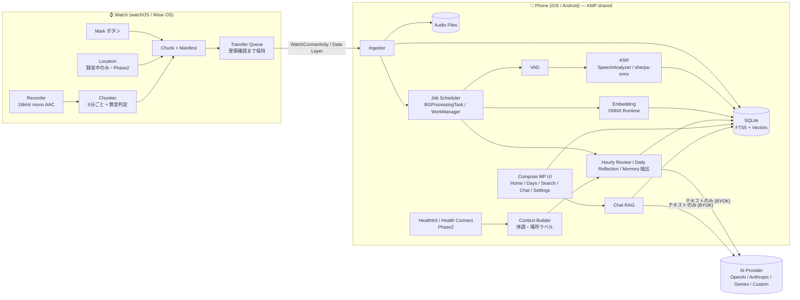
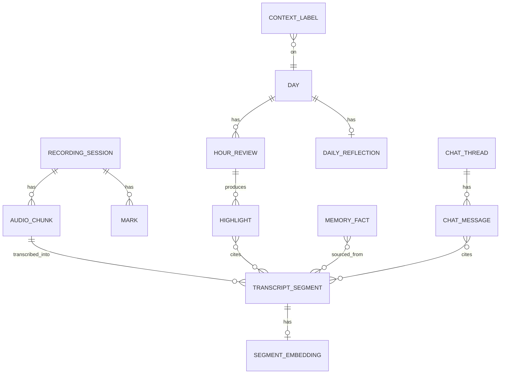

# 02. 全体構成（アーキテクチャ）

## 1. 設計方針

1. **ローカルファースト / サーバーレス** — 音声・文字起こし・索引はすべて端末内。外部送信は「ユーザーが設定した AI プロバイダへのテキスト」と「OS のジオコーディング」のみ。
2. **Watch は薄く、スマホが頭脳** — Watch は「録音・Mark・チャンク化・転送」に専念し、重い処理（ASR・埋め込み・LLM）はスマホで後追い実行する。
3. **ロジック共有、プラットフォーム固有部はアダプタ** — ドメイン/データ/パイプライン/AI クライアントは Kotlin Multiplatform で 1 本化。録音・ASR・Health・セキュアストレージなど OS 依存部は `expect/actual` かインターフェース経由で差し替える。
4. **劣化動作（Graceful degradation）** — HRV がない、AI キーがない、オフライン等でも、録音・文字起こし・検索は必ず動く。

## 2. 技術スタック選定

| レイヤ | 採用 | 理由 |
| --- | --- | --- |
| スマホ共通ロジック | **Kotlin Multiplatform (KMP)** | パイプラインは iOS の `BGProcessingTask` や Android の WorkManager から **UI なしで** 起動される。KMP は iOS ではネイティブフレームワークとして Swift から直接呼べるため、Flutter/RN のような「バックグラウンドでエンジンを立てる」問題がない。さらに **Wear OS アプリ（Kotlin）とチャンク形式・同期プロトコルのコードを共有**できる |
| スマホ UI | **Compose Multiplatform** | Android/iOS で UI を 1 本化。iOS 固有画面が必要なら SwiftUI を部分的に混在可能 |
| watchOS アプリ | **SwiftUI + AVFoundation**（ネイティブ必須） | watchOS はクロスプラットフォーム FW 非対応 |
| Wear OS アプリ | **Kotlin + Compose for Wear OS** | 前景サービス・Ongoing Activity・Data Layer はネイティブ API |
| DB | **SQLDelight + SQLite（FTS5 trigram）** | KMP 対応。trigram トークナイザで日本語の部分一致検索が可能 |
| ベクトル検索 | 埋め込みを int8 BLOB で保存し総当たり cosine | 依存を増やさず十分高速。規模が増えたら sqlite-vec 等へ移行 |
| 埋め込みモデル | multilingual-e5-small（ONNX, int8）を ONNX Runtime で実行 | 日英対応・軽量。M0 スパイクで最終決定 |
| ASR | iOS: `SpeechAnalyzer`/`SpeechTranscriber`（iOS 26+）<br>Android: sherpa-onnx + SenseVoice（候補: Whisper 系） | iOS はモデルが OS 管理でアプリが軽い。Android は日本語対応の高速 OSS。M0 スパイクで精度比較 |
| HTTP / LLM | Ktor Client + 自前の Provider 抽象 | OpenAI 互換 / Anthropic / Gemini を BYOK で直接呼ぶ |
| DI / 非同期 | Koin、Kotlin Coroutines / Flow | KMP 定番 |
| 秘密情報 | iOS Keychain（device-only）/ Android Keystore + EncryptedFile | API キー保管 |
| Health（Phase 2） | HealthKit / Health Connect | 読み取りのみ |
| CI | GitHub Actions（Android/Wear: ubuntu、iOS/watchOS: macOS） | |

**代替案**: Flutter（UI 開発速度は高いが、iOS バックグラウンド処理と Wear OS 連携でネイティブ実装比率が高くなる）。チームが Dart に強い場合のみ再検討。

**最小 OS**: iOS 26 / watchOS 26（SpeechAnalyzer 利用のため）、Android 10 (API 29) / Wear OS 4 以上を想定。

## 3. システム全体図



## 4. リポジトリ構成（モノレポ）

```
watch-audio/
├── docs/                      # 調査・設計・ロードマップ
├── shared/                    # KMP: 全プラットフォーム共通ロジック
│   ├── core-model/            #   エンティティ・値オブジェクト
│   ├── core-protocol/         #   チャンク/マニフェスト形式、転送プロトコル（Wear OS とも共有）
│   ├── core-db/               #   SQLDelight スキーマ、Repository
│   ├── core-pipeline/         #   取り込み → VAD → ASR → 埋め込み → AI レビューのジョブ
│   ├── core-search/           #   FTS + ベクトルのハイブリッド検索
│   ├── core-ai/               #   LLM Provider 抽象、プロンプト、RAG
│   ├── core-platform/         #   expect/actual: Transcriber, Embedder, SecureStore, HealthSource, Geocoder
│   └── feature-*/             #   画面ごとの ViewModel（Home, Days, Search, Chat, Settings）
├── composeApp/                # Compose Multiplatform UI（Android/iOS 共通）
├── androidApp/                # Android スマホアプリ（エントリ、WorkManager、Data Layer 受信）
├── wearApp/                   # Wear OS アプリ（録音 FGS、Ongoing Activity、Data Layer 送信）
└── iosApp/                    # Xcode プロジェクト
    ├── iosApp/                #   iOS ホスト（Compose 埋め込み、BGTask、WatchConnectivity 受信、Speech）
    └── WatchApp/              #   watchOS アプリ（SwiftUI、録音、WatchConnectivity 送信）
```

## 5. データモデル（概要）



| テーブル | 主なカラム |
| --- | --- |
| `recording_session` | id, device, started_at, ended_at, end_reason(user/interrupt/battery) |
| `audio_chunk` | id(UUID, Watch 採番), session_id, start_at, duration_ms, file_path, codec, silent_ranges, state(received/transcribed/purged) |
| `transcript_segment` | id, chunk_id, start_at, end_at, text, lang, confidence |
| `segment_fts` | FTS5(trigram) 仮想テーブル |
| `segment_embedding` | segment_id, model_id, vector(int8 BLOB), scale |
| `mark` | id, session_id, at |
| `hour_review` | day, hour, density_score, summary, state, provider, model |
| `highlight` | id, hour_review_id, title, body, cited_segment_ids |
| `daily_reflection` | day, body |
| `memory_fact` | id, kind(person/preference/plan/…), text, active, source_segment_ids |
| `chat_thread` / `chat_message` | role, content, cited_segment_ids |
| `context_label`（Phase 2） | kind(body/place/activity), start_at, end_at, label, confidence |

## 6. 主要フロー

### 6.1 録音（Watch）

- **開始**: ユーザーが Watch アプリでタップ（前景）。watchOS は `AVAudioSession(.record)` + background audio、Wear OS は `foregroundServiceType=microphone` の前景サービス + Ongoing Activity。
- **エンコード**: 16kHz / mono / AAC-LC 約 24〜32kbps（8 時間 ≈ 90〜115MB）。
- **チャンク化**: 5 分ごと（Mark/停止/正時で即時クローズ）にファイルをローテーション。各チャンクに `manifest.json`（UUID、開始時刻、長さ、Mark 時刻、無音区間、デバイス情報、ハッシュ）を付与。
- **無音スキップ**: RMS エネルギーで「確実に無音」と判断した区間のみ音声を捨て、タイムライン上の区間は manifest に残す。
- **割り込み**: 電話/Siri で停止した場合は終了理由を記録し、復帰時にユーザーへ再開を促す通知/ハプティクス。

### 6.2 転送（Watch → Phone）

- **iOS**: `WCSession.transferFile(_:metadata:)`。Phone 側で保存完了後、`sendMessage`/`transferUserInfo` で ACK → Watch がファイル削除。
- **Android**: `ChannelClient` でファイルストリーム送信 → Phone 側で保存・ハッシュ検証後に `MessageClient` で ACK。
- **冪等性**: チャンク UUID で重複受信を無視。ACK 未着のチャンクは Watch 側で再送キューに残す。
- **プロトコル定義**は `shared/core-protocol` に置き、Wear OS とスマホ側で同一コードを使う（watchOS 側は同仕様を Swift で実装し、テストベクタで互換性を保証）。

### 6.3 処理パイプライン（Phone）

```
received → vad → transcribed → embedded → (hour closed) reviewed → (day closed) reflected
                                                            ↘ memory extraction
```

- ジョブはべき等・再開可能（各チャンクの `state` で進捗管理）。
- iOS: 前景時は即時処理、バックグラウンドは `BGProcessingTask`（充電中に大量処理）+ `BGAppRefreshTask`（少量）。
- Android: WorkManager（`requiresCharging` を長時間ジョブに付与、短いものは制約なし）。
- 音声の保持期間ポリシー: 文字起こし完了済みのチャンクのみ削除対象。

### 6.4 検索・Chat（RAG）

1. クエリを埋め込み → ベクトル上位 K 件 + FTS5 上位 K 件を RRF（Reciprocal Rank Fusion）で統合。
2. 日付/時間帯フィルタ（「先週の火曜」など）は LLM の関数呼び出しで抽出（AI 未設定時は UI フィルタ）。
3. 前後の文脈セグメント + 関連 Memory + Hour Summary をコンテキストにして LLM へ。
4. 回答中の引用 `[seg:123]` を UI で原文・音声再生へのリンクに変換。

### 6.5 AI プロバイダ（BYOK）

```kotlin
interface LlmProvider {
    suspend fun complete(request: LlmRequest): LlmResponse          // 構造化出力(JSON)対応
    fun stream(request: LlmRequest): Flow<LlmDelta>
    suspend fun listModels(): List<ModelInfo>
}
// 実装: OpenAiCompatibleProvider（OpenAI / ローカル LLM / 任意エンドポイント）, AnthropicProvider, GeminiProvider
// Phase 2: OnDeviceProvider（Apple Foundation Models / Gemini Nano）
```

- 送信前に `PrivacyFilter` を必ず通す（音声・生の心拍値・正確な座標は型レベルで送れない設計にする）。
- 自動レビューは「1 日あたりの上限回数/トークン」を設定可能にし、想定外の課金を防ぐ。

## 7. セキュリティ・プライバシー

| 項目 | 方針 |
| --- | --- |
| 保存 | アプリサンドボックス内。iOS は `NSFileProtectionCompleteUntilFirstUserAuthentication`、Android は内部ストレージ |
| バックアップ | MVP では OS バックアップ対象外（Auday と同方針）。Phase 2 で E2E 暗号化バックアップを提供 |
| API キー | Keychain（`ThisDeviceOnly`）/ Android Keystore |
| 外部送信 | AI プロバイダ（テキストのみ）、OS ジオコーダ（Phase 2）。解析 SDK・広告 SDK は入れない |
| 同意 | 初回オンボーディングで「録音対象者への告知」の注意喚起。Watch に録音中インジケータを常時表示 |

## 8. 非機能目標（MVP）

| 指標 | 目標 |
| --- | --- |
| Watch 連続録音 | Apple Watch Series 10 以降で 10 時間以上、Pixel Watch 3 / Galaxy Watch 7 以降で 8 時間以上（M0 で実測し確定） |
| 転送遅延 | 接続中は録音から 20 分以内に Phone 着 |
| 文字起こし | 充電中なら 1 日分（8h 録音）を 1 時間以内に処理 |
| 検索応答 | 1 年分のデータで 300ms 以内 |
| ストレージ | 8h/日で 1 日 ≈ 120MB 以下（音声）|
