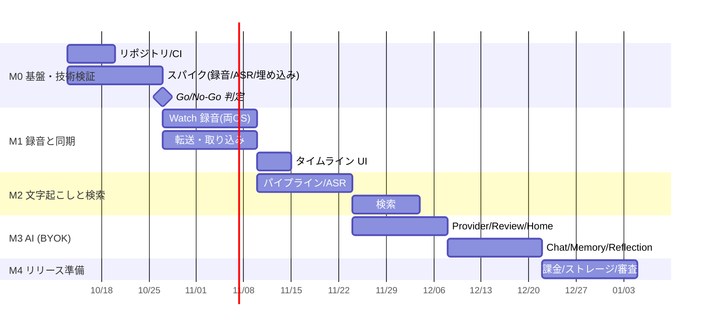

# 03. 実装手順（ロードマップ）

> ## 現在のゴール（2026-10-10 確定）
>
> **Watch 経由で常時録音し、それが文字起こしされ、データがローカルにたまっていく**ところまでを最優先で達成する。
>
> - 装着中は常に録音（充電中・就寝中は止まってよい）
> - データは端末内のみ。クラウドには上げない（Watch→スマホ転送も Bluetooth/直結のみ）
> - 文字起こしはオンデバイス
> - **AI 要約・チャット（M3）は後回し**（将来はクラウド LLM 利用も可）。意味検索（#24）・課金（#34）・ストア申請も後回し
> - 実機がない間は「音声ファイル注入」「JVM 上の E2E」「エミュレータ/シミュレータ CI」で検証する（#44）
>
> コアに含む Issue: M1（#13〜#19, #41, #43, #44）、M2（#20〜#23, #25）

各タスクは GitHub Issue として起票済み。タイトル先頭のコード（例: `[M1-3]`）で依存関係を表す。
マイルストーンごとに Epic Issue があり、各タスクはその sub-issue になっている。

## 進捗（2026-10-10 時点）

最新の状況は Issue ダッシュボード（`tools/roadmap-view/build.py` で生成）で確認できる。

| 領域 | 状態 | 内容 |
| --- | --- | --- |
| 基盤・CI（#7, #8） | ✅ クローズ | KMP モノレポ、Android/Wear OS/iOS/watchOS のビルド、GitHub Actions |
| 技術検証（#9〜#12） | 🟡 実機待ち（needs-device） | デスクトップ比較は完了（[ASR](spikes/m0-5-asr-desktop.md)・[埋め込み](spikes/m0-6-embedding-desktop.md)）。電池計測は実機待ち |
| 転送プロトコル（#13） | ✅ | ChunkManifest / ChunkAck / フレーミング / テストベクタ |
| ローカル DB・取り込み（#14） | ✅ | bundled SQLite + FTS5（日本語部分一致）、冪等な Ingestor |
| 文字起こしパイプライン（#20） | ✅ 共通部分 | 再開可能なパイプライン。OS ごとのスケジューラは実装中 |
| 実機なし検証基盤（#44） | 🟡 | JVM 上の E2E（Watch シミュレータ → 取り込み → 日本語 ASR → SQLite → 検索）を CI に組み込み済み。エミュレータテストは未着手 |
| Android スマホ（#18, #22） | ✅ 実装済み（実機未確認） | 受信と ACK、sherpa-onnx 文字起こし、モデル取得、WorkManager。詳細: [impl/android-phone.md](impl/android-phone.md)。モデル配布サイズの削減は #46 |
| Wear OS 録音（#16, #41, #43） | 🔧 実装中 | 常時録音、装着検出・充電で自動停止/再開、送信キュー、Tile |
| iOS / watchOS（#15, #17, #21） | ✅ 実装済み（実機未確認） | 録音、WatchConnectivity + ACK、SpeechAnalyzer、BGProcessingTask。詳細: [impl/ios-watchos.md](impl/ios-watchos.md) |
| スマホ UI（#19, #23, #25） | ✅ クローズ | 日別タイムライン（欠損理由・カバー率）・文字起こし・検索・状態表示。詳細: [impl/phone-ui.md](impl/phone-ui.md) |
| チャンク境界の発話分断（#45） | 📝 起票 | 境界をまたぐ発話の扱い |

## 全体の流れ

> 期間は 1〜2 名での目安。M0 のスパイク結果次第で M1 以降を見直す。

## M0: 基盤・技術検証（最重要: リスクの早期潰し）

Epic: [#1](https://github.com/Soichiro5/watch-audio/issues/1)

| コード | タスク | 依存 |
| --- | --- | --- |
| [M0-1 (#7)](https://github.com/Soichiro5/watch-audio/issues/7) | モノレポ初期化（KMP + Compose MP + Wear OS + iOS/watchOS） | - |
| [M0-2 (#8)](https://github.com/Soichiro5/watch-audio/issues/8) | CI 構築（GitHub Actions） | [M0-1 (#7)](https://github.com/Soichiro5/watch-audio/issues/7) |
| [M0-3 (#9)](https://github.com/Soichiro5/watch-audio/issues/9) | [Spike] watchOS 長時間バックグラウンド録音と電池計測 | - |
| [M0-4 (#10)](https://github.com/Soichiro5/watch-audio/issues/10) | [Spike] Wear OS 前景サービス録音と電池計測 | - |
| [M0-5 (#11)](https://github.com/Soichiro5/watch-audio/issues/11) | [Spike] オンデバイス日本語 ASR の精度・速度比較 | - |
| [M0-6 (#12)](https://github.com/Soichiro5/watch-audio/issues/12) | [Spike] 多言語埋め込みモデルの KMP 実行 | [M0-1 (#7)](https://github.com/Soichiro5/watch-audio/issues/7) |

**Go/No-Go 判定**: M0-3〜M0-5 の結果で「Wear OS 対応の可否・目標録音時間」「ASR エンジン」を確定し、`docs/02-architecture.md` を更新する。

## M1: 録音と同期

Epic: [#2](https://github.com/Soichiro5/watch-audio/issues/2)

| コード | タスク | 依存 |
| --- | --- | --- |
| [M1-1 (#13)](https://github.com/Soichiro5/watch-audio/issues/13) | チャンク/マニフェスト形式と転送プロトコル定義（core-protocol） | [M0-1 (#7)](https://github.com/Soichiro5/watch-audio/issues/7) |
| [M1-2 (#14)](https://github.com/Soichiro5/watch-audio/issues/14) | DB スキーマと取り込み処理（core-db / Ingestor） | [M1-1 (#13)](https://github.com/Soichiro5/watch-audio/issues/13) |
| [M1-3 (#15)](https://github.com/Soichiro5/watch-audio/issues/15) | watchOS 録音アプリ | M0-3, M1-1 |
| [M1-4 (#16)](https://github.com/Soichiro5/watch-audio/issues/16) | Wear OS 録音アプリ | M0-4, M1-1 |
| [M1-5 (#17)](https://github.com/Soichiro5/watch-audio/issues/17) | watchOS → iOS 転送（WatchConnectivity + ACK） | M1-2, M1-3 |
| [M1-6 (#18)](https://github.com/Soichiro5/watch-audio/issues/18) | Wear OS → Android 転送（Data Layer + ACK） | M1-2, M1-4 |
| [M1-7 (#19)](https://github.com/Soichiro5/watch-audio/issues/19) | Days タイムラインと音声再生 UI（最小） | [M1-2 (#14)](https://github.com/Soichiro5/watch-audio/issues/14) |
| [M1-8 (#42)](https://github.com/Soichiro5/watch-audio/issues/42) | スマホ録音へのハンドオフ（Watch 充電中・非装着時の 24h 継続） | M1-2, M1-3, M1-4 |
| [M1-9 (#43)](https://github.com/Soichiro5/watch-audio/issues/43) | 録音の連続性監視とアラート（欠損区間の可視化） | M1-5/M1-6, M1-7 |
| [M1-10 (#41)](https://github.com/Soichiro5/watch-audio/issues/41) | Watch のコンプリケーション / Tiles（ワンタップ録音開始・再開） | M1-3, M1-4 |

**完了条件**: 両 OS で「Watch で録音 → スマホに届く → タイムラインで再生できる」。24 時間モードで録音カバー率 95% 以上、停止は 10 分以内に通知。

## M2: 文字起こしと検索

Epic: [#3](https://github.com/Soichiro5/watch-audio/issues/3)

| コード | タスク | 依存 |
| --- | --- | --- |
| [M2-1 (#20)](https://github.com/Soichiro5/watch-audio/issues/20) | ジョブスケジューラとパイプライン状態機械 | [M1-2 (#14)](https://github.com/Soichiro5/watch-audio/issues/14) |
| [M2-2 (#21)](https://github.com/Soichiro5/watch-audio/issues/21) | VAD + Transcriber 抽象 & iOS 実装（SpeechAnalyzer） | M0-5, M2-1 |
| [M2-3 (#22)](https://github.com/Soichiro5/watch-audio/issues/22) | Android Transcriber 実装（sherpa-onnx）とモデル配信 | M0-5, M2-1 |
| [M2-4 (#23)](https://github.com/Soichiro5/watch-audio/issues/23) | キーワード検索（FTS5 trigram） | M2-2 or M2-3 |
| [M2-5 (#24)](https://github.com/Soichiro5/watch-audio/issues/24) | セマンティック検索（埋め込み + RRF ハイブリッド） | M0-6, M2-4 |
| [M2-6 (#25)](https://github.com/Soichiro5/watch-audio/issues/25) | 検索 UI と文字起こし表示 | [M2-4 (#23)](https://github.com/Soichiro5/watch-audio/issues/23) |

**完了条件**: 録音した会話が翌朝までに日本語/英語で文字起こしされ、キーワード・意味の両方で検索できる。

## M3: AI（BYOK）

Epic: [#4](https://github.com/Soichiro5/watch-audio/issues/4)

| コード | タスク | 依存 |
| --- | --- | --- |
| [M3-1 (#26)](https://github.com/Soichiro5/watch-audio/issues/26) | LLM Provider 抽象と AI 設定画面 | [M0-1 (#7)](https://github.com/Soichiro5/watch-audio/issues/7) |
| [M3-2 (#27)](https://github.com/Soichiro5/watch-audio/issues/27) | Hourly Review（Highlights / Summary / 情報密度） | M2-1, M3-1 |
| [M3-3 (#28)](https://github.com/Soichiro5/watch-audio/issues/28) | Home 画面（24h バー + Highlights） | [M3-2 (#27)](https://github.com/Soichiro5/watch-audio/issues/27) |
| [M3-4 (#29)](https://github.com/Soichiro5/watch-audio/issues/29) | Daily Reflection | [M3-2 (#27)](https://github.com/Soichiro5/watch-audio/issues/27) |
| [M3-5 (#30)](https://github.com/Soichiro5/watch-audio/issues/30) | Memory（事実の抽出・編集・無効化） | [M3-2 (#27)](https://github.com/Soichiro5/watch-audio/issues/27) |
| [M3-6 (#31)](https://github.com/Soichiro5/watch-audio/issues/31) | Chat（RAG + 引用 + ストリーミング） | M2-5, M3-1, M3-5 |

**完了条件**: API キーを入れると、1 時間ごとのハイライトと日次振り返りが自動生成され、引用付きで過去の会話について質問できる。

## M4: リリース準備

Epic: [#5](https://github.com/Soichiro5/watch-audio/issues/5)

| コード | タスク | 依存 |
| --- | --- | --- |
| [M4-1 (#32)](https://github.com/Soichiro5/watch-audio/issues/32) | オンボーディング・権限・録音同意の注意喚起 | M1-3, M1-4 |
| [M4-2 (#33)](https://github.com/Soichiro5/watch-audio/issues/33) | ストレージ管理（保持期間・容量表示・全削除） | [M2-1 (#20)](https://github.com/Soichiro5/watch-audio/issues/20) |
| [M4-3 (#34)](https://github.com/Soichiro5/watch-audio/issues/34) | 買い切り課金（StoreKit 2 / Play Billing） | [M0-1 (#7)](https://github.com/Soichiro5/watch-audio/issues/7) |
| [M4-4 (#35)](https://github.com/Soichiro5/watch-audio/issues/35) | ベータ配信と実機長時間 QA（TestFlight / Play 内部テスト） | M3 全体 |
| [M4-5 (#36)](https://github.com/Soichiro5/watch-audio/issues/36) | ストア申請準備（審査対応・プライバシーポリシー・LP） | M4-1〜M4-4, M4-6 |
| [M4-6 (#40)](https://github.com/Soichiro5/watch-audio/issues/40) | E2E 暗号化バックアップとエクスポート（「すべて残す」ため MVP に前倒し） | M1-2 |

## Phase 2: 差別化・拡張

Epic: [#6](https://github.com/Soichiro5/watch-audio/issues/6)

| コード | タスク |
| --- | --- |
| [P2-1 (#37)](https://github.com/Soichiro5/watch-audio/issues/37) | Body: HealthKit / Health Connect 取り込みとストレス推定 |
| [P2-2 (#38)](https://github.com/Soichiro5/watch-audio/issues/38) | Places: 録音中の位置取得・クラスタリング・地名化 |
| [P2-3 (#39)](https://github.com/Soichiro5/watch-audio/issues/39) | オンデバイス LLM（Apple Foundation Models / Gemini Nano） |
