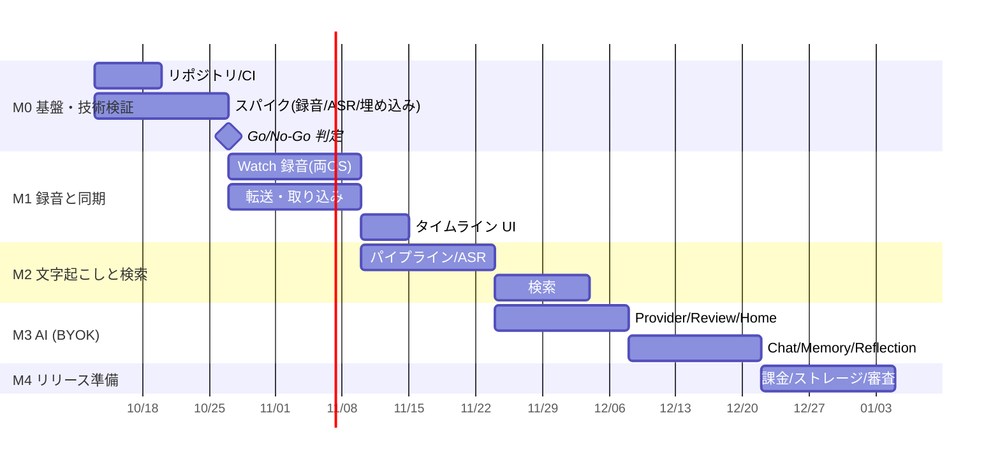

# 03. 実装手順（ロードマップ）

各タスクは GitHub Issue として起票済み。タイトル先頭のコード（例: `[M1-3]`）で依存関係を表す。
マイルストーンごとに Epic Issue があり、各タスクはその sub-issue になっている。

## 全体の流れ

> 期間は 1〜2 名での目安。M0 のスパイク結果次第で M1 以降を見直す。

## M0: 基盤・技術検証（最重要: リスクの早期潰し）

| コード | タスク | 依存 |
| --- | --- | --- |
| M0-1 | モノレポ初期化（KMP + Compose MP + Wear OS + iOS/watchOS） | - |
| M0-2 | CI 構築（GitHub Actions） | M0-1 |
| M0-3 | [Spike] watchOS 長時間バックグラウンド録音と電池計測 | - |
| M0-4 | [Spike] Wear OS 前景サービス録音と電池計測 | - |
| M0-5 | [Spike] オンデバイス日本語 ASR の精度・速度比較 | - |
| M0-6 | [Spike] 多言語埋め込みモデルの KMP 実行 | M0-1 |

**Go/No-Go 判定**: M0-3〜M0-5 の結果で「Wear OS 対応の可否・目標録音時間」「ASR エンジン」を確定し、`docs/02-architecture.md` を更新する。

## M1: 録音と同期

| コード | タスク | 依存 |
| --- | --- | --- |
| M1-1 | チャンク/マニフェスト形式と転送プロトコル定義（core-protocol） | M0-1 |
| M1-2 | DB スキーマと取り込み処理（core-db / Ingestor） | M1-1 |
| M1-3 | watchOS 録音アプリ | M0-3, M1-1 |
| M1-4 | Wear OS 録音アプリ | M0-4, M1-1 |
| M1-5 | watchOS → iOS 転送（WatchConnectivity + ACK） | M1-2, M1-3 |
| M1-6 | Wear OS → Android 転送（Data Layer + ACK） | M1-2, M1-4 |
| M1-7 | Days タイムラインと音声再生 UI（最小） | M1-2 |

**完了条件**: 両 OS で「Watch で録音 → スマホに届く → タイムラインで再生できる」。

## M2: 文字起こしと検索

| コード | タスク | 依存 |
| --- | --- | --- |
| M2-1 | ジョブスケジューラとパイプライン状態機械 | M1-2 |
| M2-2 | VAD + Transcriber 抽象 & iOS 実装（SpeechAnalyzer） | M0-5, M2-1 |
| M2-3 | Android Transcriber 実装（sherpa-onnx）とモデル配信 | M0-5, M2-1 |
| M2-4 | キーワード検索（FTS5 trigram） | M2-2 or M2-3 |
| M2-5 | セマンティック検索（埋め込み + RRF ハイブリッド） | M0-6, M2-4 |
| M2-6 | 検索 UI と文字起こし表示 | M2-4 |

**完了条件**: 録音した会話が翌朝までに日本語/英語で文字起こしされ、キーワード・意味の両方で検索できる。

## M3: AI（BYOK）

| コード | タスク | 依存 |
| --- | --- | --- |
| M3-1 | LLM Provider 抽象と AI 設定画面 | M0-1 |
| M3-2 | Hourly Review（Highlights / Summary / 情報密度） | M2-1, M3-1 |
| M3-3 | Home 画面（24h バー + Highlights） | M3-2 |
| M3-4 | Daily Reflection | M3-2 |
| M3-5 | Memory（事実の抽出・編集・無効化） | M3-2 |
| M3-6 | Chat（RAG + 引用 + ストリーミング） | M2-5, M3-1, M3-5 |

**完了条件**: API キーを入れると、1 時間ごとのハイライトと日次振り返りが自動生成され、引用付きで過去の会話について質問できる。

## M4: リリース準備

| コード | タスク | 依存 |
| --- | --- | --- |
| M4-1 | オンボーディング・権限・録音同意の注意喚起 | M1-3, M1-4 |
| M4-2 | ストレージ管理（保持期間・容量表示・全削除） | M2-1 |
| M4-3 | 買い切り課金（StoreKit 2 / Play Billing） | M0-1 |
| M4-4 | ベータ配信と実機長時間 QA（TestFlight / Play 内部テスト） | M3 全体 |
| M4-5 | ストア申請準備（審査対応・プライバシーポリシー・LP） | M4-1〜M4-4 |

## Phase 2: 差別化・拡張

| コード | タスク |
| --- | --- |
| P2-1 | Body: HealthKit / Health Connect 取り込みとストレス推定 |
| P2-2 | Places: 録音中の位置取得・クラスタリング・地名化 |
| P2-3 | オンデバイス LLM（Apple Foundation Models / Gemini Nano） |
| P2-4 | E2E 暗号化バックアップとエクスポート（Markdown 等） |
| P2-5 | Watch のコンプリケーション / Tiles（ワンタップ録音開始） |
