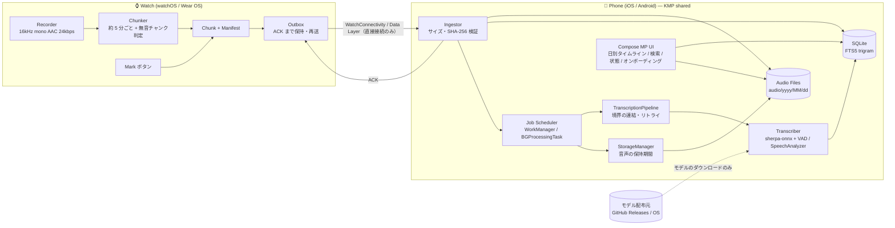
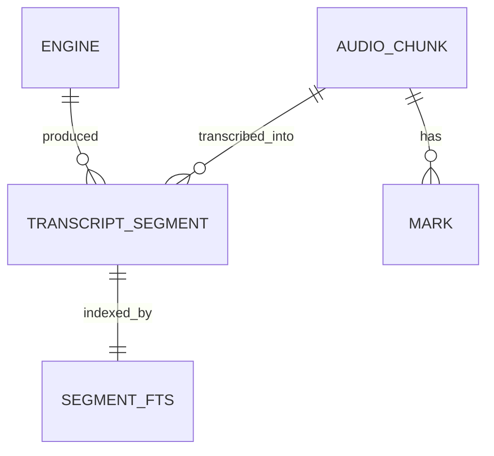
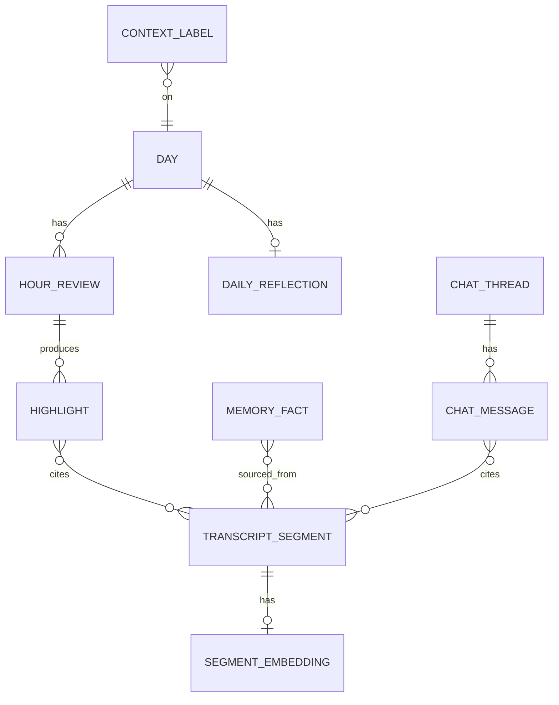

# 02. 全体構成（アーキテクチャ）

> 現在のゴール（[03-roadmap.md](../product/03-roadmap.md)）は「装着中は常時録音 → スマホでオンデバイス文字起こし → 端末内に蓄積」。この文書は**実装済みの構成**を基本に書き、AI 要約・チャット・意味検索・体調・場所など後回し（P2）の部分は「将来（P2）」と明記して区別する。

## 1. 設計方針

1. **ローカルのみ / サーバーレス** — 音声・文字起こし・索引はすべて端末内。現時点のネットワーク利用は**文字起こしモデルのダウンロードだけ**（Android: sherpa-onnx の GitHub Releases から `HttpURLConnection` で取得、iOS: Speech のモデルは OS が `AssetInventory` で導入）。Watch → スマホの転送も端末間の直接接続のみ（Wear OS は `Node.isNearby` のノードへ `ChannelClient` / `MessageClient`。`DataClient` のクラウド同期経路は使わない）。将来（P2）の AI 機能で外部の LLM に送る場合も、送るのはテキストだけで、ユーザーが明示的に設定したときに限る。
2. **Watch は薄く、スマホが頭脳** — Watch は「録音・Mark・チャンク化・転送」に専念し、重い処理（ASR）はスマホで後追い実行する。
3. **ロジック共有、プラットフォーム固有部はアダプタ** — 転送プロトコル・DB・取り込み・文字起こしパイプライン・スマホ UI は Kotlin Multiplatform で 1 本化。ASR・ストレージ情報・再生・権限など OS 依存部はインターフェース（`Transcriber`, `StorageEnvironment`, `AppServices`）か `expect/actual`（`shared/platform`）で差し替える。`if (platform)` の分岐は書かない。
4. **劣化動作（Graceful degradation）** — モデルが未準備、Watch が未接続などでも、受信済みのデータの保存・閲覧・検索は動く（文字起こしはモデルが揃ってから追いつく）。

## 2. 技術スタック

| レイヤ | 採用 | 理由・実装 |
| --- | --- | --- |
| スマホ共通ロジック | **Kotlin Multiplatform (KMP)** | パイプラインは iOS の `BGProcessingTask` や Android の WorkManager から **UI なしで** 起動される。KMP は iOS ではネイティブフレームワーク（`ComposeApp`）として Swift から直接呼べるため、Flutter/RN のような「バックグラウンドでエンジンを立てる」問題がない。さらに **Wear OS アプリ（Kotlin）とチャンク形式・転送プロトコルのコードを共有**できる |
| スマホ UI | **Compose Multiplatform** | Android/iOS で UI を 1 本化（`shared/ui`）。画面は ViewModel（`androidx.lifecycle` の KMP 版）+ `AppServices` インターフェース経由でプラットフォームの機能を使う |
| watchOS アプリ | **SwiftUI + AVFoundation**（ネイティブ必須） | watchOS はクロスプラットフォーム FW 非対応。プロトコルは `apps/ios/SharedSwift/ChunkProtocol.swift` に Swift で再実装し、`shared/protocol/testdata/*.json` のテストベクタで互換性を確認 |
| Wear OS アプリ | **Kotlin + Compose for Wear OS** | 前景サービス・Ongoing Activity・Data Layer（`ChannelClient` / `MessageClient`）はネイティブ API |
| DB | **SQLite（`androidx.sqlite` の `BundledSQLiteDriver`）+ FTS5 trigram** | 全プラットフォームで同じ SQLite（FTS5 入り）を同梱する。SQL は `LocalStore` に手書きし、スキーマは `shared/db` の `Schema.kt`（`MIGRATIONS`、`PRAGMA user_version` で管理、**追記のみ**）。trigram トークナイザで日本語の部分一致検索ができる。ORM やコード生成（SQLDelight・Room など）は使わない |
| ファイル・時刻 | kotlinx-io（`Path` / `SystemFileSystem`）、kotlinx-datetime、kotlinx-serialization（manifest / ACK の JSON） | 共通コードからファイル操作・タイムゾーン計算・JSON を扱うため |
| ASR | iOS: `SpeechAnalyzer`/`SpeechTranscriber`（iOS 26+）<br>Android: sherpa-onnx + ReazonSpeech Zipformer（int8）+ Silero VAD | iOS はモデルが OS 管理でアプリが軽い。Android は日本語対応の高速 OSS。M0-5 の精度比較で Zipformer を採用（モデルは初回にダウンロード、[実装メモ](../platforms/android-phone.md)） |
| DI | **手書きの composition root**（DI ライブラリは使わない） | Android スマホ: `AppGraph`（`apps/android`）、iOS: `IosAppGraph`（`shared/ui/iosMain`）、Wear OS: `AppGraph`（`apps/wear/WearApp.kt`）。グラフが小さく、Worker・Service・BGTask から UI なしで同じオブジェクトに届けばよいため |
| 非同期 | Kotlin Coroutines / Flow | KMP 定番 |
| バックグラウンド処理 | Android: WorkManager、iOS: `BGProcessingTask` | 文字起こし・保持期間の適用・途絶チェック |
| ネットワーク | 専用の HTTP クライアントは使わない | 通信はモデルのダウンロードだけ（Android は `HttpURLConnection`、iOS は OS 管理）。AI 機能（P2）の HTTP クライアントは P2 で決める。CI の `tools/privacy-check` が通信 API・依存を検査（§7.3） |
| CI | GitHub Actions（`android.yml` / `emulator.yml`: ubuntu、`ios.yml`: macOS、`deliver.yml`: `main` で APK を保存） | |
| 将来（P2） | 埋め込み（multilingual-e5-small, ONNX）によるベクトル検索、BYOK の LLM（要約・チャット）と API キー保管（Keychain / Keystore）、HealthKit / Health Connect | M0-6 で埋め込みモデルを比較済み（[spikes](../research/m0-6-embedding-desktop.md)）。採用ライブラリは着手時に決める |

**代替案**: Flutter（UI 開発速度は高いが、iOS バックグラウンド処理と Wear OS 連携でネイティブ実装比率が高くなる）。チームが Dart に強い場合のみ再検討。

**最小 OS**: iOS 26 / watchOS 26（SpeechAnalyzer 利用のため）、Android 10 (API 29) / Wear OS 4（API 33）以上。

## 3. システム全体図



将来（P2）は、文字起こしの後に「埋め込み → ベクトル検索」「1 時間ごとの要約・1 日の振り返り・記憶の抽出」「チャット（RAG）」を追加する（§6.4・§6.5）。

## 4. リポジトリ構成（モノレポ）

`settings.gradle.kts` に含まれる Gradle モジュールと、その他のディレクトリ（#49 で整理）。Gradle のプロジェクトパスはフォルダと同じ（`:shared:db`・`:apps:android` など）。Kotlin のパッケージ名（`app.watchaudio.core.*` など）と iOS の framework 名（`ComposeApp`）は整理前のまま。

```
watch-audio/
├── apps/
│   ├── android/               # Android スマホアプリ（AppGraph、Data Layer 受信、sherpa-onnx 文字起こし、モデル配信、WorkManager）
│   ├── wear/                  # Wear OS アプリ（録音の前景サービス、Outbox、ChannelClient 送信、Tile・コンプリケーション）
│   └── ios/                   # XcodeGen プロジェクト（project.yml）
│       ├── App/               #   iOS ホスト（Compose 埋め込み、WatchConnectivity 受信、SpeechAnalyzer）
│       ├── Watch/             #   watchOS アプリ（SwiftUI、録音、WatchConnectivity 送信）
│       ├── WatchWidget/       #   コンプリケーション（WidgetKit）
│       ├── SharedSwift/       #   ChunkProtocol.swift など、Watch・iPhone・テストで共有する Swift コード
│       └── Tests/             #   Swift のテスト（ProtocolTests・WatchLogicTests・SpeechTests・PlaybackTests）
├── shared/                    # KMP: 共通ロジック（Gradle: :shared:<名前>）
│   ├── protocol/              #   ChunkManifest / ChunkAck / ChunkFrame / RecordingFormat（Wear OS・スマホ共通。testdata/ は Swift 側と共有）
│   ├── platform/              #   expect/actual: SHA-256、IoDispatcher など
│   ├── db/                    #   LocalStore（手書き SQL。StoreTransaction はチャンク・文字起こし・検索・容量管理・設定ごとのファイルに分割）、Schema.kt のマイグレーション、FTS5 検索
│   ├── pipeline/              #   Ingestor・ChunkIntake（受信の入口）、TranscriptionPipeline・TranscriptionRun（文字起こし 1 回分）、Transcriber、発話区間の切り出し、境界の連結、StorageManager、設定（AppSettings）・状態（ProcessingStatus）・途絶アラートの判定、日のタイムライン（ギャップ）、データの書き出し（export）
│   ├── testing/               #   テスト専用: TempDir、manifest の組み立て（testManifest）。各モジュールのテストだけが使う
│   └── ui/                    #   スマホ UI（Compose MP、Android/iOS 共通）、AppServices、ViewModel。iosMain に IosAppGraph と Swift とのブリッジ
├── build-logic/               # Gradle の convention plugin（KMP ライブラリ共通設定、SQLite テストを JVM/Android/iOS で動かす設定、Android アプリ共通設定と release、Wear OS の debug 入力の混入検査）
├── gradle/libs.versions.toml  # 依存バージョンのカタログ
├── tools/
│   ├── harness/               #   実機なしの通し検証（Watch シミュレータ → 取り込み → sherpa-onnx → SQLite、Gradle モジュール）
│   ├── test-audio/            #   検証用の日本語会話音声セットの生成（Python）
│   ├── privacy-check/         #   「データは端末内のみ」の CI チェック
│   ├── check-links/           #   Markdown のリンク切れ検査
│   ├── check-version/         #   アプリのバージョンが gradle.properties と apps/ios/project.yml で一致するかの CI チェック
│   └── roadmap-view/          #   Issue ダッシュボードの生成（Python）
├── research/                  # 技術検証のスクリプトと結果（ASR・埋め込みのベンチマーク）
└── docs/                      # product/（調査・ロードマップ）・architecture/・platforms/（プラットフォーム別の実装メモ）・dev/（開発環境）・research/（検証結果）
```

## 5. データモデル

### 5.1 実装済みのテーブル

スキーマの正は `shared/db/src/commonMain/kotlin/app/watchaudio/core/db/Schema.kt`（マイグレーションは追記のみ）。DB ファイルは `watch-audio.db`、音声ファイルは音声ルート（`audio/`）の下の `yyyy/MM/dd/<chunkId>.<拡張子>`（UTC の日付）に置き、DB にはルートからの相対パスを保存する。録音セッションは独立したテーブルを持たず、`audio_chunk.session_id` でまとめる。



チャンク・エンジンは**整数のキーで参照**する（マイグレーション 6、#94）。Watch が採番した UUID は `audio_chunk.uuid` にだけ持ち、セグメントと印は `audio_chunk.id`（INTEGER PRIMARY KEY。VACUUM で番号が変わらない）を指す。整数のキーは `shared/db` の中だけで使い、公開 API（`ChunkRecord.id`・`SegmentRecord.chunkId`・`SegmentRecord.engine`）は従来どおり UUID とエンジン名の文字列で返す。

| テーブル | 主なカラム |
| --- | --- |
| `audio_chunk` | id（整数のキー）, uuid（Watch 採番の UUID、一意）, session_id, device_id, source（watchos/wearos…）, started_at, ended_at, time_zone, audio_path（相対。無音チャンクは NULL）, codec, size_bytes, sha256, end_reason（rotation/mark/user_stop/charging/off_body/…）, state（received/transcribing/transcribed/failed/no_audio）, attempts, last_error, received_at, manifest_json, audio_purged_at（保持期間で音声を削除した時刻。文字起こしは残る） |
| `mark` | chunk_id（`audio_chunk.id`）, at（PK は両方） |
| `transcript_segment` | id, chunk_id（`audio_chunk.id`）, start_at, end_at, text, lang, engine_id（`engine.id`） |
| `engine` | id, name（文字起こしエンジンの ID。`Transcriber.engineId`、一意） |
| `segment_fts` | FTS5(trigram) の contentless 仮想テーブル（本文 + 改行 2 つをトリガで索引。語彙 `segment_fts_terms` で 1〜2 文字の検索にも使う。マイグレーション 5、#72） |
| `app_setting` | key, value（音声の保持期間・通知設定など。`CREATE TABLE IF NOT EXISTS` で冪等に作成） |

時刻はすべてエポックミリ秒。

### 5.2 将来（P2）のテーブル（構想、未実装）

AI 要約・チャット・意味検索・体調/場所に着手するときに、マイグレーションを追記して作る。名前とカラムは構想段階。



| テーブル | 主なカラム |
| --- | --- |
| `segment_embedding` | segment_id, model_id, vector(int8 BLOB), scale |
| `hour_review` | day, hour, density_score, summary, state, provider, model |
| `highlight` | id, hour_review_id, title, body, cited_segment_ids |
| `daily_reflection` | day, body |
| `memory_fact` | id, kind(person/preference/plan/…), text, active, source_segment_ids |
| `chat_thread` / `chat_message` | role, content, cited_segment_ids |
| `context_label` | kind(body/place/activity), start_at, end_at, label, confidence |

## 6. 主要フロー

### 6.1 録音（Watch）

詳細は [impl/wearos.md](../platforms/wearos.md)・[impl/ios-watchos.md](../platforms/ios-watchos.md)。

- **開始**: ユーザーが Watch アプリでタップ（前景）。watchOS は `AVAudioSession(.record)` + background audio、Wear OS は `foregroundServiceType=microphone` の前景サービス + Ongoing Activity。一度 ON にすると、充電・非装着（Wear OS のみ検出）・電池残量低下・容量不足・割り込みで一時停止し、条件が解けたら自動で再開する（watchOS の充電後の再開はアプリが前面に戻ったとき）。
- **エンコード**: 16kHz / mono / AAC-LC 24kbps（.m4a、1 時間 ≈ 11MB。ffmpeg での実測 11.1MB、§9.3）。値は両 Watch 共通の `RecordingFormat`（`shared/protocol`、Swift 側は同じ値をテストベクタで確認）。
- **チャンク化**: 約 5 分ごと（停止・一時停止でも閉じる。Mark では閉じない）にファイルをローテーション。各チャンクに manifest（`ChunkManifest`: チャンク UUID、セッション ID、デバイス ID、開始時刻、長さ、タイムゾーン、Mark のオフセット、音声ファイルの形式・サイズ・SHA-256、終了理由）を付ける。
- **Mark**: 録音中のチャンクに、チャンク先頭からのオフセットとして記録する（`markOffsetsMs`）。スマホには、そのチャンクが閉じたときに一緒に届く。
- **無音スキップ**: 1 秒ごとのピークがチャンク全体で一度も −40 dBFS に届かなかった場合だけ「確実に無音」として音声を捨て、`audio` なしの manifest で時間範囲だけを送る（タイムライン上は無音区間として残る）。
- **割り込み・停止**: 終了理由（`interruption` / `charging` / `off_body` / `low_battery` / `terminated` など）を manifest に記録し、欠損の理由としてタイムラインに出す。予期しない停止は Watch 上で通知/ハプティクスを出す。

#### 両 Watch で共通の録音ルール（#137）

同じ製品なので、Watch の機種によって録音が止まる条件や Mark の扱いが変わらないようにする。数値は `shared/protocol` の `RecorderRules.CURRENT` に 1 か所で置き、watchOS は同じ値を `RecorderRules.current`（`apps/ios/SharedSwift/RecorderRules.swift`）に持つ。両側が `shared/protocol/testdata/recorder-rules.json` と一致することをテストする（`RecordingFormat` と同じ方式）。値を変えるときは、この 3 か所とこの表を一緒に直す。

| 項目 | 共通のルール | Wear OS | watchOS |
| --- | --- | --- | --- |
| 電池残量低下で停止 | 充電していないとき、録音中に残量が **10% 未満**になったら止める（`low_battery`、通知とハプティクス） | `RecorderPolicy.LOW_BATTERY_PERCENT`。残量は整数 % | `RecorderPolicy.lowBatteryPercent`。`batteryLevel` を四捨五入した整数 % で比べる |
| 電池での再開 | 残量が **15% 以上**に戻るか充電したら再開する。10〜14% の間は止まったまま（ヒステリシス） | `LOW_BATTERY_RESUME_PERCENT`（録音の開始は 10% 以上ならできる） | `resumeBatteryPercent`（録音の開始もこの値以上が条件） |
| 無音の判定 | 約 1 秒ごとのピークが**一度も −40 dBFS に届かなかった**チャンクだけ、音声を捨てて manifest だけ送る | `getMaxAmplitude()`（前回の取得からの最大値、0〜32767）が 328（= −40 dBFS）以上なら音あり | `AVAudioRecorder.peakPower`（dBFS）が −40 以上なら音あり |
| 無音判定の安全策 | ピークを取れた回数がチャンク長の **80% 以上**でなければ音声を残す | 加えて 10 回未満（短すぎるチャンク）も残す | — |
| Mark | 録音中のチャンクに `markOffsetsMs`（チャンク先頭からの ms）として記録し、**チャンクは閉じない** | `ChunkTracker.mark` | `RecorderController.mark`（`RecorderPolicy.markOffsetMs`） |
| ACK が無いときの再送待ち | **転送方式ごとに違う値**（下記） | 3 分（`Outbox.ACK_TIMEOUT_MS`） | 15 分（`ChunkSendTracker.resendAfter`） |
| 空き容量不足（#137 の対象外） | 空きが 100 MB 未満で止める | 150 MB 以上で再開 | 100 MB 以上で再開（ヒステリシスなし） |

- **電池**: 以前は Wear OS が 5% 以下で停止・10% 以上で再開、watchOS が 10% 未満で停止・15% 以上で再開だった。最後のチャンクを確定して送る余裕を残すため、watchOS の値に揃えた。
- **無音**: 以前の watchOS は「平均が −50 dBFS を超えるか、ピークが −35 dBFS を超えたら音あり」だった。Wear OS では平均が取れない（`getMaxAmplitude()` だけ）ので、ピーク −40 dBFS の 1 本に揃えた。音声を捨てると取り戻せないので保守的（音声を残す側）な値で、実機で調整する（#59・#60）。なお「ピーク」の意味は少し違い、Wear OS は前回の取得からの 1 秒間の最大値、watchOS は `updateMeters()` を呼んだ時点のメーターの値である。
- **Mark**: 以前の watchOS は Mark でチャンクを閉じていた（終了理由 `mark`）。マークした瞬間が早くスマホに届く代わりに、短いチャンクが増え、チャンクの区切りが機種で変わっていた。Wear OS に合わせて閉じないようにした（スマホに届くのはそのチャンクが閉じたとき、最大 約 5 分後）。終了理由 `mark` はプロトコルと過去のデータのために残すが、どちらの Watch も出さない。スマホは Mark を `markOffsetsMs` から DB の `mark` 表に入れるので、チャンクの閉じ方によらず同じに扱う（`mark` で終わったチャンクも `rotation` と同じく欠損にしない）。
- **再送待ち**: Wear OS の `ChannelClient` は、送り終えた時点で相手に届いているので、3 分 ACK が来なければ失われたとみて再送する。watchOS の WatchConnectivity は転送を OS のキューに預け、届くまでに時間がかかることがある。早く再送すると同じチャンクがキューに重なって二重に届くので、15 分にしている。どちらでも、二重に届いたチャンクにはスマホが `duplicate` を返すので、値の違いは保存されるデータには影響しない。

### 6.2 転送（Watch → Phone）

- **iOS**: `WCSession.transferFile(_:metadata:)`（無音チャンクは `transferUserInfo`）。Phone 側で保存完了後、`transferUserInfo` で ACK → Watch がファイル削除。
- **Android**: `ChannelClient` でファイルストリーム送信（`ChunkFrame`: 4 byte 長 + manifest JSON + 音声）→ Phone 側で保存・ハッシュ検証後に `MessageClient` で ACK。直接接続（`isNearby`）のノードとだけやり取りし、Data Layer のクラウド経路は使わない。フレームが壊れている・転送が途切れた場合は ACK を返さず、Watch の再送に任せる。
- **冪等性**: チャンク UUID で重複受信を無視。ACK 未着のチャンクは Watch 側で再送キューに残す。
- **受信後の処理は共通**（#134）: どちらのスマホも、受け取った manifest と音声ファイルを `ChunkIntake`（`shared/pipeline`）に渡し、返ってきた ACK を送るだけ。manifest が読めない（新しい形式など）がチャンク ID は読めるときは `REJECTED` を返す（両 Watch ともチャンクを保持し、数分おきの再送をやめて後で再試行する: Wear OS は 6 時間後、watchOS は次の起動時）。チャンク ID も読めない・DB に書けないときは ACK を返さず、Watch の再送に任せる。受け取った一時ファイルは結果にかかわらず、アーカイブへ移すか削除する。
- **プロトコル定義**は `shared/protocol` に置き、Wear OS とスマホ側で同一コードを使う（watchOS 側は同仕様を Swift で実装し、テストベクタで互換性を保証）。

### 6.3 処理パイプライン（Phone）

```
received → transcribing → transcribed
                       ↘ failed（リトライ上限まで再試行）
no_audio（無音チャンク。文字起こししない）
```

- ジョブはべき等・再開可能（各チャンクの `state` で進捗管理）。将来（P2）は文字起こしの後に埋め込み・要約などの段を追加する。
- iOS: 前景時は即時処理、バックグラウンドは `BGProcessingTask`（充電中、`requiresExternalPower = true`）。
- Android: WorkManager。チャンク受信ごとに unique な 1 回限りジョブ（実行中なら後続を 1 つだけ追加）、保険として充電中に 6 時間ごとの定期ジョブ（詳細は [docs/platforms/android-phone.md](../platforms/android-phone.md)）。
- **文字起こし 1 回分は共通**（#134）: `TranscriptionRun`（`shared/pipeline`）が、① 前回中断したチャンク（`TRANSCRIBING`）をキューに戻す（毎回、実行の直列化ロックの中で）、② モデルの確認（`SpeechModel`。未準備なら文字起こしをしない）、③ 電池と発熱の方針つきの文字起こし（失敗したチャンクがあればモデルを確認し直す）、④ 音声の保持期間による削除、⑤ 診断ログ（`worker_start` / `worker_stop`、チャンクごとの `transcription_*`）、⑥ 次の予約の判定（`FollowUp`: なし / すぐ再実行 / 方針による休止（遅延・充電時）/ OS による停止 / モデル待ち）を行う。Android（WorkManager）と iOS（前面実行・BGTask）は `FollowUp` を自分のスケジューラに対応づけるだけ。試行回数の上限（3 回）は `TranscriptionPipeline.DEFAULT_MAX_ATTEMPTS` の 1 か所。
- 電池と発熱の方針（#75）: どのプラットフォームでも、文字起こしは下の「充電していないときの処理方針」に従い、**チャンクごとに**処理してよいかを判定する（下記）。

#### 充電していないときの処理方針（#75）

日中は充電していないことが多く、受信のたびに文字起こし（デコード + VAD + ASR で CPU を使う）を続けるとスマホの電池と発熱が問題になる。そこで、**文字起こしの大半は充電中にまとめて行い、充電していない間は少量だけ処理する**。判定は共通の純粋関数 `ProcessingPolicy.decide`（`shared/pipeline/ProcessingPolicy.kt`）で、プラットフォームは端末の状態（`DeviceConditions`: 外部電源・電池残量・省電力モード・発熱）を読むだけ。

| 条件 | 処理 | 再開 |
| --- | --- | --- |
| 発熱（Android `THERMAL_STATUS_MODERATE` 以上、iOS `thermalState` が `.serious` 以上） | **しない**（充電中でも） | 15 分後に再判定（新しいチャンクの受信でも再判定） |
| 充電中（外部電源につながっている） | すべて処理（従来どおり） | — |
| 設定「充電中のみ文字起こしする」がオン（既定はオフ） | しない | 充電開始時 |
| 電池駆動で残量 50% 未満（残量が分からないときも） | しない | 充電開始時（新しいチャンクの受信でも再判定） |
| 電池駆動で省電力モード（Android のバッテリーセーバー、iOS の低電力モード） | しない | 同上 |
| 電池駆動で残量 50% 以上 | **1 時間あたり録音 10 分ぶんまで**処理 | 上限に達したら、その 1 時間の枠が終わる時刻か充電開始時 |
| ユーザーが「今すぐ文字起こし」を押した | 電池の条件（残量・省電力・上限・充電中のみ）を外して処理。発熱の条件は外さない | — |

- **チャンクの途中では止めない**: 判定はチャンクを始める前に毎回行う。止めるときは処理中のチャンクを終えてから止め、次の実行は次の未処理チャンクから始める（欠落・重複なし。`PolicyGatedTranscription` と単体テスト `PolicyGatedTranscriptionTest`）。OS による停止（WorkManager の制約が外れた・BGTask の時間切れ）は従来どおりチャンクを中断して再キューする。
- **1 時間あたりの上限**: 電池駆動で処理した録音の長さを固定の 1 時間枠（最初に処理したチャンクの終了時刻から）で数える。チャンクは途中で切らないので、1 枠で最大 1 チャンク（5 分）超えうる。使用量は `app_setting`（`transcription.battery_budget.*`、設定ではなく状態）に保存し、プロセスが終わっても引き継ぐ。充電中に処理した分は数えない。
- 定数（`ProcessingPolicy.Limits`）: 最低残量 50%、上限 10 分/時、発熱の閾値 MODERATE、発熱時の再判定 15 分。どれも実機の計測（#61）で見直す。
- 判定の記録: 各実行の判定（処理する / 止める理由・電源・残量・発熱・その枠の使用量）を診断ログの `transcription_policy` に 1 行ずつ残す（本文は含めない）。止まっている理由は状態タブの「文字起こしモデル」欄にも表示する。
- **目標値と根拠（推定、#61 で実測）**: 本アプリの文字起こしによるスマホの電池消費は、**充電していない間で 1 日あたり 3% 以下**。根拠: スマホでの処理時間は録音時間の約 3〜6%（[M0-5 §5](../research/m0-5-asr-desktop.md#5-1-日分の処理時間の見積もりスマホ) の 1 日 25〜50 分/装着 16 時間に、#68 の区間の細分化による約 1 割増し）。電池駆動で 16 時間 × 10 分 = 録音 160 分を処理すると CPU 時間は 5〜10 分。処理中の消費電力を 2〜3 W（2 スレッド + メモリ）、実行ごとのモデル読み込み（1 時間に 2 回程度、数秒）を足すと 1 日 約 0.2〜0.55 Wh で、4,500 mAh（約 17 Wh）の電池の約 1〜3%。受信（Bluetooth）や画面の消費は含まない。
- 充電時の処理量: 16 時間装着の録音 960 分のうち電池駆動で処理するのは最大 160 分（約 17%）。残り約 800 分を充電中に処理すると約 25〜50 分で、§8 の「充電中に 8 時間分を 1 時間以内」に収まる。
- 制約（ジョブ側）: Android の 1 回限りジョブは「電池残量低下でないこと」（設定「充電中のみ」がオンなら「充電中」）を WorkManager の制約にし、方針で止まったときは理由に応じて「遅延付きの再実行」（発熱・上限）と「充電中を条件にした実行」（`transcription-on-charge`）を予約する。iOS の `BGProcessingTask` はもともと外部電源が条件なので、止まるのは発熱のときだけ（再予約で `earliestBeginDate` を 15 分後にする）。iOS の前面実行は Android と同じ判定を使い、時間で再判定する止まり方なら前面にいる間だけ再試行する。
- 音声の保持期間ポリシー（#33）: 文字起こし完了済みのチャンクのみ削除対象。文字起こしの後に同じ実行（共通の `TranscriptionRun`。Android `TranscriptionWorker`、iOS `BGProcessingTask` / 前面実行から呼ぶ）で `StorageManager.applyRetention()` を実行する。詳細は §9.3。
- 文字起こしエンジンは共通インターフェース `Transcriber`（`shared/pipeline`）の裏に置く。入力は「音声パーツ（ファイル + 範囲 `[fromMs, toMs)`）のリスト」で、エンジンはそれを連結した 1 本の録音として認識し、連結先頭からの相対時刻で発話を返す（各パーツはちょうど `toMs - fromMs` の長さにする。ファイルが短ければ無音で埋める）。実装: Android = sherpa-onnx（各ファイルを `MediaCodec` でデコードして PCM を連結）、iOS = SpeechAnalyzer（Swift 側で一時 CAF ファイルに連結）、JVM ハーネス = sherpa-onnx（ffmpeg でデコード）。
- **誤認識の除去は共通の 1 か所**（#136、#105）: `TranscriptionPipeline` は `Transcriber` の結果（`TimedText`）を保存の前に `SegmentFilter`（`shared/pipeline`）に通し、残したものだけを保存する。アプリ（Android・iOS）とハーネスは `FalsePositiveFilter.DEFAULT` を使う（下記「会話以外の誤認識の除去」）。判断の材料として `TimedText` は任意の `speechProbability`（発話区間の Silero の確率の平均）、`levelAboveNoiseDb`（区間の音が雑音の床からどれだけ大きいか、dB）、`confidence`（認識器の確信度）を持つ。前の 2 つは sherpa-onnx の経路（`transcribeSpeech`）で付く。`confidence` は現状どの経路でも null（sherpa-onnx 1.13.8 の Java / Android API の結果はテキスト・トークン・時刻・長さだけでトークンの確率を出さない。iOS の SpeechAnalyzer の経路はどれも null）。いずれも DB には保存しない（スキーマは変えていない）。
- **モデルの記述**（#136）: sherpa-onnx の ASR モデルは `AsrModelSpec`（`shared/pipeline`: ディレクトリ名 `id`、`engineId`、言語、認識器の種類 `RecognizerKind`、役割ごとのファイル名）で表す。現在は `AsrModelSpec.JA_REAZONSPEECH`（Zipformer ReazonSpeech int8、`ja`）だけ。Android の `ModelFiles`・`ModelManifest` とハーネスの `SherpaTranscriber` はこの spec からファイルの場所と認識器の設定を作るので、別のモデル（英語・日英混在の #81 など）は spec と `RecognizerKind` の追加で足せる。

#### 発話区間の切り出し（Android / JVM ハーネス、#68・#71）

sherpa-onnx の経路では、Silero VAD の発話確率（32 ms ごと）から `speechSegments`（`shared/pipeline/SpeechDetection.kt`）で発話区間を見つけ、`padSpeechSpans`（`shared/pipeline/SpeechSegmentation.kt`）で認識器への入力に切り分け、1 つずつ認識して `TimedText` にする。この「確率の列 → 区間 → `TimedText`」は共通の関数 `transcribeSpeech`（`shared/pipeline/VadTranscription.kt`）で、Android とハーネスは同じコードを使う。プラットフォーム側は sherpa-onnx の VAD（`Vad.compute`、窓ごとの呼び出しは共通の `speechProbabilities`）と認識器を作るだけ。設定はすべて `VadSettings`（`shared/pipeline/VadSettings.kt` のデータクラス。既定値 `VadSettings.DEFAULT` が下記の値）で、ハーネスの `evaluate` は `--vad 名前=値` で再コンパイルせずに変えられる（[test-audio.md §1](../dev/test-audio.md#1-生成と評価の手順)）。iOS の SpeechAnalyzer は音声ファイルを丸ごと渡し、区切りは OS に任せる（この処理は通らない）。

**発話の検出**（`speechSegments`）: 確率が 0.15（`threshold`）以上になったら発話の開始（2 窓 = 64 ms さかのぼる、`startBackWindows`）、0.15（`negThreshold`）未満が 2 秒（`minSilenceSeconds`）続いたら終了。0.25 秒未満は捨てる。長さでは区切らない（一定の長さで切ると語の途中で切れ、clean の CER が約 1 ポイント悪化した。長い区間は 3.・4. で間や最も静かな点で切る）。sherpa-onnx の VAD は終了のしきい値が「開始 − 0.15」に固定で、開始を 0.15 に下げると 0.01 未満でしか終わらず会話全体がつながるため、同じ処理を自前で持つ（#71）。しきい値を 0.3 から下げたのは、雑音下の相手の声（装着者より 8 dB 小さく、雑音との差は 2〜7 dB）が 0.3 では検出漏れ・途中切れになるため。最小無音を 0.5 秒から 2 秒にしたのは、確率が揺れる小さな声を途中で切らないため（区間の中の間は次の 3. で切る）。

**入力への切り分け**（`padSpeechSpans`）:

1. **余白**: 各区間の前後に 0.3 秒の実音声を付ける（語頭が欠けないように）。
2. **結合と切り分け**: 余白が重なる隣の区間は、余白込みで 20 秒（`maxSegmentSeconds`）以内に収まる場合だけ 1 つにまとめる。収まらない場合はまとめず、重なった余白の中で最も静かな点で切り分ける（同じ音声を 2 回認識しない）。
3. **間での分割**: 各区間の中に「間」があれば、その中央で切る。会話の話者交代（平均 0.35 秒）を捉えるため。間は次のどちらか（10 ms ごとのエネルギーで判定）。
   - **無音の間**: 大きい音より 30 dB 以上小さい状態が 0.22 秒（`minPauseSeconds`）以上続く所。「大きい音」は前後 1 秒（`pauseLoudWindowSeconds`）の 95 パーセンタイル。区間全体を基準にすると、大きい声の話者と同じ区間に入った小さい声の話者が、声の谷ごとに切られてしまう。残響のある音声では、Silero の確率は無音になっても 1 秒以上しきい値を下回らないので、VAD の最小無音を短くしても話者交代では切れない（#68）。
   - **雑音の床まで下がった間**（#71）: 区間と前後 5 秒の 10 パーセンタイルを雑音の床とし、床から 9 dB 以内（`pauseFloorDb`、ただし大きい音より 6 dB 以上小さい。雑音しかない区間を切らないため）の状態が 0.3 秒（`minNoisyPauseSeconds`）以上続く所。雑音があると間は雑音で埋まり、大きい音より 30 dB も下がらない（話者交代の間の 61〜99% は床から 3 dB 以内、96〜100% は 9 dB 以内だった）。雑音は無音より短い谷が多く、細かく切りすぎると文脈が減って誤るので、無音の間より長く取る（0.22 / 0.25 / 0.3 / 0.35 / 0.4 / 0.5 秒で比べ、0.3 秒が最もよかった）。
4. **上限**: それでも 20 秒を超える区間（間のない長い発話、雑音で間が埋まった会話）は、最も静かな点（前後 50 ms のエネルギーが最小の所）で 20 秒以下に分ける。どの片も 5 秒以上にする。

結果として、認識器への入力は必ず 20 秒以下になり、入力どうしは重ならない。

**理由**: ReazonSpeech の Zipformer は、1 つの入力に複数の話者交代が入ると文をまとめて落とす。雑音の条件でも同じで、#68 の修正後も入力の中央値が 5〜10 秒（話者交代を含む）のままだったオフィス・カフェ・屋外・1 日分の CER は 60〜67% だった。以前は VAD が最大 20 秒で切った区間どうしが接していたため、余白を付けると重なって結合し直され、入力が最大 109 秒になっていた。上限を 20 秒にするだけでは足りず（会話の CER 53.8% → 44.3%、区間長の中央値 10 秒）、話者交代ごとに切って初めて正解区間で切った場合に近づいた（15.0%、中央値 2 秒前後）。雑音の条件は、雑音の床を基準にした間と VAD のしきい値の引き下げで 60〜67% → 26〜41% になった（正解区間で切った場合の 1.0〜1.5 倍）。Silero の確率の谷で切る方法は、話者交代の間と発話の中で確率の下がり方に差がなく採用しなかった。測定結果は [test-audio.md §4](../dev/test-audio.md#4-結果)。

**残る制約**:

- 雑音下の相手の声（装着者より小さい声）は、正解区間で切った場合より CER が大きい（カフェ 59%、屋外 52%）。細かく切られて文脈が減るか、取りこぼされる。話者の切り替わりの検出やノイズ抑制は未検討。
- しきい値を下げたぶん、会話以外の短い声（「うん」「え」など）も拾う（1 日分で会話外の誤認識 7 → 58 文字）。保存の前に除く（下記、#105）。
- パラメータは合成音声（#56）で選んだ。実機の雑音での確認は #61。

#### 会話以外の誤認識の除去（#105）

VAD のしきい値を 0.15 に下げた（#71）ぶん、会話のない所の生活音や遠くの話し声も発話として拾い、「うん」「え」「何」のような短い文字になる。`TranscriptionPipeline` は保存の前に `FalsePositiveFilter`（`shared/pipeline/SegmentFilter.kt`）で次のどちらかに当たる結果を捨てる。

1. **雑音の床に近い**: 区間の 10 ms ごとのエネルギーの 95 パーセンタイルが、雑音の床（区間と前後 5 秒の 10 パーセンタイル、§6.3 の間の検出と同じ）から 7 dB（`minLevelAboveNoiseDb`）未満（`levelAboveNoiseFloorDb`、`TimedText.levelAboveNoiseDb`）。文字数は問わない。遠くの話し声・空調・会話の合間の無音から出た文字は床とほとんど変わらない（1 日分で 3.8〜5.5 dB）。会話の CER は 8 dB まで悪化せず、10 dB で雑音下の相手の声を捨て始めた。
2. **発話らしくない 1 文字**: 文字（かな・漢字・英数字）が 1 文字（`shortTextMaxChars`）以下で、Silero の確率の平均が 0.2（`shortTextMinSpeechProbability`）未満。袖の擦れのような、大きいが声ではない音から出た「え」「あ」。

信号がない（null）ときは、その規則では捨てない。iOS の SpeechAnalyzer の経路は確率も音量も返さないので、現状は何も捨てない（Swift 側で信号を付ければ同じフィルタが効く）。

**理由**: 1 日分（`day`）の会話外の誤認識 58 文字の内訳は、オフィスの遠くの話し声（空調と合わせて床から 3.8〜5.5 dB）から 48 文字、擦れ音（床から 17〜28 dB と大きいが、Silero の確率の平均 0.05〜0.12）から 10 文字だった。会話の CER を悪化させないことを条件に候補（短い区間と文字数、Silero の確率、雑音の床からの差、その組み合わせ）を比べ、悪化がなく会話外の誤認識が最も少ない組み合わせを選んだ。区間の長さは前後 0.3 秒の余白を含むので、短さだけでは雑音と短い相づちを分けられなかった（会話の CER が悪化する）。測定結果は [test-audio.md §4](../dev/test-audio.md#4-結果)。合成の雑音で選んだ値なので、実機の生活音での確認は #61。

#### チャンク境界をまたぐ発話（#45）

Watch は発話に関係なく約 5 分ごとにチャンクを区切るので、境界をまたぐ発話を別々に認識すると前後で単語が切れて誤認識する（ハーネスの例: 「持ち主とはぐれた / そして傘が風で舞い」「バルクイ / 十八歳の時だった」）。そこで `TranscriptionPipeline` は、チャンクを**隣のチャンクの境界付近の音声と連結して**認識する（`shared/pipeline/BoundaryJoin.kt`）。

```
  前のチャンク                    このチャンク                   次のチャンク
  … ▕最後の発話▏|…………………………………………………………………|▕最初の発話▏ …
     └ tail ┘ +              チャンク全体              + └ head ┘
```

1. **連結する条件**: 隣が同じセッション・同じデバイスで、前側の終了理由が `ROTATION` / `MARK`（ギャップなし）、前の終了と後の開始の差が 1 秒以内、両方に音声があり、隣が**文字起こし済み**で、境界から 1.5 秒以内に発話（保存済みセグメント）があること。
2. **範囲**: 前のチャンクは「境界に達している発話の開始 − 0.5 秒（ただしその前の発話の終わりより前には戻らない）」から終わりまで（tail）。次のチャンクは開始から「先頭の発話の終わり + 0.5 秒（次の発話の開始まで）」まで（head）。どちらも最大 30 秒で、それより長いと連結しない。
3. **帰属と置き換え**: 認識結果は**開始時刻が入っているチャンク**のセグメントとして絶対時刻で保存する（境界をまたぐセグメントは前のチャンクに属し、`end_at` がそのチャンクの終了を越える）。隣のチャンクの、再認識した範囲内で始まるセグメントは新しい結果で置き換える（`StoreTransaction.replaceSegments`）。このチャンク自身の結果と合わせて 1 トランザクションで保存するので、重複も欠落も起きない。
4. **到着順**: 境界の 2 つのチャンクのうち**後から文字起こしされる方**が連結を行う。通常は古い順に処理するので後のチャンクが前の tail を使い、後のチャンクが先に届いて処理済みなら、前のチャンクの処理時に後の head を使って直す。欠けていたチャンクが後から届けば両側を連結する。同じチャンクを再処理しても結果は同じ（冪等）。
5. **失敗時**: 連結した認識が失敗したら（隣の音声が読めない等）、そのチャンク単体で認識し直す。

**コスト**: 追加で認識するのは発話のある境界ごとに「その発話 + 余白」（最大 30 秒）だけ。ハーネスの例（36 秒の録音、境界 2 か所）では順番どおり 39.8 秒、逆順到着 43.4 秒分を認識した。1 日 16 時間（境界 192 か所）で境界の半分に 5 秒程度の発話があると仮定すると追加は約 9 分の音声で、処理時間の増加は 1 日数分以内に収まる見込み（Android は隣のファイルを丸ごとデコードしてから切り出すので、そのデコード時間も加わる）。

**残る制約**:

- 境界付近の発話が 30 秒より長い、または隣が別セッション・別デバイス・ギャップ（停止や割り込み）の場合は連結しない。隣が `FAILED` のまま、または音声が削除済みの場合も単体で認識する。
- 境界をまたぐ発話をタップして再生すると、属するチャンクの音声の終わりで止まる（次のチャンクへ続けて再生しない）。
- 連結の判定は保存済みセグメント（VAD / SpeechTranscriber の結果）に依存する。境界直前の発話を VAD が取りこぼした場合（0.25 秒未満など）は連結されない。
- 隣のチャンクの境界付近のセグメントは後から書き換わる（タイムライン・検索結果がそのぶん変わる）。

### 6.4 検索

実装済み: `transcript_segment` の FTS5（trigram）によるキーワードの部分一致検索。trigram は 3 文字未満の語を引けないので、1〜2 文字の検索は `idx_segment_start_text` を新しい順に走査する `LIKE` で補う（#23、性能は §8）。

#### 将来（P2）: 意味検索とチャット（RAG）

1. クエリを埋め込み → ベクトル上位 K 件 + FTS5 上位 K 件を RRF（Reciprocal Rank Fusion）で統合。
2. 日付/時間帯フィルタ（「先週の火曜」など）は LLM の関数呼び出しで抽出（AI 未設定時は UI フィルタ）。
3. 前後の文脈セグメント + 関連記憶 + 1 時間ごとの要約をコンテキストにして LLM へ。
4. 回答中の引用 `[seg:123]` を UI で原文・音声再生へのリンクに変換。

### 6.5 将来（P2）: AI プロバイダ（BYOK）

未実装の構想。HTTP クライアントや SDK は着手時に決める。

```kotlin
interface LlmProvider {
    suspend fun complete(request: LlmRequest): LlmResponse          // 構造化出力(JSON)対応
    fun stream(request: LlmRequest): Flow<LlmDelta>
    suspend fun listModels(): List<ModelInfo>
}
// 実装: OpenAiCompatibleProvider（OpenAI / ローカル LLM / 任意エンドポイント）, AnthropicProvider, GeminiProvider
// Phase 2: OnDeviceProvider（Apple Foundation Models / Gemini Nano）
```

- 送信前に `PrivacyFilter` を必ず通す（音声・生の心拍値・正確な座標は型レベルで送れない設計にする）。
- 自動レビューは「1 日あたりの上限回数/トークン」を設定可能にし、想定外の課金を防ぐ。

### 6.6 データの書き出し（#155）

ためた記録を、ユーザーが読める形・ほかのアプリで使える形で端末の外に持ち出す。状態タブの「データの書き出し」で期間（すべて / 日付の範囲）と「音声ファイルを含める」を選び、「書き出す」を押したときだけ動く。保存先は OS の画面でユーザーが選ぶ（Android: SAF の保存ダイアログ、iOS: 共有シートの「ファイルに保存」など）。アプリが自動でどこかへ送ることはない（§7）。UI と各プラットフォームの実装は [phone-ui.md §1.9](../platforms/phone-ui.md#19-データの書き出し155)。

処理は共通コード `shared/pipeline` の `app.watchaudio.core.export`（`DataExporter`）。DB（`shared/db` の `ExportQueries`）と音声ファイルの両方を読み、日のギャップをタイムラインと同じ `buildDayTimeline`（`app.watchaudio.core.timeline`）で求めるので、DB だけの `shared/db` ではなくここに置く。JSON は `shared/protocol` と同じ kotlinx.serialization。

**1 つの ZIP ファイル**（`watch-audio-<最初の日>_<最後の日>.zip`。1 日だけなら日付 1 つ）にまとめる。中身はファイル名と同じフォルダの下:

```
watch-audio-2026-10-04_2026-10-10/
├── README.md                        # 中身の説明（日本語）
├── export.json                      # 一覧（ExportIndex）
├── markdown/2026-10-10.md           # 日ごとのノート
├── json/2026-10-10.json             # 日ごとのデータ（ExportDay）
└── audio/2026-10-10/070000_<チャンクの UUID>.m4a   # 「音声ファイルを含める」のときだけ
```

- **日の区切り**: 書き出したときの端末のタイムゾーンの 0:00〜24:00 に**始まった**チャンクがその日に入る（「この日のデータを削除」と同じ。各チャンクはちょうど 1 日に入る）。発話と印はチャンクについていく（23:58 に始まったチャンクの 0:01 の発話は前日のファイル。Markdown では「翌日 00:01:00」と書く）。記録のない日はファイルを作らない。
- **ZIP**: 無圧縮（STORE。音声はもともと圧縮済み）。`ZipWriter`（共通コード、外部ライブラリなし）が前から順に書き、シークしない。音声ファイルは 1 つずつ 2 回読む（CRC-32 を求めてからコピー）のでメモリに載せない。4 GiB または 65,535 件を超えると ZIP64 で書く（1 年分の音声）。ファイル名は UTF-8。
- **Markdown**（`renderDayMarkdown`、Obsidian でそのまま読める形）: YAML のフロントマター（`date`・`time_zone`・`recorded_minutes`・`utterances`・`marks`・`gaps`・`tags: [watch-audio]`）、見出し「2026年10月10日(土)」、録音時間・発話・マークの件数、文字起こし待ち・失敗のチャンクがあればその旨、「録音できていない時間」（時刻と理由。理由の言葉はタイムラインと同じ）、「文字起こし」（1 時間ごとの見出しの下に `- HH:mm:ss 発話`・`**マーク**`・*録音停止（充電中）* を時刻順）、音声を含めたときは「音声ファイル」（各チャンクへの相対リンク、保持期間で削除済み・見つからなかったものはその旨）。発話の本文は Markdown・Obsidian の記号（`* _ [ ] < > # | ~ = $ %` など）をエスケープし、改行は空白にする。
- **JSON**（取り込み直せる形。暗号化バックアップ #40 もこの形式を使う）: すべてのファイルに `"format": "watch-audio-export"` と `"formatVersion": 1`。時刻はエポックミリ秒、チャンクは Watch の UUID で表す（DB の整数のキーは外に出さない、#94）。読み手は知らないキーを無視し、`format` が違うか `formatVersion` が新しすぎるファイルは読まない（`decodeExportDay` / `decodeExportIndex`）。形式を変えるときは、古い読み手が誤読する変更なら `EXPORT_FORMAT_VERSION` を上げる。

| ファイル | 内容 |
| --- | --- |
| `export.json`（`ExportIndex`） | `exportedAt`、`timeZone`、`from` / `to`（指定した範囲。「すべて」なら省略）、`includesAudio`、`days`（日ごとの `date`・`json`・`markdown` のパスと、チャンク・発話・マーク・ギャップ・音声ファイルの件数） |
| `json/<日付>.json`（`ExportDay`） | `date`、`timeZone`、`dayStart` / `dayEnd`、`chunks`、`segments`、`marks`、`gaps` |
| `chunks[]`（`ExportChunk`） | `id`（UUID）、`sessionId`、`deviceId`、`source`（`wearos` / `watchos`）、`startedAt`、`endedAt`、`timeZone`（Watch の）、`endReason`（`rotation`・`charging` など、マニフェストと同じ値）、`transcription`（`done` / `pending` / `failed` / `none` = 無音）、`audio`（無音チャンクは省略。`codec`・`sizeBytes`・`sha256`・`purgedAt`（保持期間で削除した時刻）・`file`（ZIP 内のパス。含めなかったときは省略）） |
| `segments[]`（`ExportSegment`） | `chunkId`、`startAt`、`endAt`、`text`、`lang`（不明なら省略）、`engine` |
| `marks[]`（`ExportMark`） | `chunkId`、`at` |
| `gaps[]`（`ExportGap`） | `start`、`end`、`cause`（`stopped` + `endReason` / `missing` = 録音中のはずが届いていない / `awaiting` = 書き出し時点で転送待ち）。タイムラインと同じ規則（§9.2）で、日と書き出し時刻で切る。最初の録音より前は含めない |

エラーの扱い: 書き出しの失敗（保存先の容量不足など）は決まった日本語の文言を出し、診断ログには `data_export_failed error=<型>` だけを書く（#135）。成功時は `data_exported`（日数・チャンク数・音声ファイル数だけ。本文は書かない）。途中で失敗・キャンセルしたファイルは消す（Android: 作った文書を削除、iOS: 一時ファイルを削除）。

テスト: 固定した 1 日のデータから作った JSON と Markdown を全文で照合（`ExportGoldenTest`）、JSON の読み戻しで発話・マーク・ギャップが欠けないこと（`ExportFormatTest`）、ZIP を共通の読み手と `java.util.zip`（ZIP64 を含む）で読み戻す（`ZipWriterTest`、`ZipWriterJvmTest`）、実 DB と音声ファイルからの書き出しを ZIP から読み戻して DB と一致すること（`DataExporterTest`、JVM と iOS シミュレータ）、ViewModel と画面（`ExportViewModelTest`、`AppUiTest` の `export.png` / `export-done.png`）。

## 7. セキュリティ・プライバシー

| 項目 | 方針 |
| --- | --- |
| 保存 | アプリサンドボックス内のみ（§7.1）。iOS・watchOS は `Application Support/WatchAudio`（ファイル保護クラス `CompleteUntilFirstUserAuthentication` を明示。ロック中の録音・送信・BGTask からも読める）、Android は内部ストレージ（`files/`） |
| バックアップ | OS バックアップの対象外（データを端末外に出さないため。§7.1）。Android / Wear OS は `allowBackup=false` とバックアップ除外ルール、iOS・watchOS は保存先に `NSURLIsExcludedFromBackupKey`。E2E 暗号化バックアップは後続フェーズ（#40） |
| API キー | 現在は扱わない。将来（P2）の BYOK では Keychain（`ThisDeviceOnly`）/ Android Keystore にだけ保存する |
| 外部送信 | なし（ネットワーク利用は文字起こしモデルのダウンロードのみ。§7.2、CI で検査 §7.3）。将来（P2）に AI プロバイダ（テキストのみ、ユーザーが設定した場合）、本人の AI エージェントへの LAN 内での受け渡し（UC11、ペアリングした端末だけ。方式は [#131](https://github.com/Soichiro5/watch-audio/issues/131) で検討中、[research/agent-access.md](../research/agent-access.md)）、OS ジオコーダを検討（追加時は §7.3 の許可リストを更新）。解析 SDK・広告 SDK・クラッシュ送信 SDK は入れない |
| 診断ログ | 処理の記録（時刻・ID・処理時間・エラーの種類、異常終了）を端末内の CSV（上限約 1 MB）に残す。文字起こしの本文・音声・例外メッセージは含めない。端末外へは、ユーザーが状態タブの「診断ログを書き出す」から共有先を選んだときだけ出る（#77、[impl/android-phone.md §4.2](../platforms/android-phone.md#42-診断ログ77)） |
| 書き出し | ユーザーが状態タブの「データの書き出し」を押したときだけ、ユーザーが選んだ保存先にだけ書く（Android: SAF の保存ダイアログで作った文書へ直接、iOS: 一時ファイル → 共有シート。閉じたら一時ファイルを削除）。アプリは通信しない（§6.6、#155） |
| 同意 | 初回オンボーディングで「録音対象者への告知」の注意喚起。Watch に録音中インジケータを常時表示 |
| 削除 | 「この日のデータを削除」（その日に始まったチャンクの音声・文字起こし・マーク）と「すべてのデータを削除」（全録音・文字起こし・音声ファイル。DB は `VACUUM` で縮める）。どちらもアプリ内の確認ステップ必須（全削除は「削除」と入力）。システムダイアログは使わない。AI 設定・API キーは実装時に全削除の対象に加える |

### 7.1 保存場所と保護（#76）

| 端末 | データ | 場所 | 保存時の保護 | バックアップ |
| --- | --- | --- | --- | --- |
| Android スマホ | DB（文字起こし・チャンク）、音声、ASR モデル | `files/watch-audio.db`、`files/audio/`、`files/models/` | 内部ストレージ（ファイルベース暗号化の資格情報暗号化領域。初回ロック解除後に読める） | `allowBackup="false"`。`data_extraction_rules`（Android 12+）と `backup_rules`（11 以下）で全ドメインをクラウドバックアップから除外。機種変更時の端末間転送（ケーブル・ローカル Wi-Fi）は端末間で完結するため許可 |
| Android スマホ | 受信中のチャンク | `cache/incoming/` | 同上 | 同上 |
| Wear OS | 録音中・送信待ちのチャンク | `files/recording/`、`files/outbox/` | 同上 | `allowBackup="false"`。`data_extraction_rules` でクラウドバックアップと端末間転送の両方から全ドメインを除外 |
| Wear OS | 診断ログ（イベントと電池残量の CSV。音声・文字起こしは含まない） | アプリ専用の外部ストレージ `Android/data/app.watchaudio/files/diagnostics/` | 他アプリからは読めない（Android 11+）。adb では取り出せる（電池計測用） | 同上（`external` ドメインも除外） |
| iPhone | DB、音声、受信直後のファイル | `Application Support/WatchAudio/`（`watch-audio.db`、`audio/`、`inbox/`） | `NSFileProtectionCompleteUntilFirstUserAuthentication` をディレクトリに明示（`LocalDataDirectory`）。中に作るファイルはこのクラスを引き継ぐ | `NSURLIsExcludedFromBackupKey`（ディレクトリに設定すると中身も対象外） |
| Android スマホ・iPhone | 診断ログ（イベントの CSV。本文・音声・例外メッセージは含まない）（#77） | Android: `files/diagnostics/`、iPhone: `Application Support/WatchAudio/diagnostics/` | 上の DB と同じ | 上の DB と同じ。端末外へはユーザーが共有シートで書き出したときだけ |
| iPhone | 文字起こし用の一時ファイル | `tmp/` | 既定（同上） | 一時ディレクトリはバックアップされない。処理後に削除 |
| iPhone | データの書き出し（#155）の ZIP | `tmp/data-export/` | 既定（同上） | 一時ディレクトリはバックアップされない。共有シートを閉じたら削除（次の書き出しでも前回分を削除）。Android はアプリの領域に書かず、ユーザーが作った文書へ直接書く |
| Apple Watch | 録音中・送信待ちのチャンク、診断ログ | `Application Support/WatchAudio/`（`recording/`、`outbox/`、`diagnostics.csv`） | `FileProtectionType.completeUntilFirstUserAuthentication` をディレクトリに明示（`LocalDataProtection`） | `isExcludedFromBackup`（同上） |
| Apple Watch | コンプリケーション用の録音状態（状態・開始時刻・停止理由だけ。音声・文字起こしは含まない）（#41） | App Group の `UserDefaults`（アプリとウィジェット拡張だけが読める、端末内のコンテナ） | 既定（`CompleteUntilFirstUserAuthentication`） | 内容は状態だけで、録音データは入れない |

- 保護クラスを `Complete`（ロック中は読めない）にしないのは、画面オフ・ロック中の録音継続、送信待ちの再送、充電中の BGTask での文字起こしがロック中に動くため。再起動後に一度もロック解除されていない間だけ読めない。
- iOS・watchOS の属性は `LocalDataDirectoryTest`（Kotlin、iOS シミュレータ）と `LocalDataProtectionTests`（Swift、`ProtocolTests`）が ios.yml で確認する。バックアップ除外は値まで確認する。保護クラスは設定 API が成功することを確認し、値はファイルシステムが報告する場合だけ比較する（シミュレータには Data Protection がないため。実際の暗号化は実機でのみ有効）。

### 7.2 通信箇所の一覧

| 端末 | 通信 | 宛先 | 実装 |
| --- | --- | --- | --- |
| Android スマホ | ASR・VAD モデル（sherpa-onnx）のダウンロード（ファイル単位・再開可能・SHA-256 検証） | ASR: `https://huggingface.co/csukuangfj/reazonspeech-k2-v2`（コミット固定）、VAD: `https://github.com/k2-fsa/sherpa-onnx/releases/download/`（GitHub Releases） | URL は `apps/android/.../asr/ModelManifest.kt`、通信は `ModelDownloader.kt`（`HttpURLConnection`）。INTERNET 権限はこのためだけ |
| Wear OS → スマホ | チャンクと ACK | 直接つながっているペアのスマホ（`Node.isNearby`） | `ChannelClient` / `MessageClient`（Wearable Data Layer）。クラウド経由で同期されうる `DataClient` は使わない。Wear OS アプリに INTERNET 権限はない |
| Apple Watch → iPhone | チャンクと ACK | ペアの iPhone | WatchConnectivity（`transferFile` / `transferUserInfo`）。OS が管理する端末間の転送 |
| iPhone | 音声認識モデル | Apple（OS が管理） | `SpeechAnalyzer` の `AssetInventory`。アプリは URL を持たない。文字起こし自体は端末上 |

アプリのコード（出荷されるソース。テストコードは除く）で通信 API を使うのは `ModelDownloader.kt`、URL を持つのは `ModelManifest.kt` だけ。CI の `tools/privacy-check` がこの一覧（`policy.py` の `ALLOWED_API_USES` / `ALLOWED_URL_PREFIXES`）とソースを照合し、ジョブサマリーに通信箇所を出す（§7.3）。一覧にあるのに使われなくなった項目も失敗にするので、一覧は実装とずれない。

### 7.3 CI での検査（`tools/privacy-check`、#76）

`android.yml` の最初と Assemble の後に実行し、許可リスト（`tools/privacy-check/policy.py`）にないものがあると失敗する。

- **権限**: 各アプリのマニフェスト（全ソースセット）と、リリースのマージ後マニフェスト（ライブラリが足す権限）。Wear OS に INTERNET はない。
- **バックアップ**: `allowBackup="false"`、`dataExtractionRules` があり、全ドメインを除外している（`<include>` は不可）。`usesCleartextTraffic` と独自の `networkSecurityConfig` も不可。
- **通信・保護**: 出荷されるソース（Kotlin / Java / Swift、コメントとテストコードを除く）での HTTP クライアント・ソケット・WebView・`URLSession`・Network.framework・サーバー型の `SFSpeech…RecognitionRequest`・`DataClient`・保護なしのファイル（`.noFileProtection` など）の利用、URL リテラル。
- **依存**: Gradle ファイルに解析・広告・クラッシュ送信・HTTP クライアントの SDK がない。リリースの実行時クラスパス（推移的な依存を含む）がすべて許可リストの範囲内。
- **iOS**: `project.yml` の Info.plist のキー・`UIBackgroundModes`、entitlements（App Group だけ。Watch アプリとコンプリケーションの間の状態共有、#41）。

使い方と許可リストの広げ方は [04 §6.4](../dev/04-dev-environment.md#64-local-only-チェックtoolsprivacy-check76)。

## 8. 非機能目標（MVP）

| 指標 | 目標 |
| --- | --- |
| Watch 連続録音 | Apple Watch Series 10 以降で 10 時間以上、Pixel Watch 3 / Galaxy Watch 7 以降で 8 時間以上（M0 で実測し確定） |
| 転送遅延 | 接続中は録音から 20 分以内に Phone 着 |
| 文字起こし | 充電中なら 1 日分（8h 録音）を 1 時間以内に処理 |
| スマホの電池（文字起こし、#75） | 充電していない間の本アプリの文字起こしによる消費が 1 日あたり電池の 3% 以下（電池駆動では残量 50% 以上・1 時間に録音 10 分ぶんまで。推定値、#61 で実測）。発熱時（Android MODERATE / iOS serious 以上）は処理しない（[§6.3](#充電していないときの処理方針75)） |
| 検索応答 | 1 年分のデータで 300ms 以内（#68 以降の発話単位で 1 年 320 万セグメントの JVM ベンチマークで最悪の p95 が 150ms 以下（CI の実行ごとに約 100〜150ms）: [04 §5](../dev/04-dev-environment.md#5-検索の性能ベンチマーク23-72)。実機は未計測） |
| ストレージ | 8h/日で 1 日 ≈ 120MB 以下（音声）|

## 9. 常時録音（装着中）の設計

現在のゴール（[03-roadmap.md](../product/03-roadmap.md)）は「**装着中は常に録音**し、充電中・就寝中（外している間）は止まってよい」。プロダクトのテーマ（[01 §2](../product/01-research.md#2-作るべきものプロダクト定義)）の「24 時間録音」のうち、Watch を外している時間の欠損は許容し、代わりに「止まったことに気づける」「欠損の理由が分かる」ことを重視する。

### 9.1 録音ソース: Watch のみ（スマホ録音へのハンドオフは採用しない）

- **録音するのは Watch だけ**。Watch が充電中・非装着の間は録音しない（終了理由 `charging` / `off_body` を記録し、タイムラインには理由付きの欠損として出す）。条件が解けたら Watch 側で自動再開する（§6.1）。
- 以前は、Watch の充電中・非装着時にスマホのマイクで録音を引き継ぐ「ハンドオフ」を計画していた（#42）。**採用しない**（#42 は not planned でクローズ）。理由: 「充電中・就寝中は止まってよい」とゴールを変えたため不要になった。あわせて、スマホ側に常駐の録音（iOS の background audio、Android の `microphone` 前景サービス）と、2 台が同時に録った区間の重複解消が要らなくなり、電池・プライバシー・実装の負担を避けられる。
- 録音ソースの種類は manifest の `source`（`watchos` / `wearos` / `ios` / `android`）として残してあるが、現在スマホは録音しない。

### 9.2 連続性の監視

- スマホ側で「最後にチャンクが届いた時刻」を監視し、10 分を超えて途絶えたらローカル通知を出す（#43）。最新チャンクが停止理由付き（ユーザー停止・充電・非装着など）で終わっている場合は通知しない。おやすみ時間（既定 23:00–7:00）は通知を終了時刻まで遅らせる。Android は WorkManager の定期チェック、iOS は予約通知（[impl/phone-ui.md](../platforms/phone-ui.md) §1.5）。
- タイムラインに**欠損区間とその理由**（充電中・非装着・割り込み・電池切れ・OS による終了・ユーザー停止）を表示する。
- 1 日ごとの「録音カバー率」（録れていた時間 ÷ 24h）を計測し、改善の指標にする。

### 9.3 データ量の見積もり

音声の 1 時間あたりのサイズは、検証用音声セットを各形式で符号化した実測値（#52、[test-audio §4「録音形式の比較」](../dev/test-audio.md#録音形式の比較52)。ffmpeg の符号化器で、Watch のプラットフォームの符号化器ではない）。

| 条件 | 1 時間 | 1 日 | 1 年 |
| --- | --- | --- | --- |
| 24h × AAC-LC 24kbps（現在の形式、無音も保存） | 11.1MB | 約 266MB | 約 97GB |
| **24h、無音チャンクを捨てる（音声 8h 相当）、AAC-LC 24kbps（現在）** | 11.1MB | **約 89MB** | **約 32GB** |
| 同上 + Opus 16kbps（形式を変えた場合） | 6.7MB | 約 54MB | 約 20GB |
| 参考: 同上 + AAC-LC 32kbps（#52 以前の見積もりの前提） | 14.8MB | 約 118MB | 約 43GB |
| 文字起こし + 検索索引（SQLite、下記） | - | 約 1.7MB | 約 0.65GB |
| 埋め込みベクトル（int8 256 次元、発話 1 行ごとに作る場合。P2） | - | 約 2.2MB | 約 0.8GB |

- 「音声 8h 相当」は仮定（無音を捨てるのは 5 分チャンク全体が確実に無音のときだけ、§6.1）。実際の比率は実機の 1 日分の録音で確かめる。
- AAC はほぼ固定ビットレート（公称の約 1.03 倍）。Opus は可変ビットレートで、無音を含めて連続で符号化すると 16kbps で約 6.0MB/時になる。
- 形式ごとの文字起こし精度（正解区間で切った CER の 7 条件平均）: AAC 32kbps 19.4%・**AAC 24kbps 20.7%**・Opus 24kbps 20.5%・Opus 16kbps 21.7%・Opus 12kbps 23.5%・AAC 16kbps 24.8%（ffmpeg の AAC は 16kbps で 4kHz より上を削り、雑音下で発話の検出が崩れる）。
- **形式は AAC-LC 24kbps のままにする**（#52 の結論）。Opus 16kbps にすると音声は約 4 割減る（8h 相当で 1 年 32GB → 20GB）が、精度は平均 1 ポイント落ち、さらに watchOS の `AVAudioRecorder` は Ogg を書けない（Opus は CAF になる）、iPhone 側の AVFoundation は Ogg Opus を再生・デコードできない、Wear OS の `MediaRecorder`（OGG）で `setNextOutputFile` のローテーションと強制終了後の回収（`Mp4Probe` は MP4 専用）が使えるか未確認、と両プラットフォームとプロトコル（`AudioCodec.OPUS` = Ogg）の変更が要る。容量は保持期間（下記）で管理できる範囲に収まっている。

**文字起こしの行数と DB 容量（#72）**

- 行数: #68（PR #70）以降、ASR の入力は話者交代の間で切った発話単位になり、1 行が短く多くなった。装着 16 時間・発話 約 31%（約 5 時間、[M0-5 §5](../research/m0-5-asr-desktop.md#5-1-日分の処理時間の見積もりスマホ)）、検証用音声セットの会話で発話 1 時間あたり約 1,720 セグメント（中央値 1.7〜1.9 秒、1 行 平均約 12 文字）から、**1 日 約 8,600 行・1 年 約 310 万行**（約 3,700 万文字）。雑音の多い場面では区間が長いままなので、これは上限寄りの値。
- 容量: 1 年分（320 万行）のベンチマークで DB 644 MB・1 行あたり約 201 B（本文・索引・FTS・チャンクの表と WAL を含む）→ **1 日 約 1.7MB・1 年 約 0.65GB**。#94 でチャンクとエンジンを整数のキーで参照するようにした（マイグレーション 6）。それまでは行ごとに UUID のチャンク ID（36 文字。表と `chunk_id` の索引の両方）とエンジン名（37 文字）を持ち、1,018 MB・約 318 B だった（約 37% 減）。
- 内訳（30 万行、チェックポイント後のファイル 50 MB = 1 行 約 167 B。`-Pbenchmark.keepDb` で残した DB を SQLite の `dbstat` で集計）: `transcript_segment` の表 39%（約 66 B/行）・trigram 索引 32%（約 54 B/行）・`start_at` の索引 10%（約 17 B/行）・チャンクの表（マニフェストの JSON を含む）9%・`chunk_id` の索引 7.5%（約 12 B/行）。残りの大半は本文と FTS で、これ以上減らすには索引の持ち方を変える必要がある。
- 検索は 1 年分で 300ms 以内を保つ（#94 の後、手元で最悪のクエリの p95 は 136 ms。[04 §5](../dev/04-dev-environment.md#5-検索の性能ベンチマーク23-72)）。
- マイグレーション 6 は既存のチャンク・印・セグメントを新しい表へ写す（セグメント ID はそのままなので FTS の作り直しは要らない）。100 万行の DB で約 3.5 秒（手元の JVM）、1 年分なら 10 秒強の見込み（スマホではその数倍かかりうる。アプリの起動時に `LocalStore.open` の中で 1 回だけ走る）。写している間は古い表と新しい表が両方あるので、一時的にその分の空き容量が要る。古い表の分の空きページはファイルに残り、以後の書き込みで再利用される（縮めるには「すべて削除」と同じ `compact()`）。
- 埋め込みは発話 1 行ごとではなく、数十秒の窓ごとに作る方がよい。

→ 文字起こしは無期限に保存しても問題ない。音声は「無音を捨てる + 低ビットレート」と、保持期間・バックアップ先へのオフロードで管理する。

**ストレージ管理（#33、実装済み）**

- 音声の保持期間: 7 日 / 30 日 / 90 日 / **無期限（既定。テーマ「すべて残す」）**。設定は `app_setting.audio_retention`。
- 削除対象は**文字起こし完了済み**（`TRANSCRIBED`）かつ終了時刻が「今 − 保持日数」以前のチャンクの音声ファイルだけ。未処理・処理中・失敗のチャンクの音声は消さない。文字起こしは常に残り、UI ではそのチャンクの発話を再生ボタンなしで表示する。
- 削除は「ファイル削除 → `audio_purged_at` を記録」の順（中断しても次回で整合する）。DB の `audio_path` は残す（タイムライン上は録音できていた時間として表示）。
- 容量の内訳（音声 / 文字起こし・索引 = DB ファイル / モデル / 空き容量）を状態画面に表示し、空き容量が 1 GB 未満なら警告する。モデルサイズと空き容量はプラットフォーム実装（`StorageEnvironment`）から取得する（iOS の Speech モデルは OS 管理のため不明扱い）。
- 未対応: バックアップ（#40）済みの音声だけを消す「オフロード」。

### 9.4 OS の制約（要実機検証）

| 制約 | watchOS | Wear OS |
| --- | --- | --- |
| 録音開始 | アプリ前景からのみ | アプリ前景からのみ（Android 14+）。再起動後に自動開始できない |
| 割り込み後の自動再開 | 不確実（M0-3 で検証） | AudioFocus / 同時録音の扱いを M0-4 で検証 |
| 電池（24h） | 約 4%/時（既存の Watch 録音アプリの公開値からの推定）。充電中は録音しない（§9.1） | 機種差大（M0-4 で検証） |
