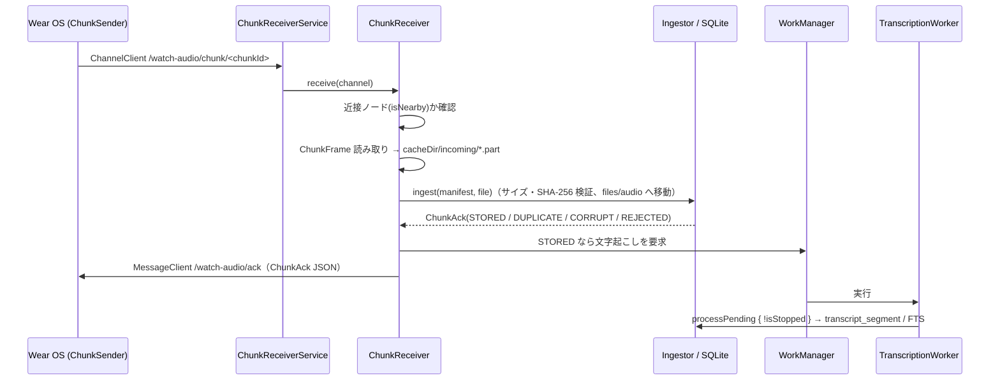

# Android スマホ側の実装（受信・オンデバイス文字起こし・蓄積）

対象 Issue: [M1-6 (#18)](https://github.com/Soichiro5/watch-audio/issues/18)（Wear OS → Android 転送 + ACK）、[M2-3 (#22)](https://github.com/Soichiro5/watch-audio/issues/22)（Android Transcriber とモデル配信）、[M2-1 (#20)](https://github.com/Soichiro5/watch-audio/issues/20) の Android 部分（WorkManager）。

コアの目標「Watch で装着中ずっと録音 → **直接の Bluetooth / Wi-Fi 接続**でスマホへ転送 → スマホ上で文字起こし → ローカル SQLite に蓄積」のうち、スマホ側を `androidApp` に実装した。**音声・文字起こしはどこにもアップロードしない**（ネットワークを使うのは ASR モデルのダウンロードのみ）。

## 1. コンポーネント

| クラス | 場所（`androidApp/src/main/kotlin/app/watchaudio/android/`） | 役割 |
| --- | --- | --- |
| `WatchAudioApp` | `WatchAudioApp.kt` | `Application`。起動時に `AppGraph` を作り、定期ジョブ登録・残件の処理要求・（Wi-Fi 時の）モデル取得を行う |
| `AppGraph` | `AppGraph.kt` | プロセス内で 1 つの依存グラフ。`LocalStore`（`files/watch-audio.db`）、音声ルート（`files/audio`）、`Ingestor`、`ModelManager`、`AndroidSherpaTranscriber`、`TranscriptionPipeline`、`AndroidAppServices` を保持。`startup` ジョブで `pipeline.recoverInterrupted()` を **プロセス起動ごとに 1 回**実行 |
| `AndroidAppServices` | `AndroidAppServices.kt` | 共通 UI 向け契約 `AppServices` の Android 実装。`status`（モデル状態・処理中・最終チャンク受信時刻・メッセージ）、`requestTranscription()`（WorkManager）、`play/stopPlayback`（`MediaPlayer` でオフセットへシーク）。追加で `downloadModels(allowMetered)`、権限（Android 13+ の `POST_NOTIFICATIONS`。`permissionStatus` / `requestPermission`）、`gapAlertSettingsChanged()` |
| `ChunkReceiverService` | `transfer/` | `WearableListenerService`。`/watch-audio/chunk/` 配下のチャネルを受け、処理を `ChunkReceiver` に渡す |
| `ChunkReceiver` / `FrameReader` | `transfer/` | `ChunkFrame` を解析 → 音声を `cacheDir/incoming/*.part` にストリーム保存 → `Ingestor.ingest` → `MessageClient` で `ChunkAck` を返す |
| `AndroidSherpaTranscriber` | `asr/` | sherpa-onnx（AAR の Kotlin API）。Silero VAD → ReazonSpeech Zipformer int8。認識器は初回に読み込み、ワーカー 1 回分の間は使い回す |
| `AudioDecoder` | `asr/` | `MediaExtractor` + `MediaCodec` で m4a(AAC)/ogg(Opus) を 16 kHz モノラル float PCM に。ダウンミックスと線形リサンプルは `core-pipeline` の `Pcm.kt`（共通コード・単体テストあり） |
| `ModelManager` / `ModelDownloadWorker` / `ModelArchive` | `asr/` | モデルの用意（adb サイドロード取り込み・ダウンロード・展開・原子的な配置） |
| `TranscriptionScheduler` / `TranscriptionWorker` | `work/` | WorkManager による文字起こしの起動 |
| `GapAlertMonitor` / `GapAlertWorker` | `alert/` | 録音の途絶アラート（#43）。判定は共通の `GapAlertEvaluator`、ここでは WorkManager でのチェックと通知の表示のみ（§4.1） |
| `MainActivity` | `MainActivity.kt` | `App(services)` をホスト。オンボーディングの権限要求用に Activity Result の launcher を `AndroidAppServices` に渡す |

共通コードの追加:

- `core-pipeline/SpeechSegmentation.kt`: `AsrSettings`（VAD しきい値 0.3、パディング 0.3 s など）と `padSpeechSpans`。**JVM ハーネスと Android で同一の分割**を使うため。
- `core-pipeline/Pcm.kt`: `downmixToMono` / `pcm16ToFloat` / `LinearResampler`（ストリーミング）。
- `core-protocol/ChunkFrame.readManifest`: フレームヘッダ（4 byte 長 + manifest JSON）の読み取り。不正なら `IllegalArgumentException`。
- `core-db/StoreTransaction.lastReceivedAt()`: 最後にチャンクを受信した時刻（連続性表示用）。

## 2. データフロー



- **ACK を返さないケース**: フレームが壊れている（長さ・JSON・manifest 不正）、転送が途中で切れた、DB 例外。Watch は ACK が来ないチャンクを保持して再送する。取り込みは chunkId で冪等なので、再送されても `DUPLICATE` が返るだけ。
- `CORRUPT`（サイズ/ハッシュ不一致）・`REJECTED`（新しいスキーマ）は ACK として返す（`isFinal=false` なので Watch は保持・再送）。
- 音声は `audio.sizeBytes + 1` バイトまでしか書かない（暴走ストリームでディスクを埋めない。超過分は取り込み時のサイズ検証で `CORRUPT`）。
- **クラウド経由を使わない**: Data Layer の `DataClient` は使わない。さらに、送信元ノードが `isNearby`（Bluetooth / Wi-Fi で直接接続）でない場合は受信せず ACK も送らない。
- 受信は同時 2 本まで（`Semaphore`）。処理はアプリ全体のスコープで行うので、`WearableListenerService` が破棄されても途中の取り込みは続く。

## 3. モデルの用意

使用モデル（ハーネスと同じ。M0-5 の比較で採用）:

```
files/models/
  silero_vad.onnx
  sherpa-onnx-zipformer-ja-reazonspeech-2024-08-01/
    encoder-epoch-99-avg-1.int8.onnx   (約 155 MB)
    decoder-epoch-99-avg-1.int8.onnx
    joiner-epoch-99-avg-1.int8.onnx
    tokens.txt
```

### 3.1 ダウンロード（受信のみ）

- 取得元: `https://github.com/k2-fsa/sherpa-onnx/releases/download/asr-models/sherpa-onnx-zipformer-ja-reazonspeech-2024-08-01.tar.bz2`（**約 713 MB**）と `.../asr-models/silero_vad.onnx`。
- `commons-compress` で bzip2 + tar を**ストリーミング展開**し、int8 の encoder/decoder/joiner と tokens.txt だけを書き出す（アーカイブ全体はディスクにもメモリにも置かない）。必要な 4 ファイルが揃った時点で読み取りを打ち切るが、int8 encoder はアーカイブの末尾付近にあるため、実際にはほぼ全量の通信が発生する。
- 書き込み先は `files/models/.tmp-download/`。全ファイルが揃ってから `rename` で所定の場所へ移すので、途中で落ちても「不完全なのに揃って見える」状態にならない。次回起動時に `.tmp-*` は掃除する。
- 実行は `ModelDownloadWorker`（WorkManager、`setForeground` で dataSync の前景ワーカーにする。バックグラウンドから開始されて前景化できない場合は通常ワーカーとして続行）。各ファイルは 3 回までその場でリトライし、さらにワーカーとして指数バックオフで最大 5 回まで再試行。
- **従量制ネットワークでは自動ダウンロードしない**: 起動時の自動取得（`downloadIfMissing()`）は `NetworkType.UNMETERED` 制約付き。モバイル通信で取得するのはユーザー操作で `AndroidAppServices.downloadModels(allowMetered = true)` が呼ばれたときだけ。Wi-Fi 待ちの間は `status.message` に案内文が入る。
- 進捗は `ModelState.Downloading(progress)` として `AppServices.status.asrModel` に流れる。完了すると `Ready` になり、保留中のチャンクの文字起こしを自動で要求する。

### 3.2 adb でのサイドロード（開発者向け）

ダウンロードを待たずに試すときは、ハーネス用のモデル（`tools/harness/download-models.sh` で取得）を外部ファイル領域に push してアプリを再起動する。起動時に内部領域へコピーされ、push したファイルは削除される。

```bash
adb shell mkdir -p /sdcard/Android/data/app.watchaudio/files/models/sherpa-onnx-zipformer-ja-reazonspeech-2024-08-01
adb push tools/harness/models/silero_vad.onnx /sdcard/Android/data/app.watchaudio/files/models/
for f in encoder-epoch-99-avg-1.int8.onnx decoder-epoch-99-avg-1.int8.onnx joiner-epoch-99-avg-1.int8.onnx tokens.txt; do
  adb push tools/harness/models/sherpa-onnx-zipformer-ja-reazonspeech-2024-08-01/$f \
    /sdcard/Android/data/app.watchaudio/files/models/sherpa-onnx-zipformer-ja-reazonspeech-2024-08-01/
done
adb shell am force-stop app.watchaudio   # 次の起動で取り込まれる
```

## 4. バックグラウンド処理（WorkManager）

| ジョブ | 起動条件 | 制約 | 内容 |
| --- | --- | --- | --- |
| `transcription`（1 回限り・unique） | チャンクを `STORED` で受信したとき、UI からの要求、モデル準備完了時、起動時に残件があるとき | 電池残量低下でないこと | `pipeline.processPending { !isStopped }` |
| `transcription-periodic`（6 時間ごと） | アプリ起動時に登録（`KEEP`） | 充電中 | 同上（取りこぼしの保険） |
| `model-download`（unique） | 起動時（Wi-Fi 制約）またはユーザー操作 | UNMETERED / CONNECTED、ストレージ残量 | §3.1 |
| `gap-alert-timer`（1 回限り・unique・`REPLACE`） | チャンクを `STORED` で受信したとき・通知設定の変更時。次にアラートが必要になる時刻に遅延実行 | なし | §4.1 |
| `gap-alert-periodic`（15 分ごと） | アプリ起動時に登録（`KEEP`） | なし | §4.1（タイマーの取りこぼし・おやすみ時間明けの保険） |

- 要求時の方針: 待機中のジョブがあれば何もしない（`KEEP` 相当）。**実行中なら後続を 1 つだけ追加**（`APPEND_OR_REPLACE`）。実行中のジョブが新着チャンクを見逃しても後続が拾う。追加は最大 1 つなので鎖は伸びない。
- 実行後にまだ保留中のチャンクがあれば（実行中に届いた、失敗して再試行回数が残っている）、もう一度要求する。WorkManager に停止された場合は WorkManager 自身が再スケジュールする。
- モデル未準備ならスキップ（ダウンロード中のみ `retry`、それ以外は成功扱いで終了し、モデル準備完了時に改めて要求）。チャンクを `FAILED` にして試行回数を浪費しないため、ワーカー側で事前に確認する。
- 1 回限りジョブと定期ジョブが重なってもパイプラインは `Mutex` で 1 本ずつ。各実行の終わりに認識器を解放してメモリを返す（次回は再読み込み、数秒）。
- 中断耐性: 処理中のチャンクは `TRANSCRIBING` になり、プロセスが殺されても次回起動時の `recoverInterrupted()` で `RECEIVED` に戻る。ワーカーは `AppGraph.startup` の完了を待ってから処理する。

### 4.1 録音の途絶アラート（#43）

「録音しているはずなのにチャンクが届かない」ときにローカル通知を出す。判定ロジックは composeApp の共通コード（`logic/GapAlert.kt` の `gapAlertAt` / `gapAlertDecision`、DB から読む `alert/GapAlertEvaluator`）で、iOS と共通・単体テストあり。

- 条件: 最新チャンク（開始時刻順）の `endReason` が継続（`ROTATION` / `MARK`）で、最終受信（`MAX(received_at)`）から **10 分超**何も届いていない。`user_stop` / `charging` / `off_body` など停止理由付きで終わっていれば録音停止は既知なので通知しない。
- おやすみ時間（既定 23:00–7:00、状態タブで変更・無効化可）の間は通知せず、終了時刻まで待つ。通知自体のオン/オフも状態タブ。
- 同じ途絶には 1 回だけ通知（通知した途絶の `lastReceivedAt` を設定 `gap_alert.shown_for` に保存）。
- チャンク受信ごとに表示中の通知を消し、`gap-alert-timer` を張り直す。ワーカー自身は張り直さない（実行中のワーカーを `REPLACE` で自分ごと取り消さないため）。待ちになった分は 15 分ごとの `gap-alert-periodic` が拾うので、通知は最大 15 分程度遅れうる（Doze 中はさらに遅れる）。
- 通知: チャネル `gap_alert`（「録音の途絶アラート」、重要度 HIGH）、本文「録音が届いていません（最後の受信: HH:mm）。Watch を確認してください」、タップでアプリを開く。
- `POST_NOTIFICATIONS`（Android 13+）が無い場合は通知せず、記録もしない（許可後の次のチェックで通知する）。権限はオンボーディングで要求する（`MainActivity` の `registerForActivityResult(RequestPermission())` を `AndroidAppServices` が使う。Activity Result API の lint 要件のため `androidx.fragment` 1.8.9 を明示的に依存に追加）。

## 5. プライバシー・パッケージング

- `android:allowBackup="false"`、`dataExtractionRules` でクラウドバックアップは全ドメイン除外（端末間移行 = device-transfer はローカル転送なので許可）。Android 11 以前向けに `fullBackupContent` でも全除外。
- `INTERNET` 権限はモデルのダウンロードのためだけに使う。解析 SDK・広告 SDK はなし。
- ABI は `arm64-v8a`（実機）と `x86_64`（エミュレータ）のみ。sherpa-onnx の C/C++ API ライブラリ（JNI からは未使用）は APK から除外。
- release ビルドで minify する場合に備え、sherpa-onnx のクラスを keep（JNI がフィールド名で設定を読むため）。

## 6. 検証方法

### 6.1 実機なし（Linux / CI）

```bash
./gradlew --max-workers=2 jvmTest testAndroidHostTest   # 共通コード（フレーム読み取り・Pcm・VAD パディングなど）
./gradlew --max-workers=2 :androidApp:testDebugUnitTest  # FrameReader / ModelArchive（JVM）
./gradlew --max-workers=2 :tools:harness:test            # 実モデルでの E2E（Android と同じ AsrSettings）
./gradlew --max-workers=2 :androidApp:assembleDebug :androidApp:lintDebug
```

ハーネスの `SherpaTranscriber` と `AndroidSherpaTranscriber` は同じ `AsrSettings` と `padSpeechSpans` を使うので、ハーネスの認識結果は端末上の結果の目安になる（デコーダが ffmpeg か MediaCodec かの差、速度の差はある）。

### 6.2 実機（adb）

```bash
./gradlew :androidApp:installDebug :wearApp:installDebug
# モデルを §3.2 の手順で入れる（または Wi-Fi 接続で自動ダウンロードを待つ）
adb logcat -s ChunkReceiver TranscriptionWorker ModelManager ModelDownloadWorker AppGraph GapAlertMonitor
# 受信・文字起こし結果の確認（debug ビルドのみ run-as 可）
adb shell run-as app.watchaudio ls -R files/audio
adb exec-out run-as app.watchaudio cat files/watch-audio.db > /tmp/wa.db   # WAL のため直前に処理が走っていると最新でない場合あり
sqlite3 /tmp/wa.db "select state, count(*) from audio_chunk group by state; select start_at, text from transcript_segment order by start_at desc limit 20;"
# WorkManager の状態（gap-alert-* も含む）
adb shell dumpsys jobscheduler | grep -A3 app.watchaudio
```

Watch が無くても、ADB 経由の Wear OS エミュレータとスマホエミュレータをペアリングすれば `ChannelClient` 経由の受信を確認できる（KVM のある環境が必要）。

## 7. 既知の制限・TODO

- **実機・エミュレータでの動作確認は未実施**（この環境に KVM がないため）。MediaCodec デコード・sherpa-onnx AAR の読み込み・Data Layer 受信・WorkManager の挙動は実機で確認が必要。
- `TransferPaths.SYNC_REQUEST_MESSAGE`（Watch からの ACK 再送依頼）は未対応。ペイロードがなく対象チャンクが分からないため、現状は Watch がチャンクを再送 → `DUPLICATE` ACK で回復する。必要なら chunkId 一覧をペイロードに持たせる仕様にする。
- モデルのダウンロードが約 713 MB と大きい（必要なのは約 160 MB）。int8 ファイルを個別に配布しているミラー（Hugging Face 等）からの取得や、自前の配布形態にすると通信量を約 1/4 にできる。ダウンロードの途中再開（Range）は未対応（bzip2 ストリームのため最初からやり直し）。
- モデルファイルのハッシュ検証なし（公式のチェックサムが公開されていない）。
- `ModelDownloadWorker` の通知には進捗を出していない（状態は `AppServices.status` で UI に出す）。Android 13+ で通知権限がないと通知は表示されないが、ダウンロードは続く。
- 録音の途絶アラートは WorkManager の精度に依存する（タイマーは Doze で遅れうる、定期チェックは最短 15 分）。厳密な時刻が必要なら `AlarmManager` を検討。実機での確認（Watch の録音を強制停止 → 10〜25 分以内に通知）が必要。
- 通知権限の「拒否済み」は同じプロセス内で拒否された場合しか区別できない（再起動後は「未許可」と表示し、要求すると OS が即座に拒否を返して「拒否済み」になる）。
- `AudioDecoder` は 1 チャンク分（5 分 ≈ 480 万サンプル ≈ 19 MB）をメモリに展開する。極端に長いチャンクが来る場合はストリーミング VAD に変える。
- 48 kHz などからのダウンサンプルは低域通過フィルタなしの線形補間（Watch は 16 kHz で録音するので通常は通らない）。
