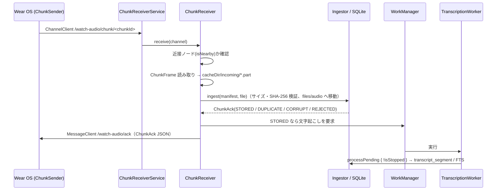

# Android スマホ側の実装（受信・オンデバイス文字起こし・蓄積）

対象 Issue: [M1-6 (#18)](https://github.com/Soichiro5/watch-audio/issues/18)（Wear OS → Android 転送 + ACK）、[M2-3 (#22)](https://github.com/Soichiro5/watch-audio/issues/22)（Android Transcriber とモデル配信）、[M2-1 (#20)](https://github.com/Soichiro5/watch-audio/issues/20) の Android 部分（WorkManager）。

コアの目標「Watch で装着中ずっと録音 → **直接の Bluetooth / Wi-Fi 接続**でスマホへ転送 → スマホ上で文字起こし → ローカル SQLite に蓄積」のうち、スマホ側を `androidApp` に実装した。**音声・文字起こしはどこにもアップロードしない**（ネットワークを使うのは ASR モデルのダウンロードのみ）。

## 1. コンポーネント

| クラス | 場所（`androidApp/src/main/kotlin/app/watchaudio/android/`） | 役割 |
| --- | --- | --- |
| `WatchAudioApp` | `WatchAudioApp.kt` | `Application`。起動時に `AppGraph` を作り、定期ジョブ登録・残件の処理要求・（Wi-Fi 時の）モデル取得を行う |
| `AppGraph` | `AppGraph.kt` | プロセス内で 1 つの依存グラフ。`LocalStore`（`files/watch-audio.db`）、音声ルート（`files/audio`）、`Ingestor`、`ModelManager`、`AndroidSherpaTranscriber`、`TranscriptionPipeline`、`AndroidAppServices` を保持。`startup` ジョブで `pipeline.recoverInterrupted()` を **プロセス起動ごとに 1 回**実行 |
| `AndroidAppServices` | `AndroidAppServices.kt` | 共通 UI 向け契約 `AppServices` の Android 実装。`status`（モデル状態・処理中・最終チャンク受信時刻・メッセージ）、`requestTranscription()`（WorkManager）、`play/stopPlayback`（`MediaPlayer` でオフセットへシーク）。追加で `downloadModels(allowMetered)`、権限（Android 13+ の `POST_NOTIFICATIONS`。`permissionStatus` / `requestPermission`）、`gapAlertSettingsChanged()` |
| `ChunkReceiverService` | `transfer/` | `WearableListenerService`。`/watch-audio/chunk/` 配下のチャネルを受け、処理を `ChunkReceiver` に渡す |
| `ChunkReceiver` / `FrameReader` | `transfer/` | `ChunkFrame` を解析 → 音声を `cacheDir/incoming/*.part` にストリーム保存 → `Ingestor.ingest` → `MessageClient` で `ChunkAck` を返す |
| `AndroidSherpaTranscriber` | `asr/` | sherpa-onnx（AAR の Kotlin API）。Silero VAD → ReazonSpeech Zipformer int8。認識器は初回に読み込み、ワーカー 1 回分の間は使い回す。入力は音声パーツのリスト（チャンク単体、または境界付近の隣のチャンクの音声と連結したもの。[02 §6.3](../02-architecture.md#63-処理パイプラインphone)）で、各ファイルを `AudioDecoder` でデコードして `concatenateParts` で切り出し・連結する |
| `AudioDecoder` | `asr/` | `MediaExtractor` + `MediaCodec` で m4a(AAC)/ogg(Opus) を 16 kHz モノラル float PCM に。ダウンミックスと線形リサンプルは `core-pipeline` の `Pcm.kt`（共通コード・単体テストあり） |
| `ModelManager` / `ModelDownloadWorker` / `ModelManifest` / `ModelDownloader` | `asr/` | モデルの用意（adb サイドロード取り込み・ファイル単位のダウンロード（途中再開・SHA-256 検証）・原子的な配置） |
| `TranscriptionScheduler` / `TranscriptionWorker` | `work/` | WorkManager による文字起こしの起動 |
| `GapAlertMonitor` / `GapAlertWorker` | `alert/` | 録音の途絶アラート（#43）。判定は共通の `GapAlertEvaluator`、ここでは WorkManager でのチェックと通知の表示のみ（§4.1） |
| `MainActivity` | `MainActivity.kt` | `App(services)` をホスト。オンボーディングの権限要求用に Activity Result の launcher を `AndroidAppServices` に渡す |

共通コードの追加:

- `core-pipeline/SpeechSegmentation.kt`: `AsrSettings`（VAD しきい値 0.15、パディング 0.3 s、入力の上限 20 s、間の分割 0.22 s / 30 dB と雑音の床から 9 dB・0.3 s など）と `padSpeechSpans`（VAD 区間 → 余白付け・結合・話者交代の間での分割・上限での分割。[02 §6.3](../02-architecture.md#発話区間の切り出しandroid--jvm-ハーネス6871)）。**JVM ハーネスと Android で同一の分割**を使うため。
- `core-pipeline/SpeechDetection.kt`: `speechSegments`（Silero の発話確率 → 発話区間。開始と終了のしきい値を別々に持つ。#71）。Android は `Vad.compute` で 32 ms ごとの確率だけを求める。
- `core-pipeline/Pcm.kt`: `downmixToMono` / `pcm16ToFloat` / `LinearResampler`（ストリーミング）/ `concatenateParts`（パーツの範囲を切り出して連結。足りない分は無音）。
- `core-pipeline/BoundaryJoin.kt`: チャンク境界をまたぐ発話を 1 つとして認識するための連結範囲の決定と、結果のチャンクへの振り分け（#45）。
- `core-db/StoreTransaction.previousInSession` / `nextInSession` / `replaceSegments`: 同じセッションの隣のチャンクと、範囲内のセグメントの置き換え（境界の再認識用）。
- `core-protocol/ChunkFrame.readManifest`: フレームヘッダ（4 byte 長 + manifest JSON）の読み取り。不正なら `IllegalArgumentException`。
- `core-db/StoreTransaction.lastReceivedAt()`: 最後にチャンクを受信した時刻（連続性表示用）。

## 2. データフロー



- 文字起こしは古い順。境界に発話がある場合は、文字起こし済みの隣のチャンクの境界付近（最大 30 秒）も一緒に認識し、隣のセグメントの該当部分を置き換える（詳細と残る制約は [02 §6.3](../02-architecture.md#63-処理パイプラインphone)）。隣の音声も `files/audio` から読むので、追加のファイルや権限は不要。

- **ACK を返さないケース**: フレームが壊れている（長さ・JSON・manifest 不正）、転送が途中で切れた、DB 例外。Watch は ACK が来ないチャンクを保持して再送する。取り込みは chunkId で冪等なので、再送されても `DUPLICATE` が返るだけ。
- `CORRUPT`（サイズ/ハッシュ不一致）・`REJECTED`（新しいスキーマ）は ACK として返す（`isFinal=false` なので Watch は保持・再送）。
- 音声は `audio.sizeBytes + 1` バイトまでしか書かない（暴走ストリームでディスクを埋めない。超過分は取り込み時のサイズ検証で `CORRUPT`）。
- **クラウド経由を使わない**: Data Layer の `DataClient` は使わない。さらに、送信元ノードが `isNearby`（Bluetooth / Wi-Fi で直接接続）でない場合は受信せず ACK も送らない。
- 受信は同時 2 本まで（`Semaphore`）。処理はアプリ全体のスコープで行うので、`WearableListenerService` が破棄されても途中の取り込みは続く。

## 3. モデルの用意

使用モデル（ハーネスと同じ。M0-5 の比較で採用）:

```
files/models/
  silero_vad.onnx
  sherpa-onnx-zipformer-ja-reazonspeech-2024-08-01/
    encoder-epoch-99-avg-1.int8.onnx   (約 155 MB)
    decoder-epoch-99-avg-1.int8.onnx
    joiner-epoch-99-avg-1.int8.onnx
    tokens.txt
```

### 3.1 ダウンロード（受信のみ）

- **必要な 5 ファイルだけを個別に取得する**（合計 161,016,054 バイト ≒ **161 MB**。以前は fp32 モデルも含む約 713 MB の tar.bz2 をほぼ全量受信していた）。対象は `ModelManifest`（URL・サイズ・SHA-256）に固定で持つ:

  | ファイル | サイズ（バイト） | 取得元 |
  | --- | ---: | --- |
  | `silero_vad.onnx` | 643,854 | `https://github.com/k2-fsa/sherpa-onnx/releases/download/asr-models/silero_vad.onnx`（従来と同じ） |
  | `tokens.txt` | 45,754 | Hugging Face `csukuangfj/reazonspeech-k2-v2` |
  | `decoder-epoch-99-avg-1.int8.onnx` | 2,959,337 | 同上 |
  | `joiner-epoch-99-avg-1.int8.onnx` | 2,696,970 | 同上 |
  | `encoder-epoch-99-avg-1.int8.onnx` | 154,670,139 | 同上 |

- ASR の 4 ファイルは sherpa-onnx の作者が公開している Hugging Face リポジトリ `csukuangfj/reazonspeech-k2-v2`（リリースの tar.bz2 の元になったもの）から、**コミットを固定した URL**（`https://huggingface.co/csukuangfj/reazonspeech-k2-v2/resolve/7ebed8f70b8ef67f656aa08e3084e5885202d0e6/<ファイル名>`）で取得する。SHA-256 はそのコミットの Git LFS のハッシュで、リリースの tar.bz2 に入っているファイル・公式の `reazon-research/reazonspeech-k2-v2` のファイルとも一致することを確認済み。
- **途中再開**: 受信中のバイトは `files/models/.partial/<SHA-256>.part` に追記し、再試行時（同じワーカー内のリトライ・ワーカーの再実行・アプリ再起動後）は `Range: bytes=<既存サイズ>-` で続きだけを要求する。206 の `Content-Range` の開始位置が合わなければ破棄してやり直し、サーバーが Range を無視して 200 を返した場合は先頭から書き直す。`.part` の名前は内容のハッシュなので、モデルが更新されても古い版の途中データを続きとして使うことはない。
- **検証と配置**: 受信し終えたファイルはサイズと SHA-256 を検証してから `rename`（`ATOMIC_MOVE`）で所定の場所に置く。所定の場所には検証済みのファイルしか現れないので、途中で落ちても「不完全なのに揃って見える」状態にならない。続きから受信した結果が一致しない場合（途中データが壊れていた等）は `.part` を消して一度だけ最初から取り直し、それでも一致しなければ失敗としてリトライに回す。全ファイルが揃ったら `.partial/` を消す。
- ダウンロードは受信のみで、ユーザーデータは送らない（リクエストに含まれるのは URL と Range ヘッダだけ）。
- ハーネス（`tools/harness/download-models.sh`）も同じ URL・SHA-256 のファイルを取得する（加えて E2E 用の `test_wavs/` を同じリポジトリから取得）。両者の一致は `ModelManifestTest` で検査しているので、ハーネスの E2E（CI の「End-to-end without devices」）がアプリと同じファイルで文字起こしできることの確認になる。
- 実行は `ModelDownloadWorker`（WorkManager、`setForeground` で dataSync の前景ワーカーにする。バックグラウンドから開始されて前景化できない場合は通常ワーカーとして続行）。各ファイルは 3 回までその場でリトライし、さらにワーカーとして指数バックオフで最大 5 回まで再試行。
- **従量制ネットワークでは自動ダウンロードしない**: 起動時の自動取得（`downloadIfMissing()`）は `NetworkType.UNMETERED` 制約付き。モバイル通信で取得するのはユーザー操作で `AndroidAppServices.downloadModels(allowMetered = true)` が呼ばれたときだけ。Wi-Fi 待ちの間は `status.message` に案内文が入る。
- 進捗は `ModelState.Downloading(progress)` として `AppServices.status.asrModel` に流れる。完了すると `Ready` になり、保留中のチャンクの文字起こしを自動で要求する。

### 3.2 adb でのサイドロード（開発者向け）

ダウンロードを待たずに試すときは、ハーネス用のモデル（`tools/harness/download-models.sh` で取得）を外部ファイル領域に push してアプリを再起動する。起動時に内部領域へコピーされ、push したファイルは削除される。

```bash
adb shell mkdir -p /sdcard/Android/data/app.watchaudio/files/models/sherpa-onnx-zipformer-ja-reazonspeech-2024-08-01
adb push tools/harness/models/silero_vad.onnx /sdcard/Android/data/app.watchaudio/files/models/
for f in encoder-epoch-99-avg-1.int8.onnx decoder-epoch-99-avg-1.int8.onnx joiner-epoch-99-avg-1.int8.onnx tokens.txt; do
  adb push tools/harness/models/sherpa-onnx-zipformer-ja-reazonspeech-2024-08-01/$f \
    /sdcard/Android/data/app.watchaudio/files/models/sherpa-onnx-zipformer-ja-reazonspeech-2024-08-01/
done
adb shell am force-stop app.watchaudio   # 次の起動で取り込まれる
```

## 4. バックグラウンド処理（WorkManager）

| ジョブ | 起動条件 | 制約 | 内容 |
| --- | --- | --- | --- |
| `transcription`（1 回限り・unique） | チャンクを `STORED` で受信したとき、UI からの要求、モデル準備完了時、起動時に残件があるとき | 電池残量低下でないこと | `pipeline.processPending { !isStopped }` → `storage.applyRetention { !isStopped }`（音声の保持期間、#33） |
| `transcription-periodic`（6 時間ごと） | アプリ起動時に登録（`KEEP`） | 充電中 | 同上（取りこぼしの保険） |
| `model-download`（unique） | 起動時（Wi-Fi 制約）またはユーザー操作 | UNMETERED / CONNECTED、ストレージ残量 | §3.1 |
| `gap-alert-timer`（1 回限り・unique・`REPLACE`） | チャンクを `STORED` で受信したとき・通知設定の変更時。次にアラートが必要になる時刻に遅延実行 | なし | §4.1 |
| `gap-alert-periodic`（15 分ごと） | アプリ起動時に登録（`KEEP`） | なし | §4.1（タイマーの取りこぼし・おやすみ時間明けの保険） |

- 要求時の方針: 待機中のジョブがあれば何もしない（`KEEP` 相当）。**実行中なら後続を 1 つだけ追加**（`APPEND_OR_REPLACE`）。実行中のジョブが新着チャンクを見逃しても後続が拾う。追加は最大 1 つなので鎖は伸びない。
- 実行後にまだ保留中のチャンクがあれば（実行中に届いた、失敗して再試行回数が残っている）、もう一度要求する。WorkManager に停止された場合は WorkManager 自身が再スケジュールする。
- 音声の保持期間（#33）は文字起こしの後に適用する。文字起こし済みのチャンクだけが対象なので、モデル未準備で文字起こしをスキップした回でも適用する。失敗はログのみ（次回の実行で再試行）。容量表示用の `AndroidStorageEnvironment` は `files/models` の合計と `StatFs(filesDir).availableBytes` を返す。
- モデル未準備ならスキップ（ダウンロード中のみ `retry`、それ以外は成功扱いで終了し、モデル準備完了時に改めて要求）。チャンクを `FAILED` にして試行回数を浪費しないため、ワーカー側で事前に確認する。
- 1 回限りジョブと定期ジョブが重なってもパイプラインは `Mutex` で 1 本ずつ。各実行の終わりに認識器を解放してメモリを返す（次回は再読み込み、数秒）。
- 中断耐性: 処理中のチャンクは `TRANSCRIBING` になり、プロセスが殺されても次回起動時の `recoverInterrupted()` で `RECEIVED` に戻る。ワーカーは `AppGraph.startup` の完了を待ってから処理する。エミュレータで `am force-stop` を挟んで確認済み（§6.1 の `ResumeAfterKillTest`）。
- ログ: ワーカーはチャンクごとに `transcribing chunk <id>` / `transcribed chunk <id>`（失敗時 `failed chunk <id>`）を出す（`TranscriptionPipeline.Observer`。ID のみで文字起こし本文は出さない）。

### 4.1 録音の途絶アラート（#43）

「録音しているはずなのにチャンクが届かない」ときにローカル通知を出す。判定ロジックは composeApp の共通コード（`logic/GapAlert.kt` の `gapAlertAt` / `gapAlertDecision`、DB から読む `alert/GapAlertEvaluator`）で、iOS と共通・単体テストあり。

- 条件: 最新チャンク（開始時刻順）の `endReason` が継続（`ROTATION` / `MARK`）で、最終受信（`MAX(received_at)`）から **10 分超**何も届いていない。`user_stop` / `charging` / `off_body` など停止理由付きで終わっていれば録音停止は既知なので通知しない。
- おやすみ時間（既定 23:00–7:00、状態タブで変更・無効化可）の間は通知せず、終了時刻まで待つ。通知自体のオン/オフも状態タブ。
- 同じ途絶には 1 回だけ通知（通知した途絶の `lastReceivedAt` を設定 `gap_alert.shown_for` に保存）。
- チャンク受信ごとに表示中の通知を消し、`gap-alert-timer` を張り直す。ワーカー自身は張り直さない（実行中のワーカーを `REPLACE` で自分ごと取り消さないため）。待ちになった分は 15 分ごとの `gap-alert-periodic` が拾うので、通知は最大 15 分程度遅れうる（Doze 中はさらに遅れる）。
- 通知: チャネル `gap_alert`（「録音の途絶アラート」、重要度 HIGH）、本文「録音が届いていません（最後の受信: HH:mm）。Watch を確認してください」、タップでアプリを開く。
- `POST_NOTIFICATIONS`（Android 13+）が無い場合は通知せず、記録もしない（許可後の次のチェックで通知する）。権限はオンボーディングで要求する（`MainActivity` の `registerForActivityResult(RequestPermission())` を `AndroidAppServices` が使う。Activity Result API の lint 要件のため `androidx.fragment` 1.8.9 を明示的に依存に追加）。

### 4.2 診断ログ（#77）

夜間の処理や数日にわたる実機検証で「止まった・遅い」原因を後から追えるよう、処理の記録を端末内の CSV に残す。logcat と違って流れて消えず、`adb` をつながなくても状態タブから書き出せる。

- 実装: 共通コード `shared/core-pipeline` の `Diagnostics`（インターフェース）/ `DiagnosticsLog`（kotlinx-io のファイル実装、iOS と共通）。プロセスで 1 つ（`AppGraph.diagnostics(context)`。グラフの構築前から使えるので、構築中のクラッシュも残る）。
- 場所: `files/diagnostics/diagnostics.csv`。**512 KB に達すると `diagnostics.csv.1` に回して（前の `.1` は削除）新しく始める**ので、最大でも約 1 MB。アプリ内部ストレージなのでバックアップ対象外（§5）。
- 形式: `timestamp,event,detail`（UTC の ISO 8601、イベント名、`key=value` の空白区切り）。Watch 側の `events.csv` / `diagnostics.csv` と同じ考え方。
- **含めないもの**: 文字起こしの本文・音声・例外メッセージ（データを引用しうるため。例外は型名とスタックの先頭のみ）。含めるのは ID・件数・時間・エラーの種類だけ。

| イベント | 記録する場所 | detail の例 |
| --- | --- | --- |
| `app_start` | `WatchAudioApp.onCreate` | `version=0.1.0 sdk=35 device=Pixel 8` |
| `previous_exit` | 起動時に `ApplicationExitInfo`（Android 11+）を読み、前回以降の終了を 1 回ずつ（`PreviousExits`、既読の時刻は SharedPreferences `diagnostics`） | `reason=LOW_MEMORY status=0 importance=400 pss_kb=…`（Java のクラッシュは説明文を省き、下の `crash` 行で見る） |
| `crash` | 未捕捉の例外（`CrashRecorder` が既定のハンドラを包み、1 行書いてから元のハンドラに渡す） | `thread=main type=java.lang.IllegalStateException causes=… at=フレーム < フレーム …` |
| `chunk_received` / `chunk_rejected` | `ChunkReceiver`（取り込み結果、近接でないノード・壊れたフレーム・転送の中断・取り込み失敗） | `chunk=… status=STORED audio_ms=300000 bytes=…` |
| `ack_sent` / `ack_failed` | `ChunkReceiver.sendAck`（試行ごと） | `chunk=… status=STORED attempt=1` |
| `worker_start` / `worker_stop` | `TranscriptionWorker`（件数、モデル未準備でのスキップ、OS による停止と `stop_reason`） | `worker=transcription transcribed=3 failed=0` |
| `transcription_started` / `_finished` / `_failed` | `TranscriptionPipeline.Observer`（共通の `DiagnosticsPipelineObserver`） | `chunk=… audio_ms=300000 elapsed_ms=21000 rtf=0.07`（失敗時は `error=例外の型`） |
| `retention_purge` | 保持期間による音声の削除（#33） | `chunks=12 bytes=…` |
| `model_download_*` / `model_ready` | `ModelManager`（開始・10% ごとの進捗・完了・失敗（HTTP ステータスなど）・準備完了） | `pct=30 bytes=…`、`error=java.io.IOException message=HTTP 404 for …` |
| `gap_alert` / `gap_alert_blocked` | `GapAlertMonitor`（通知した / 通知が許可されておらず出せなかった） | `last_received_at=…` |

**書き出し**: 状態タブの「診断ログを書き出す」→ `AndroidAppServices.exportDiagnostics()` が `.1` と現在のファイルを 1 つの CSV（`cache/diagnostics-export/watch-audio-diagnostics-<日時>.csv`、前回の書き出しは削除）にまとめ、`FileProvider`（authority `app.watchaudio.diagnostics`、公開するのはこのディレクトリだけ）経由で共有シート（`ACTION_SEND`）を開く。ユーザーが選んだ共有先だけに読み取り権限が付く。**自動では送らない**。新しい権限・通信・SDK は追加していない。

**エミュレータでの確認**（CI `emulator.yml` の phone、`DiagnosticsScenarioTest`）: 時計からの転送と同じフレームを `ChunkReceiver.store`（チャネルから読んだ後の処理。Wearable のチャネルなしで呼べる）に渡して受信 → 本番のワーカーが文字起こし → アプリを起動して `adb shell am force-stop app.watchaudio` → 次の起動で、ログに `chunk_received`・`transcription_started` / `_finished`（`rtf` つき）・`app_start`・強制終了の時刻の `previous_exit`（理由は OS が報告したまま記録）があること、状態タブの「診断ログを書き出す」で CSV が書き出されて共有シートが開くこと、書き出した CSV にそのチャンクの文字起こし本文が含まれないことを確かめる。証拠は `DIAGNOSTICS_CHECK` 行・`diagnostics-export.png`・成果物 `logcat-phone` の `scenario-logs/diagnostics-export.csv`（流れは [04-dev-environment.md §6.2](../04-dev-environment.md#62-1-回の計装テストでは確かめられないものphone-scenariossh)）。

## 5. プライバシー・パッケージング

- `android:allowBackup="false"`、`dataExtractionRules` でクラウドバックアップは全ドメイン除外（端末間移行 = device-transfer はローカル転送なので許可）。Android 11 以前向けに `fullBackupContent` でも全除外。
- `INTERNET` 権限はモデルのダウンロードのためだけに使う。解析 SDK・広告 SDK・クラッシュ収集 SDK はなし（異常終了は §4.2 の診断ログに端末内で残す）。
- `FileProvider`（非公開・`grantUriPermissions`）が公開するのは診断ログの書き出し先 `cache/diagnostics-export/` だけ。録音・文字起こしのディレクトリは対象外。
- ABI は `arm64-v8a`（実機）と `x86_64`（エミュレータ）のみ。sherpa-onnx の C/C++ API ライブラリ（JNI からは未使用）は APK から除外。
- **release ビルド（#78）**: R8 でコードとリソースを縮小・難読化する（`watchaudio.android.release` プラグイン、設定と署名は [docs/04 §7.1](../04-dev-environment.md#71-android-の-release-ビルドと署名78)）。keep ルール（`androidApp/proguard-rules.pro`）:
  - sherpa-onnx: パッケージ `com.k2fsa.sherpa.onnx` 全体を keep（JNI がフィールド名で設定を読み、結果のオブジェクトをクラス名で作るため）。
  - それ以外は各ライブラリが同梱するルールで足りる: kotlinx.serialization（`@Serializable` の生成シリアライザ）、WorkManager（`Worker` のコンストラクタ）、bundled SQLite（JNI）、Data Layer の受信サービス（manifest から参照されるので R8 が残す）。
  - CI: `android.yml` で `assembleRelease`、`emulator.yml` で release の APK を入れて起動し、クラッシュしないことを確認する（`launch-smoke.sh`）。続けて release ビルドに対して計装テスト `ReleaseAsrTest` を実行し、既知の日本語チャンクが取り込み → WorkManager の文字起こし（sherpa-onnx）→ DB の経路で保存・検索できることを確認する（`release-asr.sh`。テストが呼ぶものを残す keep ルール `proguard-release-test.pro` はそのビルドでだけ足す。docs/04 §7.1）。

## 6. 検証方法

### 6.1 実機なし（Linux / CI）

```bash
./gradlew --max-workers=2 jvmTest testAndroidHostTest   # 共通コード（フレーム読み取り・Pcm・VAD 区間の分割など）
./gradlew --max-workers=2 :androidApp:testDebugUnitTest  # FrameReader / ModelDownloader（途中切断するフェイクサーバーからの再開）/ ModelManifest / CrashRecorder・PreviousExits（JVM）
./gradlew --max-workers=2 :tools:harness:test            # 実モデルでの E2E（Android と同じ AsrSettings）
./gradlew --max-workers=2 :androidApp:assembleDebug :androidApp:lintDebug
```

エミュレータ（CI `emulator.yml` の phone、または KVM のある手元環境）では計装テストも動く:

```bash
./gradlew :androidApp:connectedDebugAndroidTest   # PlaybackTest（下記）
./gradlew :shared:core-db:connectedAndroidDeviceTest :shared:core-pipeline:connectedAndroidDeviceTest   # SQLite・Ingestor を Android 上で
adb logcat -d | grep PLAYBACK_CHECK                # 再生位置の記録
```

計装テストの一覧（すべて CI `emulator.yml` の phone ジョブ。証拠の行はジョブサマリーに集約、スクリーンショットは成果物 `screenshots-phone`。モデルの置き方と、計装テスト 1 回では確かめられないシナリオの流れは [04-dev-environment.md §6.1–6.2](../04-dev-environment.md#61-エミュレータでの音声認識モデル)）:

| テスト | 確認すること（Issue） | 証拠 |
| --- | --- | --- |
| `PlaybackTest` | 再生・検索から 1 タップ再生（#19, #25、下記） | `PLAYBACK_CHECK` |
| `SherpaTranscriberTest` | `AndroidSherpaTranscriber`（MediaCodec で AAC をデコード + sherpa-onnx AAR、Silero VAD + ReazonSpeech int8）が参照音声 5 文を 1 チャンクにした AAC を文字起こしし、DB に保存・検索できる（「気象庁」「ヤンバルクイナ」「傘」）（#22） | `ASR_CHECK`（処理時間・RTF・セグメント数）、`ASR_SEGMENT` |
| `ModelWaitTest` | モデルを退避した状態でチャンクを受信 → 文字起こしジョブは成功扱いで終わりチャンクは `RECEIVED`・試行 0 回のまま、再生はできる、状態タブに「モデルが未ダウンロードです」→ モデルを戻すと（`ModelManager.refresh` → `onReady`）自動で文字起こしされる（#22） | `MODEL_CHECK`、`status-model-missing.png` / `status-model-ready.png` |
| `ChargingWorkTest` | `TranscriptionScheduler.schedulePeriodic()` の定期ジョブは充電を条件とし、条件を満たすまで実行されない（チャンクは処理待ちのまま）。WorkManager の `TestDriver.setAllConstraintsMet`（充電開始に相当）で本番の `TranscriptionWorker` が走り、溜まったチャンクが文字起こしされる（#20） | `CHARGING_CHECK` |
| `GapAlertNotificationTest` | 最後のチャンクから 15 分後の時計で本番の `GapAlertMonitor.check()` を呼ぶと通知が出て、通知シェードに表示される（#43） | `GAP_ALERT_CHECK`、`gap-alert-notification.png` |
| `PermissionDeniedTest`（シナリオ） | オンボーディングで通知を拒否 → 「設定を開く」→ アプリの設定画面（#32） | `PERMISSION_CHECK`、`onboarding-permission-denied.png` ほか |
| `ResumeAfterKillTest`（シナリオ） | 8 チャンクの文字起こし中に `adb shell am force-stop app.watchaudio` → 再起動後に全チャンクが 1 回ずつ文字起こしされる（欠落 0・重複 0、中断したチャンクは試行 2 回）（#20） | `RESUME_CHECK` |
| `DiagnosticsScenarioTest`（シナリオ） | `ChunkReceiver.store` で受信 → 文字起こし → `am force-stop` → 再起動で、診断ログに各イベントと前回の終了理由が残り、状態タブから CSV を書き出せる（共有シートが開く・本文を含まない）（§4.2、#77） | `DIAGNOSTICS_CHECK`、`diagnostics-export.png`、`scenario-logs/diagnostics-export.csv` |

`PlaybackTest` は MediaCodec で実際の AAC（16 kHz モノラル）を作り、本番の `Ingestor` で「前日 10:00 開始」のチャンクとして取り込んだうえで、

- `AndroidAppServices.play(path, 45 秒)` で MediaPlayer が 45 秒付近から再生を始め、2 秒後に再生位置が進んでいることを確認する（#19）。
- `MainActivity` で検索 → 結果を 1 タップ → 発話の位置（チャンク先頭から 60 秒）から再生が始まり、「HH:MM から再生中」が表示されることを確認する（#25）。

計測した再生位置は `PLAYBACK_CHECK check=… requested_ms=… first_ms=… after_2s_ms=…` としてログに出し、CI のジョブサマリーにも載る。エミュレータの音声出力を有効にしておく必要がある（`-noaudio` を付けない）。

ハーネスの `SherpaTranscriber` と `AndroidSherpaTranscriber` は同じ `AsrSettings`・`padSpeechSpans`・`concatenateParts` を使うので、ハーネスの認識結果は端末上の結果の目安になる（デコーダが ffmpeg か MediaCodec かの差、速度の差はある）。

### 6.2 実機（adb）

```bash
./gradlew :androidApp:installDebug :wearApp:installDebug
# モデルを §3.2 の手順で入れる（または Wi-Fi 接続で自動ダウンロードを待つ）
adb logcat -s ChunkReceiver TranscriptionWorker ModelManager ModelDownloadWorker AppGraph GapAlertMonitor
# 受信・文字起こし結果の確認（debug ビルドのみ run-as 可）
adb shell run-as app.watchaudio ls -R files/audio
adb exec-out run-as app.watchaudio cat files/watch-audio.db > /tmp/wa.db   # WAL のため直前に処理が走っていると最新でない場合あり
sqlite3 /tmp/wa.db "select state, count(*) from audio_chunk group by state; select start_at, text from transcript_segment order by start_at desc limit 20;"
# WorkManager の状態（gap-alert-* も含む）
adb shell dumpsys jobscheduler | grep -A3 app.watchaudio
# 診断ログ（§4.2）。adb なしなら状態タブの「診断ログを書き出す」から共有する
adb exec-out run-as app.watchaudio cat files/diagnostics/diagnostics.csv.1 files/diagnostics/diagnostics.csv > /tmp/wa-diagnostics.csv
```

長時間の実機検証（#61 など）の証拠には、状態タブから書き出した診断ログを添えると、受信の間隔・文字起こしの RTF・ワーカーの停止理由・前回の終了理由（強制終了・メモリ不足など）を後から確認できる。エミュレータ（API 35）では `am force-stop` は `previous_exit` に `reason=USER_REQUESTED`、`description=[FORCE STOP] stop app.watchaudio due to from pid …` として残る（CI の `DIAGNOSTICS_CHECK` 行、§4.2。計装テストの終了も同じ理由で、説明が `… due to finished inst` になる）。

Watch が無くても、ADB 経由の Wear OS エミュレータとスマホエミュレータをペアリングすれば `ChannelClient` 経由の受信を確認できる（KVM のある環境が必要）。

## 7. 既知の制限・TODO

- **実機での動作確認は未実施**（#61）。エミュレータ（CI、§6.1）では起動・再生・MediaCodec デコード + sherpa-onnx AAR での文字起こし・モデル待ち・強制終了からの再開・充電時の定期ジョブ（WorkManager のテストドライバ）・途絶通知の表示を確認している（この開発環境には KVM がないため手元では動かせない）。Data Layer 受信、実機の速度・発熱、Doze 中の WorkManager の挙動は実機で確認が必要。
- `TransferPaths.SYNC_REQUEST_MESSAGE`（Watch からの ACK 再送依頼）は未対応。ペイロードがなく対象チャンクが分からないため、現状は Watch がチャンクを再送 → `DUPLICATE` ACK で回復する。必要なら chunkId 一覧をペイロードに持たせる仕様にする。
- モデルの取得元は外部（Hugging Face の個人リポジトリと k2-fsa の GitHub Release）に依存している。コミット固定 + SHA-256 検証なので内容が差し替わることはないが、公開が取り下げられると取得できなくなる。その場合は `ModelManifest` と `tools/harness/download-models.sh` の URL を自前の配布先（このリポジトリの GitHub Release 等）に差し替える（ハッシュはそのまま）。
- `ModelDownloadWorker` の通知には進捗を出していない（状態は `AppServices.status` で UI に出す）。Android 13+ で通知権限がないと通知は表示されないが、ダウンロードは続く。
- 録音の途絶アラートは WorkManager の精度に依存する（タイマーは Doze で遅れうる、定期チェックは最短 15 分）。厳密な時刻が必要なら `AlarmManager` を検討。実機での確認（Watch の録音を強制停止 → 10〜25 分以内に通知）が必要。
- 通知権限の「拒否済み」は同じプロセス内で拒否された場合しか区別できない（再起動後は「未許可」と表示し、要求すると OS が即座に拒否を返して「拒否済み」になる）。
- `AudioDecoder` は 1 チャンク分（5 分 ≈ 480 万サンプル ≈ 19 MB）をメモリに展開する。極端に長いチャンクが来る場合はストリーミング VAD に変える。
- 48 kHz などからのダウンサンプルは低域通過フィルタなしの線形補間（Watch は 16 kHz で録音するので通常は通らない）。
