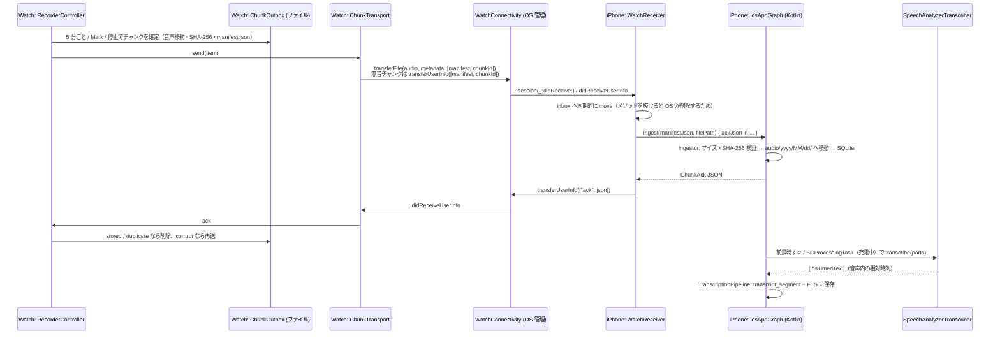

# iOS / watchOS 実装メモ

Apple Watch で装着中ずっと録音 → WatchConnectivity で iPhone へ（ローカルのみ）→ iPhone 上の Speech フレームワーク（SpeechAnalyzer / SpeechTranscriber, iOS 26, 日本語）でオンデバイス文字起こし → Kotlin 共有コードのローカル SQLite に保存、までの Apple 側の実装。充電中・睡眠中などの欠損は許容する。

関連 Issue: #15（watchOS 録音）、#17（転送 + ACK）、#21（iOS 文字起こし）

## 1. コンポーネント

| 場所 | ファイル | 役割 |
| --- | --- | --- |
| watch / iPhone / テスト共通 | `iosApp/Shared/ChunkProtocol.swift` | `ChunkManifest` / `ChunkAck` の Codable 版（`shared/core-protocol` の Swift ミラー） |
| 〃 | `iosApp/Shared/FileDigest.swift` | ファイルの SHA-256（CryptoKit, 64 KiB ずつ）、WatchConnectivity の辞書キー |
| watchOS | `iosApp/WatchApp/Recording/RecorderController.swift` | 録音本体（ローテーション・メータリング・判定結果の適用・通知） |
| 〃 | `iosApp/WatchApp/Recording/RecorderPolicy.swift` | 停止理由・自動再開・通知・無音判定の純粋ロジック（WatchKit / AVFoundation に依存しない。Wear OS の `RecorderPolicy` に相当） |
| 〃 | `iosApp/WatchApp/Recording/ChunkAudioInput.swift` | チャンクを書く入力のプロトコル。本番は `MicrophoneChunkInput`（`AVAudioRecorder` + メータリング） |
| 〃 | `iosApp/WatchApp/Recording/DebugAudioFileInput.swift` | **Debug 構成のみ**（`#if DEBUG`）: マイクの代わりに音声ファイルを流す入力（§13） |
| 〃 | `iosApp/WatchApp/Recording/ChunkOutbox.swift` | 永続アウトボックス（録音中チャンクの状態、送信待ちチャンク、異常終了からの復旧） |
| 〃 | `iosApp/WatchApp/Recording/ChunkSendTracker.swift` | 送信キューの再送判断（ACK の処理、未 ACK の再送時刻、送信中の二重送信防止） |
| 〃 | `iosApp/WatchApp/Recording/ChunkTransport.swift` | WCSession 送信・ACK 受信 |
| 〃 | `iosApp/WatchApp/Recording/DiagnosticsLog.swift` | 上限付きのローカル診断ログ（イベント + 電池残量、CSV） |
| 〃 | `iosApp/WatchApp/WatchAudioApp.swift`, `ContentView.swift` | 画面、scenePhase、WatchConnectivity のバックグラウンド起床 |
| iOS (Swift) | `iosApp/iosApp/iOSApp.swift` | 起動時に Kotlin グラフ → WatchConnectivity の順で開始、scenePhase を Kotlin に通知、Compose UI をホスト |
| 〃 | `iosApp/iosApp/WatchReceiver.swift` | WCSession 受信 → Kotlin `Ingestor` → ACK 返信 |
| 〃 | `iosApp/iosApp/SpeechTranscription.swift` | SpeechAnalyzer + SpeechTranscriber による文字起こし本体（モデル準備・範囲の連結・時刻付きセグメント）。Kotlin に依存しない |
| 〃 | `iosApp/iosApp/SpeechAnalyzerTranscriber.swift` | 上記を Kotlin の `IosSpeechTranscriber` として公開するブリッジ |
| iOS (Kotlin) | `composeApp/src/iosMain/.../IosAppGraph.kt` | iOS の composition root（DB・音声置き場・Ingestor・パイプライン・BGTask） |
| 〃 | `IosAppServices.kt` | 共有 UI 向け `AppServices` 実装（状態 Flow、AVAudioPlayer 再生、権限、モデル準備、通知設定の変更通知） |
| 〃 | `IosPermissions.kt` | オンボーディングで求める権限（通知 `UNUserNotificationCenter`、音声認識 `SFSpeechRecognizer`）の状態取得と要求 |
| 〃 | `IosGapAlerts.kt` | 録音の途絶アラート（#43）のローカル通知の予約・取り消し |
| 〃 | `IosSpeechTranscriber.kt` | Swift 実装を受けるコールバック型インターフェースと共通 `Transcriber` へのアダプタ |
| 〃 | `MainViewController.kt` | Compose UI のエントリ（Swift から引数なしで呼ぶ） |
| テスト | `iosApp/ProtocolTests/ChunkProtocolTests.swift` | Swift プロトコル実装を Kotlin のテストベクタ（`shared/core-protocol/testdata/*.json`）で検証 |
| 〃 | `iosApp/WatchLogicTests/RecorderPolicyTests.swift` | 停止理由（充電・低電池・ストレージ不足・割り込み・ユーザー停止・レコーダー停止）の判定、ヒステリシス、自動再開、通知、無音判定、停止理由がマニフェストの `endReason` に書かれること（#15） |
| 〃 | `iosApp/WatchLogicTests/ChunkOutboxTests.swift` | 送信キュー: 最終 ACK で削除、CORRUPT で再送（上限つき）、REJECTED は保持、ACK が無ければ 15 分後に再送、送信中は二重送信しない、再起動後も残り再送される、強制終了からの復旧（#17） |
| 〃 | `iosApp/SpeechTests/SpeechTranscriptionTests.swift` | シミュレータで SpeechTranscriber（ja_JP）が既知の日本語音声（16 kHz AAC）を時刻付きで文字起こしできるか（#21）。使えなければ理由を記録してスキップ |
| 〃 | `composeApp/src/iosTest/.../IosPlaybackTest.kt` | `IosAppServices.play` が正しいチャンクのファイルを AVAudioPlayer で開き、指定位置（±0.2 秒）に合わせ、長さも正しいこと。共有 UI で前日のタイムライン → 発話タップ、検索 → 1 タップ → その発話の位置（#19, #25）。テスト実行ファイルはアプリではないため `play()` は false を返し、`started=` は記録のみ |
| 〃 | `iosApp/PlaybackTests/HostedPlaybackTests.swift` | iOS アプリをホストにした XCTest。アプリが起動時に作った本物の `IosAppServices`（ComposeApp フレームワーク経由）で Watch と同じ形式（AAC 16 kHz モノラル）の音声を 8 秒から再生し、再生位置がそこから始まり 2 秒後に 1 秒以上進むこと（#19） |
| 〃 | `composeApp/src/iosTest/.../IosTranscriberBridgeTest.kt` | Swift 側の結果（`IosTimedText`）が `IosTranscriberAdapter` → `TranscriptionPipeline` で絶対時刻つきで DB と FTS に保存されること、Swift のエラーでチャンクが FAILED になること（#21） |

## 2. データフロー



## 3. ワイヤ形式（Kotlin との互換）

- 正は `shared/core-protocol`（`ChunkManifest.kt` / `ChunkAck.kt` / `ProtocolJson.kt`）。Swift 側は `iosApp/Shared/ChunkProtocol.swift` で同じ形を Codable で表現する。
- 時刻はすべて **Int64 のエポックミリ秒**、列挙値は Kotlin の `@SerialName` と同じ小文字文字列（`watchos`, `aac`, `rotation`, `user_stop`, `low_battery`, `stored`, `corrupt` …）。
- `audio` が無い（無音チャンク）場合はキーごと省略（Kotlin の `explicitNulls = false` と同じ）。`markOffsetsMs` は空でも `[]` を出力（Kotlin の `encodeDefaults = true` と同じ）。未知キーは両側で無視。
- `markOffsetsMs` は `0...durationMs` に収める必要がある（Kotlin 側の `init` で検証されるため、Swift 側で clamp している）。
- WatchConnectivity の辞書キー: `manifest`（manifest JSON）、`chunkId`（送信中転送の突き合わせ用に JSON 外にも複製）、`ack`（ChunkAck JSON）。
- 互換性は `ProtocolTests`（CI の `SwiftUnitTests` スキーム）で、Kotlin 側と同じテストベクタを decode → encode して JSON が一致することを確認している。

## 4. watchOS 録音

- **形式**: AAC-LC 16 kHz mono 24 kbps（`ChunkAudioFormat`、約 10.8 MB/時）。`AVAudioSession(.record)` + `UIBackgroundModes: audio` で画面消灯中も継続（M0-3 で確認済みの方式）。
- **ローテーション**: 5 分ごと。次のファイルの `record()` を開始してから前のファイルを `stop()` する（数 ms 重なるが欠けない）。2 本同時に開けなかった場合は stop → start にフォールバックし、診断ログに `rotate_fallback` を残す。
- **Mark**: 現在チャンクにオフセットを記録してチャンクを閉じる（`endReason = mark`）。マークした瞬間が早く iPhone に届く。
- **無音判定**: `isMeteringEnabled = true` にして 1 秒ごとに `updateMeters()` → `averagePower` / `peakPower` をサンプリング。チャンク全体で一度も閾値（平均 −50 dBFS / ピーク −35 dBFS）を超えず、かつサンプルがチャンク長の 80% 以上取れていた場合のみ「確実に無音」とし、音声を削除して manifest のみ送る。サンプル不足（タイマーが止まっていた等）の場合は音声を残す（安全側）。閾値は実機で要調整。
- **停止理由と自動再開**（`wantsRecording` を UserDefaults に保持し、「ユーザーが録音したい状態」なら条件が解けたときに再開する）:

| 状況 | 終了理由 | 再開 |
| --- | --- | --- |
| ユーザーが停止 | `user_stop` | しない |
| 充電開始（`WKInterfaceDevice.batteryState` を 30 秒ごとに確認） | `charging` | 充電器から外れ、アプリが動いている/前面に来たとき |
| 電池 10% 未満 | `low_battery` | 15% 以上に戻ったとき + ハプティクスと通知 |
| 空き容量 100 MB 未満 | `low_storage` | 空きが戻ったとき + 通知 |
| 通話・Siri など（`AVAudioSession.interruptionNotification`） | `interruption` | `.ended` で再開を試行（`shouldResume` が無くても試す）。失敗時はハプティクス + ローカル通知。中断時に 2 分後の通知を予約し、再開できたら取り消す（アプリがサスペンドされても通知が出るように） |
| レコーダーが通知なしに停止 | `error` | 最大 3 回まで自動再開、超えたら通知 |
| ローテーションで次のレコーダーを開始できない | `low_storage`（空き不足のとき）/ `error` | 通知 |
| アプリ強制終了 | `terminated`（次回起動時に確定） | 次に前面に来たとき |

- 判定（どのイベントでどの終了理由で止めるか・再開するか・通知するか）は `RecorderPolicy.decide(event, phase:, wantsRecording:)` に集約し、`RecorderController` は端末の値（電池・充電・空き容量）とイベント（停止ボタン・定期チェック・割り込み・レコーダー停止・ローテーション失敗）を渡して結果を適用するだけにした。判定は `WatchLogicTests` で単体テストしている。

- **充電後の自動再開の制約**: 録音を止めて音声セッションを無効にするとアプリはサスペンドされるため、バックグラウンドで「外れた」ことは検知できない。実際の再開は「アプリが前面に戻ったとき」（手首を上げてアプリが表示されている、またはユーザーが開いたとき）になる。watchOS の「アプリに戻る」設定次第。
- **装着検出**: watchOS にはサードパーティ向けの手首検出 API が無いため `off_body` は生成しない（外すとウォッチはロックされるが録音は続く）。
- **アウトボックス**（`Application Support/WatchAudio/`）:
  - `recording/<id>.m4a` と `recording/<id>.json`（録音中チャンクの状態: id・セッション・開始時刻・TZ・Mark）
  - `outbox/<id>.m4a` と `outbox/<id>.json`（確定済み manifest）。最終 ACK（`stored` / `duplicate`）で削除。
  - 起動時、`recording/` に残っているものは `terminated` として確定する。`AVAudioFile` で読める場合のみ音声を残し（長さは実サンプル数から算出）、読めない場合（moov 未書き込み等）は manifest のみ（長さは更新日時から推定）。
- **deviceId**: インストールごとの UUID（`watchos-…`）を UserDefaults に保存。ハードウェア識別子は使わない。
- **診断ログ**: `diagnostics.csv`（イベント・電池残量・充電状態）。512 KB を超えたら新しい半分だけ残す。ウォッチ内のみ（送信しない）。

## 5. 転送と ACK

- WatchConnectivity は Apple が管理するペアリング端末間のローカル転送（Bluetooth / P2P Wi-Fi 等、経路は OS が選択・キューイング・バックグラウンド配送）。自前のサーバーやクラウドには一切送らない。
- 送信条件: `activationState == .activated`（または `isReachable`）のときのみ。`transferFile` / `transferUserInfo` は相手が不在でも OS がキューに保持する。
- 二重送信防止: `outstandingFileTransfers` / `outstandingUserInfoTransfers` のメタデータ `chunkId` と照合。送信済みで ACK 待ちのものは 15 分間は再送しない（`ChunkSendTracker`。送信失敗の通知を受けたものはすぐ再送対象）。
- 再送: WCSession が activated になるたび（= アプリ起動ごと）に未 ACK の全チャンクを再送（iPhone は `duplicate` で最終 ACK を返すので安全）。`corrupt` は最大 3 回まで即再送。`rejected`（新しいスキーマ等）は保持して次回起動時に再提示。
- iPhone 側は `session(_:didReceive:)` 内でファイルを `Application Support/WatchAudio/inbox/` に**同期的に** move してから非同期で取り込む。取り込みは `UIApplication.beginBackgroundTask` で保護。取り込み前にプロセスが落ちた inbox の残骸は次回起動時に削除（Watch が再送する）。
- Watch がサスペンド中に ACK が届いた場合は `.backgroundTask(.watchConnectivity)` で起こされ、`hasContentPending` が消えるまで起きている。

## 6. Kotlin ↔ Swift ブリッジ

Swift から見える Kotlin API（`ComposeApp` フレームワーク、静的）:

```swift
IosAppGraph.shared.start(transcriber: SpeechAnalyzerTranscriber())   // App.init で 1 回（BGTask 登録を含む）
IosAppGraph.shared.inboxDirectoryPath()                               // 受信ファイルの退避先
IosAppGraph.shared.ingest(manifestJson: json, filePath: path) { ackJson in … }  // ackJson: String?（nil = ACK しない）
IosAppGraph.shared.setAppActive(active: true / false)                 // scenePhase .active / .background
MainViewControllerKt.MainViewController()                             // Compose UI
```

- Swift の `async` は Kotlin から呼べないため、文字起こしはコールバック型の Kotlin インターフェース `IosSpeechTranscriber`（`engineId`, `language`, `prepareModel(callback:)`, `transcribe(parts:callback:)`, `cancel()`。`parts` は `IosAudioPart(path, fromMs, toMs)` のリスト）を Swift で実装し、Kotlin 側 `IosTranscriberAdapter` が `suspendCancellableCoroutine` で共通 `Transcriber` に変換する。コルーチンのキャンセルは `cancel()` → Swift の `Task.cancel()` → `SpeechAnalyzer.cancelAndFinishNow()` に伝わる。
- Swift 6 の厳格な並行性チェック対策として、Kotlin のコールバック（非 Sendable）は `UncheckedSendableBox` に入れて Task に渡す。コールバックはどのスレッドから呼んでもよく、必ず 1 回だけ呼ぶ。
- `MainViewController()` は引数なしのまま `IosAppGraph.services` を取得し `App(services)` を表示する。オンボーディング・権限・途絶アラートはすべて Kotlin（iosMain）側で実装しており、Swift 側の変更はない。
- Kotlin 内部状態はメインディスパッチャ上でのみ変更する（`ingest` はどのスレッドから呼んでもよい）。

## 7. 文字起こし（iOS）

- 実装は `SpeechTranscription.swift`（Speech フレームワークだけに依存）にあり、`SpeechAnalyzerTranscriber.swift` はそれを Kotlin の `IosSpeechTranscriber` として渡す薄いブリッジ。分けてあるのは、シミュレータテスト（`SpeechTests`）が Kotlin フレームワークをリンクせずに同じコードを動かせるようにするため。
- `SpeechTranscriber(locale:transcriptionOptions: [], reportingOptions: [], attributeOptions: [.audioTimeRange])`。ロケールは `SpeechTranscriber.supportedLocale(equivalentTo: ja_JP)` で解決。`isAvailable` が false の端末ではエラー。
- モデルは OS 管理: `installedLocales` に無ければ `AssetInventory.reserve(locale:)` → `assetInstallationRequest(supporting:)` → `downloadAndInstall()`。Kotlin 側は各実行の前に `prepareModel` で確認し、失敗したら実行しない（モデル未導入のまま全チャンクがリトライ上限に達するのを防ぐ）。状態は `ProcessingStatus.asrModel`（Downloading / Ready / Failed）。
- `SpeechAnalyzer(modules:)` → `analyzeSequence(from: AVAudioFile)` → `finalizeAndFinish(through:)`。結果は `transcriber.results` を別 Task で収集し、`isFinal` の各結果を 1 セグメント（`result.range` の開始・終了をミリ秒に変換）とする。
- 入力は音声パーツのリスト。通常はチャンク 1 つ（先頭から）で、そのファイルをそのまま解析する。チャンク境界をまたぐ発話がある場合（[02 §6.3](../02-architecture.md#63-処理パイプラインphone)）は、隣のチャンクの境界付近を含む複数パーツが来るので、各ファイルを `AVAudioFile` の `processingFormat`（Float32）で読み、範囲を切り出して一時ディレクトリの 32 bit float CAF に書き出し（ファイルが短ければ無音で埋める）、その一時ファイルを解析して削除する。パーツ間でサンプルレート・チャンネル数が違うとエラーにし、共有パイプラインがそのチャンク単体で認識し直す（同じセッションのチャンクは同じ形式なので通常は起きない）。一時ファイルは最大で「チャンク + 前後 30 秒」分（16 kHz モノラルで約 23 MB）。
- エンジン ID: `apple-speechtranscriber-ja`。言語: `ja`。
- 実行タイミング:
  - アプリが前面（scenePhase `.active`）: すぐに処理。新しいチャンク受信時も再実行。
  - バックグラウンドへ移るとき: 前面の実行をキャンセルし、`BGProcessingTaskRequest(app.watchaudio.transcribe)` を `requiresExternalPower = true`, `requiresNetworkConnectivity = false` で予約。
  - BGProcessingTask: `processPending { !expired }` でチャンク単位に進め、期限切れハンドラでは実行中のチャンクもキャンセルして速やかに `setTaskCompleted` する。期限切れなら再予約。
  - 実行は Mutex で直列化し、毎回 `recoverInterrupted()` で前回中断分（TRANSCRIBING）をキューに戻す。
  - 文字起こしの後（モデル未準備で文字起こしをスキップした場合も）、同じ実行内で `StorageManager.applyRetention(shouldContinue)` により音声の保持期間を適用する（#33。文字起こし済みのチャンクの音声だけを削除）。容量表示の空き容量は `NSURLVolumeAvailableCapacityForImportantUsageKey`（取れなければ `NSFileSystemFreeSize`）、モデルサイズは OS 管理のため不明扱い（`IosStorageEnvironment`）。
- オンボーディング / 状態タブの「モデルを準備」（`AppServices.modelSetup = OS_MANAGED`、`downloadModels()`）は、同じ Mutex の中で `ensureModel()`（= Swift の `prepareModel`）を呼んでモデルのインストールを OS に依頼し、準備できたら文字起こしを要求する。

### 7.1 録音の途絶アラート（#43）

アプリがサスペンドされていても届くよう、定期チェックではなく**予約通知**にしている（判定は共通コード、`phone-ui.md` §1.5）。

- チャンクを `STORED` で取り込むたびに `IosGapAlerts.reschedule(chunkArrived = true)`: 識別子 `app.watchaudio.gap-alert` の未配信の通知（と表示済みの古い通知）を取り消し、`GapAlertEvaluator.alertAt()` の時刻に `UNTimeIntervalNotificationTrigger` で 1 件だけ予約し直す。
- そのチャンクが停止理由付き（`user_stop` / `charging` / `off_body` など）で終わっていれば予約しない（取り消しのみ）。通常は最終受信 + 10 分。おやすみ時間（既定 23:00–7:00）にかかる場合は終了時刻に予約する。
- 状態タブで通知設定を変えると `gapAlertSettingsChanged()` → 予約し直し（すでに過ぎた時刻なら予約しない）。
- 本文「録音が届いていません（最後の受信: HH:mm）。Watch を確認してください」。予約の失敗は ACK を妨げない（`status.message` に出すだけ）。
- `UNUserNotificationCenterDelegate` を設定していないので、アプリが前面にある間は通知バナーは出ない（その間は状態タブの警告で分かる）。

## 8. 保存場所とプライバシー

- iPhone: `Application Support/WatchAudio/`（`watch-audio.db`、`audio/yyyy/MM/dd/<chunkId>.m4a`、`inbox/`）。ディレクトリに `NSURLIsExcludedFromBackupKey` を設定し、iCloud / PC バックアップに含めない。ファイル保護は iOS 既定（`CompleteUntilFirstUserAuthentication`、BGTask から読める）。
- Watch: `Application Support/WatchAudio/`（録音中・送信待ちチャンク、診断ログ）。ACK 後に削除。
- 音声・文字起こしとも端末外（自前サーバー・クラウド）には送らない。Speech もオンデバイスモデル。

## 9. 権限・Info.plist

| ターゲット | キー | 値・目的 |
| --- | --- | --- |
| iosApp | `NSMicrophoneUsageDescription` | 将来のスマホ側録音用（現状はマイク未使用） |
| 〃 | `NSSpeechRecognitionUsageDescription` | 音声認識の用途説明。オンボーディングで `SFSpeechRecognizer.requestAuthorization` を念のため要求する（SpeechTranscriber に必要かは未確認。`SpeechTests` は許可状態をログに出す） |
| 〃 | `UIBackgroundModes: [processing]` | BGProcessingTask |
| 〃 | `BGTaskSchedulerPermittedIdentifiers: [app.watchaudio.transcribe]` | `IosAppGraph.PROCESSING_TASK_ID` と一致させること |
| WatchApp | `NSMicrophoneUsageDescription` | 録音 |
| 〃 | `UIBackgroundModes: [audio]` | 画面消灯中の録音継続 |
| 〃 | `WKApplication`, `WKCompanionAppBundleIdentifier` | iPhone アプリの付属 watch アプリ |

実行時の許可: Watch でマイク（初回開始時）と通知（初回録音開始時）。iPhone ではオンボーディングの「許可の設定」で通知（alert + sound、途絶アラート用）と音声認識を要求する（`IosPermissions`。拒否済みなら設定アプリへの案内を表示）。スパイク用の `UIFileSharingEnabled` / `LSSupportsOpeningDocumentsInPlace` は削除した。

## 10. 検証状況

| 項目 | 方法 | 状況 |
| --- | --- | --- |
| Kotlin iosMain（core-platform / composeApp）のコンパイル | Linux で klib クロスコンパイル `./gradlew :composeApp:compileKotlinIosSimulatorArm64 :composeApp:compileKotlinIosArm64 -Pkotlin.native.enableKlibsCrossCompilation=true` | 通過（リンクは不可） |
| 共通ロジック（Ingestor ほか） | `./gradlew jvmTest`、CI で `./gradlew iosSimulatorArm64Test`（SQLite を使う core-db / Ingestor のテストを含む。ジョブサマリーにテスト一覧） | JVM は通過、iOS シミュレータは CI で確認 |
| iOS・watchOS アプリの起動 | CI `ios.yml` の Launch ステップ: ビルド済みの `.app` をシミュレータ（iPhone / Apple Watch）に入れて起動し、15 秒後もプロセスが生きていてクラッシュレポートがないことを確認（`.github/scripts/simulator-smoke.sh`、スクリーンショットは成果物 `simulator-smoke`） | CI で確認 |
| iOS の再生（`IosAppServices.play`、#19 / #25） | 2 段構え。(a) `composeApp` の iOS シミュレータテスト `IosPlaybackTest`（`./gradlew iosSimulatorArm64Test`）: 本番の `Ingestor` で前日 10:00 開始の AAC チャンクを取り込み、(1) `play(path, 45 s)`、(2) 共有 Compose UI で「前の日」→ 発話をタップ → 「HH:mm から再生中」、(3) 検索 → 結果を 1 タップ、のそれぞれで、そのチャンクのファイル（音声ルートからの相対パスを解決したもの）が AVAudioPlayer に開かれ、再生位置が指定位置 ±0.2 秒、長さが正しいことを確認する。Kotlin/Native のテスト実行ファイルはアプリのプロセスではなく `AVAudioPlayer.play()` が false を返すため（CI で確認、シークは効く）、再生が始まったか（`started=`）は `PLAYBACK_CHECK` 行に記録するだけにしている。テストプロセスには UIApplication が無いため `IosAppGraph` ではなく、それが組み立てるのと同じ `IosAppServices` を一時 DB で作る。(b) 実際に再生が進むことは `PlaybackTests`（iOS アプリをホストにした XCTest、`HostedPlaybackTests.swift`）で確認: アプリが起動時に作った `IosAppGraph.shared.services`（本物の `IosAppServices`）に、音声ルート下に置いた AAC 16 kHz モノラル 20 秒のファイルを相対パスで渡して 8 秒から再生し、最初に観測した位置が 8 秒（-0.2〜+1 秒）、2 秒後に 1 秒以上進むことを確認（`PLAYBACK_CHECK check=hosted_player` 行）。ComposeApp は静的フレームワークでアプリにだけリンクされるので、テストバンドルはヘッダだけを参照し、シンボルは `BUNDLE_LOADER`（アプリ）から解決する（Kotlin ランタイムが二重にならないよう自動リンクを無効化）。ランナーに音声出力デバイスが無い場合に備え、CI は BlackHole（仮想デバイス）を入れる | CI で確認（ジョブサマリーの「Playback checks」と「Playback check in the app process」） |
| Swift プロトコル互換 | Linux の Swift 6.2 で同等のテストを実行 | 通過。CI では `ProtocolTests`（`SwiftUnitTests` スキーム）を iOS シミュレータで実行 |
| Watch の停止理由・状態判定（#15）、送信キュー（#17） | `WatchLogicTests`（`SwiftUnitTests` スキーム、ホストなし）を iPhone シミュレータで実行。対象の `RecorderPolicy` / `ChunkSendTracker` / `ChunkOutbox` は Foundation / AVFoundation だけを使うので watchOS 以外でもそのまま動く（WatchKit・WatchConnectivity・AVAudioRecorder を使う `RecorderController` / `ChunkTransport` は対象外で、実機確認は #60） | CI で確認 |
| SpeechTranscriber（ja_JP）の文字起こし（#21） | `SpeechTests`（iOS アプリをホストにした XCTest）。CI が macOS の `say`（日本語音声）→ `afconvert` で Watch と同じ AAC 16 kHz モノラルの音声と正解文を作り、`SpeechTranscription` で文字起こし → セグメントの時刻（0 以上・音声長以内・昇順）と文字の再現率 0.5 以上を確認。3 秒の無音を前に連結した場合に時刻がずれることも確認。DB への保存は `IosTranscriberBridgeTest`（Kotlin、シミュレータ）で確認。シミュレータで使えない（`isAvailable` が false、ja_JP 非対応、モデルを入れられない、解析がエラー）場合は理由をログ（`build/swift-evidence/`、ジョブサマリー）に残してスキップし、実機確認は #60 | CI で確認（結果はジョブサマリーの「Speech check logs」） |
| Swift の型・Swift 6 並行性チェック | Linux の Swift 6.2 + Apple フレームワークのスタブ（API 名は developer.apple.com で確認）で SIL 診断まで実行 | 通過（SwiftUI の画面ファイルは対象外） |
| ComposeApp フレームワークのリンク（bundled SQLite を含む）、Xcode ビルド、SwiftUI、実 API との一致 | **CI（macOS）のみ** | 要確認 |
| 録音・転送・文字起こしの実動作、電池 | **実機のみ** | 下記チェックリスト |

## 11. 実機チェックリスト

1. Watch で「録音開始」→ マイク・通知の許可 → 画面消灯のまま 30 分以上録音が続く。
2. 5 分ごとにチャンクが確定し、iPhone 到着後に Watch の「未送信」が減る（ACK で削除）。
3. iPhone アプリがバックグラウンド / 未起動でも、チャンクが届き DB に入る（OS がアプリをバックグラウンド起動する）。アプリ切り替え画面でスワイプ終了した後の挙動も確認する。
4. iPhone を Watch から離して（機内モード等）録音 → 戻したときに未送信分がまとめて届く。重複が DB に入らない。
5. Mark を押すとチャンクが閉じ、Mark 時刻がタイムラインに出る。
6. 静かな部屋に 5 分以上置いたチャンクが「無音」になり音声が保存されない。小声の会話チャンクが無音扱いされない（閾値調整）。
7. 充電器に置く → `charging` で停止 → 外してアプリを開くと自動再開。
8. 録音中に電話を受ける / Siri を使う → `interruption` で区切られ、終了後に再開する。再開できない場合は通知が来る。
9. 録音中に Watch アプリを強制終了 → 再起動で直前チャンクが `terminated` として届く（音声が読めるかも確認）。
10. iPhone を初回起動 → オンボーディング（同意 → 通知・音声認識の許可ダイアログ → 「モデルを準備」で日本語モデルのダウンロード → Watch の案内）→ 前面で文字起こしが進む。
   - 途絶アラート: 録音中に Watch アプリを強制終了（`terminated` チャンクが届かない状態）→ iPhone をロックして 10 分後に「録音が届いていません（最後の受信: HH:mm）…」の通知が来る。次のチャンクが届くと予約が取り消される。Watch を充電器に置いた（`charging`）場合は通知が来ない。おやすみ時間中は終了時刻に来る。
11. iPhone を充電しながらロック → BGProcessingTask で文字起こしが進む（Xcode の `e -l objc -- (void)[[BGTaskScheduler sharedScheduler] _simulateLaunchForTaskWithIdentifier:@"app.watchaudio.transcribe"]` で強制起動も可）。
12. Watch の `diagnostics.csv` で電池消費（%/時）を確認（M0-3 と比較）。

## 12. 既知のリスク・制約

- **CI でしか分からないこと**: ComposeApp 静的フレームワークのリンク（androidx.sqlite の bundled SQLite を含む初めてのリンク）、Kotlin が生成する ObjC ヘッダの Swift 名（`ingest(manifestJson:filePath:completion:)`、`IosSpeechTranscriber` の各メソッド、`transcribe(parts:callback:)` と `IosAudioPart` のプロパティ）、SwiftUI の `.backgroundTask(.watchConnectivity)` などのビルド。
- **SpeechAnalyzer とファイル形式**: `analyzeSequence(from: AVAudioFile)` が 16 kHz AAC をそのまま受け付ける前提。もしフォーマット不一致エラーになる場合は `SpeechAnalyzer.bestAvailableAudioFormat(compatibleWith:)` + `AVAudioConverter` で変換してから `AnalyzerInput` を流す実装に切り替える。
- **境界の連結（#45）は実機未確認**: 一時 CAF への書き出し（`AVAudioFile(forWriting:settings:commonFormat:interleaved:)`、`read(into:frameCount:)`、`write(from:)`）と、その結果の時刻が元のチャンクの時刻に正しく戻ることを実機で確認する。Linux ではスタブに対する Swift 6 の型チェックのみ。
- **音声認識の認可**: SpeechTranscriber が `SFSpeechRecognizer` の認可を必要とするかは未確認。念のためオンボーディングで要求している。不要と確認できたら `IosPermissions.all` から外す。
- **充電後の自動再開**はアプリが前面に来たときのみ（上記 4 章）。バックグラウンドで録音を開始できるかは watchOS の制約次第。
- **割り込み後の再開**: watchOS が中断後にバックグラウンドでの録音再開を許すかは M0-3 の検証課題。失敗時は通知でユーザーに促す。
- **無音判定の閾値**（−50 / −35 dBFS）は仮の値。実機で誤判定（会話を捨てる）が無いことを最優先で確認する。
- **BGProcessingTask の実行頻度**は OS 任せ（充電中・アイドル時）。前面で開いている間が最も確実。
- 共有パイプラインの `TranscriptionPipeline` はキャンセル時の `resetInterrupted()` が（キャンセル済みのため）実行されない場合があるが、iOS では毎回の実行前に `recoverInterrupted()` を呼んで補っている。

## 13. 音声ファイル入力（開発用）

対象 Issue: [#57](https://github.com/Soichiro5/watch-audio/issues/57)。シミュレータでは決まった音声で録音処理を確かめられないため、**Debug 構成に限り**マイクの代わりに音声ファイルを流せる。ローテーション（5 分）・Mark・無音判定（メータリング相当）・manifest・アウトボックス・転送は本番と同じ `RecorderController` / `ChunkOutbox` のコードを通る。

### 13.1 仕組み

- `RecorderController` は各チャンクのファイルを `ChunkAudioInput` で書く。本番（Release を含む）は常に `MicrophoneChunkInput`（`AVAudioRecorder`）。
- `DebugAudioFileInput.swift` はファイル全体が `#if DEBUG` で囲まれており、`RecorderController` / `ContentView` 側の呼び出しも `#if DEBUG` の中だけにある。XcodeGen の Debug 構成は `SWIFT_ACTIVE_COMPILATION_CONDITIONS: DEBUG` を設定し、Release は設定しないため、Release ビルドにはファイル入力のコードが含まれない。
- `DebugAudioPlayback`: `AVAudioFile(forReading:)` で読み、チャンネル平均 + 線形補間で 16 kHz mono に変換。連続するチャンクで共有するので、ローテーションしても続きから流れる。
- `DebugAudioFileInput`: `record()` からの経過時間（壁時計）分のサンプルを、毎秒の `updateMeters()` と `stop()` のたびに `AVAudioFile(forWriting:settings: ChunkAudioFormat.recorderSettings, ...)` へ書き（本番と同じ AAC 16 kHz mono 24 kbps）、そのサンプルの RMS / ピークを dBFS で返す（`averagePower` / `peakPower`）。`stop()` で `close()` してから確定する。
- **実時間のみ**（watchOS 側は壁時計でチャンク長を測るため倍速はない。倍速で試したいときは Wear OS 版を使う）。
- ファイルの終わりで録音を停止し、最後のチャンクは `user_stop` で閉じる。以後の入力はマイクに戻る。

### 13.2 シミュレータでの使い方

```bash
# 1. Debug でビルドして watchOS シミュレータに入れる（例: Xcode で WatchApp スキームを実行、または）
cd iosApp && xcodegen generate && cd ..
xcodebuild -project iosApp/WatchAudio.xcodeproj -scheme WatchApp -configuration Debug \
  -destination 'platform=watchOS Simulator,name=<watch のシミュレータ名>' -derivedDataPath build/dd build
WATCH=<watch シミュレータの UDID>      # xcrun simctl list devices | grep -i watch
xcrun simctl boot "$WATCH"
xcrun simctl install "$WATCH" build/dd/Build/Products/Debug-watchsimulator/WatchAudio.app

# 2. 入力ファイルをアプリのコンテナ（Documents/debug-input）に置く
DATA=$(xcrun simctl get_app_container "$WATCH" app.watchaudio.watchkitapp data)
mkdir -p "$DATA/Documents/debug-input"
cp test.wav "$DATA/Documents/debug-input/"

# 3. 起動引数で開始（ファイル名 = Documents/debug-input → アプリバンドルの順に探す、または絶対パス）
xcrun simctl launch "$WATCH" app.watchaudio.watchkitapp -debugAudioInput test.wav
xcrun simctl launch "$WATCH" app.watchaudio.watchkitapp -debugAudioInput test.wav -debugAudioInputLoop YES

# 4. 結果を見る
ls -l "$DATA/Library/Application Support/WatchAudio/recording" "$DATA/Library/Application Support/WatchAudio/outbox"
cat "$DATA/Library/Application Support/WatchAudio/outbox/"*.json
cat "$DATA/Library/Application Support/WatchAudio/diagnostics.csv"
```

- 初回はマイク権限のダイアログが出る（ファイル入力でも `AVAudioSession(.record)` を有効にする本番の経路を通るため）。許可すると開始する。
- Xcode から起動する場合は、スキームの Run → Arguments → Arguments Passed On Launch に `-debugAudioInput test.wav` を追加する。
- 画面からも操作できる: Debug ビルドの画面の一番下に `Documents/debug-input` のファイルが「▶ ファイル名」として並び、タップで開始（録音中なら一度止めてから）。「ファイル入力を止める」で停止してマイクに戻る。
- 充電中・電池残量低下の判定は本番どおり働く（シミュレータの電池状態によっては `charging` で止まる）。
- 期待される結果の例: 12 分 30 秒のファイル → 5 分・5 分・2 分 30 秒の 3 チャンク（`rotation`, `rotation`, `user_stop`）。5 分間ほぼ無音（平均 −50 dBFS・ピーク −35 dBFS 以下）のチャンクは `audio` なしの manifest。

### 13.3 検証状況

- Linux では Swift をコンパイルできないため、API 名（`AVAudioFile(forReading:)`、`init(forWriting:settings:commonFormat:interleaved:)`、`read(into:frameCount:)`、`write(from:)`、`close()`（watchOS 11+）、`framePosition` / `length`、`AVAudioPCMBuffer.floatChannelData` / `frameLength`）は developer.apple.com の宣言で確認したのみ。Debug 構成のビルドは CI（`ios.yml`）で確認する。CI では watchOS アプリを Release 構成でもビルドし、バイナリに `DebugAudioFileInput` が含まれないこと（Debug 側には含まれること）を確かめる（ステップ「watchOS Release build has no debug audio input」）。
- 実際にシミュレータで流してチャンク・manifest を確かめるのは macOS 上で行う（Wear OS 側のチャンク化・無音判定・manifest の流れは [wearos.md §11.4](wearos.md#114-開発環境でのテストエミュレータ不要) の JVM テストで確認している）。
