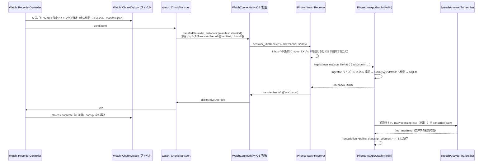

# iOS / watchOS 実装メモ

Apple Watch で装着中ずっと録音 → WatchConnectivity で iPhone へ（ローカルのみ）→ iPhone 上の Speech フレームワーク（SpeechAnalyzer / SpeechTranscriber, iOS 26, 日本語）でオンデバイス文字起こし → Kotlin 共有コードのローカル SQLite に保存、までの Apple 側の実装。充電中・睡眠中などの欠損は許容する。

関連 Issue: #15（watchOS 録音）、#17（転送 + ACK）、#21（iOS 文字起こし）

## 1. コンポーネント

| 場所 | ファイル | 役割 |
| --- | --- | --- |
| watch / iPhone / テスト共通 | `iosApp/Shared/ChunkProtocol.swift` | `ChunkManifest` / `ChunkAck` の Codable 版（`shared/core-protocol` の Swift ミラー） |
| 〃 | `iosApp/Shared/FileDigest.swift` | ファイルの SHA-256（CryptoKit, 64 KiB ずつ）、WatchConnectivity の辞書キー |
| watchOS | `iosApp/WatchApp/Recording/RecorderController.swift` | 録音本体（ローテーション・無音判定・停止理由・自動再開・通知） |
| 〃 | `iosApp/WatchApp/Recording/ChunkOutbox.swift` | 永続アウトボックス（録音中チャンクの状態、送信待ちチャンク、異常終了からの復旧） |
| 〃 | `iosApp/WatchApp/Recording/ChunkTransport.swift` | WCSession 送信・ACK 受信 |
| 〃 | `iosApp/WatchApp/Recording/DiagnosticsLog.swift` | 上限付きのローカル診断ログ（イベント + 電池残量、CSV） |
| 〃 | `iosApp/WatchApp/WatchAudioApp.swift`, `ContentView.swift` | 画面、scenePhase、WatchConnectivity のバックグラウンド起床 |
| iOS (Swift) | `iosApp/iosApp/iOSApp.swift` | 起動時に Kotlin グラフ → WatchConnectivity の順で開始、scenePhase を Kotlin に通知、Compose UI をホスト |
| 〃 | `iosApp/iosApp/WatchReceiver.swift` | WCSession 受信 → Kotlin `Ingestor` → ACK 返信 |
| 〃 | `iosApp/iosApp/SpeechAnalyzerTranscriber.swift` | SpeechAnalyzer + SpeechTranscriber による文字起こし（Kotlin の `IosSpeechTranscriber` を実装） |
| iOS (Kotlin) | `composeApp/src/iosMain/.../IosAppGraph.kt` | iOS の composition root（DB・音声置き場・Ingestor・パイプライン・BGTask） |
| 〃 | `IosAppServices.kt` | 共有 UI 向け `AppServices` 実装（状態 Flow、AVAudioPlayer 再生） |
| 〃 | `IosSpeechTranscriber.kt` | Swift 実装を受けるコールバック型インターフェースと共通 `Transcriber` へのアダプタ |
| 〃 | `MainViewController.kt` | Compose UI のエントリ（Swift から引数なしで呼ぶ） |
| テスト | `iosApp/ProtocolTests/ChunkProtocolTests.swift` | Swift プロトコル実装を Kotlin のテストベクタ（`shared/core-protocol/testdata/*.json`）で検証 |

## 2. データフロー



## 3. ワイヤ形式（Kotlin との互換）

- 正は `shared/core-protocol`（`ChunkManifest.kt` / `ChunkAck.kt` / `ProtocolJson.kt`）。Swift 側は `iosApp/Shared/ChunkProtocol.swift` で同じ形を Codable で表現する。
- 時刻はすべて **Int64 のエポックミリ秒**、列挙値は Kotlin の `@SerialName` と同じ小文字文字列（`watchos`, `aac`, `rotation`, `user_stop`, `low_battery`, `stored`, `corrupt` …）。
- `audio` が無い（無音チャンク）場合はキーごと省略（Kotlin の `explicitNulls = false` と同じ）。`markOffsetsMs` は空でも `[]` を出力（Kotlin の `encodeDefaults = true` と同じ）。未知キーは両側で無視。
- `markOffsetsMs` は `0...durationMs` に収める必要がある（Kotlin 側の `init` で検証されるため、Swift 側で clamp している）。
- WatchConnectivity の辞書キー: `manifest`（manifest JSON）、`chunkId`（送信中転送の突き合わせ用に JSON 外にも複製）、`ack`（ChunkAck JSON）。
- 互換性は `ProtocolTests`（CI）で、Kotlin 側と同じテストベクタを decode → encode して JSON が一致することを確認している。

## 4. watchOS 録音

- **形式**: AAC-LC 16 kHz mono 24 kbps（`ChunkAudioFormat`、約 10.8 MB/時）。`AVAudioSession(.record)` + `UIBackgroundModes: audio` で画面消灯中も継続（M0-3 で確認済みの方式）。
- **ローテーション**: 5 分ごと。次のファイルの `record()` を開始してから前のファイルを `stop()` する（数 ms 重なるが欠けない）。2 本同時に開けなかった場合は stop → start にフォールバックし、診断ログに `rotate_fallback` を残す。
- **Mark**: 現在チャンクにオフセットを記録してチャンクを閉じる（`endReason = mark`）。マークした瞬間が早く iPhone に届く。
- **無音判定**: `isMeteringEnabled = true` にして 1 秒ごとに `updateMeters()` → `averagePower` / `peakPower` をサンプリング。チャンク全体で一度も閾値（平均 −50 dBFS / ピーク −35 dBFS）を超えず、かつサンプルがチャンク長の 80% 以上取れていた場合のみ「確実に無音」とし、音声を削除して manifest のみ送る。サンプル不足（タイマーが止まっていた等）の場合は音声を残す（安全側）。閾値は実機で要調整。
- **停止理由と自動再開**（`wantsRecording` を UserDefaults に保持し、「ユーザーが録音したい状態」なら条件が解けたときに再開する）:

| 状況 | 終了理由 | 再開 |
| --- | --- | --- |
| ユーザーが停止 | `user_stop` | しない |
| 充電開始（`WKInterfaceDevice.batteryState` を 30 秒ごとに確認） | `charging` | 充電器から外れ、アプリが動いている/前面に来たとき |
| 電池 10% 未満 | `low_battery` | 15% 以上に戻ったとき + ハプティクスと通知 |
| 空き容量 100 MB 未満 | `low_storage` | 空きが戻ったとき + 通知 |
| 通話・Siri など（`AVAudioSession.interruptionNotification`） | `interruption` | `.ended` で再開を試行（`shouldResume` が無くても試す）。失敗時はハプティクス + ローカル通知。中断時に 2 分後の通知を予約し、再開できたら取り消す（アプリがサスペンドされても通知が出るように） |
| レコーダーが通知なしに停止 | `error` | 最大 3 回まで自動再開、超えたら通知 |
| アプリ強制終了 | `terminated`（次回起動時に確定） | 次に前面に来たとき |

- **充電後の自動再開の制約**: 録音を止めて音声セッションを無効にするとアプリはサスペンドされるため、バックグラウンドで「外れた」ことは検知できない。実際の再開は「アプリが前面に戻ったとき」（手首を上げてアプリが表示されている、またはユーザーが開いたとき）になる。watchOS の「アプリに戻る」設定次第。
- **装着検出**: watchOS にはサードパーティ向けの手首検出 API が無いため `off_body` は生成しない（外すとウォッチはロックされるが録音は続く）。
- **アウトボックス**（`Application Support/WatchAudio/`）:
  - `recording/<id>.m4a` と `recording/<id>.json`（録音中チャンクの状態: id・セッション・開始時刻・TZ・Mark）
  - `outbox/<id>.m4a` と `outbox/<id>.json`（確定済み manifest）。最終 ACK（`stored` / `duplicate`）で削除。
  - 起動時、`recording/` に残っているものは `terminated` として確定する。`AVAudioFile` で読める場合のみ音声を残し（長さは実サンプル数から算出）、読めない場合（moov 未書き込み等）は manifest のみ（長さは更新日時から推定）。
- **deviceId**: インストールごとの UUID（`watchos-…`）を UserDefaults に保存。ハードウェア識別子は使わない。
- **診断ログ**: `diagnostics.csv`（イベント・電池残量・充電状態）。512 KB を超えたら新しい半分だけ残す。ウォッチ内のみ（送信しない）。

## 5. 転送と ACK

- WatchConnectivity は Apple が管理するペアリング端末間のローカル転送（Bluetooth / P2P Wi-Fi 等、経路は OS が選択・キューイング・バックグラウンド配送）。自前のサーバーやクラウドには一切送らない。
- 送信条件: `activationState == .activated`（または `isReachable`）のときのみ。`transferFile` / `transferUserInfo` は相手が不在でも OS がキューに保持する。
- 二重送信防止: `outstandingFileTransfers` / `outstandingUserInfoTransfers` のメタデータ `chunkId` と照合。送信済みで ACK 待ちのものは 15 分間は再送しない。
- 再送: WCSession が activated になるたび（= アプリ起動ごと）に未 ACK の全チャンクを再送（iPhone は `duplicate` で最終 ACK を返すので安全）。`corrupt` は最大 3 回まで即再送。`rejected`（新しいスキーマ等）は保持して次回起動時に再提示。
- iPhone 側は `session(_:didReceive:)` 内でファイルを `Application Support/WatchAudio/inbox/` に**同期的に** move してから非同期で取り込む。取り込みは `UIApplication.beginBackgroundTask` で保護。取り込み前にプロセスが落ちた inbox の残骸は次回起動時に削除（Watch が再送する）。
- Watch がサスペンド中に ACK が届いた場合は `.backgroundTask(.watchConnectivity)` で起こされ、`hasContentPending` が消えるまで起きている。

## 6. Kotlin ↔ Swift ブリッジ

Swift から見える Kotlin API（`ComposeApp` フレームワーク、静的）:

```swift
IosAppGraph.shared.start(transcriber: SpeechAnalyzerTranscriber())   // App.init で 1 回（BGTask 登録を含む）
IosAppGraph.shared.inboxDirectoryPath()                               // 受信ファイルの退避先
IosAppGraph.shared.ingest(manifestJson: json, filePath: path) { ackJson in … }  // ackJson: String?（nil = ACK しない）
IosAppGraph.shared.setAppActive(active: true / false)                 // scenePhase .active / .background
MainViewControllerKt.MainViewController()                             // Compose UI
```

- Swift の `async` は Kotlin から呼べないため、文字起こしはコールバック型の Kotlin インターフェース `IosSpeechTranscriber`（`engineId`, `language`, `prepareModel(callback:)`, `transcribe(path:callback:)`, `cancel()`）を Swift で実装し、Kotlin 側 `IosTranscriberAdapter` が `suspendCancellableCoroutine` で共通 `Transcriber` に変換する。コルーチンのキャンセルは `cancel()` → Swift の `Task.cancel()` → `SpeechAnalyzer.cancelAndFinishNow()` に伝わる。
- Swift 6 の厳格な並行性チェック対策として、Kotlin のコールバック（非 Sendable）は `UncheckedSendableBox` に入れて Task に渡す。コールバックはどのスレッドから呼んでもよく、必ず 1 回だけ呼ぶ。
- `MainViewController()` は引数なしのまま `IosAppGraph.services` を取得する。共有 UI の `App()` が `AppServices` を受け取るようになったら、Kotlin 側の 1 行を `App(services)` に変えるだけで Swift 側は変更不要。
- Kotlin 内部状態はメインディスパッチャ上でのみ変更する（`ingest` はどのスレッドから呼んでもよい）。

## 7. 文字起こし（iOS）

- `SpeechTranscriber(locale:transcriptionOptions: [], reportingOptions: [], attributeOptions: [.audioTimeRange])`。ロケールは `SpeechTranscriber.supportedLocale(equivalentTo: ja_JP)` で解決。`isAvailable` が false の端末ではエラー。
- モデルは OS 管理: `installedLocales` に無ければ `AssetInventory.reserve(locale:)` → `assetInstallationRequest(supporting:)` → `downloadAndInstall()`。Kotlin 側は各実行の前に `prepareModel` で確認し、失敗したら実行しない（モデル未導入のまま全チャンクがリトライ上限に達するのを防ぐ）。状態は `ProcessingStatus.asrModel`（Downloading / Ready / Failed）。
- `SpeechAnalyzer(modules:)` → `analyzeSequence(from: AVAudioFile)` → `finalizeAndFinish(through:)`。結果は `transcriber.results` を別 Task で収集し、`isFinal` の各結果を 1 セグメント（`result.range` の開始・終了をミリ秒に変換）とする。
- エンジン ID: `apple-speechtranscriber-ja`。言語: `ja`。
- 実行タイミング:
  - アプリが前面（scenePhase `.active`）: すぐに処理。新しいチャンク受信時も再実行。
  - バックグラウンドへ移るとき: 前面の実行をキャンセルし、`BGProcessingTaskRequest(app.watchaudio.transcribe)` を `requiresExternalPower = true`, `requiresNetworkConnectivity = false` で予約。
  - BGProcessingTask: `processPending { !expired }` でチャンク単位に進め、期限切れハンドラでは実行中のチャンクもキャンセルして速やかに `setTaskCompleted` する。期限切れなら再予約。
  - 実行は Mutex で直列化し、毎回 `recoverInterrupted()` で前回中断分（TRANSCRIBING）をキューに戻す。

## 8. 保存場所とプライバシー

- iPhone: `Application Support/WatchAudio/`（`watch-audio.db`、`audio/yyyy/MM/dd/<chunkId>.m4a`、`inbox/`）。ディレクトリに `NSURLIsExcludedFromBackupKey` を設定し、iCloud / PC バックアップに含めない。ファイル保護は iOS 既定（`CompleteUntilFirstUserAuthentication`、BGTask から読める）。
- Watch: `Application Support/WatchAudio/`（録音中・送信待ちチャンク、診断ログ）。ACK 後に削除。
- 音声・文字起こしとも端末外（自前サーバー・クラウド）には送らない。Speech もオンデバイスモデル。

## 9. 権限・Info.plist

| ターゲット | キー | 値・目的 |
| --- | --- | --- |
| iosApp | `NSMicrophoneUsageDescription` | 将来のスマホ側録音用（現状はマイク未使用） |
| 〃 | `NSSpeechRecognitionUsageDescription` | 音声認識の用途説明（SpeechTranscriber が認可を要求する場合に備えて記載。アプリからは要求していない） |
| 〃 | `UIBackgroundModes: [processing]` | BGProcessingTask |
| 〃 | `BGTaskSchedulerPermittedIdentifiers: [app.watchaudio.transcribe]` | `IosAppGraph.PROCESSING_TASK_ID` と一致させること |
| WatchApp | `NSMicrophoneUsageDescription` | 録音 |
| 〃 | `UIBackgroundModes: [audio]` | 画面消灯中の録音継続 |
| 〃 | `WKApplication`, `WKCompanionAppBundleIdentifier` | iPhone アプリの付属 watch アプリ |

実行時の許可: Watch でマイク（初回開始時）と通知（初回録音開始時）。スパイク用の `UIFileSharingEnabled` / `LSSupportsOpeningDocumentsInPlace` は削除した。

## 10. 検証状況

| 項目 | 方法 | 状況 |
| --- | --- | --- |
| Kotlin iosMain（core-platform / composeApp）のコンパイル | Linux で klib クロスコンパイル `./gradlew :composeApp:compileKotlinIosSimulatorArm64 :composeApp:compileKotlinIosArm64 -Pkotlin.native.enableKlibsCrossCompilation=true` | 通過（リンクは不可） |
| 共通ロジック（Ingestor ほか） | `./gradlew jvmTest`、CI で `./gradlew iosSimulatorArm64Test`（SQLite を使う core-db / Ingestor のテストを含む。ジョブサマリーにテスト一覧） | JVM は通過、iOS シミュレータは CI で確認 |
| iOS・watchOS アプリの起動 | CI `ios.yml` の Launch ステップ: ビルド済みの `.app` をシミュレータ（iPhone / Apple Watch）に入れて起動し、15 秒後もプロセスが生きていてクラッシュレポートがないことを確認（`.github/scripts/simulator-smoke.sh`、スクリーンショットは成果物 `simulator-smoke`） | CI で確認 |
| iOS の再生（`IosAppServices.play`） | 未自動化（シミュレータでの XCTest は未整備） | 要確認 |
| Swift プロトコル互換 | Linux の Swift 6.2 で同等のテストを実行 | 通過。CI では `ProtocolTests` を iOS シミュレータで実行 |
| Swift の型・Swift 6 並行性チェック | Linux の Swift 6.2 + Apple フレームワークのスタブ（API 名は developer.apple.com で確認）で SIL 診断まで実行 | 通過（SwiftUI の画面ファイルは対象外） |
| ComposeApp フレームワークのリンク（bundled SQLite を含む）、Xcode ビルド、SwiftUI、実 API との一致 | **CI（macOS）のみ** | 要確認 |
| 録音・転送・文字起こしの実動作、電池 | **実機のみ** | 下記チェックリスト |

## 11. 実機チェックリスト

1. Watch で「録音開始」→ マイク・通知の許可 → 画面消灯のまま 30 分以上録音が続く。
2. 5 分ごとにチャンクが確定し、iPhone 到着後に Watch の「未送信」が減る（ACK で削除）。
3. iPhone アプリがバックグラウンド / 未起動でも、チャンクが届き DB に入る（OS がアプリをバックグラウンド起動する）。アプリ切り替え画面でスワイプ終了した後の挙動も確認する。
4. iPhone を Watch から離して（機内モード等）録音 → 戻したときに未送信分がまとめて届く。重複が DB に入らない。
5. Mark を押すとチャンクが閉じ、Mark 時刻がタイムラインに出る。
6. 静かな部屋に 5 分以上置いたチャンクが「無音」になり音声が保存されない。小声の会話チャンクが無音扱いされない（閾値調整）。
7. 充電器に置く → `charging` で停止 → 外してアプリを開くと自動再開。
8. 録音中に電話を受ける / Siri を使う → `interruption` で区切られ、終了後に再開する。再開できない場合は通知が来る。
9. 録音中に Watch アプリを強制終了 → 再起動で直前チャンクが `terminated` として届く（音声が読めるかも確認）。
10. iPhone を初回起動 → 日本語モデルのダウンロード → 前面で文字起こしが進む。
11. iPhone を充電しながらロック → BGProcessingTask で文字起こしが進む（Xcode の `e -l objc -- (void)[[BGTaskScheduler sharedScheduler] _simulateLaunchForTaskWithIdentifier:@"app.watchaudio.transcribe"]` で強制起動も可）。
12. Watch の `diagnostics.csv` で電池消費（%/時）を確認（M0-3 と比較）。

## 12. 既知のリスク・制約

- **CI でしか分からないこと**: ComposeApp 静的フレームワークのリンク（androidx.sqlite の bundled SQLite を含む初めてのリンク）、Kotlin が生成する ObjC ヘッダの Swift 名（`ingest(manifestJson:filePath:completion:)`、`IosSpeechTranscriber` の各メソッド）、SwiftUI の `.backgroundTask(.watchConnectivity)` などのビルド。
- **SpeechAnalyzer とファイル形式**: `analyzeSequence(from: AVAudioFile)` が 16 kHz AAC をそのまま受け付ける前提。もしフォーマット不一致エラーになる場合は `SpeechAnalyzer.bestAvailableAudioFormat(compatibleWith:)` + `AVAudioConverter` で変換してから `AnalyzerInput` を流す実装に切り替える。
- **音声認識の認可**: SpeechTranscriber が `SFSpeechRecognizer` の認可を必要とするかは未確認。必要なら前面時に `SFSpeechRecognizer.requestAuthorization` を追加する（Info.plist の説明文は記載済み）。
- **充電後の自動再開**はアプリが前面に来たときのみ（上記 4 章）。バックグラウンドで録音を開始できるかは watchOS の制約次第。
- **割り込み後の再開**: watchOS が中断後にバックグラウンドでの録音再開を許すかは M0-3 の検証課題。失敗時は通知でユーザーに促す。
- **無音判定の閾値**（−50 / −35 dBFS）は仮の値。実機で誤判定（会話を捨てる）が無いことを最優先で確認する。
- **BGProcessingTask の実行頻度**は OS 任せ（充電中・アイドル時）。前面で開いている間が最も確実。
- 共有パイプラインの `TranscriptionPipeline` はキャンセル時の `resetInterrupted()` が（キャンセル済みのため）実行されない場合があるが、iOS では毎回の実行前に `recoverInterrupted()` を呼んで補っている。
