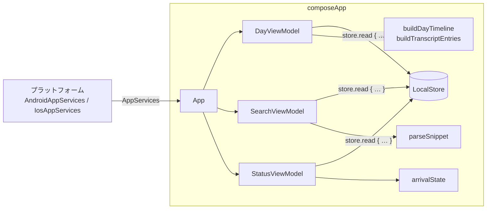

# スマホ UI（composeApp）

Compose Multiplatform で Android / iOS 共通のスマホ UI を実装している（#19, #23, #25, #43 の UI 部分、#33 ストレージ管理）。
目的は「Watch が録り続けたデータがスマホに溜まっていく様子が**見えて**、その中から**探せる**」こと。AI 要約・Chat は対象外。

## 1. 画面構成

下部ナビゲーションで 3 画面を切り替える。文字列はすべて `Strings.kt` に集約（将来のローカライズ用）。

| タブ | 内容 |
| --- | --- |
| **タイムライン** | 日付の前後移動（未来日へは進めない・「今日」に戻るボタン）、録音カバー率、24 時間バー、録音できていない時間の一覧、その日の文字起こし（時刻 + テキスト）。発話をタップすると、その位置から音声を再生（再生できる発話には ▶ を表示）。リスト末尾に「この日のデータを削除」（§1.4） |
| **検索** | 文字起こし全体を部分一致検索（FTS5 trigram。2 文字以下は LIKE）。一致箇所を太字 + 背景色で強調。結果をタップするとその日のタイムラインへ移動し、該当発話までスクロール・ハイライトして再生 |
| **状態** | Watch からの受信状況（最終受信時刻、10 分以上途絶えたら警告）、文字起こしモデルの状態（未取得 / ダウンロード中 / 準備完了 / エラー）とダウンロード操作、保存データの統計、**ストレージ**（容量の内訳・空き容量の警告・音声の保持期間・すべてのデータを削除。§1.4）、プライバシー表記「データはこの端末内にのみ保存され、外部に送信されません」 |

再生中は下部ナビの上に「HH:mm から再生中 [停止]」のバーを出す（再生終了はプラットフォームから通知されないので、停止するまで表示）。

### 1.1 タイムライン（24 時間バー）

その日の `[00:00, 翌日 00:00)`（端末のタイムゾーン。DST の日は 23/25 時間）を次の区間で塗り分ける。

| 区間 | 意味 | 色 |
| --- | --- | --- |
| 音声 | 録音あり（音声を保存） | primary |
| 無音 | 録音していたが「確実に無音」で音声を捨てた区間（`audio == null` のチャンク） | primary 50% |
| 停止 | 録音が止まっていた。理由は**直前のチャンクの `endReason`**（充電中・非装着・割り込み・手動停止・電池残量低下・ストレージ不足・アプリ終了・エラー） | tertiary |
| 欠落 | 直前のチャンクは「継続」（`ROTATION`/`MARK`）で終わったのに、次のチャンクが届いていない | error |
| 転送待ち | 今日の直近 25 分以内（チャンク 5 分 + 転送目標 20 分）の空白。録音中・転送中の可能性が高い | outline |
| 記録なし | それ以前のチャンクが一つもない（理由不明） | 薄いグレー |
| 未来 | 今日のうち、まだ来ていない時間 | 背景色 |

- その日の最初の空白の理由は、前日以前で最後に始まったチャンク（`lastChunkBefore(dayStart)`）の `endReason` から決める。
- チャンク間の 5 秒以下の隙間はローテーションの揺らぎとして無視する。
- Watch とスマホが同時に録っていた時間（重複）は 1 回だけ数える。
- **録音カバー率** = （音声 + 無音）÷ その日の長さ（24 時間）。今日も 24 時間に対する値（経過時間比ではない）。

### 1.2 文字起こしリスト

`segmentsBetween` の発話を時刻順に並べ、まだ文字起こしされていないチャンクを行として差し込む。

- 連続する「文字起こし待ち」「文字起こし中」「失敗」のチャンクはそれぞれ 1 行にまとめる（例: `文字起こし待ち 10:00–10:30（6件）`）。無音チャンクはグループを分けない。
- 「失敗」の行の「再試行」は `requeueFailed`（試行回数をリセットしてキューに戻す）→ `requestTranscription()`。待ちの行の「今すぐ文字起こし」は `requestTranscription()` のみ。
- 再生位置は `segment.startAt - chunk.startedAt`。`services.play(chunk.audioPath, offsetMs)` を呼ぶ。
- 保持期間で音声を削除したチャンク（`audioPurgedAt != null`）の発話は、テキストはそのまま表示し、▶ を出さずタップしても再生しない（`Utterance.audioPath = null`）。検索結果から開いた場合も再生しない。その日に該当チャンクがあれば見出しの下に「保持期間を過ぎた音声は削除済みです（文字起こしは残っています）」を出す。タイムラインバーでは引き続き「音声」（録音できていた時間）として塗る。

### 1.3 受信状況の警告（#43、スマホ側の表示のみ）

最新チャンク（`lastChunkBefore()`）と最終受信時刻（`ProcessingStatus.lastChunkReceivedAt` と DB の `MAX(received_at)` の新しい方）から判定する。

| 状態 | 条件 | 表示 |
| --- | --- | --- |
| 受信中 | 最新チャンクが継続で終わり、10 分以内に受信 | 「録音データを受信中です」 |
| 停止中 | 最新チャンクが停止理由付きで終わった | 「Watch の録音は停止しています（理由: 充電中）」 |
| 途絶 | 最新チャンクが継続で終わったのに 10 分以上受信がない | エラー色のカードで警告 |
| データなし | チャンクが 1 件もない | 「まだ録音データを受信していません」 |

ローカル通知は各プラットフォーム側の担当（この画面は表示のみ）。

### 1.4 ストレージ管理（#33）

テーマは「すべて残す」。**文字起こしは常に無期限**で保存し、音声だけをユーザーの設定で整理できる。処理本体は `shared/core-pipeline` の `StorageManager`（`AppServices.storage`）。

| 項目 | 内容 |
| --- | --- |
| 容量の内訳 | 音声（DB の `size_bytes` の合計。削除済みは除く）/ 文字起こし・索引（DB ファイル + WAL）/ 文字起こしモデル（Android: `files/models` の合計、iOS: 「OS が管理」）/ 合計 / 端末の空き容量。`StorageEnvironment`（プラットフォーム実装）からモデルサイズと空き容量を取得 |
| 空き容量の警告 | 空きが **1 GB 未満**でカードをエラー色にし、保持期間の短縮か日単位の削除を促す（`StorageBreakdown.isLowOnSpace`） |
| 音声の保持期間 | 7 日 / 30 日 / 90 日 / **無期限（既定）**。`app_setting` テーブル（キー `audio_retention`）に保存。**文字起こし完了済み（`TRANSCRIBED`）のチャンクだけ**が対象で、終了時刻が「今 − 保持日数」以前のもの。未処理・処理中・失敗のチャンクの音声は決して消さない |
| 保持期間の変更 | 短くする場合は、今すぐ消える音声の件数とサイズ（`previewRetention`）を示す確認カードを出し、「変更する」で保存 → 直ちに適用。長くする・無期限に戻す場合は確認なしで保存（消えたものは戻らない） |
| この日のデータを削除 | タイムラインのリスト末尾のボタン → 確認カード（日付と件数）→「削除する」。その日（端末のタイムゾーンの 0:00〜24:00）に**始まった**チャンクの音声・文字起こし・マークを削除（前日の 23:58 に始まったチャンクは前日の扱い）。再生中ならその日の再生を止める |
| すべてのデータを削除 | ボタン → 説明と入力欄が開き、「削除」と**入力したときだけ**「すべて削除する」が押せる。全チャンク・文字起こし・マーク・音声ファイル（DB から参照されない残骸も含む）を削除し、`VACUUM` で DB ファイルを縮める。設定（`app_setting`）は残す |

- 破壊的な操作はすべて**アプリ内の確認ステップ**（システムダイアログは使わない）を経る。確認状態は ViewModel（`StatusViewModel.storageActions`、`DayViewModel.deletion`）が持ち、確認前の `confirm*` 呼び出しは何もしない。
- 自動適用: Android は `TranscriptionWorker`（1 回限り・定期の両方）の文字起こしの後、iOS は `IosAppGraph.runPipeline`（前面実行と BGProcessingTask の両方）の後に `applyRetention()` を呼ぶ。モデル未準備で文字起こしをスキップした回でも適用する。
- 削除の順序: 保持期間の削除は「ファイル削除 → DB に `audio_purged_at` を記録」。途中で落ちても、次回の実行で（ファイルが無くても）記録される。日単位の削除も「ファイル → 行」の順で、中断しても行が残るのでもう一度削除できる。

## 2. データの流れ



- プラットフォームとの契約は `AppServices`（`store`, `audioRoot`, `storage`, `status`, `requestTranscription()`, `play()`, `stopPlayback()`, `downloadModels(allowMetered)`）。`downloadModels` はデフォルト no-op（iOS のように OS がモデルを管理する場合はそのまま）。
- 計算はすべて UI から独立した純粋関数（`logic/`）で、`commonTest` でテストしている。
- 時刻表示は端末のタイムゾーン（`TimeZone.currentSystemDefault()`、kotlinx-datetime）。チャンクの `timeZone` も DB に保存されているが、表示には使っていない。

### 2.1 再読み込みのタイミング

SQLite には変更通知がないため、`refreshSignal()` が次のいずれかで再クエリする。

1. `LocalStore.changes` が進んだとき（同じ `LocalStore` インスタンス経由で書き込みトランザクションがコミットされるたびに +1）。取り込み・文字起こしは同じプロセスの同じインスタンスで動くので、通常はこれで即時に反映される。
2. `AppServices.status` の `lastChunkReceivedAt` / `transcribing` が変わったとき。
3. 20 秒ごと（「今」が進むことによる転送待ち→欠落の変化、別プロセス・別接続からの書き込みへの保険）。検索は 1, 2 のみ。

ViewModel の Flow は `WhileSubscribed(5s)` なので、画面が見えていない間はクエリもタイマーも止まる。DB アクセスは `LocalStore` が IO ディスパッチャで行う。

## 3. ホストへの組み込み

- Android: `MainActivity` で `App(services)`。`AndroidAppServices` ができるまでは `FakeAppServices.open(filesDir)`（既存のローカル DB を表示するだけで、取り込み・再生などは何もしない）を仮に渡している（TODO コメントあり）。
- iOS: Swift から `MainViewControllerKt.MainViewController(services: IosAppServices(...))`。
- `FakeAppServices`（commonMain）は呼び出しを記録するだけの実装で、テスト・プレビュー用。

## 4. テスト

```bash
./gradlew --max-workers=2 :composeApp:jvmTest              # ロジック + ViewModel + UI スモークテスト
./gradlew --max-workers=2 :composeApp:testAndroidHostTest  # ロジック（commonTest）を Android ホストで
```

| テスト | 内容 |
| --- | --- |
| `commonTest/…/DayTimelineTest` ほか | タイムライン・カバー率・欠損理由、文字起こしリストのグループ化（削除済み音声は再生不可）、スニペット解析、日付/時刻・容量の書式、受信状況、保持期間変更の確認要否・「削除」入力の判定（`StorageLogicTest`） |
| `jvmTest/…/ViewModelTest` | 一時ファイルの実 `LocalStore` + 一時ディレクトリの音声 + テストディスパッチャで、日付移動・変更時の再読み込み・周期更新・再試行・検索→該当日へ移動・受信途絶の警告、容量表示と保持期間の確認・適用・空き容量警告、「削除」入力による全削除、確認付きの日単位削除、削除済み音声の発話が再生されないこと |
| `jvmTest/…/AppUiTest` | Skia でヘッドレス描画し、タイムライン→再生→検索→結果を開く→状態→ストレージ（「削除」を入力して全削除）を操作。スクリーンショットを `composeApp/build/screenshots/` に出力 |

共通ロジックのテスト: `shared/core-pipeline` の `AudioRetentionPolicyTest`（未処理・最近の音声は消さない、無期限は何も消さない）と `StorageManagerTest`（一時ディレクトリ + 実 `LocalStore`）、`shared/core-db` の `StorageQueriesTest`（削除の連鎖・FTS・設定・マイグレーションの冪等性）。

## 5. 未対応・今後

- スクリーンショット: TODO（`AppUiTest` の出力をデザイン確認用に貼る）
- タイムラインバーのタップ/ドラッグでその時刻へスクロール
- カレンダーから日付を選ぶ（現在は前後移動のみ）
- 再生状態（再生位置・終了）をプラットフォームから受け取る
- 長いギャップ一覧の折りたたみ、Mark の表示
- ストレージ: バックアップ済み（#40）の古い音声だけを端末から消す「オフロード」、AI 設定・API キー（未実装）の全削除への追加、音声コーデック比較による容量見積もりの更新（#33 の残り）
