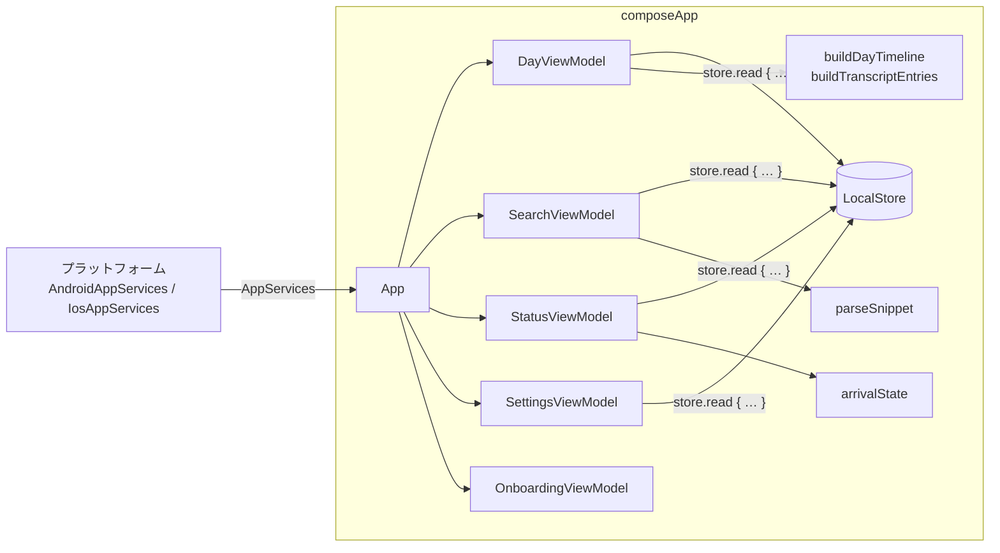

# スマホ UI（composeApp）

Compose Multiplatform で Android / iOS 共通のスマホ UI を実装している（#19, #23, #25, #32, #43 の UI 部分）。
目的は「Watch が録り続けたデータがスマホに溜まっていく様子が**見えて**、その中から**探せる**」こと。AI 要約・Chat は対象外。

## 1. 画面構成

初回起動時はオンボーディング（§1.5）を表示し、完了後は下部ナビゲーションで 3 画面を切り替える。文字列はすべて `Strings.kt` に集約（将来のローカライズ用）。

| タブ | 内容 |
| --- | --- |
| **タイムライン** | 日付の前後移動（未来日へは進めない・「今日」に戻るボタン）、録音カバー率、24 時間バー、録音できていない時間の一覧、その日の文字起こし（時刻 + テキスト）。発話をタップすると、その位置から音声を再生 |
| **検索** | 文字起こし全体を部分一致検索（FTS5 trigram。2 文字以下は LIKE）。一致箇所を太字 + 背景色で強調。結果をタップするとその日のタイムラインへ移動し、該当発話までスクロール・ハイライトして再生 |
| **状態** | Watch からの受信状況（最終受信時刻、10 分以上途絶えたら警告）、文字起こしモデルの状態（未取得 / ダウンロード中 / 準備完了 / エラー）とダウンロード操作、通知設定（途絶アラートのオン/オフ、おやすみ時間）、保存データの統計、プライバシー表記「データはこの端末内にのみ保存され、外部に送信されません」、「初回の説明をもう一度見る」 |

再生中は下部ナビの上に「HH:mm から再生中 [停止]」のバーを出す（再生終了はプラットフォームから通知されないので、停止するまで表示）。

### 1.1 タイムライン（24 時間バー）

その日の `[00:00, 翌日 00:00)`（端末のタイムゾーン。DST の日は 23/25 時間）を次の区間で塗り分ける。

| 区間 | 意味 | 色 |
| --- | --- | --- |
| 音声 | 録音あり（音声を保存） | primary |
| 無音 | 録音していたが「確実に無音」で音声を捨てた区間（`audio == null` のチャンク） | primary 50% |
| 停止 | 録音が止まっていた。理由は**直前のチャンクの `endReason`**（充電中・非装着・割り込み・手動停止・電池残量低下・ストレージ不足・アプリ終了・エラー） | tertiary |
| 欠落 | 直前のチャンクは「継続」（`ROTATION`/`MARK`）で終わったのに、次のチャンクが届いていない | error |
| 転送待ち | 今日の直近 25 分以内（チャンク 5 分 + 転送目標 20 分）の空白。録音中・転送中の可能性が高い | outline |
| 記録なし | それ以前のチャンクが一つもない（理由不明） | 薄いグレー |
| 未来 | 今日のうち、まだ来ていない時間 | 背景色 |

- その日の最初の空白の理由は、前日以前で最後に始まったチャンク（`lastChunkBefore(dayStart)`）の `endReason` から決める。
- チャンク間の 5 秒以下の隙間はローテーションの揺らぎとして無視する。
- Watch とスマホが同時に録っていた時間（重複）は 1 回だけ数える。
- **録音カバー率** = （音声 + 無音）÷ その日の長さ（24 時間）。今日も 24 時間に対する値（経過時間比ではない）。

### 1.2 文字起こしリスト

`segmentsBetween` の発話を時刻順に並べ、まだ文字起こしされていないチャンクを行として差し込む。

- 連続する「文字起こし待ち」「文字起こし中」「失敗」のチャンクはそれぞれ 1 行にまとめる（例: `文字起こし待ち 10:00–10:30（6件）`）。無音チャンクはグループを分けない。
- 「失敗」の行の「再試行」は `requeueFailed`（試行回数をリセットしてキューに戻す）→ `requestTranscription()`。待ちの行の「今すぐ文字起こし」は `requestTranscription()` のみ。
- 再生位置は `segment.startAt - chunk.startedAt`。`services.play(chunk.audioPath, offsetMs)` を呼ぶ。

### 1.3 受信状況の警告（#43、スマホ側の表示のみ）

最新チャンク（`lastChunkBefore()`）と最終受信時刻（`ProcessingStatus.lastChunkReceivedAt` と DB の `MAX(received_at)` の新しい方）から判定する。

| 状態 | 条件 | 表示 |
| --- | --- | --- |
| 受信中 | 最新チャンクが継続で終わり、10 分以内に受信 | 「録音データを受信中です」 |
| 停止中 | 最新チャンクが停止理由付きで終わった | 「Watch の録音は停止しています（理由: 充電中）」 |
| 途絶 | 最新チャンクが継続で終わったのに 10 分以上受信がない | エラー色のカードで警告 |
| データなし | チャンクが 1 件もない | 「まだ録音データを受信していません」 |

### 1.4 途絶アラートの判定と設定（#43）

ローカル通知の**判定は共通コード**、表示・スケジュールは各プラットフォーム（Android: WorkManager、iOS: `UNUserNotificationCenter`。詳細は `android-phone.md` §4.1、`ios-watchos.md`）。

- `logic/GapAlert.kt`:
  - `QuietHours`（分単位・日付またぎ可。既定 23:00–7:00 で有効）。`contains` / `endOf`（おやすみ時間の終了時刻。DST はタイムゾーン変換に任せる）。
  - `gapAlertAt(lastEndReason, lastReceivedAt, settings, tz)`: 通知すべき時刻。最新チャンクが停止理由付き（`endReason.startsGap`）・データなし・通知オフなら null。通常は最終受信 + 10 分、それがおやすみ時間内なら終了時刻。iOS はこの時刻に通知を予約する。
  - `gapAlertDecision(…, now, alertedFor)`: 定期チェック用（Android）。`None` / `Wait(at)` / `Notify(lastReceivedAt)`。10 分**超**で通知、`now` がおやすみ時間内なら終了まで待つ、同じ途絶（同じ `lastReceivedAt`）には 1 回だけ。
- `alert/GapAlertEvaluator`: `LocalStore` から最新チャンクの `endReason`・最終受信・設定を読んで上を適用。通知文「録音が届いていません（最後の受信: HH:mm）。Watch を確認してください」も作る。
- 設定は状態タブの「通知」カードで変更（時刻は 1 時間単位のメニュー）。変更すると `AppServices.gapAlertSettingsChanged()` で各プラットフォームに再評価させる。

### 1.5 オンボーディング（#32）

`AppSettings.onboardingCompleted` が false の間、タブの代わりに `OnboardingScreen` を出す（設定の読み込み中は空の画面）。下部に「戻る」・進捗（例: 2 / 5）・「次へ」。

| ステップ | 内容 |
| --- | --- |
| ようこそ | アプリの仕組み（Watch で録音し続ける → スマホへ届く → 端末内で文字起こし → タイムライン・検索）と「データはこの端末内にのみ保存され、外部に送信されません」（バックアップに含めない・ネットワークはモデル取得のみ） |
| 録音する前に | 周りの人の声も録音されること、**国・地域により録音に相手の同意が必要な場合があること**、録音が禁止・制限された場所では止めること。「法的助言ではない」旨。チェックボックスに同意しないと先に進めない |
| 許可の設定 | `AppServices.permissions` を順に表示（状態: 確認中 / 許可する ボタン / 許可済み / 拒否済み → 設定アプリへ）。Android 13+: 通知、iOS: 通知・音声認識。権限が不要なプラットフォームではこのステップ自体を省く。画面復帰時（`LifecycleResumeEffect`）に状態を読み直す |
| 文字起こしの準備 | `ModelSetup.DOWNLOAD`（Android）: 「Wi-Fi でダウンロード」「モバイル通信でも許可」と進捗。`ModelSetup.OS_MANAGED`（iOS）: 「モデルを準備」（OS が SpeechTranscriber のモデルをインストール） |
| Watch で録音を開始 | 「Watch アプリを開いて録音を開始してください」と、届いたデータの確認方法・止まる条件・途絶時の通知の説明。「はじめる」で完了を保存 |

権限とモデルは任意（未完了ならボタンが「後で設定する」になり、状態タブから後で設定できる）。同意だけは必須。状態タブの「初回の説明をもう一度見る」で最初から表示し直せる。

### 1.6 設定の保存

`settings/AppSettings.kt`。`LocalStore` の key-value テーブル `app_setting`（core-db のマイグレーション 2）に保存するので、DB と同じく端末内のみ・バックアップ対象外。

| キー | 意味 | 既定 |
| --- | --- | --- |
| `onboarding.completed` | オンボーディング完了 | false |
| `gap_alert.enabled` | 途絶アラート | true |
| `gap_alert.quiet_hours.enabled` / `.start_minute` / `.end_minute` | おやすみ時間（0 時からの分） | true / 1380 / 420 |
| `gap_alert.shown_for` | 最後に通知した途絶の `lastReceivedAt`（Android の重複通知防止） | なし |

読めない値は既定値に戻す。`updateSettings { … }` は 1 トランザクションで読み→変更→差分のみ書き込み。`SettingsViewModel` は `LocalStore.changes` で再読み込みする。

## 2. データの流れ



- プラットフォームとの契約は `AppServices`（`store`, `audioRoot`, `status`, `requestTranscription()`, `play()`, `stopPlayback()`, `downloadModels(allowMetered)`, `modelSetup`, `permissions` / `permissionStatus()` / `requestPermission()`, `gapAlertSettingsChanged()`）。追加分はすべてデフォルト実装あり（権限なし・`DOWNLOAD`・no-op）。iOS は `downloadModels` で OS にモデルのインストールを依頼する。
- 計算はすべて UI から独立した純粋関数（`logic/`）で、`commonTest` でテストしている。
- 時刻表示は端末のタイムゾーン（`TimeZone.currentSystemDefault()`、kotlinx-datetime）。チャンクの `timeZone` も DB に保存されているが、表示には使っていない。

### 2.1 再読み込みのタイミング

SQLite には変更通知がないため、`refreshSignal()` が次のいずれかで再クエリする。

1. `LocalStore.changes` が進んだとき（同じ `LocalStore` インスタンス経由で書き込みトランザクションがコミットされるたびに +1）。取り込み・文字起こしは同じプロセスの同じインスタンスで動くので、通常はこれで即時に反映される。
2. `AppServices.status` の `lastChunkReceivedAt` / `transcribing` が変わったとき。
3. 20 秒ごと（「今」が進むことによる転送待ち→欠落の変化、別プロセス・別接続からの書き込みへの保険）。検索は 1, 2 のみ。

ViewModel の Flow は `WhileSubscribed(5s)` なので、画面が見えていない間はクエリもタイマーも止まる。DB アクセスは `LocalStore` が IO ディスパッチャで行う。

## 3. ホストへの組み込み

- Android: `MainActivity` で `App((application as WatchAudioApp).services)`。権限要求の launcher も `MainActivity` が登録して `AndroidAppServices` に渡す。
- iOS: Swift から `MainViewControllerKt.MainViewController()`（`IosAppGraph.services` を使う）。
- `FakeAppServices`（commonMain）は呼び出しを記録するだけの実装で、テスト・プレビュー用。

## 4. テスト

```bash
./gradlew --max-workers=2 :composeApp:jvmTest              # ロジック + ViewModel + UI スモークテスト
./gradlew --max-workers=2 :composeApp:testAndroidHostTest  # ロジック（commonTest）を Android ホストで
```

| テスト | 内容 |
| --- | --- |
| `commonTest/…/DayTimelineTest` ほか | タイムライン・カバー率・欠損理由、文字起こしリストのグループ化、スニペット解析、日付/時刻の書式、受信状況 |
| `commonTest/…/GapAlertTest`, `AppSettingsTest` | おやすみ時間（日付またぎ・DST）、通知時刻、定期チェックの判定（1 回だけ・おやすみ時間中は待つ・停止理由付きは通知しない）、設定の保存形式と不正値 |
| `jvmTest/…/ViewModelTest` | 一時ファイルの実 `LocalStore` + テストディスパッチャで、日付移動・変更時の再読み込み・周期更新・再試行・検索→該当日へ移動・受信途絶の警告、設定の保存、オンボーディングのステップ・同意必須・権限要求 |
| `jvmTest/…/GapAlertEvaluatorTest` | 実 DB 上で途絶アラートの判定・通知文・設定の反映 |
| `jvmTest/…/AppUiTest` | Skia でヘッドレス描画し、(1) タイムライン→再生→検索→結果を開く→状態→おやすみ時間の切り替え、(2) オンボーディング（同意しないと次へ進めない→通知許可→モデルのダウンロード選択→はじめる→タブ画面→説明をもう一度）を操作。スクリーンショットを `composeApp/build/screenshots/` に出力 |

## 5. 未対応・今後

- スクリーンショット: TODO（`AppUiTest` の出力をデザイン確認用に貼る）
- タイムラインバーのタップ/ドラッグでその時刻へスクロール
- カレンダーから日付を選ぶ（現在は前後移動のみ）
- 再生状態（再生位置・終了）をプラットフォームから受け取る
- 長いギャップ一覧の折りたたみ、Mark の表示
