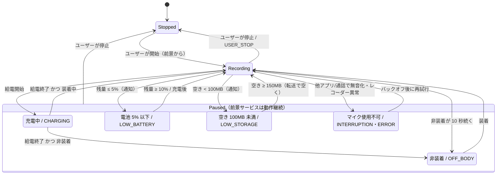
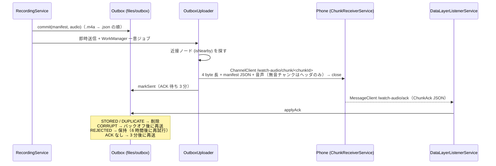

# Wear OS ウォッチ側の実装（常時録音・チャンク化・スマホへの直接転送）

対象 Issue: [M1-4 (#16)](https://github.com/Soichiro5/watch-audio/issues/16)（Wear OS 録音アプリ本実装）、[#41](https://github.com/Soichiro5/watch-audio/issues/41)（タイル / コンプリケーション）、[#43](https://github.com/Soichiro5/watch-audio/issues/43)（録音停止の通知）の Watch 側。

コアの目標「**装着している間はずっと録音** → チャンクを**直接接続（Bluetooth / Wi-Fi）でペアのスマホへ**送る（クラウド経由は使わない）→ スマホで文字起こし・保存」のうち、Watch 側を `wearApp` に実装した。充電中・就寝中（外している間）の欠損は許容する。スマホ側は [android-phone.md](android-phone.md) を参照。

## 1. コンポーネント

`wearApp/src/main/kotlin/app/watchaudio/wear/` 以下。**太字**は Android 非依存の純粋 Kotlin で、`src/test` に JUnit テストがある。

| クラス | 場所 | 役割 |
| --- | --- | --- |
| `WearApp` / `AppGraph` | `WearApp.kt` | `Application` と手書き DI。プロセス起動時に、前のプロセスが残した録音途中のチャンクを `TERMINATED` で確定し、アップロードを予約。録音 ON のまま止まっていたら「タップで再開」通知を出す |
| `WearPrefs` | `WearPrefs.kt` | `deviceId`（インストールごとに固定の UUID）、`armed`（ユーザーが録音 ON にしているか）、送信 ON/OFF、最終 ACK 時刻 |
| `RecordingService` | `recording/` | `microphone` 前景サービス + Ongoing Activity。イベントを `RecorderPolicy` に渡し、結果（録音 / 一時停止 / 停止）を適用する |
| `ChunkRecorder` | `recording/` | `MediaRecorder` ラッパ。AAC-LC 16 kHz mono 24 kbps、`setNextOutputFile` による無音ギャップなしのローテーション |
| **`RecorderPolicy` / `InterruptionBackoff`** | `recording/RecorderPolicy.kt` | 状態機械（§3）。優先順位・猶予・ヒステリシス・アラート判定・リトライ間隔 |
| **`SilenceDetector`** | `recording/` | `getMaxAmplitude()` の 1 秒ごとのピーク値から「チャンク全体が確実に無音か」を判定 |
| **`ChunkJournal` / `RecordingDir`** | `recording/` | 録音中チャンクのジャーナル（`files/recording/<id>.journal.json`） |
| **`ChunkFinalizer`** | `recording/` | 閉じたチャンクの無音判定・SHA-256・manifest 作成 → outbox へ。プロセス死後の回収（`recoverLeftovers`） |
| **`Mp4Probe`** | `recording/` | MP4 のトップレベル `moov` box の有無（= 正常に閉じたか）を判定 |
| `BatteryMonitor` / `OffBodyMonitor` | `recording/ConditionMonitors.kt` | `ACTION_BATTERY_CHANGED`（残量・給電）、`TYPE_LOW_LATENCY_OFFBODY_DETECT`（装着検出） |
| `RecorderAlerts` | `recording/` | 前景通知（Ongoing Activity）と停止アラート（通知 + ハプティクス） |
| **`Outbox`** | `outbox/` | 送信待ちチャンクの永続キュー（`files/outbox/`）と ACK の処理 |
| **`ChunkFrameWriter`** | `outbox/` | `ChunkFrame.header(manifest)` + 音声バイト列をストリームへ書く |
| `OutboxUploader` | `outbox/` | 近接ノードを探して `ChannelClient` で 1 チャンク 1 チャネル送信 |
| `UploadWorker` / `UploadScheduler` | `outbox/UploadWorker.kt` | 即時送信 + WorkManager（一意ジョブ・15 分ごとの定期ジョブ） |
| `DataLayerListenerService` | `outbox/` | `/watch-audio/ack` の ACK 受信、スマホ再接続（capability 変化）で再送要求 |
| `RecorderTileService` / `RecorderComplicationService` | `tile/` | タイル・SHORT_TEXT コンプリケーション。タップでアプリを開く |
| `MainActivity` / `RecorderScreen` | `MainActivity.kt` / `ui/` | Compose for Wear OS (Material 3) の画面 |
| **`DiagnosticsLog`** | `diag/` | イベントと電池残量の CSV（上限付き） |
| `BootReceiver` | `BootReceiver.kt` | 再起動後にプロセスを起こす（実処理は `WearApp`） |

## 2. 録音とチャンク

- **形式**: AAC-LC / 16 kHz / mono / 24 kbps、MPEG-4（`.m4a`）。プロトコルの `AudioCodec.AAC`。
- **チャンク長**: 約 5 分。`setNextOutputFile` はファイルサイズ上限（`setMaxFileSize`）でしか機能しないため、`24 kbps × 300 s ≈ 900 KB` をサイズ上限にしている。上限が近づく（`MAX_FILESIZE_APPROACHING`）と次のファイルを渡し、エンコーダが切り替えた瞬間（`NEXT_OUTPUT_FILE_STARTED`）を正確な境界とする。
- **時刻**: 最初のチャンクは `start()` 直後の壁時計。以降のチャンクの `startedAtEpochMs` は「前チャンクの開始 + `elapsedRealtime` で測った長さ」で求めるので、連続するチャンクは隙間も重なりもなくつながる（壁時計の補正の影響を受けない）。
- **ID**: `chunkId` はチャンクごとの UUID。`sessionId` は録音開始ごとの UUID（一時停止→再開でも新しいセッション。manifest の定義「開始から、理由を問わず停止するまで」に従う）。`deviceId` はインストールごとに固定。
- **Mark**: 現在のチャンク先頭からのオフセット（ms）として `markOffsetsMs` に記録する。チャンクは区切らない。
- **ジャーナル**: 録音中のチャンクは `files/recording/<id>.m4a` と `<id>.journal.json`（開始時刻・Mark・無音統計・最終生存時刻）。ジャーナルは開始時・Mark 時・30 秒ごとに書き換える。
- **確定**: チャンクを閉じたら SHA-256（`java.security.MessageDigest`）とサイズを計算し、音声を `files/outbox/<id>.m4a` へ移動 → manifest を `files/outbox/<id>.json` に**最後に**原子的に書く（`.tmp` → rename）。
- **プロセスが死んだ場合**: 次にプロセスが起動したとき（`WearApp.onCreate`。録音中のレコーダーは存在し得ないタイミング）にジャーナルが残っていれば `endReason = TERMINATED` で確定する。長さは最終生存時刻（30 秒ごと）まで。`MediaRecorder` が `stop()` されないと MP4 の `moov` が書かれず再生できないため、その場合は音声を捨てて **`durationMs = 0` の manifest**（欠損の開始位置と理由だけを伝える）にする。`audio == null` で長さがあると、スマホ側では「無音区間」と解釈されてしまうため。→ 最悪でも失うのは録音中の 1 チャンク（≤ 5 分）。

### 2.1 無音スキップ

- 1 秒ごとに `MediaRecorder.getMaxAmplitude()`（前回呼び出し以降のピーク、0〜32767）を取り、チャンクごとに集計する。
- しきい値 `SilenceDetector.SILENCE_PEAK_THRESHOLD = 300`（≈ -40 dBFS ピーク）。**一度でも超えたら音声を残す**。さらに、取得回数が想定の 80 % 未満（ポーリングが止まっていた）や 10 回未満（短すぎる）の場合も残す。
- 無音と判定したチャンクは音声を削除し、`audio = null` の manifest（時間範囲は残る）を送る。
- しきい値は保守的（音声を残す側）に置いた。実機で寝室・静かな会議室・屋外の雑音レベルを測って調整する（§8）。

## 3. 状態機械

`RecorderPolicy.decide(conditions, now)` が入力（ユーザーの開始/停止、給電、電池残量、装着、空き容量、割り込み）から状態を決める。サービスは `Recording` から外れるときに、理由に対応する `ChunkEndReason` でチャンクを閉じる。

- **優先順位**（同時に成り立つとき）: 充電 > 非装着 > 電池残量低下 > 容量不足 > 割り込み。
- **非装着の猶予 10 秒**: ベルトの付け直しなどでチャンクが細切れにならないように。装着に戻ったら即再開。センサーがない機種・まだ値が来ていない間は「装着中」とみなす。
- **ヒステリシス**: 電池は 5 % 以下で停止・10 % 以上で再開（充電すれば解除）、容量は 100 MB 未満で停止・150 MB 以上で再開。
- **割り込み**: `AudioRecordingCallback` で自分のセッションが `isClientSilenced` になった、またはポーリングで検出 → `INTERRUPTION` でチャンクを閉じる。`MediaRecorder` のエラー・開始失敗・ローテーション失敗は `ERROR`。いずれも 5 s → 15 s → 30 s → 1 min → 2 min → 以降 5 min 間隔で**ユーザーが停止するまで再試行し続ける**（前景サービスを止めると、バックグラウンドからは二度と開始できないため）。再試行直後 10 秒以内に再び無音化された「試し録り」は捨てる（前の `INTERRUPTION` から続く欠損として扱う）。30 秒正常に録れたら回復とみなす。
- **前景サービスは止めない**: 一時停止中も `microphone` 前景サービスを維持する。Android 14 以降は `microphone` 前景サービスをバックグラウンドから開始できないが、動作中のサービス内で録音を再開するのは許可されている。これが「装着したら自動再開」「充電器から外したら自動再開」を実現する鍵。

### 3.1 停止の通知（#43 の Watch 側）

通知（高優先度チャネル）+ ハプティクスを出すのは、ユーザーが予期しない停止だけ:

| 状況 | 通知 |
| --- | --- |
| ユーザー停止 / 充電 / 非装着 | なし（想定どおり） |
| 電池残量低下・容量不足 | 即時 |
| 割り込み | 2 分以上続いたとき、または開始失敗が 3 回続いたとき（短い割り込みでは鳴らさない） |
| プロセスが死んだ / 再起動後（録音 ON のまま） | 「タップで再開」。タップでアプリが開き、そこから再開する |

録音が回復すると通知は取り消す。

## 4. 転送と ACK

- **クラウドを経由しない**: 送信先は `Node.isNearby == true`（Bluetooth / Wi-Fi で直接つながっている）ノードのみ。`DataClient`（Google のサーバー経由で同期され得る）は使わない。スマホ側も送信元が近接ノードでなければ受信しない。
- **送信先の探し方**: まず capability `watch_audio_receiver` を持つ到達可能・近接ノード、なければ接続中の近接ノード。※現時点でスマホアプリはこの capability を宣言していないため、フォールバックで見つけている（§9）。
- **outbox の構成**: `<id>.m4a`（無音なら無し）、`<id>.json`（manifest。存在 = 送信待ち）、`<id>.state`（試行回数・次回送信時刻・REJECTED 等）。すべて `filesDir` 内なのでプロセスが死んでも残る。
- **再送**:
  - 送信失敗（チャネルが開けない・途中で切れた）: 30 s, 1 min, 2 min … 最大 30 min。
  - ACK なし: 完全に送った後 3 分で再送対象（スマホは不正フレーム・中断・DB エラーでは ACK を返さない）。再送済みのチャンクは `DUPLICATE` が返り削除される。
  - `UploadWorker` は送るものがなくなるまで送り、ACK 待ちが残っていれば WorkManager のバックオフ（30 s〜）で再実行。スマホが見つからないときはリトライせず終了し、①スマホの capability 変化（再接続）、②次のチャンク確定（録音中は約 5 分ごと）、③15 分ごとの定期ジョブ、のいずれかで再開する。
  - `SYNC_REQUEST_MESSAGE` は使わない（スマホ側は未対応）。回復は Watch からの再送のみ。
- **同時実行**: サービスからの即時送信と WorkManager は同じプロセス内の `Mutex` で直列化。
- **送信 OFF スイッチ**: 画面の「Send to phone」。電池計測で転送コストを切り分けるため（OFF でも outbox には溜まり、ON にすると送る）。

## 5. UI・タイル・コンプリケーション

- **アプリ画面**: 状態（Recording / Paused · not worn / Paused · charging / … / Stopped）、録音中の経過時間、Mark ボタン（セッション内の回数）、送信待ち件数、最終 ACK 時刻、電池残量、Send to phone スイッチ。画面下の大きな EdgeButton で Start / Stop / Resume。
- **自動再開**: 録音 ON（`armed`）のままサービスが動いていない状態でアプリを開くと、その場で再開する（アプリが前景にあるので Android 14+ でも許可される）。
- **タイル**: 状態・送信待ち件数・ボタン（Start / Resume / Open）。タップでアプリを開き（`from_tile` extra）、未録音なら開始・再開する。**タイルから直接前景サービスは開始できない**（Android 14+ の制約）ため、必ずアプリを経由する。
- **コンプリケーション**（SHORT_TEXT）: `REC` / `OFF` / `CHG` / `BAT` / `FULL` / `MIC` / `!`（録音 ON なのに停止中）/ `—`。タップでアプリ。状態変化時に更新を要求する（定期更新なし）。
- **Ongoing Activity**: 録音中はストップウォッチ、一時停止中は理由を表示。

## 6. 権限

| 権限 | 用途 | 必須 |
| --- | --- | --- |
| `RECORD_AUDIO` | 録音 | 必須（開始時に要求） |
| `FOREGROUND_SERVICE` / `FOREGROUND_SERVICE_MICROPHONE` | 前景サービス | 必須（インストール時） |
| `POST_NOTIFICATIONS` | 停止アラート・前景通知 | 任意（開始時に一度だけ要求。拒否してもハプティクスは出る） |
| `BODY_SENSORS`（`maxSdkVersion=35`） | Wear OS 4/5 での装着検出 | 任意。Wear OS 6（API 36）以降は要求しない。無くても登録を試み、イベントが来なければ「装着中」扱い |
| `VIBRATE` | ハプティクス | インストール時 |
| `RECEIVE_BOOT_COMPLETED` | 再起動後に「タップで再開」通知 | インストール時 |

バックアップ: `allowBackup=false` + `dataExtractionRules` ですべて除外（録音を OS バックアップ・端末移行に載せない）。

## 7. 診断ログ

- `/sdcard/Android/data/app.watchaudio/files/diagnostics/events.csv`（音声・内容は含まない）。512 KB を超えると `events.csv.1` に回して 1 世代だけ残す（最大 約 1 MB）。
- 列: `timestamp,battery_pct,charging,mode,pending_uploads,event,detail`
- 主なイベント: `armed` / `user_stop` / `mode`（状態遷移）/ `recording_started` / `chunk_closed`（理由・長さ・サイズ・silent・dropped・Mark 数）/ `chunk_recovered` / `mark` / `power_connected` / `on_body` / `off_body` / `interrupted` / `recovered` / `probe_discarded` / `alert` / `chunk_sent` / `send_failed` / `ack` / `phone_reachable` / `battery`（5 分ごと）/ `terminated` / `sticky_restart` / `boot_completed`。
- 取り出し: `adb -s <watch> pull /sdcard/Android/data/app.watchaudio/files/diagnostics`

## 8. 実機なしで検証できること / できないこと

**Linux（CI 含む）で検証済み**: `./gradlew :wearApp:testDebugUnitTest :wearApp:assembleDebug :wearApp:lintDebug`

| 検証できる（単体テスト） | 実機が必要 |
| --- | --- |
| 状態機械（優先順位・非装着の猶予・電池/容量のヒステリシス・割り込みのアラート条件・バックオフ） | `MediaRecorder` の `setNextOutputFile` が本当に無音ギャップなしで切り替わるか、`NEXT_OUTPUT_FILE_STARTED` 時点で前ファイルの `moov` が書かれているか（コードは最大 10 秒待つ） |
| 無音判定（しきい値・カバレッジ・短すぎるチャンク） | 無音しきい値（≈ -40 dBFS）が実環境で妥当か |
| チャンク確定（SHA-256・サイズ・Mark の並べ替えと範囲内への丸め・無音/破損時の manifest） | オフボディセンサーの有無・権限の要否・反応（Pixel Watch / Galaxy Watch） |
| プロセス死後の回収（`moov` 有無で音声を残すか、孤立ファイルの掃除） | 通話・アシスタント・他アプリ録音時の `isClientSilenced` と自動復帰 |
| outbox の ACK 処理（削除・再送・保持・タイムアウト・永続化） | 充電器に置いた/外したとき・装着/非装着のときの自動停止/再開 |
| フレームの組み立て（ヘッダ + 音声、無音はヘッダのみ）がスマホ側の読み取りと一致 | Data Layer の近接判定・チャネル転送・ACK の往復、再接続時の再送 |
| 診断ログのローテーション | Android 14+ での前景サービス開始制約（タイル→アプリ→開始、再起動後の通知） |
| | 電池消費（M0-4 の計測手順で実施） |

## 9. 既知の制約・未解決事項

- **スマホ側 capability**: スマホアプリが `res/values/wear.xml` で `android_wear_capabilities` に `watch_audio_receiver` を宣言すると、送信先の特定が確実になり、再接続時の `CAPABILITY_CHANGED` で即座に再送が始まる。未宣言の間は「接続中の近接ノード」へのフォールバックと、チャンク確定・定期ジョブでの再送に頼る。
- **プロセス死・再起動後は自動で録音を再開できない**: Android 14+ の制約。「タップで再開」通知・タイル・アプリを開く、のいずれかで再開する。`START_STICKY` での再起動時も前景化を試みるが、多くの場合拒否される。
- **一時停止中のタイマー**: 非装着の猶予・再試行のバックオフは `delay` で実装しており、録音していない間に端末がスリープすると遅れることがある（装着・給電のイベント自体はシステムが端末を起こして届ける）。問題になれば `AlarmManager` に置き換える。
- **録音中チャンクの喪失**: プロセスが強制終了されると、その時点のチャンク（≤ 5 分）は MP4 が閉じられず失われる（manifest は長さ 0 の `TERMINATED` として残る）。
- **REJECTED のチャンク**は 6 時間ごとに再送を試みる（スマホアプリの更新で受け付けられるようになる想定）。それまで Watch の容量を使う。
- Ongoing Activity のストップウォッチは `elapsedRealtime` 基準で渡している（実機で表示を確認）。

## 10. 実機での手動テスト チェックリスト

準備: Watch とスマホに同じ署名の debug ビルドを入れる（`./gradlew :wearApp:installDebug :androidApp:installDebug`）。スマホ側でモデルを用意しておく。

1. **開始**: アプリで Start → マイク・通知（Wear OS 4/5 は身体センサーも）を許可 → 「Recording」と経過時間が表示され、ウォッチフェイスに Ongoing Activity のアイコンが出る。
2. **ローテーション**: 12 分以上録音 → 診断ログに `chunk_closed ... rotation` が約 5 分ごと。スマホ側に届いたチャンクの境目を聞いて音が欠けていない。連続するチャンクの `startedAtEpochMs + durationMs` が次の `startedAtEpochMs` と一致。
3. **Mark**: 録音中に Mark を数回 → スマホ側のチャンクに Mark が正しい位置で付く。
4. **無音**: 静かな部屋に 6 分置く → そのチャンクが `silent=true`、スマホ側で音声なし・時間範囲あり。小声の会話でも `silent=false` になること（しきい値の確認）。
5. **非装着**: 外して机に置く → 約 10 秒で「Paused · not worn」（`off_body`）、チャンクは `off_body` で閉じる。再装着で即再開（新しい session）。通知は出ない。
6. **充電**: 充電器に置く → 「Paused · charging」（`charging`）。外して装着 → 自動再開。外して机に置いたまま → 「Paused · not worn」。
7. **割り込み**: 録音中に電話を受ける / アシスタントを起動 / 他の録音アプリ → `interrupted` → 終了後にバックオフで自動再開（`recovered`）。2 分以上続くと通知 + 振動。
8. **電池低下**: 5 % 以下 → 停止して通知 + 振動。充電後に自動再開。
9. **容量不足**（任意）: スマホとの接続を切って長時間録音、またはダミーファイルで空きを減らす → `low_storage` で停止・通知、転送で空くと再開。
10. **転送 / ACK**: スマホのアプリで受信を確認。画面の「To send」が 0 に戻り「Last ACK」が更新される。`files/outbox` が空になる（`adb shell run-as app.watchaudio ls files/outbox`）。
11. **切断と再送**: スマホの Bluetooth を 30 分 OFF → 「To send」が増える → ON に戻すと数分以内に全件送られ ACK される（`phone_reachable` または次のチャンク確定で再開）。
12. **ACK 消失**: ACK 受信前に Watch の Bluetooth を切る → 3 分以上後に再送され `duplicate` の ACK で削除される。
13. **プロセス死**: `adb shell am kill app.watchaudio`（または `force-stop`）→ 次の起動で `chunk_recovered`（`terminated`、長さ 0）。数秒後に「タップで再開」通知 → タップで再開。
14. **再起動**: 録音中に Watch を再起動 → 起動後に「タップで再開」通知。タイルからも再開できる。
15. **タイル / コンプリケーション**: 状態に応じて表示が変わる。タップでアプリが開き、停止中なら開始する。
16. **停止**: Stop → 前景通知が消え、最後のチャンクが `user_stop` で閉じて送られる。以後は自動再開しない。
17. **プライバシー**: スマホの Bluetooth だけを OFF（Wi-Fi は別ネットワークで ON）にし、Watch とスマホが Data Layer のクラウド経由でしかつながらない状態にする → Watch は送らない（`isNearby == false` → `To send` が溜まるだけ）。
