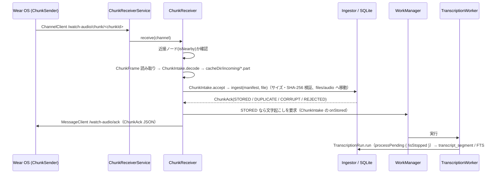

# Android スマホ側の実装（受信・オンデバイス文字起こし・蓄積）

対象 Issue: [M1-6 (#18)](https://github.com/Soichiro5/watch-audio/issues/18)（Wear OS → Android 転送 + ACK）、[M2-3 (#22)](https://github.com/Soichiro5/watch-audio/issues/22)（Android Transcriber とモデル配信）、[M2-1 (#20)](https://github.com/Soichiro5/watch-audio/issues/20) の Android 部分（WorkManager）。

コアの目標「Watch で装着中ずっと録音 → **直接の Bluetooth / Wi-Fi 接続**でスマホへ転送 → スマホ上で文字起こし → ローカル SQLite に蓄積」のうち、スマホ側を `apps/android` に実装した。**音声・文字起こしはどこにもアップロードしない**（ネットワークを使うのはモデル（ASR と意味検索の埋め込み）のダウンロードのみ）。意味検索（[#24](https://github.com/Soichiro5/watch-audio/issues/24)）の Android 部分は §3.4・§4.5。

## 1. コンポーネント

| クラス | 場所（`apps/android/src/main/kotlin/app/watchaudio/android/`） | 役割 |
| --- | --- | --- |
| `WatchAudioApp` | `WatchAudioApp.kt` | `Application`。起動時に `AppGraph` を作り、定期ジョブ登録・残件の処理要求・（Wi-Fi 時の）モデル取得を行う |
| `AppGraph` | `AppGraph.kt` | プロセス内で 1 つの依存グラフ。`LocalStore`（`files/watch-audio.db`）、音声ルート（`files/audio`）、`Ingestor`、`ModelManager`、`AndroidSherpaTranscriber`、`TranscriptionPipeline`、共通の `ChunkIntake`（受信の入口）と `TranscriptionRun`（文字起こし 1 回分）、`AndroidAppServices` を保持。`startup` ジョブでも `pipeline.recoverInterrupted()` を実行する（起動時の「未処理があれば実行を要求する」判定が中断分も数えるため。各実行の最初にも `TranscriptionRun` が行う） |
| `AndroidAppServices` | `AndroidAppServices.kt` | 共通 UI 向け契約 `AppServices` の Android 実装。`status`（モデル状態・処理中・最終チャンク受信時刻・メッセージ）、`requestTranscription()`（WorkManager）、`play/stopPlayback`（`MediaPlayer` でオフセットへシーク）。追加で `downloadModels(allowMetered)`、権限（Android 13+ の `POST_NOTIFICATIONS`。`permissionStatus` / `requestPermission`）、`gapAlertSettingsChanged()` |
| `ChunkReceiverService` | `transfer/` | `WearableListenerService`。`/watch-audio/chunk/` 配下のチャネルを受け、処理を `ChunkReceiver` に渡す |
| `ChunkReceiver` / `FrameReader` | `transfer/` | `ChunkFrame` のヘッダ（manifest JSON）を読む → 共通の `ChunkIntake.decode` → 音声を `cacheDir/incoming/*.part` にストリーム保存 → `ChunkIntake.accept`（`Ingestor.ingest`・診断ログ・文字起こしの要求。iOS と共通）→ `MessageClient` で `ChunkAck` を返す |
| `AndroidSherpaTranscriber` | `asr/` | sherpa-onnx（AAR の Kotlin API）。Silero VAD → `ModelFiles.spec`（`AsrModelSpec.JA_REAZONSPEECH` = ReazonSpeech Zipformer int8）。Android 固有なのは VAD と認識器（`RecognizerKind` ごと）を作る部分だけで、確率の列から `TimedText` までは共通の `transcribeSpeech`（`VadSettings.DEFAULT`）。認識器は初回に読み込み、ワーカー 1 回分の間は使い回す。入力は音声パーツのリスト（チャンク単体、または境界付近の隣のチャンクの音声と連結したもの。[02 §6.3](../architecture/02-architecture.md#63-処理パイプラインphone)）で、各ファイルを `AudioDecoder` でデコードして `concatenateParts` で切り出し・連結する |
| `AudioDecoder` | `asr/` | `MediaExtractor` + `MediaCodec` で m4a(AAC)/ogg(Opus) を 16 kHz モノラル float PCM に。ダウンミックスと線形リサンプルは `shared/pipeline` の `Pcm.kt`（共通コード・単体テストあり） |
| `ModelManager` / `ModelDownloadWorker` / `ModelManifest` / `ModelDownloader` / `ModelFiles` | `asr/` | モデルの用意（adb サイドロード取り込み・ファイル単位のダウンロード（途中再開・SHA-256 検証）・原子的な配置）。ダウンロードするモデルは `ModelManifest.spec`、ファイルの場所（`ModelFiles`）とパスはその `AsrModelSpec` から作る |
| `TranscriptionScheduler` / `TranscriptionWorker` / `AndroidDeviceConditions` | `work/` | WorkManager による文字起こしの起動。ワーカーは共通の `TranscriptionRun` を呼び、その `FollowUp` を WorkManager の予約に対応づけるだけ（§4）。電池と発熱の方針の端末の状態の読み取り（§4.0） |
| `GapAlertMonitor` / `GapAlertWorker` | `alert/` | 録音の途絶アラート（#43）。判定は共通の `GapAlertEvaluator`、ここでは WorkManager でのチェックと通知の表示のみ（§4.1） |
| `AndroidEmbedding` / `AndroidSemanticSearch` | `search/` | 意味検索（#24、§3.4・§4.5）。埋め込みモデル（ruri-v3-30m int8）を共通の `OnnxEmbedder` で組み立て（推論は `shared/ort` の ONNX Runtime C API を JNA で、sherpa-onnx 同梱の `libonnxruntime.so` 上で呼ぶ）、`AppGraph` の `SemanticIndex`（`files/search/` のベクトルのキャッシュ）と共通の `EmbeddingStep`（`TranscriptionRun` の中の埋め込みの段）に渡す。`AndroidSemanticSearch` は検索画面が状態を尋ねたときにモデルのダウンロード（Wi-Fi のみ）を予約する |
| `MainActivity` | `MainActivity.kt` | `App(services)` をホスト。オンボーディングの権限要求用に Activity Result の launcher を `AndroidAppServices` に渡す |

共通コードの追加:

- `shared/pipeline/AsrModelSpec.kt`: `AsrModelSpec`（sherpa-onnx の ASR モデルの記述: ディレクトリ名・`engineId`・言語・認識器の種類・役割ごとのファイル名）。Android の `ModelFiles`・`ModelManifest` とハーネスはこれからファイルの場所を作る（#136）。
- `shared/pipeline/VadSettings.kt`: `VadSettings`（発話の検出と区間の切り出しの設定のデータクラス。既定値は VAD しきい値 0.15、パディング 0.3 s、入力の上限 20 s、間の分割 0.22 s / 30 dB と雑音の床から 9 dB・0.3 s など）。
- `shared/pipeline/VadTranscription.kt`: `transcribeSpeech`（VAD の確率の列 → `speechSegments` → `padSpeechSpans` → 区間ごとの認識 → `TimedText`。発話確率の平均を `TimedText.speechProbability`、雑音の床からの差を `TimedText.levelAboveNoiseDb` に付ける）と `speechProbabilities`（窓ごとの VAD 呼び出し）。Android とハーネスで共通（#136）。
- `shared/pipeline/SegmentFilter.kt`: 保存の前に `TranscriptionPipeline` が通すフィルタ。`AppGraph` は `FalsePositiveFilter.DEFAULT` を使い、雑音の床から 7 dB 未満の結果と、発話らしくない（Silero の確率の平均 0.2 未満の）1 文字を捨てる（#105、[02 §6.3](../architecture/02-architecture.md#会話以外の誤認識の除去105)）。
- `shared/pipeline/SpeechSegmentation.kt`: `padSpeechSpans`（VAD 区間 → 余白付け・結合・話者交代の間での分割・上限での分割。[02 §6.3](../architecture/02-architecture.md#発話区間の切り出しandroid--jvm-ハーネス6871)）。**JVM ハーネスと Android で同一の分割**を使うため。
- `shared/pipeline/SpeechDetection.kt`: `speechSegments`（Silero の発話確率 → 発話区間。開始と終了のしきい値を別々に持つ。#71）。Android は `Vad.compute` で 32 ms ごとの確率だけを求める。
- `shared/pipeline/Pcm.kt`: `downmixToMono` / `pcm16ToFloat` / `LinearResampler`（ストリーミング）/ `concatenateParts`（パーツの範囲を切り出して連結。足りない分は無音）。
- `shared/pipeline/BoundaryJoin.kt`: チャンク境界をまたぐ発話を 1 つとして認識するための連結範囲の決定と、結果のチャンクへの振り分け（#45）。
- `shared/db/StoreTransaction.previousInSession` / `nextInSession` / `replaceSegments`: 同じセッションの隣のチャンクと、範囲内のセグメントの置き換え（境界の再認識用）。
- `shared/protocol/ChunkFrame.readManifest` / `readManifestJson`: フレームヘッダ（4 byte 長 + manifest JSON）の読み取り（後者は JSON を解釈せずに返し、読めない manifest にも返答できるようにする）。長さが不正なら `IllegalArgumentException`。
- `shared/db/StoreTransaction.lastReceivedAt()`: 最後にチャンクを受信した時刻（連続性表示用）。

## 2. データフロー



- 文字起こしは古い順。境界に発話がある場合は、文字起こし済みの隣のチャンクの境界付近（最大 30 秒）も一緒に認識し、隣のセグメントの該当部分を置き換える（詳細と残る制約は [02 §6.3](../architecture/02-architecture.md#63-処理パイプラインphone)）。隣の音声も `files/audio` から読むので、追加のファイルや権限は不要。

- **ACK を返さないケース**: フレームが壊れている（長さの不正）、manifest が読めずチャンク ID も読めない、転送が途中で切れた、DB 例外。Watch は ACK が来ないチャンクを保持して再送する。取り込みは chunkId で冪等なので、再送されても `DUPLICATE` が返るだけ。
- `CORRUPT`（サイズ/ハッシュ不一致）・`REJECTED`（新しいスキーマ、または manifest が読めないがチャンク ID は読める）は ACK として返す（`isFinal=false` なので Watch は保持。`REJECTED` は 6 時間後に再送）。manifest が読めないときの `REJECTED` は iOS と同じ扱い（#134。以前の Android は ACK を返さず、Watch が 3 分ごとに再送していた）。
- 音声は `audio.sizeBytes + 1` バイトまでしか書かない（暴走ストリームでディスクを埋めない。超過分は取り込み時のサイズ検証で `CORRUPT`）。
- **クラウド経由を使わない**: Data Layer の `DataClient` は使わない。さらに、送信元ノードが `isNearby`（Bluetooth / Wi-Fi で直接接続）でない場合は受信せず ACK も送らない。
- 受信は同時 2 本まで（`Semaphore`）。処理はアプリ全体のスコープで行うので、`WearableListenerService` が破棄されても途中の取り込みは続く。

## 3. モデルの用意

使用モデル（ハーネスと同じ。M0-5 の比較で採用）:

```
files/models/
  silero_vad.onnx
  sherpa-onnx-zipformer-ja-reazonspeech-2024-08-01/
    encoder-epoch-99-avg-1.int8.onnx   (約 155 MB)
    decoder-epoch-99-avg-1.int8.onnx
    joiner-epoch-99-avg-1.int8.onnx
    tokens.txt
```

### 3.1 ダウンロード（受信のみ）

- **必要な 5 ファイルだけを個別に取得する**（合計 161,016,054 バイト ≒ **161 MB**。以前は fp32 モデルも含む約 713 MB の tar.bz2 をほぼ全量受信していた）。対象は `ModelManifest`（URL・サイズ・SHA-256）に固定で持つ:

  | ファイル | サイズ（バイト） | 取得元 |
  | --- | ---: | --- |
  | `silero_vad.onnx` | 643,854 | `https://github.com/k2-fsa/sherpa-onnx/releases/download/asr-models/silero_vad.onnx`（従来と同じ） |
  | `tokens.txt` | 45,754 | Hugging Face `csukuangfj/reazonspeech-k2-v2` |
  | `decoder-epoch-99-avg-1.int8.onnx` | 2,959,337 | 同上 |
  | `joiner-epoch-99-avg-1.int8.onnx` | 2,696,970 | 同上 |
  | `encoder-epoch-99-avg-1.int8.onnx` | 154,670,139 | 同上 |

- ASR の 4 ファイルは sherpa-onnx の作者が公開している Hugging Face リポジトリ `csukuangfj/reazonspeech-k2-v2`（リリースの tar.bz2 の元になったもの）から、**コミットを固定した URL**（`https://huggingface.co/csukuangfj/reazonspeech-k2-v2/resolve/7ebed8f70b8ef67f656aa08e3084e5885202d0e6/<ファイル名>`）で取得する。SHA-256 はそのコミットの Git LFS のハッシュで、リリースの tar.bz2 に入っているファイル・公式の `reazon-research/reazonspeech-k2-v2` のファイルとも一致することを確認済み。
- **途中再開**: 受信中のバイトは `files/models/.partial/<SHA-256>.part` に追記し、再試行時（同じワーカー内のリトライ・ワーカーの再実行・アプリ再起動後）は `Range: bytes=<既存サイズ>-` で続きだけを要求する。206 の `Content-Range` の開始位置が合わなければ破棄してやり直し、サーバーが Range を無視して 200 を返した場合は先頭から書き直す。`.part` の名前は内容のハッシュなので、モデルが更新されても古い版の途中データを続きとして使うことはない。
- **検証と配置**: 受信し終えたファイルはサイズと SHA-256 を検証してから `rename`（`ATOMIC_MOVE`）で所定の場所に置く。所定の場所には検証済みのファイルしか現れないので、途中で落ちても「不完全なのに揃って見える」状態にならない。続きから受信した結果が一致しない場合（途中データが壊れていた等）は `.part` を消して一度だけ最初から取り直し、それでも一致しなければ失敗としてリトライに回す。全ファイルが揃ったら、それらの `.part` を消す（英語モデルの途中データは残す）。
- ダウンロードは受信のみで、ユーザーデータは送らない（リクエストに含まれるのは URL と Range ヘッダだけ）。
- ハーネス（`tools/harness/download-models.sh`）も同じ URL・SHA-256 のファイルを取得する（加えて E2E 用の `test_wavs/` を同じリポジトリから取得。英語モデル（§3.3）とその `test_wavs/en.wav` も取得し、CI の E2E で英語の経路も確かめる）。両者の一致は `ModelManifestTest` で検査しているので、ハーネスの E2E（CI の「End-to-end without devices」）がアプリと同じファイルで文字起こしできることの確認になる。
- 実行は `ModelDownloadWorker`（WorkManager、`setForeground` で dataSync の前景ワーカーにする。通知はチャネル `model-download`（「文字起こしモデルのダウンロード」、重要度 LOW）、タイトル「文字起こしモデルをダウンロード中」で、文言は共通の `Strings`。バックグラウンドから開始されて前景化できない場合は通常ワーカーとして続行）。各ファイルは 3 回までその場でリトライし、さらにワーカーとして指数バックオフで最大 5 回まで再試行。
- **従量制ネットワークでは自動ダウンロードしない**: 起動時の自動取得（`downloadIfMissing()`）は `NetworkType.UNMETERED` 制約付き。モバイル通信で取得するのはユーザー操作で `AndroidAppServices.downloadModels(allowMetered = true)` が呼ばれたときだけ。Wi-Fi 待ちの間は `status.notice` が `StatusNotice.ModelWaitingForWifi` になり、状態タブに「Wi-Fi に接続されたときに、文字起こしモデルを自動でダウンロードします」と出る。
- 進捗は `ModelState.Downloading(progress)` として `AppServices.status.asrModel` に流れる。完了すると `Ready` になり、保留中のチャンクの文字起こしを自動で要求する。

### 3.3 英語（設定「英語も文字起こしする」、#81）

日本語モデル（Zipformer ReazonSpeech）は英語を認識できない（英語の発話に「はい」「そう」程度しか出さない）。英語は**オプトイン**で、状態タブの設定「英語も文字起こしする」（`AppSettings.transcribeEnglish`、`app_setting.transcription.english`、既定オフ）をオンにしたときだけ、追加のモデルを使う。比較と採用の理由は [research/english-asr.md](../research/english-asr.md)。

```
files/models/
  sherpa-onnx-sense-voice-zh-en-ja-ko-yue-2024-07-17/   (AsrModelSpec.SENSE_VOICE)
    model.int8.onnx   (239,233,841 バイト)
    tokens.txt        (315,894 バイト)
```

- **取得**: `ModelManifest.englishFiles`（Hugging Face `csukuangfj/sherpa-onnx-sense-voice-zh-en-ja-ko-yue-2024-07-17`、コミット `2365baea…` に固定。SHA-256 はモデルが Git LFS のハッシュ、tokens はファイルのハッシュで、sherpa-onnx のリリースの tar.bz2 の中身と一致）。合計約 240 MB。途中再開・検証・原子的な配置は §3.1 と同じ `ModelDownloader` で、ワーカーも同じ `ModelDownloadWorker`（入力 `english=true`、unique work `english-model-download`、通知「英語の文字起こしモデルをダウンロード中」）。
- **いつ取得・削除するか**（`ModelManager.syncEnglish`）: 設定をオンにしたとき（`AppServices.transcriptionSettingsChanged()`）と起動時に、未取得なら **Wi-Fi（`UNMETERED`）待ち**で予約する。状態タブの「モバイルデータ通信でもダウンロード」（`downloadEnglishModel(allowMetered = true)`）を押せばモバイル通信でも始める。オフにすると予約を取り消し、モデルと途中データを削除する（約 240 MB を空ける）。状態は `ProcessingStatus.englishModel`（設定オフのときは null）と `englishModelWaitingForWifi` で状態タブに出る。
- **文字起こし**（`AndroidSherpaTranscriber`、共通の `LanguageRouting`）: 設定がオンで英語モデルがそろっているときだけ、区間ごとに次の順で処理する。英語モデルが未取得の間は日本語だけで文字起こしする（待たない）。
  1. 日本語モデルで認識する（従来どおり）。
  2. 結果の文字数が区間の長さに対して少ない（`LanguageRouting.maxPrimaryCharsPerSecond` = 1.5 文字/秒未満、余白を含む区間の長さで割る）か、文字の 8 割以上がカタカナとラテン文字（`minForeignScriptShare`、日本語モデルは英語をカタカナの別の語にすることがある）のときだけ、SenseVoice でも認識する。日本語の発話はふつう 2〜6 文字/秒あるので、SenseVoice が動くのは短い相づちや英語の区間だけで、日本語中心の録音では計算量がほとんど増えない（日本語の条件で区間の 3〜8%）。
  3. SenseVoice が英語（`<|en|>`）と判定し、文字の 9 割以上がラテン文字（`minLatinShare`）なら SenseVoice の文（句読点・大文字小文字つき）を `lang = "en"` で保存する。それ以外は日本語モデルの文を `lang = "ja"` で保存する。
- エンジン ID は英語オンの実行では `sherpa-zipformer-ja-reazonspeech-int8+sherpa-sensevoice-small-int8`（どちらのモデルの文かはセグメントの `lang` でわかる）。DB のスキーマは変えていない（`lang` 列は以前からある）。
- 設定をオンにする前に文字起こし済みの録音はやり直さない（オンにした後に文字起こしする分から英語を認識する）。
- メモリ: 英語オンの実行では 2 つの認識器（int8 で約 155 MB + 約 240 MB）を読み込む。英語を使わない実行では英語の認識器を解放する。実機での速度・電池・メモリは #61 で確認する。
- **既知の制限**: 1 つの発話の中で日本語と英語が混ざる場合（「このPRをmergeして」）は、どちらか一方の言語として認識される（日本語モデルは英単語をカタカナや別の語にし、SenseVoice の日本語は Zipformer より誤りが多い）。話者交代や 0.2 秒以上の間で区間が分かれていれば、区間ごとに言語を選べる。

### 3.4 意味検索の埋め込みモデル（#24）

```
files/models/
  ruri-v3-30m/
    model_quantized.onnx   (37,048,575 バイト。onnx-community/ruri-v3-30m-ONNX の int8、コミット 1b41a27… に固定)
    tokenizer.json         ( 6,724,873 バイト。cl-nagoya/ruri-v3-30m、コミット 24899e5… に固定)
```

- **モデル**: M0-6 で選んだ `cl-nagoya/ruri-v3-30m`（日本語、256 次元、Apache-2.0。[research/m0-6](../research/m0-6-embedding-desktop.md)）。SHA-256 はモデルが Git LFS のハッシュ、tokenizer はファイルのハッシュ。ベクトルには `RuriV3.SPEC.id`（`ruri-v3-30m-int8@1b41a27`）を付けて保存するので、ファイルを差し替えるときは id も変えれば全体が埋め込み直される（§4.5）。
- **いつ取得するか（自動・Wi-Fi のみ、検索画面を開いたとき）**: `AndroidSemanticSearch.status()`（検索タブを開くと呼ばれる）が `ModelManager.downloadEmbeddingIfMissing()` で `UNMETERED` 制約付きの `embedding-model-download`（`ModelDownloadWorker`、入力 `embedding=true`、通知「意味で探すためのモデルをダウンロード中」）を `KEEP` で予約する。モバイル通信では取得しない。理由: 約 44 MB と小さく文字起こしと同じ扱い（自動・Wi-Fi のみ）で足りるが、検索を使わない人にまで通信・容量・埋め込みの電池を使わせないため、きっかけを検索画面にした。取得できるまでの検索は従来どおりキーワードだけで、画面に「意味で探すためのモデルは Wi-Fi に接続したときにダウンロードします」と出る。途中再開・SHA-256 検証・原子的な配置は §3.1 と同じ `ModelDownloader`。
- 揃った後は次の文字起こしの実行（新しいチャンクの受信、または充電中の定期実行）から埋め込みが始まる（モデル到着時に実行は要求しない）。
- サイドロード（§3.2）も同じ場所に取り込む（外部ファイル領域の `models/ruri-v3-30m/` に push）。

**ONNX Runtime の選び方（重要）**: sherpa-onnx の AAR（v1.13.8）はすでに `lib/<abi>/libonnxruntime.so`（ONNX Runtime **1.28.2**）を含む。Microsoft の Java パッケージ `com.microsoft.onnxruntime:onnxruntime-android` を足すと同じパスに別の `libonnxruntime.so` が来て、APK には 1 つしか入らない（`pickFirst` が要る）。しかも両方の JNI ライブラリはシンボルのバージョンを要求する（`readelf` で確認: `libsherpa-onnx-jni.so` は `OrtGetApiBase@VERS_1.28.2`、Maven Central の最新に近い `onnxruntime-android` 1.28.0 の `libonnxruntime4j_jni.so` は `OrtGetApiBase@VERS_1.28.0`。1.28.2 は Maven Central にない）。Android の linker（bionic）も glibc もこの不一致で読み込みに失敗するので、**どちらを残しても片方が動かない**。そこで Java パッケージは使わず、**ONNX Runtime の C API（`OrtGetApiBase` → 関数テーブル）を JNA で直接呼ぶ**（`shared/ort` の `OrtApi` / `OrtSession`、JNA 5.19.1 の AAR が `libjnidispatch.so` を足す。arm64 で 176 KB、16 KB ページ対応）:

- APK の `libonnxruntime.so` は sherpa-onnx のもの 1 つだけ（ASR と埋め込みで共有。Java パッケージを足すより ABI ごとに約 28 MB 小さい）。
- C API はバージョンなしの `OrtGetApiBase` だけを参照し、関数テーブルは追記のみで位置が変わらない。要求する API 版は 16（1.16 以降の全ランタイムが提供）なので、sherpa-onnx の更新で ONNX Runtime が新しくなってもそのまま動く。
- 関数の位置（`OrtApi.Fn`）は `onnxruntime_c_api.h`（v1.28.2）から数え、`shared/ort` の単体テスト（Linux 版の sherpa-onnx の 1.28.2 で、使う関数をすべて呼ぶ）と `tools/harness` の一致テストで確かめる。Android 上では emulator の `EmbeddingDeviceTest`（§6.1）が、同じプロセスで sherpa-onnx の文字起こしの後に埋め込みを動かして確かめる。
- R8: `proguard-rules.pro` で `com.sun.jna.**` を残す（ネイティブ側が名前で参照する）。
- 推論は 1 スレッド（ONNX Runtime のスレッドプールは待機中にスピンして電池を使うため。passage は短く 1 件 数 ms）。パディングのあるバッチは int8 の動的量子化で値が変わるため 1 件ずつ（[m0-6 §9.1](../research/m0-6-embedding-desktop.md#91-トークナイザと埋め込みの一致)）。

### 3.2 adb でのサイドロード（開発者向け）

ダウンロードを待たずに試すときは、ハーネス用のモデル（`tools/harness/download-models.sh` で取得）を外部ファイル領域に push してアプリを再起動する。起動時に内部領域へコピーされ、push したファイルは削除される。

```bash
adb shell mkdir -p /sdcard/Android/data/app.watchaudio/files/models/sherpa-onnx-zipformer-ja-reazonspeech-2024-08-01
adb push tools/harness/models/silero_vad.onnx /sdcard/Android/data/app.watchaudio/files/models/
for f in encoder-epoch-99-avg-1.int8.onnx decoder-epoch-99-avg-1.int8.onnx joiner-epoch-99-avg-1.int8.onnx tokens.txt; do
  adb push tools/harness/models/sherpa-onnx-zipformer-ja-reazonspeech-2024-08-01/$f \
    /sdcard/Android/data/app.watchaudio/files/models/sherpa-onnx-zipformer-ja-reazonspeech-2024-08-01/
done
adb shell am force-stop app.watchaudio   # 次の起動で取り込まれる
```

## 4. バックグラウンド処理（WorkManager）

| ジョブ | 起動条件 | 制約 | 内容 |
| --- | --- | --- | --- |
| `transcription`（1 回限り・unique） | チャンクを `STORED` で受信したとき、UI からの要求、モデル準備完了時、起動時に残件があるとき、方針による一時停止の後（遅延付き、§4.0） | 電池残量低下でないこと（設定「充電中のみ文字起こしする」がオンなら充電中。UI からの要求は制約なし） | `PolicyGatedTranscription.run`（チャンクごとに `ProcessingPolicy` で判定して `pipeline.processPending`、§4.0）→ `storage.applyRetention { !isStopped }`（音声の保持期間、#33） |
| `transcription-on-charge`（1 回限り・unique） | 方針が充電待ちで止めたとき（残量 50% 未満・省電力・充電中のみ・1 時間の上限） | 充電中 | 同上 |
| `transcription-periodic`（6 時間ごと） | アプリ起動時に登録（`KEEP`） | 充電中 | 同上（取りこぼしの保険） |
| `model-download`（unique） | 起動時（Wi-Fi 制約）またはユーザー操作 | UNMETERED / CONNECTED、ストレージ残量 | §3.1 |
| `embedding-model-download`（unique、`KEEP`） | 検索タブを開いたとき（モデルが無ければ。#24） | UNMETERED、ストレージ残量 | §3.4 |
| `gap-alert-timer`（1 回限り・unique・`REPLACE`） | チャンクを `STORED` で受信したとき・通知設定の変更時。次にアラートが必要になる時刻に遅延実行 | なし | §4.1 |
| `gap-alert-periodic`（15 分ごと） | アプリ起動時に登録（`KEEP`） | なし | §4.1（タイマーの取りこぼし・おやすみ時間明けの保険） |

- 要求時の方針: 待機中のジョブがあれば何もしない（`KEEP` 相当）。ただし待機中のジョブが方針による遅延付き（発熱・上限）なら置き換え、新しいチャンクのたびに条件を見直す（処理できなければすぐ終わる）。**実行中なら後続を 1 つだけ追加**（`APPEND_OR_REPLACE`。実行中に `REPLACE` するとチャンクの途中で止まるので使わない）。実行中のジョブが新着チャンクを見逃しても後続が拾う。追加は最大 1 つなので鎖は伸びない。
- 1 回の実行の中身（中断分の回復・モデルの確認・方針つきの文字起こし・保持期間の削除・診断ログ・次の予約の判定）は iOS と共通の `TranscriptionRun`（`shared/pipeline`、[02 §6.3](../architecture/02-architecture.md#63-処理パイプラインphone)）。ワーカーはその `FollowUp` を次のように対応づける: `RunAgain`（まだ保留中のチャンクがある: 実行中に届いた、失敗して再試行回数が残っている）→ もう一度要求、`Paused` → §4.0 のとおり予約、`Interrupted`（WorkManager に停止された）→ WorkManager 自身が再スケジュール、`WaitForModel` → 下記。
- 設定「充電中のみ文字起こしする」を変えると（`AppServices.transcriptionSettingsChanged` → `TranscriptionScheduler.settingsChanged`）、待機中のジョブを新しい制約で置き換える。
- 音声の保持期間（#33）は文字起こしの後に適用する。文字起こし済みのチャンクだけが対象なので、モデル未準備で文字起こしをスキップした回でも適用する。失敗はログのみ（次回の実行で再試行）。容量表示用の `AndroidStorageEnvironment` は `files/models` の合計と `StatFs(filesDir).availableBytes` を返す。
- モデル未準備ならスキップ（ダウンロード中のみ `retry`、それ以外は成功扱いで終了し、モデル準備完了時に改めて要求）。チャンクを `FAILED` にして試行回数を浪費しないため、実行の最初に確認する（`SpeechModel.ensureReady`: モデルのファイルがそろっているか）。失敗したチャンクがあった実行の後は `ModelManager.recheck()` でファイルを確認し直し、消えていれば状態を `Missing` にする（iOS と共通の扱い）。
- 1 回限りジョブと定期ジョブが重なっても実行は `TranscriptionRun` の `Mutex` で 1 本ずつ。各実行の終わりに認識器を解放してメモリを返す（次回は再読み込み、数秒）。
- 中断耐性: 処理中のチャンクは `TRANSCRIBING` になり、プロセスが殺されても各実行の最初（と起動時）の `recoverInterrupted()` で `RECEIVED` に戻る。ワーカーは `AppGraph.startup` の完了を待ってから処理する。エミュレータで `am force-stop` を挟んで確認済み（§6.1 の `ResumeAfterKillTest`）。
- ログ: 進捗は診断ログ（§4.2）の `transcription_started` / `_finished` / `_failed`。logcat にもチャンクごとに `transcribing chunk <id>` / `transcribed chunk <id>`（失敗時 `failed chunk <id>`）を出すが、これは `adb logcat` で見る人のためだけで、CI のスクリプトは診断ログを読む（文言を変えてもよい）。ID のみで文字起こし本文は出さない。

### 4.0 電池と発熱の方針（#75）

方針と目標値は [02 §6.3「充電していないときの処理方針」](../architecture/02-architecture.md#充電していないときの処理方針75)。Android での実装:

- **判定**: `TranscriptionRun` は実行ごとに `AppGraph` の `PolicyGatedTranscription`（その時点の端末の状態・方針・時計のテスト用フックを使う）でパイプラインを回す。チャンクを始める前に毎回 `AndroidDeviceConditions.read()` で端末の状態を読み、`ProcessingPolicy.decide` に渡す。止める判定ならそのチャンクを始めずに終える（処理中のチャンクは最後まで処理する）。
- **端末の状態**（権限不要）: 外部電源と残量はスティッキーブロードキャスト `ACTION_BATTERY_CHANGED`（`EXTRA_PLUGGED` が 0 以外なら充電中、`EXTRA_LEVEL / EXTRA_SCALE`）、バッテリーセーバーは `PowerManager.isPowerSaveMode`、発熱は `PowerManager.getCurrentThermalStatus()`（minSdk 29 なので常に使える。`THERMAL_STATUS_MODERATE` 以上で停止、EMERGENCY / SHUTDOWN は CRITICAL 扱い）。
- **止まった後の予約**（保留中のチャンクがあるとき）: 発熱 → `transcription` を 15 分後に（`requestLater`）。1 時間の上限 → `transcription` を枠の終わりに + `transcription-on-charge`。残量不足・省電力・充電中のみ → `transcription-on-charge`（充電開始で実行）。いずれも新しいチャンクの受信でも再判定する。
- **1 時間の上限の使用量**は `app_setting` の `transcription.battery_budget.window_start` / `.used_ms` に保存（実行の終わりにまとめて書く）。
- **ユーザーの要求**（状態タブの「今すぐ文字起こし」、タイムラインの「文字起こしする」）は `userRequested` 付きのジョブ（制約なし）で、電池の条件を外す（発熱の条件は外さない）。
- **表示**: 最後の実行が止まった理由を `AppGraph.transcriptionPause` → `ProcessingStatus.paused` で状態タブの「文字起こしモデル」欄に出す（例「電池残量が50%未満のため、充電を待っています」）。設定は状態タブの「文字起こしのタイミング」（`AppSettings.transcribeOnlyWhileCharging`、`app_setting.transcription.charging_only`、既定オフ）。
- **診断ログ**: 各実行の判定を `transcription_policy` に記録する（§4.2）。
- テスト: 判定の単体テスト `ProcessingPolicyTest`（commonTest）、中断・再開の単体テスト `PolicyGatedTranscriptionTest`（sqliteTest。JVM と Android 実機/エミュレータ）、端末の状態の変換 `AndroidDeviceConditionsTest`（JVM）、WorkManager のテストドライバでの計装テスト `BatteryPolicyWorkTest`（§6.1）。

### 4.5 意味検索の埋め込み（#24）

文字起こしの実行（`transcription` / `-on-charge` / `-periodic`）の最後に、共通の `EmbeddingStep`（[02 §6.3](../architecture/02-architecture.md#63-処理パイプラインphone)）が走る。新しいワーカーやジョブは足していない。

- **文字起こしを遅らせない**: 文字起こし待ちのチャンクが 1 つも無いときだけ始め、チャンクごとに「新しいチャンクが届いていないか（`pipeline.hasPending()`）」「WorkManager に止められていないか」「方針（§4.0）がまだ許すか」を確かめ、どれかが変わればその場でやめる（次の実行が続きをする）。
- **電池**: 方針は文字起こしと同じ（発熱時は動かない、電池駆動では残量 50% 以上・省電力オフ・設定「充電中のみ」に従う）。電池駆動では**受信から 48 時間以内のチャンクを 1 回 50 件まで**だけ（その日の会話。1 チャンク数十〜数百 ms）。それより古い分（インストール直後の過去分・モデル更新後の埋め込み直し）は**充電中だけ**、1 回 300 件・4 分までで、残りがあれば次の実行を要求する（`EmbeddingStep.FollowUp.RunAgain` → `requestNow`、電池駆動で残れば `OnCharge` → `requestOnCharge`。`TranscriptionWorker` が文字起こしの `FollowUp` が `None` のときに対応づける）。埋め込み自体は時間の上限（1 時間に録音 10 分）に数えない（文字起こしに比べて桁違いに軽い。m0-6 §9.3）。
- 失敗: チャンク単位の失敗は飛ばして診断ログに残し、3 件で打ち切る。ネイティブライブラリの読み込み失敗なども含め、埋め込みの失敗が文字起こしの結果や実行の成否に影響することはない。
- 実行のあとモデルを解放する（モデル 37 MB と ONNX Runtime の作業領域）。検索画面は次のクエリでまた読み込む（デスクトップの JVM で 0.85 秒）。
- 埋め込みの間もワーカーは動いているが、状態タブには「文字起こし中…」を出さない（`AppGraph.embeddingRunning` → `AndroidAppServices.status`）。進み具合は検索画面の「意味で探す準備中 N%」に出る。
- 全削除・日の削除（状態タブ）の後は `StorageManager` の `onDeleted` で `SemanticIndex.sync` を呼び、消えた会話のベクトルをキャッシュのファイルからもすぐに消す（[02 §6.4](../architecture/02-architecture.md#64-検索)）。

### 4.1 録音の途絶アラート（#43）

「録音しているはずなのにチャンクが届かない」ときにローカル通知を出す。判定ロジックは UI ではない共通コード `shared/pipeline` の `core/alert`（`GapAlert.kt` の `gapAlertAt` / `gapAlertDecision`、DB から読む `GapAlertEvaluator`）で、iOS と共通・単体テストあり。通知の文言は UI の文字列なので `shared/ui` の `GapAlertText`。

- 条件: 最新チャンク（開始時刻順）の `endReason` が継続（`ROTATION` / `MARK`）で、最終受信（`MAX(received_at)`）から **10 分超**何も届いていない。`user_stop` / `charging` / `off_body` など停止理由付きで終わっていれば録音停止は既知なので通知しない。
- おやすみ時間（既定 23:00–7:00、状態タブで変更・無効化可）の間は通知せず、終了時刻まで待つ。通知自体のオン/オフも状態タブ。
- 同じ途絶には 1 回だけ通知（通知した途絶の `lastReceivedAt` を設定 `gap_alert.shown_for` に保存）。
- チャンク受信ごとに表示中の通知を消し、`gap-alert-timer` を張り直す。ワーカー自身は張り直さない（実行中のワーカーを `REPLACE` で自分ごと取り消さないため）。待ちになった分は 15 分ごとの `gap-alert-periodic` が拾うので、通知は最大 15 分程度遅れうる（Doze 中はさらに遅れる）。
- 通知: チャネル `gap_alert`（「録音の途絶アラート」、重要度 HIGH）、本文「録音が届いていません（最後の受信: HH:mm）。Watch を確認してください」、タップでアプリを開く。
- `POST_NOTIFICATIONS`（Android 13+）が無い場合は通知せず、記録もしない（許可後の次のチェックで通知する）。権限はオンボーディングで要求する（`MainActivity` の `registerForActivityResult(RequestPermission())` を `AndroidAppServices` が使う。Activity Result API の lint 要件のため `androidx.fragment` 1.8.9 を明示的に依存に追加）。

### 4.2 診断ログ（#77）

夜間の処理や数日にわたる実機検証で「止まった・遅い」原因を後から追えるよう、処理の記録を端末内の CSV に残す。logcat と違って流れて消えず、`adb` をつながなくても状態タブから書き出せる。

- 実装: 共通コード `shared/pipeline` の `Diagnostics`（インターフェース）/ `DiagnosticsLog`（kotlinx-io のファイル実装、iOS と共通）。プロセスで 1 つ（`AppGraph.diagnostics(context)`。グラフの構築前から使えるので、構築中のクラッシュも残る）。
- 場所: `files/diagnostics/diagnostics.csv`。**512 KB に達すると `diagnostics.csv.1` に回して（前の `.1` は削除）新しく始める**ので、最大でも約 1 MB。アプリ内部ストレージなのでバックアップ対象外（§5）。
- 形式: `timestamp,event,detail`（UTC の ISO 8601、イベント名、`key=value` の空白区切り）。Watch 側の `events.csv` / `diagnostics.csv` と同じ考え方。
- **含めないもの**: 文字起こしの本文・音声・例外メッセージ（データを引用しうるため。例外は型名とスタックの先頭のみ）。含めるのは ID・件数・時間・エラーの種類だけ。

| イベント | 記録する場所 | detail の例 |
| --- | --- | --- |
| `app_start` | `WatchAudioApp.onCreate` | `version=0.1.0 sdk=35 device=Pixel 8` |
| `previous_exit` | 起動時に `ApplicationExitInfo`（Android 11+）を読み、前回以降の終了を 1 回ずつ（`PreviousExits`、既読の時刻は SharedPreferences `diagnostics`） | `reason=LOW_MEMORY status=0 importance=400 pss_kb=…`（Java のクラッシュは説明文を省き、下の `crash` 行で見る） |
| `crash` | 未捕捉の例外（`CrashRecorder` が既定のハンドラを包み、1 行書いてから元のハンドラに渡す） | `thread=main type=java.lang.IllegalStateException causes=… at=フレーム < フレーム …` |
| `chunk_received` / `chunk_rejected` | 共通の `ChunkIntake`（取り込み結果、読めない manifest、取り込み失敗）と `ChunkReceiver`（近接でないノード・壊れたフレーム・転送の中断） | `chunk=… status=STORED audio_ms=300000 bytes=…` |
| `ack_sent` / `ack_failed` | `ChunkReceiver.sendAck`（試行ごと） | `chunk=… status=STORED attempt=1` |
| `worker_start` / `worker_stop` | 共通の `TranscriptionRun`（件数、モデル未準備でのスキップ）。`TranscriptionWorker` が試行回数と OS による停止・`stop_reason` を足す | `worker=transcription transcribed=3 failed=0` |
| `transcription_started` / `_finished` / `_failed` | `TranscriptionPipeline.Observer`（共通の `DiagnosticsPipelineObserver`） | `chunk=… audio_ms=300000 elapsed_ms=21000 rtf=0.07`（失敗時は `error=例外の型`） |
| `transcription_policy` | `PolicyGatedTranscription`（各実行の最初の判定と、止めたときの理由。§4.0、#75） | `decision=run on_battery=true charging=false battery=80 power_save=false thermal=none battery_used_ms=0`、`decision=pause reason=thermal … retry_ms=900000 after_chunks=1` |
| `retention_purge` | 保持期間による音声の削除（#33、`TranscriptionRun`） | `chunks=12 bytes=…` |
| `embedding_run` / `embedding_failed` | 意味検索の埋め込み（#24、`EmbeddingStep`。件数と時間、失敗はチャンク ID とエラーの種類だけ） | `chunks=12 passages=40 failed=0 on_battery=false ms=950`、`chunk=… error=…` |
| `model_download_*` / `model_ready` | `ModelManager`（開始・10% ごとの進捗・完了・失敗（HTTP ステータスなど）・準備完了） | `pct=30 bytes=…`、`error=java.io.IOException message=HTTP 404 for …` |
| `gap_alert` / `gap_alert_blocked` | `GapAlertMonitor`（通知した / 通知が許可されておらず出せなかった） | `last_received_at=…` |
| `audio_offloaded` | 共通 UI の `StatusViewModel`（バックアップ済みの音声を端末から外した、#156。件数とバイト数だけ） | `chunks=12 bytes=…` |
| `storage_action_failed` / `diagnostics_export_failed` | 共通 UI の `StatusViewModel`（状態タブからの削除・診断ログの書き出しの失敗。画面には例外のメッセージを出さず決まった文言を出すので、エラーの種類はここで見る、#135）。`AppServices.diagnostics` 経由 | `action=delete_all error=java.io.IOException` |

**書き出し**: 状態タブの「診断ログを書き出す」→ `AndroidAppServices.exportDiagnostics()` が `.1` と現在のファイルを 1 つの CSV（`cache/diagnostics-export/watch-audio-diagnostics-<日時>.csv`、前回の書き出しは削除）にまとめ、`FileProvider`（authority `app.watchaudio.diagnostics`、公開するのはこのディレクトリだけ）経由で共有シート（`ACTION_SEND`）を開く。ユーザーが選んだ共有先だけに読み取り権限が付く。**自動では送らない**。新しい権限・通信・SDK は追加していない。

**削除**: 状態タブの「すべてのデータを削除」で、ログ（`.1` を含む）と `cache/diagnostics-export/` の書き出し済みのコピーも消える（`StorageManager.deleteAll` → `DiagnosticsLog.clear`、#159）。書き出し先のディレクトリ名は `AppGraph.DIAGNOSTICS_EXPORT_DIR` の 1 か所（`res/xml/diagnostics_paths.xml` と一致させる）。

**エミュレータでの確認**（CI `emulator.yml` の phone、`DiagnosticsScenarioTest`）: 時計からの転送と同じフレームを `ChunkReceiver.store`（チャネルから読んだ後の処理。Wearable のチャネルなしで呼べる）に渡して受信 → 本番のワーカーが文字起こし → アプリを起動して `adb shell am force-stop app.watchaudio` → 次の起動で、ログに `chunk_received`・`transcription_started` / `_finished`（`rtf` つき）・`app_start`・強制終了の時刻の `previous_exit`（理由は OS が報告したまま記録）があること、状態タブの「診断ログを書き出す」で CSV が書き出されて共有シートが開くこと、書き出した CSV にそのチャンクの文字起こし本文が含まれないことを確かめる。証拠は `DIAGNOSTICS_CHECK` 行・`diagnostics-export.png`・成果物 `logcat-phone` の `scenario-logs/diagnostics-export.csv`（流れは [04-dev-environment.md §6.2](../dev/04-dev-environment.md#62-1-回の計装テストでは確かめられないものphone-scenariossh)）。

### 4.3 データの書き出し（#155）

状態タブの「データの書き出し」→「書き出す」（範囲の確認と ZIP の中身は共通コード、[phone-ui.md §1.9](phone-ui.md#19-データの書き出し155)）。`AndroidAppServices.saveExport()` が `MainActivity` の登録した `ActivityResultContracts.CreateDocument("application/zip")` で SAF の保存ダイアログを開き、ユーザーが作った文書の `ContentResolver.openOutputStream(uri, "w")`（新しく作った空の文書なので切り詰めの `"wt"` は使わない。対応しない保存先がある）に ZIP を直接書く（`kotlinx.io` の `asSink()`）。アプリの領域（`cache/` など）にはコピーを作らないので、音声を含めても端末の空きを二重に使わない。キャンセルなら何も書かない。書き込みに失敗・中断したら `DocumentsContract.deleteDocument` で作りかけの文書を消す。書き終えて文書を閉じたら `true` を返す（暗号化バックアップでは、このときだけ音声を「バックアップ済み」と記録する、#156）。保存先（端末内・SD カード・ユーザーが入れたクラウドのアプリなど）はユーザーが選ぶもので、アプリ自身は通信しない。新しい権限・通信・SDK は追加していない（SAF は権限不要）。

### 4.4 暗号化バックアップ（#40）

状態タブの「暗号化バックアップ」（暗号化・復元の処理は共通コード、[phone-ui.md §1.10](phone-ui.md#110-暗号化バックアップ40)、形式は [02 §6.7](../architecture/02-architecture.md#67-暗号化バックアップ40)）。作成は §4.3 と同じ `saveExport()` で、`MainActivity` が MIME タイプごとに登録した `CreateDocument("application/octet-stream")` の保存ダイアログを開き、ユーザーが作った文書へ直接書く（失敗したら作りかけの文書を消す）。復元は `openBackup()` が `ActivityResultContracts.OpenDocument()`（種類は `*/*`。`.wabackup` に登録された MIME タイプはない）で選ばせ、選ばれた文書を `ContentResolver.openInputStream` で 2 回（確認と追加）直接読む。アプリの領域にコピーを作らない。暗号は `javax.crypto`（`AES/CTR/NoPadding`・`HmacSHA256`・`SecureRandom`）だけで、新しい依存・権限・通信はない。パスフレーズと鍵は保存せず、端末の外に出さない。


- `android:allowBackup="false"`、`dataExtractionRules` でクラウドバックアップは全ドメイン除外（端末間移行 = device-transfer はローカル転送なので許可）。Android 11 以前向けに `fullBackupContent` でも全除外。
- `INTERNET` 権限はモデルのダウンロードのためだけに使う。解析 SDK・広告 SDK・クラッシュ収集 SDK はなし（異常終了は §4.2 の診断ログに端末内で残す）。
- `FileProvider`（非公開・`grantUriPermissions`）が公開するのは診断ログの書き出し先 `cache/diagnostics-export/` だけ。録音・文字起こしのディレクトリは対象外。データの書き出し（§4.3）は `FileProvider` を使わず、ユーザーが SAF で作った文書にだけ書く。
- ABI は `arm64-v8a`（実機）と `x86_64`（エミュレータ）のみ。sherpa-onnx の C/C++ API ライブラリ（JNI からは未使用）は APK から除外。
- **release ビルド（#78）**: R8 でコードとリソースを縮小・難読化する（`watchaudio.android.app` プラグイン、設定と署名は [docs/dev/04 §7.1](../dev/04-dev-environment.md#71-android-の-release-ビルドと署名78)）。keep ルール（`apps/android/proguard-rules.pro`）:
  - sherpa-onnx: パッケージ `com.k2fsa.sherpa.onnx` 全体を keep（JNI がフィールド名で設定を読み、結果のオブジェクトをクラス名で作るため）。
  - それ以外は各ライブラリが同梱するルールで足りる: kotlinx.serialization（`@Serializable` の生成シリアライザ）、WorkManager（`Worker` のコンストラクタ）、bundled SQLite（JNI）、Data Layer の受信サービス（manifest から参照されるので R8 が残す）。
  - CI: `android.yml` で `assembleRelease`、`emulator.yml` で release の APK を入れて起動し、クラッシュしないことを確認する（`launch-smoke.sh`）。続けて release ビルドに対して計装テスト `ReleaseAsrTest` を実行し、既知の日本語チャンクが取り込み → WorkManager の文字起こし（sherpa-onnx）→ DB の経路で保存・検索できることを確認する（`release-asr.sh`。テストが呼ぶものを残す keep ルール `proguard-release-test.pro` はそのビルドでだけ足す。docs/dev/04 §7.1）。

## 6. 検証方法

### 6.1 実機なし（Linux / CI）

```bash
./gradlew --max-workers=2 jvmTest testAndroidHostTest   # 共通コード（フレーム読み取り・Pcm・VAD 区間の分割など）
./gradlew --max-workers=2 :apps:android:testDebugUnitTest  # FrameReader / ModelDownloader（途中切断するフェイクサーバーからの再開）/ ModelManifest / CrashRecorder・PreviousExits（JVM）
./gradlew --max-workers=2 :tools:harness:test            # 実モデルでの E2E（Android と同じ AsrModelSpec・VadSettings）
./gradlew --max-workers=2 :apps:android:assembleDebug :apps:android:lintDebug
```

エミュレータ（CI `emulator.yml` の phone、または KVM のある手元環境）では計装テストも動く:

```bash
./gradlew :apps:android:connectedDebugAndroidTest   # PlaybackTest（下記）
./gradlew :shared:db:connectedAndroidDeviceTest :shared:pipeline:connectedAndroidDeviceTest   # SQLite・Ingestor を Android 上で
adb logcat -d | grep PLAYBACK_CHECK                # 再生位置の記録
```

計装テストの一覧（すべて CI `emulator.yml` の phone ジョブ。証拠の行はジョブサマリーに集約、スクリーンショットは成果物 `screenshots-phone`。モデルの置き方と、計装テスト 1 回では確かめられないシナリオの流れは [04-dev-environment.md §6.1–6.2](../dev/04-dev-environment.md#61-エミュレータでの音声認識モデル)）:

| テスト | 確認すること（Issue） | 証拠 |
| --- | --- | --- |
| `PlaybackTest` | 再生・検索から 1 タップ再生（#19, #25、下記） | `PLAYBACK_CHECK` |
| `EmbeddingDeviceTest` | 意味検索（#24、§3.4）: 同じプロセスで sherpa-onnx の文字起こしの後に、JNA 経由の C API で同じ `libonnxruntime.so`（1.28.2）上の埋め込みモデルが動く。(a) 8 文（passage 4・クエリ 4）のベクトルが JVM で計算した参照（`src/androidTest/assets/embedding-reference.json`）とコサイン 0.99 以上で一致する（同じモデルを同じように計算している）、(b) JVM で 0.05 以上の差で決まる順位（クエリ 4 件）が端末でも同じ、(c) 文字起こしと共通の語を持たないクエリで正しい会話が意味だけで見つかる（`EmbeddingStep` → `HybridSearch`）。参照ベクトルと順位の差は `tools/harness` の `DeviceEmbeddingFixtureTest` が JVM の結果と照合する（作り直しは `UPDATE_EMBEDDING_FIXTURE=1`）。モデルは `push-models.sh` が push したものをこのテストの間だけ入れる | `EMBED_CHECK`（読み込み・1 件あたりの時間・JVM とのコサイン）、`EMBED_RANK`、`EMBED_SEARCH` |
| `SherpaTranscriberTest` | `AndroidSherpaTranscriber`（MediaCodec で AAC をデコード + sherpa-onnx AAR、Silero VAD + ReazonSpeech int8）が参照音声 5 文を 1 チャンクにした AAC を文字起こしし、DB に保存・検索できる（「気象庁」「ヤンバルクイナ」「傘」）（#22） | `ASR_CHECK`（処理時間・RTF・セグメント数）、`ASR_SEGMENT` |
| `ModelWaitTest` | モデルを退避した状態でチャンクを受信 → 文字起こしジョブは成功扱いで終わりチャンクは `RECEIVED`・試行 0 回のまま、再生はできる、状態タブに「モデルが未ダウンロードです」→ モデルを戻すと（`ModelManager.refresh` → `onReady`）自動で文字起こしされる（#22） | `MODEL_CHECK`、`status-model-missing.png` / `status-model-ready.png` |
| `ChargingWorkTest` | `TranscriptionScheduler.schedulePeriodic()` の定期ジョブは充電を条件とし、条件を満たすまで実行されない（チャンクは処理待ちのまま）。WorkManager の `TestDriver.setAllConstraintsMet`（充電開始に相当）で本番の `TranscriptionWorker` が走り、溜まったチャンクが文字起こしされる（#20） | `CHARGING_CHECK` |
| `BatteryPolicyWorkTest` | 電池と発熱の方針（§4.0、#75）。本番の `TranscriptionScheduler` / `TranscriptionWorker`・DB・ASR を WorkManager の `TestDriver` で動かし、端末の状態・上限・時計は `AppGraph` のテスト用フックで差し替える: 電池駆動で残量 30% → 何も処理せず `transcription-on-charge`（充電が条件）を予約 → 残量 80%・上限 = 1 チャンク分 → 1 チャンクだけ処理して 1 時間後の再実行を予約 → 充電開始（`setAllConstraintsMet`）、2 つ目の処理中に発熱 → 2 つ目を終えて止まり（3 つ目は `RECEIVED` のまま）、15 分後の再実行を予約 → 冷えてから再実行（`setInitialDelayMet`）で 3 つ目を処理。3 チャンクとも試行 1 回・`transcription_started` 1 回（重複・欠落なし）で、参照音声のキーワードを含む | `POLICY_CHECK` |
| `GapAlertNotificationTest` | 最後のチャンクから 15 分後の時計で本番の `GapAlertMonitor.check()` を呼ぶと通知が出て、通知シェードに表示される（#43） | `GAP_ALERT_CHECK`、`gap-alert-notification.png` |
| `PermissionDeniedTest`（シナリオ） | オンボーディングで通知を拒否 → 「設定を開く」→ アプリの設定画面（#32） | `PERMISSION_CHECK`、`onboarding-permission-denied.png` ほか |
| `ResumeAfterKillTest`（シナリオ） | 8 チャンクの文字起こし中に `adb shell am force-stop app.watchaudio` → 再起動後に全チャンクが 1 回ずつ文字起こしされる（欠落 0・重複 0、中断したチャンクは試行 2 回）（#20） | `RESUME_CHECK` |
| `DiagnosticsScenarioTest`（シナリオ） | `ChunkReceiver.store` で受信 → 文字起こし → `am force-stop` → 再起動で、診断ログに各イベントと前回の終了理由が残り、状態タブから CSV を書き出せる（共有シートが開く・本文を含まない）（§4.2、#77） | `DIAGNOSTICS_CHECK`、`diagnostics-export.png`、`scenario-logs/diagnostics-export.csv` |

`PlaybackTest` は MediaCodec で実際の AAC（16 kHz モノラル）を作り、本番の `Ingestor` で「前日 10:00 開始」のチャンクとして取り込んだうえで、

- `AndroidAppServices.play(path, 45 秒)` で MediaPlayer が 45 秒付近から再生を始め、2 秒後に再生位置が進んでいることを確認する（#19）。
- `MainActivity` で検索 → 結果を 1 タップ → 発話の位置（チャンク先頭から 60 秒）から再生が始まり、「HH:MM から再生中」が表示されることを確認する（#25）。

計測した再生位置は `PLAYBACK_CHECK check=… requested_ms=… first_ms=… after_2s_ms=…` としてログに出し、CI のジョブサマリーにも載る。エミュレータの音声出力を有効にしておく必要がある（`-noaudio` を付けない）。

ハーネスの `SherpaTranscriber` と `AndroidSherpaTranscriber` は同じ `AsrModelSpec`・`VadSettings`・`transcribeSpeech`・`concatenateParts` を使うので、ハーネスの認識結果は端末上の結果の目安になる（デコーダが ffmpeg か MediaCodec かの差、速度の差はある）。

### 6.2 実機（adb）

```bash
./gradlew :apps:android:installDebug :apps:wear:installDebug
# モデルを §3.2 の手順で入れる（または Wi-Fi 接続で自動ダウンロードを待つ）
adb logcat -s ChunkReceiver TranscriptionWorker ModelManager ModelDownloadWorker AppGraph GapAlertMonitor
# 受信・文字起こし結果の確認（debug ビルドのみ run-as 可）
adb shell run-as app.watchaudio ls -R files/audio
adb exec-out run-as app.watchaudio cat files/watch-audio.db > /tmp/wa.db   # WAL のため直前に処理が走っていると最新でない場合あり
sqlite3 /tmp/wa.db "select state, count(*) from audio_chunk group by state; select start_at, text from transcript_segment order by start_at desc limit 20;"
# WorkManager の状態（gap-alert-* も含む）
adb shell dumpsys jobscheduler | grep -A3 app.watchaudio
# 診断ログ（§4.2）。adb なしなら状態タブの「診断ログを書き出す」から共有する
adb exec-out run-as app.watchaudio cat files/diagnostics/diagnostics.csv.1 files/diagnostics/diagnostics.csv > /tmp/wa-diagnostics.csv
```

長時間の実機検証（#61 など）の証拠には、状態タブから書き出した診断ログを添えると、受信の間隔・文字起こしの RTF・ワーカーの停止理由・前回の終了理由（強制終了・メモリ不足など）を後から確認できる。エミュレータ（API 35）では `am force-stop` は `previous_exit` に `reason=USER_REQUESTED`、`description=[FORCE STOP] stop app.watchaudio due to from pid …` として残る（CI の `DIAGNOSTICS_CHECK` 行、§4.2。計装テストの終了も同じ理由で、説明が `… due to finished inst` になる）。

Watch が無くても、ADB 経由の Wear OS エミュレータとスマホエミュレータをペアリングすれば `ChannelClient` 経由の受信を確認できる（KVM のある環境が必要）。

## 7. 既知の制限・TODO

- **意味検索（#24）の実機確認は未実施**。実機で確かめること: 埋め込みの速度（1 passage・1 日分の過去分）と電池・発熱（充電中のバックフィル）、50 万件・100 万件のベクトルでの検索時間（4 スレッド、目標 300 ms 以内）、モデル読み込みのメモリのピーク、アプリサイズの増分、`libjnidispatch.so` の読み込み（arm64 実機）と R8 の release ビルドでの動作。release ビルドの JNA は emulator の `ReleaseAsrTest` では通っていない（埋め込みモデルを入れないため）。
- 意味検索のベクトルは DB（正本、1 passage 約 300 B）と検索用のキャッシュのファイル（約 268 B）の 2 か所にあり、1 年分（約 100 万 passage）で合わせて約 0.57 GB になる（[02 §9.3](../architecture/02-architecture.md#93-データ量の見積もり)）。

- **実機での動作確認は未実施**（#61）。エミュレータ（CI、§6.1）では起動・再生・MediaCodec デコード + sherpa-onnx AAR での文字起こし・モデル待ち・強制終了からの再開・充電時の定期ジョブ（WorkManager のテストドライバ）・電池と発熱の方針（同、端末の状態は差し替え）・途絶通知の表示を確認している（この開発環境には KVM がないため手元では動かせない）。Data Layer 受信、実機の速度・発熱、Doze 中の WorkManager の挙動、方針の目標値（電池消費 1 日 3% 以下）は実機で確認が必要。
- Watch からの ACK 再送依頼はない（送る側も受ける側もなかった定数 `SYNC_REQUEST_MESSAGE` は #133 で削除）。ACK を失ったときは Watch がチャンクを再送 → `DUPLICATE` ACK で回復する。必要になったら chunkId 一覧をペイロードに持たせるメッセージとして、Swift 側・testdata と合わせて追加する。
- モデルの取得元は外部（Hugging Face の個人リポジトリと k2-fsa の GitHub Release）に依存している。コミット固定 + SHA-256 検証なので内容が差し替わることはないが、公開が取り下げられると取得できなくなる。その場合は `ModelManifest` と `tools/harness/download-models.sh` の URL を自前の配布先（このリポジトリの GitHub Release 等）に差し替える（ハッシュはそのまま）。
- `ModelDownloadWorker` の通知には進捗を出していない（状態は `AppServices.status` で UI に出す）。Android 13+ で通知権限がないと通知は表示されないが、ダウンロードは続く。
- 録音の途絶アラートは WorkManager の精度に依存する（タイマーは Doze で遅れうる、定期チェックは最短 15 分）。厳密な時刻が必要なら `AlarmManager` を検討。実機での確認（Watch の録音を強制停止 → 10〜25 分以内に通知）が必要。
- 通知権限の「拒否済み」は同じプロセス内で拒否された場合しか区別できない（再起動後は「未許可」と表示し、要求すると OS が即座に拒否を返して「拒否済み」になる）。
- `AudioDecoder` は 1 チャンク分（5 分 ≈ 480 万サンプル ≈ 19 MB）をメモリに展開する。極端に長いチャンクが来る場合はストリーミング VAD に変える。
- データの書き出し（§4.3、#155）と暗号化バックアップ（§4.4、#40）の保存・選択ダイアログ（SAF）から実際の文書を書く・読む部分は、エミュレータの計装テストがまだない（ZIP・暗号化の中身・画面・失敗時の扱いは共通コードのテストで確認済み。バックアップの書き出しと復元はエミュレータの `sqliteTest` でも確認）。実機で、保存した ZIP を開けること・キャンセルで何も残らないこと、作ったバックアップを別の端末（iPhone を含む）で戻せることを確かめる。オフロード（#156）は、音声入りのバックアップを保存 → 状態タブの「バックアップ済みの音声を端末から外す」で外す → タイムラインに「バックアップにあり」・検索は変わらない → そのバックアップを戻すと再生できる、を実機で確かめる（保存ダイアログでキャンセルしたバックアップでは外せる音声が増えないことも）。差分バックアップ（#164）は、全体のバックアップを保存した後に「差分」を作って SAF で保存し（ファイル名が `…-diff.wabackup`）、別の端末（iPhone を含む）で全体と差分を（逆順でも）戻すと元の端末と同じになること、保存ダイアログでキャンセルした差分では「前回のバックアップ」の表示が変わらないこと、1 日を削除すると差分が選べなくなることを実機で確かめる。
- 48 kHz などからのダウンサンプルは低域通過フィルタなしの線形補間（Watch は 16 kHz で録音するので通常は通らない）。
