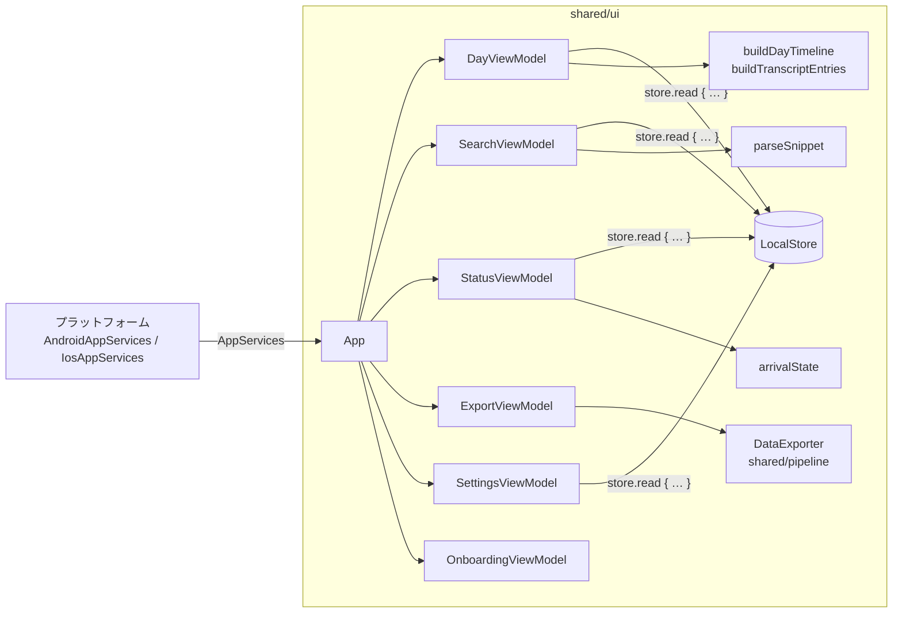

# スマホ UI（shared/ui）

Compose Multiplatform で Android / iOS 共通のスマホ UI を実装している（#19, #23, #25, #32, #43 の UI 部分、#33 ストレージ管理）。
目的は「Watch が録り続けたデータがスマホに溜まっていく様子が**見えて**、その中から**探せる**」こと。AI 要約・チャットは対象外。

## 1. 画面構成

初回起動時はオンボーディング（§1.6）を表示し、完了後は下部ナビゲーションで 3 画面を切り替える。文字列はすべて `Strings.kt` に集約（将来のローカライズ用）。通知（途絶アラート・Android のモデルのダウンロード）の文言も同じ `Strings` にあり、`strings.xml` には置かない。

| タブ | 内容 |
| --- | --- |
| **タイムライン** | 日付の前後移動（未来日へは進めない・「今日」に戻るボタン）、録音カバー率、24 時間バー、録音できていない時間の一覧、その日の文字起こし（時刻 + テキスト）。発話をタップすると、その位置から音声を再生（再生できる発話には ▶ を表示）。リスト末尾に「この日のデータを削除」（§1.4） |
| **検索** | 文字起こし全体を部分一致検索（FTS5 trigram。2 文字以下は LIKE）。一致箇所を太字 + 背景色で強調。結果をタップするとその日のタイムラインへ移動し、該当発話までスクロール・ハイライトして再生 |
| **状態** | Watch からの受信状況（最終受信時刻、10 分以上途絶えたら警告）、文字起こしモデルの状態（未取得 / ダウンロード中 / 準備完了 / エラー）とダウンロード操作、通知設定（途絶アラートのオン/オフ、おやすみ時間）、保存データの統計、**ストレージ**（容量の内訳・空き容量の警告・音声の保持期間・すべてのデータを削除。§1.4）、プライバシー表記「データはこの端末内にのみ保存され、外部に送信されません」、「初回の説明をもう一度見る」、一番下に「ライセンス」（§1.11） |

再生中は下部ナビの上に「HH:mm から再生中 [停止]」のバーを出す（再生終了はプラットフォームから通知されないので、停止するまで表示）。

### 1.1 タイムライン（24 時間バー）

その日の `[00:00, 翌日 00:00)`（端末のタイムゾーン。DST の日は 23/25 時間）を次の区間で塗り分ける。

| 区間 | 意味 | 色 |
| --- | --- | --- |
| 音声 | 録音あり（音声を保存） | primary |
| 無音 | 録音していたが「確実に無音」で音声を捨てた区間（`audio == null` のチャンク） | primary 50% |
| 停止 | 録音が止まっていた。理由は**直前のチャンクの `endReason`**（充電中・非装着・割り込み・手動停止・電池残量低下・ストレージ不足・アプリ終了・エラー） | tertiary |
| 欠落 | 直前のチャンクは「継続」（`ROTATION`/`MARK`）で終わったのに、次のチャンクが届いていない | error |
| 転送待ち | 今日の直近 25 分以内（チャンク 5 分 + 転送目標 20 分）の空白。録音中・転送中の可能性が高い | outline |
| 記録なし | それ以前のチャンクが一つもない（理由不明） | 薄いグレー |
| 未来 | 今日のうち、まだ来ていない時間 | 背景色 |

- その日の最初の空白の理由は、前日以前で最後に始まったチャンク（`lastChunkBefore(dayStart)`）の `endReason` から決める。
- チャンク間の 5 秒以下の隙間はローテーションの揺らぎとして無視する。
- Watch とスマホが同時に録っていた時間（重複）は 1 回だけ数える。
- **録音カバー率** = （音声 + 無音）÷ その日の長さ（24 時間）。今日も 24 時間に対する値（経過時間比ではない）。

### 1.2 文字起こしリスト

`segmentsBetween` の発話を時刻順に並べ、まだ文字起こしされていないチャンクを行として差し込む。

- 連続する「文字起こし待ち」「文字起こし中」「失敗」のチャンクはそれぞれ 1 行にまとめる（例: `文字起こし待ち 10:00–10:30（6件）`）。無音チャンクはグループを分けない。
- 「失敗」の行には決まった文言「この時間の音声を文字起こしできませんでした。原因は診断ログに記録されています。」（`Strings.FAILED_CHUNKS_NOTE`）を出し、例外のメッセージ（DB の `audio_chunk.last_error`）は表示しない（英語や内部の情報になりうるため、#144）。`TranscriptEntry.Untranscribed` もエラーの文字列を持たない。エラーの種類は診断ログの `transcription_failed`、メッセージは DB に残る。
- 「失敗」の行の「再試行」は `requeueFailed`（試行回数をリセットしてキューに戻す）→ `requestTranscription()`。待ちの行の「今すぐ文字起こし」は `requestTranscription()` のみ。
- 再生位置は `segment.startAt - chunk.startedAt`。`services.play(chunk.audioPath, offsetMs)` を呼ぶ。
- チャンク境界をまたぐ発話（#45）は開始時刻のチャンクに属し、`endAt` がそのチャンクの終了を越える。再生はそのチャンクのファイルの終わりで止まる（次のチャンクへは続けない）。境界付近の発話は隣のチャンクの文字起こし時に置き換わることがあるが、`LocalStore.changes` による再取得で反映される。
- 保持期間で音声を削除したチャンク（`audioPurgedAt != null`）の発話は、テキストはそのまま表示し、▶ を出さずタップしても再生しない（`Utterance.audioPath = null`）。検索結果から開いた場合も再生しない。その日に該当チャンクがあれば見出しの下に「保持期間を過ぎた音声は削除済みです（文字起こしは残っています）」を出す。タイムラインバーでは引き続き「音声」（録音できていた時間）として塗る。
- 音声が端末になくバックアップにあるチャンク（オフロードした、またはバックアップ済みで保持期間により削除した。`ChunkRecord.isAudioOnlyInBackup`、#156）の発話は、▶ の代わりに「バックアップにあり」と出す（`Utterance.audioInBackup`。タップしても再生しない）。その日に該当チャンクがあれば見出しの下に「「バックアップにあり」の音声は、この端末から外して暗号化バックアップ（<作成日> 作成）に入っています。そのバックアップから戻すと再生できます（文字起こしは残っています）。」（作成日はその日の該当チャンクのうち最新のバックアップ）。検索は今までどおり（発話は消していない）。

### 1.3 受信状況の警告（#43、スマホ側の表示のみ）

最新チャンク（`lastChunkBefore()`）と最終受信時刻（`ProcessingStatus.lastChunkReceivedAt` と DB の `MAX(received_at)` の新しい方）から判定する。

| 状態 | 条件 | 表示 |
| --- | --- | --- |
| 受信中 | 最新チャンクが継続で終わり、10 分以内に受信 | 「録音データを受信中です」 |
| 停止中 | 最新チャンクが停止理由付きで終わった | 「Watch の録音は停止しています（理由: 充電中）」 |
| 途絶 | 最新チャンクが継続で終わったのに 10 分以上受信がない | エラー色のカードで警告 |
| データなし | チャンクが 1 件もない | 「まだ録音データを受信していません」 |

### 1.4 ストレージ管理（#33）

テーマは「すべて残す」。**文字起こしは常に無期限**で保存し、音声だけをユーザーの設定で整理できる。処理本体は `shared/pipeline` の `StorageManager`（`AppServices.storage`）。

| 項目 | 内容 |
| --- | --- |
| 容量の内訳 | 音声（DB の `size_bytes` の合計。削除済みは除く）/ 文字起こし・索引（DB ファイル + WAL）/ 文字起こしモデル（Android: `files/models` の合計、iOS: 「OS が管理」）/ 合計 / 端末の空き容量。`StorageEnvironment`（プラットフォーム実装）からモデルサイズと空き容量を取得 |
| 空き容量の警告 | 空きが **1 GB 未満**でカードをエラー色にし、保持期間の短縮か日単位の削除を促す（`StorageBreakdown.isLowOnSpace`） |
| 音声の保持期間 | 7 日 / 30 日 / 90 日 / **無期限（既定）**。`app_setting` テーブル（キー `audio_retention`）に保存。**文字起こし完了済み（`TRANSCRIBED`）のチャンクだけ**が対象で、終了時刻が「今 − 保持日数」以前のもの。未処理・処理中・失敗のチャンクの音声は決して消さない |
| 保持期間の変更 | 短くする場合は、今すぐ消える音声の件数とサイズ（`previewRetention`）を示す確認カードを出し、「変更する」で保存 → 直ちに適用。長くする・無期限に戻す場合は確認なしで保存（消えたものは戻らない） |
| この日のデータを削除 | タイムラインのリスト末尾のボタン → 確認カード（日付と件数）→「削除する」。その日（端末のタイムゾーンの 0:00〜24:00）に**始まった**チャンクの音声・文字起こし・マークを削除（前日の 23:58 に始まったチャンクは前日の扱い）。再生中ならその日の再生を止める |
| バックアップ済みの音声（#156） | 音声を含む暗号化バックアップをまだ保存していなければ、その説明だけ。保存していれば「端末から外せる音声」（バックアップ済み・文字起こし済みで端末にあるもののサイズと件数、`StorageBreakdown.offloadableAudio`）、「音声を含む最後のバックアップ: <日付>」、外した音声があれば「端末から外し、バックアップにだけある音声 N件」、説明（バックアップしていない音声と文字起こし前の音声は外さない・文字起こしと検索はそのまま）と「バックアップ済みの音声を端末から外す」ボタン（外せるものがなければ無効） |
| 外す確認 | ボタン → 確認カード: 対象の古さ（「すべて」/「7日より前」/「30日より前」、`OffloadAge`。変えると `previewOffload` で数え直す）と「暗号化バックアップ（<作成日>〜<作成日> 作成）に入っている音声 N件（サイズ）を、この端末から削除します。…アプリはバックアップファイルがまだあるかを確かめられないので、ファイルを消していないことを確認してから進めてください。」。「端末から外す」で `StorageManager.offloadBackedUpAudio` → 「音声 N件（サイズ）を端末から外しました」。対象がなければ「この条件で外せる音声はありません」で押せない。失敗は「音声を端末から外せませんでした。もう一度試してください。」（診断ログに `storage_action_failed action=offload error=<型>`、成功は `audio_offloaded chunks=… bytes=…`）。仕組みと保持期間との関係は [02 §6.8](../architecture/02-architecture.md#68-バックアップ済みの音声のオフロード156) |
| すべてのデータを削除 | ボタン → 説明と入力欄が開き、「削除」と**入力したときだけ**「すべて削除する」が押せる。全チャンク・文字起こし・マーク・音声ファイル（DB から参照されない残骸も含む）を削除し、`VACUUM` で DB ファイルを縮める。スマホの**診断ログ**（ローテーション分と、共有用に一時フォルダへ書き出したコピーも）も消す（#159。記録には受信の時刻が残り、録音していた時間がわかるため）。設定（`app_setting`。オンボーディング済みかどうかを含む）は残すので、削除後にオンボーディングはやり直さない。Watch の診断ログは Watch 側にあり対象外 |

- 破壊的な操作はすべて**アプリ内の確認ステップ**（システムダイアログは使わない）を経る。確認状態は ViewModel（`StatusViewModel.storageActions`、`DayViewModel.deletion`）が持ち、確認前の `confirm*` 呼び出しは何もしない。
- 自動適用: 文字起こし 1 回分の共通処理 `TranscriptionRun`（`shared/pipeline`。Android は `TranscriptionWorker` の 1 回限り・定期の両方、iOS は前面実行と BGProcessingTask の両方から呼ぶ）が、文字起こしの後に `applyRetention()` を呼ぶ。モデル未準備で文字起こしをスキップした回でも適用する。
- 削除の順序: 保持期間の削除は「ファイル削除 → DB に `audio_purged_at` を記録」。途中で落ちても、次回の実行で（ファイルが無くても）記録される。日単位の削除も「ファイル → 行」の順で、中断しても行が残るのでもう一度削除できる。

### 1.5 途絶アラートの判定と設定（#43）

ローカル通知の**判定は共通コード**、表示・スケジュールは各プラットフォーム（Android: WorkManager、iOS: `UNUserNotificationCenter`。詳細は `android-phone.md` §4.1、`ios-watchos.md`）。

- `logic/GapAlert.kt`:
  - `QuietHours`（分単位・日付またぎ可。既定 23:00–7:00 で有効）。`contains` / `endOf`（おやすみ時間の終了時刻。DST はタイムゾーン変換に任せる）。
  - `gapAlertAt(lastEndReason, lastReceivedAt, settings, tz)`: 通知すべき時刻。最新チャンクが停止理由付き（`endReason.startsGap`）・データなし・通知オフなら null。通常は最終受信 + 10 分、それがおやすみ時間内なら終了時刻。iOS はこの時刻に通知を予約する。
  - `gapAlertDecision(…, now, alertedFor)`: 定期チェック用（Android）。`None` / `Wait(at)` / `Notify(lastReceivedAt)`。10 分**超**で通知、`now` がおやすみ時間内なら終了まで待つ、同じ途絶（同じ `lastReceivedAt`）には 1 回だけ。
- `GapAlertEvaluator`: `LocalStore` から最新チャンクの `endReason`・最終受信・設定を読んで上を適用。判定（`GapAlert.kt`）とあわせて、バックグラウンド処理からも使うので UI ではない `shared/pipeline` の `app.watchaudio.core.alert` にある（#134）。通知文「録音が届いていません（最後の受信: HH:mm）。Watch を確認してください」は UI の文字列なので `shared/ui` の `alert/GapAlertText` が作る。
- 設定は状態タブの「通知」カードで変更（時刻は 1 時間単位のメニュー）。変更すると `AppServices.gapAlertSettingsChanged()` で各プラットフォームに再評価させる。
- 状態タブの「文字起こしのタイミング」カード（#75）: スイッチ「充電中のみ文字起こしする」（既定オフ。`SettingsViewModel.setTranscribeOnlyWhileCharging` → `AppServices.transcriptionSettingsChanged()` で各プラットフォームが予約を見直す）と、オフのときの電池駆動での処理の説明（残量 50% 以上・省電力でない間・1 時間に録音 10 分ぶんまで・熱いときは休む）。方針は [02 §6.3](../architecture/02-architecture.md#充電していないときの処理方針75)。文字起こしが方針で止まっていて未処理のチャンクがあると、「文字起こしモデル」カードに理由（`ProcessingStatus.paused` → `Strings.transcriptionPaused`）を出す。バックグラウンド処理からのお知らせ（Wi-Fi 待ち・取り込み失敗・途絶通知の予約失敗・文字起こし失敗の件数・古い音声の削除失敗）も同じカードに出す。各プラットフォームは文言ではなく型付きの `ProcessingStatus.notice`（`StatusNotice`、`shared/pipeline`）を渡し、日本語の文言は `Strings.statusNotice` だけが持つ（#135）。失敗のお知らせには例外のメッセージを入れない（英語になりうるため。エラーの種類は診断ログにある）。モデルの準備に失敗した場合（`ModelState.Failed`）も `reason` は表示せず、`Strings.modelFailed(ModelSetup)` の決まった文言（Android: 通信状況を確認してもう一度ダウンロード、iOS: 「モデルを準備」でもう一度）をボタンと一緒に出す（オンボーディングも同じ）。`reason` は開発者向けで、診断ログには `model_download_failed` が残る。「今すぐ文字起こし」は電池の条件を外して実行する（発熱の条件は外さない）。
- 状態タブの「文字起こしの言語」カード（#81、`AppServices.supportsEnglish` が true のプラットフォームだけ。現在は Android）: スイッチ「英語も文字起こしする」（既定オフ。`SettingsViewModel.setTranscribeEnglish` → `AppServices.transcriptionSettingsChanged()` で Android が英語モデルを取得・削除する）と、説明（追加のモデル約 240 MB を Wi-Fi でダウンロード、文字起こしの時間と電池が増える、1 つの発話の中の日英混在はどちらか一方の言語になる、オンにした後に届いた録音から、オフでモデルを削除）、その下にモデルの帰属表示（「英語のモデル: SenseVoice Small — FunASR / Alibaba Group（出典: URL）」。FunASR Model License の条件、#167、§1.11）。オンの間はその下に英語モデルの状態（`ProcessingStatus.englishModel` → `Strings.englishModelState`: 確認中 / Wi-Fi 待ち / 未ダウンロード / ダウンロード中 N%（進捗バー）/ 準備完了 / 失敗（自動で再試行））を出し、未取得か失敗のときは「モバイルデータ通信でもダウンロード」（`AppServices.downloadEnglishModel(allowMetered = true)`）を出す。iOS は SpeechAnalyzer の日本語ロケールだけで、このカードは出さない（[research/english-asr.md](../research/english-asr.md)）。

### 1.6 オンボーディング（#32）

`AppSettings.onboardingCompleted` が false の間、タブの代わりに `OnboardingScreen` を出す（設定の読み込み中は空の画面）。下部に「戻る」・進捗（例: 2 / 5）・「次へ」。

| ステップ | 内容 |
| --- | --- |
| ようこそ | アプリの仕組み（Watch で録音し続ける → スマホへ届く → 端末内で文字起こし → タイムライン・検索）と「データはこの端末内にのみ保存され、外部に送信されません」（バックアップに含めない・ネットワークはモデル取得のみ） |
| 録音する前に | 周りの人の声も録音されること、**国・地域により録音に相手の同意が必要な場合があること**、録音が禁止・制限された場所では止めること。「法的助言ではない」旨。チェックボックスに同意しないと先に進めない |
| 許可の設定 | `AppServices.permissions` を順に表示（状態: 確認中 / 許可する ボタン / 許可済み / 拒否済み → 理由の表示と「設定を開く」ボタン）。「設定を開く」は `AppServices.openAppSettings()` でアプリの設定画面を開く（Android: `Settings.ACTION_APPLICATION_DETAILS_SETTINGS`、iOS: `UIApplication.openSettingsURLString`。拒否された権限があるときだけ）。Android 13+: 通知、iOS: 通知・音声認識。権限が不要なプラットフォームではこのステップ自体を省く。画面復帰時（`LifecycleResumeEffect`）に状態を読み直す |
| 文字起こしの準備 | `ModelSetup.DOWNLOAD`（Android）: 「Wi-Fi でダウンロード」「モバイル通信でも許可」と進捗。`ModelSetup.OS_MANAGED`（iOS）: 「モデルを準備」（OS が SpeechTranscriber のモデルをインストール） |
| Watch で録音を開始 | 「Watch アプリを開いて録音を開始してください」と、届いたデータの確認方法・止まる条件・途絶時の通知の説明。「はじめる」で完了を保存 |

権限とモデルは任意（未完了ならボタンが「後で設定する」になり、状態タブから後で設定できる）。同意だけは必須。状態タブの「初回の説明をもう一度見る」で最初から表示し直せる。

### 1.7 設定の保存

`AppSettings`（`shared/pipeline` の `app.watchaudio.core.settings`。文字起こしの実行や途絶アラートも読むので UI モジュールの外に置く、#134）。`LocalStore` の key-value テーブル `app_setting`（shared/db のマイグレーション 2）に保存するので、DB と同じく端末内のみ・バックアップ対象外。

| キー | 意味 | 既定 |
| --- | --- | --- |
| `onboarding.completed` | オンボーディング完了 | false |
| `gap_alert.enabled` | 途絶アラート | true |
| `gap_alert.quiet_hours.enabled` / `.start_minute` / `.end_minute` | おやすみ時間（0 時からの分） | true / 1380 / 420 |
| `gap_alert.shown_for` | 最後に通知した途絶の `lastReceivedAt`（Android の重複通知防止） | なし |
| `transcription.charging_only` | 充電中のみ文字起こしする（#75） | false |
| `transcription.english` | 英語も文字起こしする（#81） | false |

音声の保持期間（#33、§1.4）も同じテーブルに `StorageManager` が保存する。電池駆動での 1 時間あたりの処理量（`transcription.battery_budget.*`、#75）は設定ではなく状態で、`PolicyGatedTranscription` が保存する。

読めない値は既定値に戻す。`updateSettings { … }` は 1 トランザクションで読み→変更→差分のみ書き込み。`SettingsViewModel` は `LocalStore.changes` で再読み込みする。

### 1.8 診断ログの書き出し（#77）

状態タブの「プライバシー」の下に「診断ログ」カード。端末内に残している処理の記録（受信・文字起こし・モデルのダウンロード・異常終了などの時刻・ID・処理時間・エラーの種類。**文字起こしの本文や音声は含まない**）の説明と「診断ログを書き出す」ボタン。

- ボタン → `StatusViewModel.exportDiagnostics()` → `AppServices.exportDiagnostics()`。プラットフォームが 1 つの CSV にまとめて共有シートを開く（Android: `ACTION_SEND` + `FileProvider`、iOS: `UIActivityViewController`）。共有先はユーザーが選ぶ。**ボタンを押したときだけ**で、自動では送らない。
- 状態は `StatusUiState.diagnosticsExport`（`busy` の間はボタンを無効化）。共有シートが開けば追加の表示はなし。記録が 1 件もなければ「書き出せる診断ログがありません」、失敗すると「診断ログを書き出せませんでした。もう一度試してください。」（例外のメッセージは出さず、診断ログに `diagnostics_export_failed error=<型>` を書く、#135）。
- 何をどこに記録するかは [android-phone.md §4.2](android-phone.md#42-診断ログ77) と [ios-watchos.md §7.2](ios-watchos.md#72-診断ログ77)。

### 1.9 データの書き出し（#155）

状態タブの「ストレージ」の下に「データの書き出し」カード。文字起こし・マーク・録音できていない時間を、日ごとの Markdown（Obsidian などで読める形）と JSON にまとめた ZIP ファイルにする。形式は [02 §6.6](../architecture/02-architecture.md#66-データの書き出し155)。

| 項目 | 内容 |
| --- | --- |
| 期間 | 「すべて」（既定）/「期間を指定」。指定すると「開始日」「終了日」のボタン（Material の `DatePicker` のダイアログ。今日より後は選べない）。開始日を終了日より後にすると終了日が、終了日を開始日より前にすると開始日がついてくる。初期値は今日までの 7 日間。日は端末のタイムゾーン |
| 音声ファイルを含める | スイッチ（既定オフ）。端末にある音声の合計（「ストレージ」の内訳と同じ値）を添えて、ZIP が大きくなることを示す |
| 書き出す | `ExportViewModel.export()`: ① `DataExporter.plan` で範囲にチャンクがあるか確かめ、なければ「この期間に書き出せる記録はありません」（保存先は聞かない）、② `AppServices.saveExport(ファイル名, "application/zip") { sink -> … }` でプラットフォームが保存先を聞き、③ `DataExporter.write` がそこへ ZIP を流し込む。書き出し中はボタンを無効にし「書き出し中…」と進捗（日数の割合）を出す |
| 結果 | 「N日分を書き出しました（発話 N件、音声 N件）」。見つからなかった音声ファイルがあれば「音声ファイルが見つからなかった N件は、文字起こしだけを書き出しました」。保存先の画面でキャンセルしたら何も出さない。失敗は「書き出せませんでした。保存先の空き容量を確認して、もう一度試してください。」（例外のメッセージは出さず、診断ログに `data_export_failed error=<型>`。成功時は `data_exported` に件数だけ） |

- 保存先: Android は `MainActivity` が登録した `ActivityResultContracts.CreateDocument("application/zip")`（SAF の保存ダイアログ）。ユーザーが作った文書に `ContentResolver.openOutputStream` で直接書くので、アプリの領域にコピーを作らない。iOS は一時ディレクトリ（`tmp/data-export/`）に書いてから共有シート（`UIActivityViewController`、「ファイルに保存」・AirDrop など）を開き、閉じたら消す。どちらも**ボタンを押したときだけ**で、保存先はユーザーが選ぶ。途中で失敗したら作りかけのファイルを消す。
- 書き出しの処理（ZIP・Markdown・JSON）は共通コード（`shared/pipeline` の `core/export`）で、プラットフォームは保存先を開くだけ。`AppServices.exporter` は既定で `DataExporter(store, audioRoot)`。
- Markdown のギャップの理由の言葉（`MarkdownText`）はタイムラインの `Strings.endReason` などと同じ（`ExportTextTest` で確認）。

### 1.10 暗号化バックアップ（#40）

状態タブの「データの書き出し」の下に「暗号化バックアップ」カード。記録をパスフレーズで暗号化したファイルにし、そのファイルから戻す。最初は**全体**（すべての記録、`watch-audio-backup-<日付>.wabackup`）、その後は前回のバックアップからの**差分**（`watch-audio-backup-<日付>-diff.wabackup`、#164）を作れる。形式・差分の決め方・復元の規則は [02 §6.7](../architecture/02-architecture.md#67-暗号化バックアップ40)。

| 項目 | 内容 |
| --- | --- |
| 前回のバックアップ | カードの説明の下に「前回のバックアップ: 2026年10月10日(土) 15:40（全体）」/「…（差分。2026年10月1日(木) の全体のバックアップの後の 3個目）」/「まだバックアップを保存していません」（#164）。保存できたと記録したバックアップだけ（`BackupWriter.preview` → `SavedBackups`） |
| パスフレーズ・確認 | 伏せ字の入力欄（`PasswordVisualTransformation`、パスワード用キーボード）。8 文字以上が必須で、強さの目安（「8文字以上にしてください」/「強さ: 弱い…」/「ふつう」/「強い」。`logic/Passphrase.kt` の `passphraseStrength`: 長さと文字の種類。日本語は 1 文字ずつ数える）を出す。確認が違えば「確認のパスフレーズが一致しません」 |
| 忘れたときの警告 | 赤字で常に表示:「パスフレーズを忘れると、このバックアップは誰にも（開発者にも）戻せません。パスフレーズはどこにも保存されないので、紙やパスワード管理アプリなど別の場所に控えてください。」 |
| 音声もバックアップする | スイッチ（既定オフ）。端末にある音声の合計を添え、含めないと戻した端末では文字起こしだけで再生できないことを示す |
| 全体 / 差分（#164） | `FilterChip` 2 つ。差分は全体のバックアップを保存した後で、その後に記録を削除していないときだけ選べ、選べるときは差分が先に選ばれる（ユーザーが選んだ方を優先）。下に選んだ方の中身と大きさの目安: 全体「すべての記録（チャンク N件、約 X）を 1 つのファイルにします。」、差分「前回のバックアップの後に増えた・変わった記録だけ（チャンク N件、音声 N件、約 X）を書き出します。」（何も変わっていなければ「前回のバックアップの後に増えた・変わった記録はありません」）。差分を選ぶと「戻すときは、全体のバックアップとその後の差分のファイルをすべて戻してください（順番は問いません）。差分には、保存済みのバックアップに入っている音声は入らないので、前のファイルも消さずに残してください。」。選べないときは理由（「差分は、全体のバックアップを保存した後に作れます。」/ 削除の後は「前回の全体のバックアップの後に記録を削除したので、次は全体のバックアップを作ってください（…）」）。大きさは DB の件数と音声の大きさからの目安（`BackupWriter.preview`、DB が変わるたび・音声のスイッチを切り替えるたびに読み直す）。0.1 MB 未満は KB で出す（`formatBackupSize`） |
| バックアップを作成 | `BackupViewModel.create()`: ① `BackupWriter.plan`（全体か差分）で記録があるか確かめ、なければ「バックアップする記録がありません」（差分なら「前回のバックアップの後に増えた・変わった記録はありません」）、② `AppServices.saveExport(ファイル名, "application/octet-stream")` でプラットフォームが保存先を聞き、③ `BackupWriter.write` が暗号化して流し込む、④ プラットフォームが保存できたと答えたら（`saveExport` が true）`BackupWriter.recordSaved` で、書いた音声を「バックアップ済み」と記録し（#156）、このバックアップを次の差分の元にする（#164）。キャンセル・失敗では何も記録しない（音声なしなら音声は記録しない）。記録の失敗は `backup_record_failed error=<型>` だけで、作成は成功のまま（次の差分は前のバックアップを元にするので、多めに入るだけ）。作成中は「暗号化して書き出し中…」と進捗（日数の割合）。成功したら「N日分（チャンク N件、音声 N件）をバックアップしました。パスフレーズを忘れないようにしてください。」（差分は「差分（N日分、チャンク N件、音声 N件）をバックアップしました。全体のバックアップと前の差分のファイルも残してください。」）と出し、入力したパスフレーズを消す。失敗は決まった文言（診断ログに `backup_failed error=<型>`、成功時は `backup_created kind=full|diff` に件数だけ。差分の大きさを読めなかったときは `backup_preview_failed error=<型>`） |
| バックアップから戻す | 全体・差分のどちらのファイルも同じ操作で戻す（#164）。パスフレーズを入れて「ファイルを選んで戻す」→ `AppServices.openBackup` でプラットフォームがファイルを選ばせ、`BackupRestorer.restore` が「パスフレーズとファイル全体を確認中…（この間は何も変更しません）」→「戻しています…（N / N日）」と進む。結果は「チャンク N件を戻しました（発話 N件、音声 N件）。すでにこの端末にあった N件はそのままです。」。新しい版の文字起こしで置き換えたら「そのうち N件は新しい文字起こしにしました。」（#164）、端末から外していた音声を戻したら「端末から外していた音声 N件を戻しました。」を足す（#156）。診断ログの `backup_restored` には `updated=<件数> kind=full|diff` も |
| 復元の失敗 | 原因ごとの決まった文言（例外のメッセージは出さない、#135）: パスフレーズ違い・壊れた / 途中までのファイル・このアプリのバックアップでない・新しいバージョンの形式・読めない（いずれも「何も変更していません」）。追加の途中で失敗したら（容量不足など）「同じファイルでもう一度戻してください（戻した分は重複せず、残りが加わります）」。診断ログには `backup_restore_failed phase=verify|apply error=<型>`、成功時は `backup_restored` に件数だけ |

- 保存先: データの書き出し（§1.9）と同じ `saveExport`。Android は `CreateDocument("application/octet-stream")` の SAF 保存ダイアログで、ユーザーが作った文書に直接書く。iOS は `tmp/data-export/` に書いてから共有シートを開き、閉じるまで待って、選んだ保存先が完了したか（`completed`）を返す。閉じたら消す。
- 読み込み元: Android は `OpenDocument`（SAF。種類は限定しない）で選ばれた文書を `ContentResolver.openInputStream` で直接 2 回読む（コピーを作らない）。iOS は `UIDocumentPickerViewController`（`asCopy`。iCloud Drive などのファイルは OS が先に取得する）が `tmp/` に作ったコピーを読み、終わったら（失敗でも）消す。
- パスフレーズは画面の状態（メモリ）にだけあり、保存・記録・送信しない。どちらも**ボタンを押したときだけ**動き、アプリが自動でどこかへ送ることはない。
- 戻した直後は、DB の変更（`LocalStore.changes`）でタイムライン・検索・状態が読み直される。音声つきで戻した文字起こし待ちのチャンクは、通常の文字起こしの予定で処理される。

### 1.11 ライセンス（#167）

状態タブの一番下の「ライセンス」カードの「ライセンスを表示」で、タブの代わりに `LicensesScreen` を出す。左上の「戻る」と、Android のシステムの戻る操作（`BackHandler`）で状態タブに戻る（状態タブのスクロール位置は保つ）。

| 項目 | 内容 |
| --- | --- |
| 一覧 | 「文字起こしのモデル」と「ライブラリ」に分けて、名前・作者・ライセンス名・著作権表示（MIT / BSD）・どのコンポーネントに含まれるか（例: ONNX Runtime は sherpa-onnx に含まれる）・URL。モデルはダウンロード元の URL も出す。スマホと Wear OS の両方を出す Android では「使っているアプリ」も出す |
| SenseVoice Small | 作者「FunASR / Alibaba Group」、FunASR Model License の要点（日本語、`Strings.FUNASR_TERMS_SUMMARY`）と原文の URL。英語のカード（§1.5、「英語も文字起こしする」を出すプラットフォームだけ）にも「英語のモデル: SenseVoice Small — FunASR / Alibaba Group（出典: URL）」を出す |
| ライセンスの本文 | 使っているライセンスを 1 回ずつ。Apache-2.0・MIT・BSD-3-Clause は「本文を表示」で全文（英語の原文、段落の改行だけ詰めた。`licenses/LicenseTexts.kt`）、それ以外は名前と URL |
| 選択 | リンクは開かない（開けない環境もある）ので、画面全体を `SelectionContainer` にして URL を長押しで選択・コピーできる |

- 一覧は共通の純粋なデータ `licenses/OpenSourceNotices.kt`（`OpenSourceNotice`: 名前・作者・`License`・URL・種類・`NoticeApp` の集合）。どのアプリの分を出すかは `AppServices.noticeApps`（Android: スマホ + Wear OS、iOS: iPhone。watchOS アプリは Apple のフレームワークだけ）。
- URL は表示するだけで開かないので、`tools/privacy-check/policy.py` の `DISPLAY_ONLY_URL_FILES` に入れている（通信 API の禁止はそのまま）。
- 依存やモデルを足したら一覧も更新する。集め方とライセンス一覧は [store-data-declarations.md §8](../legal/store-data-declarations.md#8-使っているライブラリとモデルのライセンス167)。

## 2. データの流れ



- プラットフォームとの契約は `AppServices`（`store`, `audioRoot`, `storage`, `status`, `requestTranscription()`, `play()`, `stopPlayback()`, `downloadModels(allowMetered)`, `modelSetup`, `permissions` / `permissionStatus()` / `requestPermission()` / `openAppSettings()`, `gapAlertSettingsChanged()`, `transcriptionSettingsChanged()`, `exportDiagnostics()`, `diagnostics`, `exporter`, `saveExport()`, `noticeApps`）。追加分はすべてデフォルト実装あり（権限なし・`DOWNLOAD`・no-op・保存先なし）。iOS は `downloadModels` で OS にモデルのインストールを依頼する。
- `status` の型 `ProcessingStatus` / `ModelState`、設定 `AppSettings`、途絶アラートの判定はバックグラウンド処理（文字起こしの実行・通知）も使うので、UI ではない `shared/pipeline` にある（`app.watchaudio.core.pipeline` / `.settings` / `.alert`、#134）。UI はそれを import して使う。
- 計算はすべて UI から独立した純粋関数（`logic/`）で、`commonTest` でテストしている。日のタイムライン（`buildDayTimeline`・`DayWindow`・`GapCause`）は書き出し（#155）も同じギャップを使うので `shared/pipeline` の `app.watchaudio.core.timeline` にある（テストは UI の `DayTimelineTest`）。
- 時刻表示は端末のタイムゾーン（`TimeZone.currentSystemDefault()`、kotlinx-datetime）。チャンクの `timeZone` も DB に保存されているが、表示には使っていない。

### 2.1 再読み込みのタイミング

SQLite には変更通知がないため、`refreshSignal()` が次のいずれかで再クエリする。

1. `LocalStore.changes` が進んだとき（同じ `LocalStore` インスタンス経由で書き込みトランザクションがコミットされるたびに +1）。取り込み・文字起こしは同じプロセスの同じインスタンスで動くので、通常はこれで即時に反映される。
2. `AppServices.status` の `lastChunkReceivedAt` / `transcribing` が変わったとき。
3. 20 秒ごと（「今」が進むことによる転送待ち→欠落の変化、別プロセス・別接続からの書き込みへの保険）。検索は 1, 2 のみ。

ViewModel の Flow は `WhileSubscribed(5s)` なので、画面が見えていない間はクエリもタイマーも止まる。DB アクセスは `LocalStore` が IO ディスパッチャで行う。

## 3. ホストへの組み込み

- Android: `MainActivity` で `App((application as WatchAudioApp).services)`。権限要求と、データの書き出し・暗号化バックアップの保存ダイアログ（MIME タイプごとの `CreateDocument`）、バックアップを選ぶ `OpenDocument` の launcher も `MainActivity` が登録して `AndroidAppServices` に渡す。
- iOS: Swift から `MainViewControllerKt.MainViewController()`（`IosAppGraph.services` を使う）。
- `FakeAppServices`（`jvmTest`）は呼び出しを記録するだけのテスト用の実装。アプリ（iOS の framework を含む）には入らない。

## 4. テスト

```bash
./gradlew --max-workers=2 :shared:ui:jvmTest              # ロジック + ViewModel + UI スモークテスト
./gradlew --max-workers=2 :shared:ui:testAndroidHostTest  # ロジック（commonTest）を Android ホストで
```

| テスト | 内容 |
| --- | --- |
| `commonTest/…/DayTimelineTest` ほか | タイムライン・カバー率・欠損理由、文字起こしリストのグループ化（削除済み音声は再生不可）、スニペット解析、日付/時刻・容量の書式、受信状況、保持期間変更の確認要否・「削除」入力の判定（`StorageLogicTest`） |
| `shared/pipeline` の `commonTest/…/GapAlertTest`, `AppSettingsTest` | おやすみ時間（日付またぎ・DST）、通知時刻、定期チェックの判定（1 回だけ・おやすみ時間中は待つ・停止理由付きは通知しない）、設定の保存形式と不正値 |
| `commonTest/…/GapAlertTextTest` | 途絶アラートの通知文 |
| `commonTest/…/StatusNoticeTextTest` | すべての `StatusNotice`、状態タブの失敗の文言（モデル・削除・診断ログの書き出し）、通知の文言（途絶アラート・モデルのダウンロード）が空でなく、文ごとに日本語であること（#135） |
| `jvmTest/…/ViewModelTest` | 一時ファイルの実 `LocalStore` + 一時ディレクトリの音声 + テストディスパッチャで、日付移動・変更時の再読み込み・周期更新・再試行・検索→該当日へ移動・受信途絶の警告、容量表示と保持期間の確認・適用・空き容量警告、「削除」入力による全削除、確認付きの日単位削除、削除済み音声の発話が再生されないこと、設定の保存、オンボーディングのステップ・同意必須・権限要求・拒否時に設定画面を開き戻ったら読み直す（`refusedPermissionLeadsToTheSystemSettingsAndIsReReadOnReturn`）、診断ログの書き出しはボタンでのみ依頼し結果（空・失敗）を表示する（`exportingDiagnosticsAsksThePlatformOnlyOnTapAndReportsTheOutcome`）、削除や書き出しの失敗は決まった文言を出し診断ログにはエラーの種類だけを書く（`aFailedDeletionShowsAFixedTextAndLogsOnlyTheErrorType`、#135） |
| `commonTest/…/licenses/OpenSourceNoticesTest` | ライセンス一覧（#167）: 空でなく、すべてに名前・作者・ライセンス・https の URL がある、MIT / BSD は著作権表示つき、SenseVoice の帰属（FunASR / Alibaba Group・FunASR Model License）、Android と iOS それぞれに出るもの（iOS にモデルと sherpa-onnx がない）、ライセンスは 1 回ずつ |
| `apps/android` の `ModelNoticesTest` | `ModelManifest` がダウンロードするすべてのファイル（`englishFiles` を含む）に、ライセンス画面のモデルの項目がある。逆に一覧のモデルはすべて `ModelManifest` にある |
| `jvmTest/…/ExportViewModelTest` | データの書き出し（#155）: 既定の選択（すべて・直近 7 日）と範囲の補正、ボタンを押すまで保存先を聞かないこと、書き出した ZIP の中身（JSON・Markdown・音声）と結果の文言、範囲に記録がなければ保存先を聞かない、キャンセルでは何も出さない、失敗は決まった文言で診断ログには型だけ |
| `commonTest/…/ExportTextTest` | 書き出す Markdown のギャップの理由・曜日がタイムラインの文言と同じ |
| `shared/pipeline` の `ExportGoldenTest`・`ExportFormatTest`・`ZipWriterTest`（`commonTest`）、`ZipWriterJvmTest`（`jvmTest`）、`DataExporterTest`（`sqliteTest`） | 書き出しの形式（[02 §6.6](../architecture/02-architecture.md#66-データの書き出し155)）: 固定データの JSON・Markdown の全文照合、JSON の読み戻し、ZIP（ZIP64 を含む）の読み戻し、実 DB からの書き出し |
| `jvmTest/…/BackupViewModelTest`、`commonTest/…/PassphraseTest` | 暗号化バックアップ（#40）: パスフレーズの長さ・確認・強さの目安、押すまで保存先を聞かない、1 台目で作ったファイルを 2 台目で戻すと文字起こしと音声が戻り、診断ログに件数だけ（パスフレーズや本文を含まない）、パスフレーズ違い・壊れたファイルは決まった文言で何も変えない、ピッカーのキャンセル、保存の失敗、記録がないとき。保存できた音声入りのバックアップだけが音声を「バックアップ済み」にし、音声なし・保存の失敗・iOS で共有シートを保存先なしで閉じたときは何も記録しない（#156）。差分（#164）: 全体を保存するまで選べない・保存後は差分が先に選ばれ大きさが DB の変更と音声のスイッチで更新される（`aDiffIsOfferedOnceAFullBackupWasSaved`）、差分のファイル名・結果の文言・診断ログと、差分を先に戻しても全体と合わせて元に戻る（`aDiffAfterTheFullBackupRestoresOnTopOfIt`）、全体も選べる、変わっていなければその旨、削除の後は全体だけ |
| `jvmTest/…/ViewModelTest`（#156 の分） | オフロード: 確認を開くまで何も消さない・古さで対象が変わる・確定でバックアップ済みの文字起こし済みの音声だけが消え、バックアップしていない音声と文字起こし前の音声は残り、検索は変わらない（`offloadRemovesOnlyBackedUpAudioAfterConfirmation`）、失敗の決まった文言（`aFailedOffloadShowsAFixedText`）、外したチャンクの発話は「バックアップにあり」で再生しない（`offloadedAudioShowsInBackupInsteadOfPlayback`） |
| `shared/pipeline` の `BackupCipherTest`（`commonTest`）、`BackupRestorerTest`・`BackupDiffTest`・`BackupFixtureTest`（`sqliteTest`）、`shared/db` の `BackupQueriesTest`、`shared/platform` の `CryptoTest` | バックアップの形式と復元（[02 §6.7](../architecture/02-architecture.md#67-暗号化バックアップ40)）。`BackupFixtureTest` は JVM・iOS シミュレータ・Android エミュレータで同じファイル（全体と差分）を書けて戻せること、#164 より前の v1 のファイルも戻せることを確かめる（OS 間の互換）。`BackupDiffTest` は全体 + 差分 2 つをどの順でも何度戻しても今の全体と同じになること、差分の大きさが変わった分に比例すること |
| `shared/pipeline` の `sqliteTest/…/GapAlertEvaluatorTest` | 実 DB 上で途絶アラートの判定・設定の反映 |
| `jvmTest/…/AppUiTest` | Skia でヘッドレス描画し、(1) タイムライン→再生→検索→結果を開く→状態→おやすみ時間の切り替え→ストレージ（「削除」を入力して全削除）→「診断ログを書き出す」、(2) オンボーディング（同意しないと次へ進めない→通知許可→モデルのダウンロード選択→はじめる→タブ画面→説明をもう一度）、(3) 通知を拒否したときの「設定を開く」（`onboarding-permission-denied.png`）を操作。(4) 状態タブのお知らせ（Wi-Fi 待ち・文字起こし失敗）とモデルのダウンロード失敗（英語の `reason` を渡しても表示されない）を表示し、画面上に英語だけのテキストがないことを確認（`status-waiting-for-wifi.png`、`status-notice.png`、`status-model-failed.png`、#135）。(5) DB に英語の例外メッセージを持つ失敗チャンクのあるタイムラインで、失敗の行に決まった文言だけが出て例外のメッセージが表示されず、英語だけのテキストもないことを確認（`timeline-failed.png`、#144）。(6) 「データの書き出し」で「期間を指定」と「音声ファイルを含める」を選び、押すまで保存先を聞かないこと、押すと ZIP が渡され結果が出ること（`export.png`、`export-done.png`、#155）。(7) 「暗号化バックアップ」でパスフレーズと確認を入れ（不一致の表示を経て）、押すまで保存先を聞かないこと、作成したファイルを同じ端末に戻すと「すでにこの端末にあった」件数が出ること（`backup.png`、`backup-done.png`、`restore-done.png`、#40）。全体のバックアップを保存した後は前回の日時と差分（件数と大きさ）が出て、作ると `-diff` のファイルが渡り、前回の表示が差分に変わること（`backup-diff.png`、`backup-diff-done.png`、#164）。(8) 音声入りのバックアップを作ってから「バックアップ済みの音声を端末から外す」→ 確認（バックアップの作成日が出る）→ 外すと、タイムラインの発話に「バックアップにあり」と説明が出て、タップしても再生せず、検索は同じ結果を返すこと（`offload-confirm.png`、`offload-done.png`、`timeline-offloaded.png`、`search-offloaded.png`、#156）。(9) 「英語も文字起こしする」（#81）: 英語に対応するプラットフォームではスイッチが出て、押すと設定が保存されプラットフォームに伝わり、英語モデルの Wi-Fi 待ち・ダウンロード中の表示と「モバイルデータ通信でもダウンロード」が働くこと（`status-english-downloading.png`）、対応しないプラットフォームでは出ないこと。英語のカードに SenseVoice の帰属表示が出ること（#167）。(10) 状態タブの「ライセンスを表示」でライセンス画面が開き、Android の一覧のすべての名前と URL・SenseVoice の作者と FunASR の要点があり、iOS だけのもの（Skia）がないこと、本文は押すまで閉じていて「本文を表示」で Apache-2.0 の全文が出ること、「戻る」で状態タブに戻ること（`licenses.png`、`licenses-text.png`、#167）。スクリーンショットを `shared/ui/build/screenshots/` に出力（CI の成果物 `ui-screenshots`） |
| `apps/android/src/androidTest/…/PlaybackTest` | エミュレータ上の実アプリで、実際の AAC を MediaPlayer が指定位置から再生すること、検索 → 結果を 1 タップ → 発話の位置から再生されることを確認（CI `emulator.yml`、[android-phone.md §6.1](android-phone.md#61-実機なしlinux--ci)） |
| `apps/android/src/androidTest/…/PermissionDeniedTest` | エミュレータでオンボーディングから通知の許可を求め、システムのダイアログで拒否 → 理由と「設定を開く」が表示され、押すとアプリの設定画面が開く（インストール直後に `phone-scenarios.sh` から実行。スクリーンショット `onboarding-permission-denied.png` ほか） |
| `apps/android/src/androidTest/…/ModelWaitTest` | モデルなしの状態タブ（「モデルが未ダウンロードです」・文字起こし待ち）と、モデルを置いた後の「準備完了」のスクリーンショット（`status-model-*.png`） |
| `shared/ui/src/iosTest/…/IosPlaybackTest` | iOS シミュレータで、本番の `Ingestor` で取り込んだ前日の AAC チャンクについて、`IosAppServices.play` 直接・共有 UI（`App`）で「前の日」→ 発話をタップ・検索 → 結果を 1 タップ、のそれぞれで「HH:mm から再生中」が表示され、そのチャンクのファイルが AVAudioPlayer に指定位置（±0.2 秒）・正しい長さで用意されることを確認（CI `ios.yml` の Shared tests、`PLAYBACK_CHECK` 行。`./gradlew iosSimulatorArm64Test`）。テスト実行ファイルはアプリではなく `play()` が false を返すので、再生開始（`started=`）は記録のみ |
| `apps/ios/Tests/PlaybackTests/HostedPlaybackTests.swift` | iOS アプリをホストにした XCTest で、アプリの本物の `IosAppServices`（`IosAppGraph.shared.services`）が AAC 16 kHz の音声を指定位置（8 秒）から再生し、2 秒後に 1 秒以上進むこと（CI `ios.yml` の「Playback in the iOS app」、`PLAYBACK_CHECK check=hosted_player` 行） |

共通ロジックのテスト: `shared/pipeline` の `AudioRetentionPolicyTest`（未処理・最近の音声は消さない、無期限は何も消さない）と `StorageManagerTest`（一時ディレクトリ + 実 `LocalStore`）、`AudioOffloadPolicyTest`・`OffloadRestoreTest`（#156。バックアップしていない音声は消さない、戻すと音声が戻る）、`DiagnosticsLogTest`（診断ログの書式・上限での切り替え・書き出しの順序・クラッシュ行にメッセージを含めない）と `TranscriptionPipelineTest.diagnosticsGetTimingsAndErrorTypesButNeverTextOrMessages`（文字起こしの本文や例外メッセージがログに入らない）、`shared/db` の `StorageQueriesTest`（削除の連鎖・FTS・設定・マイグレーションの冪等性）と `OffloadQueriesTest`（#156。バックアップ済みの記録・オフロードの条件・マイグレーション 7）。実 SQLite を使うテストは `src/sqliteTest` にあり、JVM・iOS シミュレータ・Android 端末で実行される（[04-dev-environment.md §6](../dev/04-dev-environment.md#6-ci-での自動確認実機なし)）。

検索のスニペット（一致箇所を `[` `]` で囲んだ文字列）は shared/db の `highlightSnippet` が作る。40 文字を超える発話は最初の一致の前後で切り詰め、切った側に `…` を付ける。検索速度は [04-dev-environment.md §5](../dev/04-dev-environment.md#5-検索の性能ベンチマーク23-72) のベンチマークで確認する。

## 5. 未対応・今後

- スクリーンショット: TODO（`AppUiTest` の出力をデザイン確認用に貼る）
- タイムラインバーのタップ/ドラッグでその時刻へスクロール
- カレンダーから日付を選ぶ（現在は前後移動のみ）
- 再生状態（再生位置・終了）をプラットフォームから受け取る
- チャンク境界をまたぐ発話を次のチャンクへ続けて再生する
- 長いギャップ一覧の折りたたみ、Mark の表示
- 暗号化バックアップ（#40）: 圧縮。差分（#164）は削除を運べないので、削除の後は全体からやり直す
- ストレージ: バックアップ済みの音声の自動オフロード（今は状態タブからの手動のみ、#156）、AI 設定・API キー（未実装）の全削除への追加、音声コーデック比較による容量見積もりの更新（#33 の残り）
