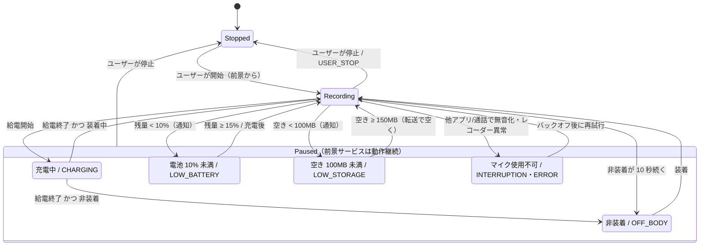
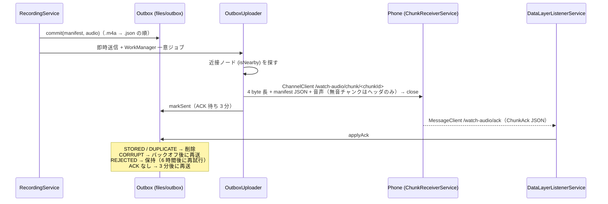

# Wear OS ウォッチ側の実装（常時録音・チャンク化・スマホへの直接転送）

対象 Issue: [M1-4 (#16)](https://github.com/Soichiro5/watch-audio/issues/16)（Wear OS 録音アプリ本実装）、[#41](https://github.com/Soichiro5/watch-audio/issues/41)（タイル / コンプリケーション）、[#43](https://github.com/Soichiro5/watch-audio/issues/43)（録音停止の通知）の Watch 側。

コアの目標「**装着している間はずっと録音** → チャンクを**直接接続（Bluetooth / Wi-Fi）でペアのスマホへ**送る（クラウド経由は使わない）→ スマホで文字起こし・保存」のうち、Watch 側を `apps/wear` に実装した。充電中・就寝中（外している間）の欠損は許容する。スマホ側は [android-phone.md](android-phone.md) を参照。

## 1. コンポーネント

`apps/wear/src/main/kotlin/app/watchaudio/wear/` 以下。**太字**は Android 非依存の純粋 Kotlin で、`src/test` に JUnit テストがある。

| クラス | 場所 | 役割 |
| --- | --- | --- |
| `WearApp` / `AppGraph` | `WearApp.kt` | `Application` と手書き DI。プロセス起動時に、前のプロセスが残した録音途中のチャンクを `TERMINATED` で確定し、アップロードを予約。録音 ON のまま止まっていたら「タップで再開」通知を出す |
| `WearPrefs` | `WearPrefs.kt` | `deviceId`（インストールごとに固定の UUID）、`armed`（ユーザーが録音 ON にしているか）、送信 ON/OFF、最終 ACK 時刻 |
| `RecordingService` | `recording/` | `microphone` 前景サービス + Ongoing Activity。イベントを `RecorderPolicy` に渡し、結果（録音 / 一時停止 / 停止）を適用する |
| `RecorderInput` | `recording/` | 録音入力のインターフェース（ファイル開始・ローテーション通知・ピーク値・時計）。本番は常に `ChunkRecorder`（マイク）。debug ビルドだけ音声ファイルに差し替えられる（§11） |
| `ChunkRecorder` | `recording/` | `MediaRecorder` ラッパ（`RecorderInput` の本番実装）。`RecordingFormat.CURRENT`（AAC-LC 16 kHz mono 24 kbps）、`setNextOutputFile` による無音ギャップなしのローテーション |
| **`ChunkTracker`** | `recording/` | 録音中チャンクの記帳（Mark・無音統計・ローテーション時の次チャンクへの引き継ぎと開始時刻の連結） |
| **`RecorderPolicy` / `InterruptionBackoff`** | `recording/RecorderPolicy.kt` | 状態機械（§3）。優先順位・猶予・ヒステリシス・アラート判定・リトライ間隔 |
| **`SilenceDetector`** | `recording/` | `getMaxAmplitude()` の 1 秒ごとのピーク値から「チャンク全体が確実に無音か」を判定 |
| **`ChunkJournal` / `RecordingDir`** | `recording/` | 録音中チャンクのジャーナル（`files/recording/<id>.journal.json`） |
| **`ChunkFinalizer`** | `recording/` | 閉じたチャンクの無音判定・SHA-256・manifest 作成 → outbox へ。プロセス死後の回収（`recoverLeftovers`） |
| **`Mp4Probe`** | `recording/` | MP4 のトップレベル `moov` box の有無（= 正常に閉じたか）を判定 |
| `BatteryMonitor` / `OffBodyMonitor` | `recording/ConditionMonitors.kt` | `ACTION_BATTERY_CHANGED`（残量・給電）、`TYPE_LOW_LATENCY_OFFBODY_DETECT`（装着検出） |
| `RecorderAlerts` | `recording/` | 前景通知（Ongoing Activity）と停止アラート（通知 + ハプティクス） |
| **`Outbox`** | `outbox/` | 送信待ちチャンクの永続キュー（`files/outbox/`）と ACK の処理 |
| **`ChunkFrameWriter`** | `outbox/` | `ChunkFrame.header(manifest)` + 音声バイト列をストリームへ書く |
| `OutboxUploader` | `outbox/` | 近接ノードを探して `ChannelClient` で 1 チャンク 1 チャネル送信 |
| `UploadWorker` / `UploadScheduler` | `outbox/UploadWorker.kt` | 即時送信 + WorkManager（一意ジョブ・15 分ごとの定期ジョブ） |
| `DataLayerListenerService` | `outbox/` | `/watch-audio/ack` の ACK 受信、スマホ再接続（capability 変化）で再送要求 |
| `RecorderTileService` / `RecorderComplicationService` | `tile/` | タイル・SHORT_TEXT コンプリケーション。タップでアプリを開く |
| `MainActivity` / `RecorderScreen` | `MainActivity.kt` / `ui/` | Compose for Wear OS (Material 3) の画面 |
| **`DiagnosticsLog`** | `diag/` | イベントと電池残量の CSV（上限付き） |
| `BootReceiver` | `BootReceiver.kt` | 再起動後にプロセスを起こす（実処理は `WearApp`） |

## 2. 録音とチャンク

- **形式**: AAC-LC / 16 kHz / mono / 24 kbps、MPEG-4（`.m4a`）。プロトコルの `AudioCodec.AAC`。値は `shared/protocol` の `RecordingFormat.CURRENT`（watchOS と共通。両側が `shared/protocol/testdata/recording-format.json` と一致することをテストする）から取る。
- **チャンク長**: 約 5 分。`setNextOutputFile` はファイルサイズ上限（`setMaxFileSize`）でしか機能しないため、`24 kbps × 300 s ≈ 900 KB`（`ChunkRecorder.CHUNK_BYTES`）をサイズ上限にしている。上限が近づく（`MAX_FILESIZE_APPROACHING`）と次のファイルを渡し、エンコーダが切り替えた瞬間（`NEXT_OUTPUT_FILE_STARTED`）を正確な境界とする。
- **時刻**: 最初のチャンクは `start()` 直後の壁時計。以降のチャンクの `startedAtEpochMs` は「前チャンクの開始 + `elapsedRealtime` で測った長さ」で求めるので、連続するチャンクは隙間も重なりもなくつながる（壁時計の補正の影響を受けない）。
- **ID**: `chunkId` はチャンクごとの UUID。`sessionId` は録音開始ごとの UUID（一時停止→再開でも新しいセッション。manifest の定義「開始から、理由を問わず停止するまで」に従う）。`deviceId` はインストールごとに固定。
- **Mark**: 現在のチャンク先頭からのオフセット（ms）として `markOffsetsMs` に記録する。チャンクは区切らない（watchOS も同じ。[02 §6.1「両 Watch で共通の録音ルール」](../architecture/02-architecture.md#両-watch-で共通の録音ルール137)）。
- **ジャーナル**: 録音中のチャンクは `files/recording/<id>.m4a` と `<id>.journal.json`（開始時刻・Mark・無音統計・最終生存時刻）。ジャーナルは開始時・Mark 時・30 秒ごとに書き換える。
- **確定**: チャンクを閉じたら SHA-256（`shared/platform` の `sha256Of`。スマホ側の検証と同じ実装）とサイズを計算し、音声を `files/outbox/<id>.m4a` へ移動 → manifest を `files/outbox/<id>.json` に**最後に**原子的に書く（`.tmp` → rename）。
- **プロセスが死んだ場合**: 次にプロセスが起動したとき（`WearApp.onCreate`。録音中のレコーダーは存在し得ないタイミング）にジャーナルが残っていれば `endReason = TERMINATED` で確定する。長さは最終生存時刻（30 秒ごと）まで。`MediaRecorder` が `stop()` されないと MP4 の `moov` が書かれず再生できないため、その場合は音声を捨てて **`durationMs = 0` の manifest**（欠損の開始位置と理由だけを伝える）にする。`audio == null` で長さがあると、スマホ側では「無音区間」と解釈されてしまうため。→ 最悪でも失うのは録音中の 1 チャンク（≤ 5 分）。

### 2.1 無音スキップ

- 1 秒ごとに `MediaRecorder.getMaxAmplitude()`（前回呼び出し以降のピーク、0〜32767）を取り、チャンクごとに集計する。
- しきい値 `SilenceDetector.SILENCE_PEAK_THRESHOLD = 328`（= -40 dBFS ピーク）。**一度でも届いたら音声を残す**。さらに、取得回数が想定の 80 % 未満（ポーリングが止まっていた）や 10 回未満（短すぎる）の場合も残す。-40 dBFS と 80 % は watchOS と共通の `RecorderRules`（`shared/protocol`）から取る（#137、[02 §6.1](../architecture/02-architecture.md#両-watch-で共通の録音ルール137)。以前は 300 ≈ -40.8 dBFS）。
- 無音と判定したチャンクは音声を削除し、`audio = null` の manifest（時間範囲は残る）を送る。
- しきい値は保守的（音声を残す側）に置いた。実機で寝室・静かな会議室・屋外の雑音レベルを測って調整する（§8）。

## 3. 状態機械

`RecorderPolicy.decide(conditions, now)` が入力（ユーザーの開始/停止、給電、電池残量、装着、空き容量、割り込み）から状態を決める。サービスは `Recording` から外れるときに、理由に対応する `ChunkEndReason` でチャンクを閉じる。



- **優先順位**（同時に成り立つとき）: 充電 > 非装着 > 電池残量低下 > 容量不足 > 割り込み。
- **非装着の猶予 10 秒**: ベルトの付け直しなどでチャンクが細切れにならないように。装着に戻ったら即再開。センサーがない機種・まだ値が来ていない間は「装着中」とみなす。
- **ヒステリシス**: 電池は 10 % 未満で停止・15 % 以上で再開（充電すれば解除。watchOS と共通の `RecorderRules`、#137 で 5 % 以下・10 % 以上から変更）、容量は 100 MB 未満で停止・150 MB 以上で再開。
- **割り込み**: `AudioRecordingCallback` で自分のセッションが `isClientSilenced` になった、またはポーリングで検出 → `INTERRUPTION` でチャンクを閉じる。`MediaRecorder` のエラー・開始失敗・ローテーション失敗は `ERROR`。いずれも 5 s → 15 s → 30 s → 1 min → 2 min → 以降 5 min 間隔で**ユーザーが停止するまで再試行し続ける**（前景サービスを止めると、バックグラウンドからは二度と開始できないため）。再試行直後 10 秒以内に再び無音化された「試し録り」は捨てる（前の `INTERRUPTION` から続く欠損として扱う）。30 秒正常に録れたら回復とみなす。
- **前景サービスは止めない**: 一時停止中も `microphone` 前景サービスを維持する。Android 14 以降は `microphone` 前景サービスをバックグラウンドから開始できないが、動作中のサービス内で録音を再開するのは許可されている。これが「装着したら自動再開」「充電器から外したら自動再開」を実現する鍵。

### 3.1 停止の通知（#43 の Watch 側）

通知（高優先度チャネル）+ ハプティクスを出すのは、ユーザーが予期しない停止だけ:

| 状況 | 通知 |
| --- | --- |
| ユーザー停止 / 充電 / 非装着 | なし（想定どおり） |
| 電池残量低下・容量不足 | 即時 |
| 割り込み | 2 分以上続いたとき、または開始失敗が 3 回続いたとき（短い割り込みでは鳴らさない） |
| プロセスが死んだ / 再起動後（録音 ON のまま） | 「タップで再開」。タップでアプリが開き、そこから再開する |

録音が回復すると通知は取り消す。

## 4. 転送と ACK



- **クラウドを経由しない**: 送信先は `Node.isNearby == true`（Bluetooth / Wi-Fi で直接つながっている）ノードのみ。`DataClient`（Google のサーバー経由で同期され得る）は使わない。スマホ側も送信元が近接ノードでなければ受信しない。
- **送信先の探し方**: まず capability `watch_audio_receiver` を持つ到達可能・近接ノード、なければ接続中の近接ノード。※現時点でスマホアプリはこの capability を宣言していないため、フォールバックで見つけている（§9）。
- **outbox の構成**: `<id>.m4a`（無音なら無し）、`<id>.json`（manifest。存在 = 送信待ち）、`<id>.state`（試行回数・次回送信時刻・REJECTED 等）。すべて `filesDir` 内なのでプロセスが死んでも残る。
- **再送**:
  - 送信失敗（チャネルが開けない・途中で切れた）: 30 s, 1 min, 2 min … 最大 30 min。
  - ACK なし: 完全に送った後 3 分（`Outbox.ACK_TIMEOUT_MS`）で再送対象（スマホは不正フレーム・中断・DB エラーでは ACK を返さない）。再送済みのチャンクは `DUPLICATE` が返り削除される。`ChannelClient` は送り終えた時点で相手に届いているので短くしている（watchOS は WatchConnectivity のキューのため 15 分。[02 §6.1](../architecture/02-architecture.md#両-watch-で共通の録音ルール137)）。
  - `UploadWorker` は送るものがなくなるまで送り、ACK 待ちが残っていれば WorkManager のバックオフ（30 s〜）で再実行。スマホが見つからないときはリトライせず終了し、①スマホの capability 変化（再接続）、②次のチャンク確定（録音中は約 5 分ごと）、③15 分ごとの定期ジョブ、のいずれかで再開する。
  - スマホに ACK の再送を頼むメッセージはない。ACK を失ったときの回復は Watch からの再送（`DUPLICATE` が返る）だけ。
- **同時実行**: サービスからの即時送信と WorkManager は同じプロセス内の `Mutex` で直列化。
- **送信 OFF スイッチ**: 画面の「スマホに送信」。電池計測で転送コストを切り分けるため（OFF でも outbox には溜まり、ON にすると送る）。

## 5. UI・タイル・コンプリケーション

- **文言は日本語**（#144）: 画面・タイル・コンプリケーション・通知・通知チャンネル名・debug ビルドのファイル入力画面の文言はすべて `res/values/strings.xml`（debug は `src/debug/res/values/strings.xml`）にあり、日本語。英語のままにするのはブランド名 `watch-audio`（`app_name`・`tile_label`）だけ。watchOS（`apps/ios/Watch`）と同じ言い回し（録音開始 / 停止 / 再開、未送信、電池、一時停止・充電中 など）に揃え、丸い小さな画面に収まる長さにする。単体テスト `WearStringsTest`（`src/test`、リソース XML を直接読む）が、英単語（ASCII 英字 2 文字以上。書式指定子とブランド名は除く）を含む文字列がないこと・ASCII だけの文字列がブランド名だけであること・コンプリケーションの短い文言が 3 文字以内であることを確認する。
- **アプリ画面**: 状態（録音中 / 一時停止・未装着 / 一時停止・充電中 / 一時停止・電池不足 / 一時停止・容量不足 / 一時停止・マイク使用中 / 停止中 / 停止中・タップで再開）、録音中の経過時間、「マーク」ボタン（セッション内の回数）、「未送信 N」、「最終受領 HH:mm」、「電池 N%」、「スマホに送信」スイッチ。画面下の大きな EdgeButton で 録音開始 / 停止 / 再開。
- **自動再開**: 録音 ON（`armed`）のままサービスが動いていない状態でアプリを開くと、その場で再開する（アプリが前景にあるので Android 14+ でも許可される）。
- **タイル**: 状態・送信待ち件数・ボタン（録音開始 / 再開 / 開く）。タップでアプリを開き（`from_tile` extra）、未録音なら開始・再開する。**タイルから直接前景サービスは開始できない**（Android 14+ の制約）ため、必ずアプリを経由する。
- **コンプリケーション**（SHORT_TEXT）: 録音中 / 未装着 / 充電中 / 電池少 / 容量満 / 中断 / 要再開（録音 ON なのに停止中）/ 停止（`status_short_*`、3 文字以内）。タイトルはブランド名、長い説明（`contentDescription`）はアプリ画面と同じ状態の文言。タップでアプリ。状態変化時に更新を要求する（定期更新なし）。
- **Ongoing Activity**: 録音中はストップウォッチ、一時停止中は理由を表示。
- **エミュレータでの確認（#41）**: CI `emulator.yml` の wear ジョブが `.github/scripts/wear-surfaces.sh` で、Wear OS のデバッグ用ブロードキャスト（`com.google.android.wearable.app.DEBUG_SURFACE` の `add-tile` / `set-complication`、`DEBUG_SYSUI` の `show-tile`）を使って Tile を表示し、現在の文字盤（`dumpsys wallpaper`）のスロットにコンプリケーションを設定する。停止中 → Tile のボタンをタップ（`uiautomator dump` でボタンの文言「録音開始」「再開」「開く」を探し、見つからなければ画面下寄りの中央。文言を変えたらスクリプトも直す）→ アプリが開いて録音開始 → 録音中、の順にスクリーンショットを撮る（成果物 `screenshots-wear`: `wear-tile-stopped.png` / `wear-tile-tap-opens-app.png` / `wear-tile-recording.png` / `wear-complication-*.png`）。エミュレータは AC 給電扱いで録音が「充電中」で止まるため、`dumpsys battery unplug` してから行う。マイク・通知の権限は `pm grant` で事前に付与（許可ダイアログを挟まないため）。音声入力はエミュレータの既定（ホストに入力がなければ無音）で、仮想マイクは使わない。
  - システム UI のブロードキャストはイメージによって動かないことがあるため、このスクリプトは失敗してもジョブを落とさず、`WEAR_SURFACE_CHECK step=… ok=false` としてジョブサマリーに出す。特に `set-complication` は公式ドキュメントに記載がなく（Android Studio の実行構成が使う形式）、文字盤のスロット番号も文字盤ごとに違うため、0–7・100–103 を順に試す。
  - 最初の CI 実行（run 38047480914）でわかったこと: 起動完了（`sys.boot_completed`）の後もしばらくシステム UI が「Starting…」画面のままで、その間のスクリーンショットはすべてこの画面だった → スクリプトは `uiautomator dump` で `starting_screen` が消えるまで最大 5 分待つ。既定の文字盤（Orbita）はスロット 0–2 が無効（`Complication slot is not enabled`）→ インストール済みの文字盤（`cmd package query-services -a android.service.wallpaper.WallpaperService`）を `set-watchface` で順に切り替えて試す。最後に adb が切断されスクリーンショットを回収できなかった → 撮るたびにその場で `adb pull` する。

## 6. 権限

| 権限 | 用途 | 必須 |
| --- | --- | --- |
| `RECORD_AUDIO` | 録音 | 必須（開始時に要求） |
| `FOREGROUND_SERVICE` / `FOREGROUND_SERVICE_MICROPHONE` | 前景サービス | 必須（インストール時） |
| `POST_NOTIFICATIONS` | 停止アラート・前景通知 | 任意（開始時に一度だけ要求。拒否してもハプティクスは出る） |
| `BODY_SENSORS`（`maxSdkVersion=35`） | Wear OS 4/5 での装着検出 | 任意。Wear OS 6（API 36）以降は要求しない。無くても登録を試み、イベントが来なければ「装着中」扱い |
| `VIBRATE` | ハプティクス | インストール時 |
| `RECEIVE_BOOT_COMPLETED` | 再起動後に「タップで再開」通知 | インストール時 |

バックアップ: `allowBackup=false` + `dataExtractionRules` ですべて除外（録音を OS バックアップ・端末移行に載せない）。

## 7. 診断ログ

- `/sdcard/Android/data/app.watchaudio/files/diagnostics/events.csv`（音声・内容は含まない）。512 KB を超えると `events.csv.1` に回して 1 世代だけ残す（最大 約 1 MB）。
- 列: `timestamp,battery_pct,charging,mode,pending_uploads,event,detail`
- 主なイベント: `armed` / `user_stop` / `mode`（状態遷移）/ `recording_started` / `chunk_closed`（理由・長さ・サイズ・silent・dropped・Mark 数）/ `chunk_recovered` / `mark` / `power_connected` / `on_body` / `off_body` / `interrupted` / `recovered` / `probe_discarded` / `alert` / `chunk_sent` / `send_failed` / `ack` / `phone_reachable` / `battery`（5 分ごと）/ `terminated` / `sticky_restart` / `boot_completed`。
- 取り出し: `adb -s <watch> pull /sdcard/Android/data/app.watchaudio/files/diagnostics`

## 8. 実機なしで検証できること / できないこと

**Linux で検証済み**: `./gradlew :apps:wear:testDebugUnitTest :apps:wear:assembleDebug :apps:wear:assembleRelease :apps:wear:lintDebug`（既知の音声をチャンク化して outbox まで流すテストは §11.4）。CI（`android.yml`）でも単体テスト（`:apps:wear:testDebugUnitTest`）・lint・debug ビルドと、R8 を使う release ビルド（debug 専用入力の混入検査を含む、#78）を毎回実行する。release の keep ルールは `apps/wear/proguard-rules.pro`（現状、アプリ独自のルールは不要: サービス類は manifest から、kotlinx.serialization・WorkManager・Wear のライブラリは同梱のルールで残る）。CI（`emulator.yml` の wear ジョブ）では Wear OS エミュレータで release（CI 内の使い捨て鍵で署名）と debug の起動確認に加えて、Tile・コンプリケーションの表示と Tile のタップでの録音開始のスクリーンショットを撮る（§5）。

| 検証できる（単体テスト） | 実機が必要 |
| --- | --- |
| 状態機械（優先順位・非装着の猶予・電池/容量のヒステリシス・割り込みのアラート条件・バックオフ） | `MediaRecorder` の `setNextOutputFile` が本当に無音ギャップなしで切り替わるか、`NEXT_OUTPUT_FILE_STARTED` 時点で前ファイルの `moov` が書かれているか（コードは最大 10 秒待つ） |
| 無音判定（しきい値・カバレッジ・短すぎるチャンク） | 無音しきい値（-40 dBFS、watchOS と共通）が実環境で妥当か |
| チャンク確定（SHA-256・サイズ・Mark の並べ替えと範囲内への丸め・無音/破損時の manifest） | オフボディセンサーの有無・権限の要否・反応（Pixel Watch / Galaxy Watch） |
| プロセス死後の回収（`moov` 有無で音声を残すか、孤立ファイルの掃除） | 通話・アシスタント・他アプリ録音時の `isClientSilenced` と自動復帰 |
| outbox の ACK 処理（削除・再送・保持・タイムアウト・永続化） | 充電器に置いた/外したとき・装着/非装着のときの自動停止/再開 |
| フレームの組み立て（ヘッダ + 音声、無音はヘッダのみ）がスマホ側の読み取りと一致 | Data Layer の近接判定・チャネル転送・ACK の往復、再接続時の再送 |
| 診断ログのローテーション | Android 14+ での前景サービス開始制約（タイル→アプリ→開始、再起動後の通知） |
| | 電池消費（M0-4 の計測手順で実施） |

## 9. 既知の制約・未解決事項

- **スマホ側 capability**: スマホアプリが `res/values/wear.xml` で `android_wear_capabilities` に `watch_audio_receiver` を宣言すると、送信先の特定が確実になり、再接続時の `CAPABILITY_CHANGED` で即座に再送が始まる。未宣言の間は「接続中の近接ノード」へのフォールバックと、チャンク確定・定期ジョブでの再送に頼る。
- **プロセス死・再起動後は自動で録音を再開できない**: Android 14+ の制約。「タップで再開」通知・タイル・アプリを開く、のいずれかで再開する。`START_STICKY` での再起動時も前景化を試みるが、多くの場合拒否される。
- **一時停止中のタイマー**: 非装着の猶予・再試行のバックオフは `delay` で実装しており、録音していない間に端末がスリープすると遅れることがある（装着・給電のイベント自体はシステムが端末を起こして届ける）。問題になれば `AlarmManager` に置き換える。
- **録音中チャンクの喪失**: プロセスが強制終了されると、その時点のチャンク（≤ 5 分）は MP4 が閉じられず失われる（manifest は長さ 0 の `TERMINATED` として残る）。
- **REJECTED のチャンク**は 6 時間ごとに再送を試みる（スマホアプリの更新で受け付けられるようになる想定）。それまで Watch の容量を使う。
- Ongoing Activity のストップウォッチは `elapsedRealtime` 基準で渡している（実機で表示を確認）。

## 10. 実機での手動テスト チェックリスト

準備: Watch とスマホに同じ署名の debug ビルドを入れる（`./gradlew :apps:wear:installDebug :apps:android:installDebug`）。スマホ側でモデルを用意しておく。

1. **開始**: アプリで「録音開始」→ マイク・通知（Wear OS 4/5 は身体センサーも）を許可 → 「録音中」と経過時間が表示され、ウォッチフェイスに Ongoing Activity のアイコンが出る。
2. **ローテーション**: 12 分以上録音 → 診断ログに `chunk_closed ... rotation` が約 5 分ごと。スマホ側に届いたチャンクの境目を聞いて音が欠けていない。連続するチャンクの `startedAtEpochMs + durationMs` が次の `startedAtEpochMs` と一致。
3. **Mark**: 録音中に「マーク」を数回 → スマホ側のチャンクに Mark が正しい位置で付く。
4. **無音**: 静かな部屋に 6 分置く → そのチャンクが `silent=true`、スマホ側で音声なし・時間範囲あり。小声の会話でも `silent=false` になること（しきい値の確認）。
5. **非装着**: 外して机に置く → 約 10 秒で「一時停止・未装着」（`off_body`）、チャンクは `off_body` で閉じる。再装着で即再開（新しい session）。通知は出ない。
6. **充電**: 充電器に置く → 「一時停止・充電中」（`charging`）。外して装着 → 自動再開。外して机に置いたまま → 「一時停止・未装着」。
7. **割り込み**: 録音中に電話を受ける / アシスタントを起動 / 他の録音アプリ → `interrupted` → 終了後にバックオフで自動再開（`recovered`）。2 分以上続くと通知 + 振動。
8. **電池低下**: 10 % 未満 → 停止して通知 + 振動。15 % 以上に戻るか充電すると自動再開。
9. **容量不足**（任意）: スマホとの接続を切って長時間録音、またはダミーファイルで空きを減らす → `low_storage` で停止・通知、転送で空くと再開。
10. **転送 / ACK**: スマホのアプリで受信を確認。画面の「未送信」が 0 に戻り「最終受領」が更新される。`files/outbox` が空になる（`adb shell run-as app.watchaudio ls files/outbox`）。
11. **切断と再送**: スマホの Bluetooth を 30 分 OFF → 「未送信」が増える → ON に戻すと数分以内に全件送られ ACK される（`phone_reachable` または次のチャンク確定で再開）。
12. **ACK 消失**: ACK 受信前に Watch の Bluetooth を切る → 3 分以上後に再送され `duplicate` の ACK で削除される。
13. **プロセス死**: `adb shell am kill app.watchaudio`（または `force-stop`）→ 次の起動で `chunk_recovered`（`terminated`、長さ 0）。数秒後に「タップで再開」通知 → タップで再開。
14. **再起動**: 録音中に Watch を再起動 → 起動後に「タップで再開」通知。タイルからも再開できる。
15. **タイル / コンプリケーション**: 状態に応じて表示が変わる。タップでアプリが開き、停止中なら開始する。
16. **停止**: 「停止」→ 前景通知が消え、最後のチャンクが `user_stop` で閉じて送られる。以後は自動再開しない。
17. **プライバシー**: スマホの Bluetooth だけを OFF（Wi-Fi は別ネットワークで ON）にし、Watch とスマホが Data Layer のクラウド経由でしかつながらない状態にする → Watch は送らない（`isNearby == false` → 「未送信」が溜まるだけ）。

## 11. 音声ファイル入力（開発用）

対象 Issue: [#57](https://github.com/Soichiro5/watch-audio/issues/57)。エミュレータや CI にはマイク入力がないため、**debug ビルドに限り**マイクの代わりに音声ファイルを録音処理へ流せる。エンコード（AAC-LC 16 kHz mono 24 kbps）・約 5 分ごとのチャンク分割・無音判定・ジャーナル・manifest 作成・outbox・送信は本番と同じコードを通る。

### 11.1 仕組み

- `RecordingService` は録音入力を `AppGraph.recorderInputFactory`（`RecorderInput.Factory`）から作る。既定値はマイク（`ChunkRecorder`）で、release ビルドではこれ以外にならない。
- debug 用のコードはすべて `apps/wear/src/debug`（パッケージ `app.watchaudio.wear.debug`）にあり、release ビルドには含まれない:

| クラス | 役割 |
| --- | --- |
| `DebugAudioInputActivity` | adb またはメイン画面の「Debug: audio file input」ボタン（debug ビルドにだけ出る）から開く画面。ファイルを選ぶ / Intent extra で指定すると、入力をファイルに切り替えて録音サービスを（再）起動する |
| `DebugAudioInput` | 入力の切り替え（`recorderInputFactory` をファイル入力 ⇔ マイク）、入力ファイルの置き場所 |
| `FileRecorderInput` / `FilePlayback` | `RecorderInput` のファイル版。書き込みスレッドで読み込み → 指定速度でペース配分 → エンコード。一時停止（充電・非装着など）からの再開は前回の続きから再生する |
| `WavPcmSource` / `MediaPcmSource` / `PcmConverter` | 16-bit WAV を直接読む / それ以外（m4a, mp3, ogg, flac など）は `MediaExtractor` + `MediaCodec` でデコード。チャンネル平均と線形補間で 16 kHz mono に変換 |
| `PcmChunker` / `AacChunkSink` | 音声 5 分（`RecordingFormat.CURRENT.chunkDurationMs`）ごとにファイルを切り替え、`MediaCodec`（AAC-LC）+ `MediaMuxer` で本番と同じ形式の `.m4a` を書く。前回のポーリング以降のピーク値（`getMaxAmplitude()` 相当）を返す |

- **時計**: ファイル入力の時計は「再生した音声の長さ」。チャンクの長さ・Mark のオフセットは倍速でも音声上の正確な値になる。レベルのポーリングも音声 1 秒ごと（実時間では `1 秒 ÷ 速度`）に行うので、無音判定の条件（カバレッジ 80 % 以上）は本番と同じ。
- **時刻**: 最初のチャンクの `startedAtEpochMs` は開始時の壁時計、以降は本番と同じく「前チャンクの開始 + 長さ」。倍速では実際の時刻より先に進む（1 時間分の音声を 10 倍速 = 実時間 6 分で流すと、終わりの時刻は実際より約 54 分先になる）。
- **ファイルの終わり**: 録音サービスを停止し、最後のチャンクを `user_stop` で閉じる（`loop` 指定時は先頭に戻って続ける）。その後の入力はマイクに戻る。
- **リリースへの混入防止**: `assembleDebug` / `assembleRelease` は `verify<Variant>DebugInput` タスクに依存する（`build-logic` の `VerifyDebugInputTask`。`apps/wear` が `watchaudio.android.debug-input-guard` プラグインで登録し、検索するパッケージは namespace + `.debug`）。APK の dex を `app/watchaudio/wear/debug/` で、merged manifest を `app.watchaudio.wear.debug.` で検索し、debug では「ある」（検索が機能していることの確認）、release では「ない」ことを確認して、混入していればビルドを失敗させる。release は R8 で難読化されるため（#78）、R8 の mapping（元のクラス名の一覧）も `app.watchaudio.wear.debug.` で検索する。結果は `apps/wear/build/reports/debug-input/<variant>.txt`。CI は `android.yml` の `assembleRelease` で release 側の検査を毎回実行し、結果をジョブサマリーに出す。

### 11.2 エミュレータでの使い方

```bash
# 1. debug ビルドを入れ、マイク権限を付与（ファイル入力でも microphone 前景サービスとして動くため必要）
./gradlew :apps:wear:installDebug
adb -s <watch> shell pm grant app.watchaudio android.permission.RECORD_AUDIO

# 2. エミュレータは「AC 充電中」を報告するので、そのままだと Paused · charging になる
adb -s <watch> shell dumpsys battery unplug

# 3. 入力ファイルを置く（どちらか）
#    a) アプリ専用の外部ストレージ（adb push できる）
adb -s <watch> shell mkdir -p /sdcard/Android/data/app.watchaudio/files/debug-input
adb -s <watch> push test.wav /sdcard/Android/data/app.watchaudio/files/debug-input/
#    b) アプリ内部の files/debug-input（run-as。バイナリを壊さないよう exec-in を使う）
adb -s <watch> shell run-as app.watchaudio mkdir -p files/debug-input
adb -s <watch> exec-in run-as app.watchaudio sh -c 'cat > files/debug-input/test.wav' < test.wav

# 4. 開始（file: ファイル名 = 上の 2 か所を内部 → 外部の順に探す、または絶対パス。
#    speed: 1〜120 倍、省略時 1。loop: 終わったら先頭から繰り返す）
adb -s <watch> shell am start -n app.watchaudio/app.watchaudio.wear.debug.DebugAudioInputActivity \
    --es file test.wav --ef speed 10
adb -s <watch> shell am start -n app.watchaudio/app.watchaudio.wear.debug.DebugAudioInputActivity \
    --es file test.wav --ef speed 30 --ez loop true

# 5. 途中で止めてマイクに戻す（最後のチャンクは user_stop で閉じる）
adb -s <watch> shell am start -n app.watchaudio/app.watchaudio.wear.debug.DebugAudioInputActivity --ez stop true

# 6. 結果を見る
adb -s <watch> shell run-as app.watchaudio ls -l files/recording files/outbox
adb -s <watch> shell run-as app.watchaudio sh -c 'cat files/outbox/*.json'
adb -s <watch> pull /sdcard/Android/data/app.watchaudio/files/diagnostics   # debug_input / chunk_closed など

# 後片付け
adb -s <watch> shell dumpsys battery reset
```

- 画面からも操作できる: メイン画面の一番下の「デバッグ: 音声ファイル入力」→ 速度（×1 / ×10 / ×30 / ×60 を順に切り替え）・「繰り返し」を選び、ファイル名をタップ。「停止してマイクに戻す」で停止してマイクに戻す。
- 録音が動いている最中に開始すると、いったん停止（`user_stop`）してからファイル入力で開始し直す。
- スマホとペアになっていれば、できたチャンクは通常どおり送られる（outbox に残して見たいときはメイン画面の「スマホに送信」を OFF）。
- 検証用の音声: 16 kHz mono 16-bit WAV が最も確実（例: `ffmpeg -i in.m4a -ac 1 -ar 16000 -c:a pcm_s16le test.wav`）。他のレート・チャンネル数の WAV や、端末がデコードできる形式も受け付ける。無音判定を確かめるときは、無音区間の手前 1 秒程度も静かにしておく（ローテーション直後の最初のポーリングは前チャンク末尾のピークも含むため。マイクでも同じ）。
- 期待される結果の例: 12 分 30 秒のファイル → 5 分・5 分・2 分 30 秒の 3 チャンク（`rotation`, `rotation`, `user_stop`）。5 分間ほぼ無音のチャンクは `audio` なしの manifest。

### 11.3 制約

- 入力デバイスのエミュレーションではないので、`isClientSilenced`（通話・他アプリの録音による割り込み）は起きない。充電・非装着・電池・容量の判定は本番と同じに働く（エミュレータに装着センサーがなければ「装着中」扱い）。
- 倍速時はローテーションの実時間間隔が短い（60 倍速で 5 秒）。エンコードがペースに追いつかない場合は、実際の再生速度が指定より遅くなるだけで、チャンクの長さ・内容は変わらない。
- エンコードはチャンクごとに `MediaCodec` を作り直すため、チャンクの先頭に AAC のプライミング分（数十 ms）が入る。`MediaRecorder` の `setNextOutputFile` による切り替えとは境界の細部が異なる。

### 11.4 開発環境でのテスト（エミュレータ不要）

`./gradlew :apps:wear:testDebugUnitTest` に含まれる（`src/testDebug`）。`MediaCodec` は JVM で動かないため、AAC エンコーダだけを PCM をそのまま書くスタブに置き換え、それ以外は本番・debug と同じクラスを通す。

| テスト | 内容 |
| --- | --- |
| `FileInputPipelineTest` | 合成した 12 分 30 秒の WAV（音 → 静かな部屋 → 音）を `WavPcmSource` → `PcmChunker` → `ChunkTracker`（音声 1 秒ごとのポーリング・Mark）→ `ChunkFinalizer` → `Outbox` に流し、outbox に 3 チャンク（300 s / 300 s / 150 s、`rotation` / `rotation` / `user_stop`）、開始時刻の連結、2 つ目が `audio == null`（無音）、Mark の位置、音声がサンプル単位で元の区間と一致（SHA-256）することを確認。48 kHz ステレオの変換、短すぎて無音と判定しないケースも |
| `PcmChunkerTest` | ブロック境界に依らない正確なローテーション位置、次ファイルが無いときの停止、ピーク値、`PcmConverter` のストリーミング一致とチャンネル平均、WAV の読み込み・再開位置へのスキップ・非対応形式の拒否 |
| `ChunkTrackerTest`（`src/test`） | Mark のオフセット、ローテーションでの開始時刻の連結・統計のリセット、終了時の長さ |
