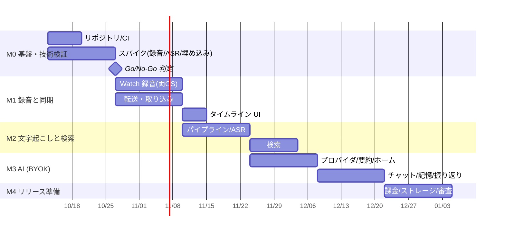

# 03. 実装手順（ロードマップ）

> ## 現在のゴール（2026-10-10 確定）
>
> **Watch 経由で常時録音し、それが文字起こしされ、データがローカルにたまっていく**ところまでを最優先で達成する。
>
> - 装着中は常に録音（充電中・就寝中は止まってよい）
> - データは端末内のみ。クラウドには上げない（Watch→スマホ転送も Bluetooth/直結のみ）
> - 文字起こしはオンデバイス
> - **AI 要約・チャット（M3）は後回し**（将来はクラウド LLM 利用も可）。本人の AI エージェントからデータを使う連携（UC11、2026-10-11 追加）も同じく後回し。意味検索（#24）・課金（#34）・ストア申請も後回し
> - 実機がない間は「音声ファイル注入」「JVM 上の E2E」「エミュレータ/シミュレータ CI」で検証する（#44）
>
> コアに含む Issue: M1（#13〜#19, #41, #43, #44）、M2（#20〜#23, #25）

## ユースケースとリリース

ロードマップは GitHub 上で次の形で管理する（2026-10-11 から）。

- **ユースケース** = 親 Issue（`usecase` ラベル）。使う人から見た「できるようになること」、使う人の流れ、使う人から見た完了条件を書く。実現に必要な作業 Issue を **sub-issue** としてぶら下げるので、進み具合が親 Issue に表示される。
- **リリース** = **Milestone**。どのユースケースをどのリリースで実現するかを表す（ユースケースとその作業 Issue に同じ Milestone を付ける）。
- 開発の進め方（CI・開発フロー・リポジトリ構成）の Issue は、ユースケースに属さず `dev-flow` ラベルで扱う。

v0.1 では、**自分の Watch とスマホに入れて 1 日中録音し、夜に検索して聞き返す**ことが一通りできる状態を目指す。

ユースケースの状態は次の 4 つで表す（ダッシュボードも同じ）。

| 状態 | 意味 |
| --- | --- |
| ⬜ 未着手 | まだ作業を始めていない |
| 🛠 開発中 | 開発環境での作業が残っている |
| 🧪 実機確認待ち | 開発環境では完成。実機での確認だけが残っている |
| ✅ 完了 | 実機で確かめ、ユースケースを閉じた |

### 現在地（2026-10-12）

| リリース | 状態 | 次にやること | 担当 |
| --- | --- | --- | --- |
| **v0.1 実機で 1 日使える** | 🧪 実機確認待ち | 実機で数日使い、UC1〜UC4 の完了条件を確かめる: #59（Wear OS）・#60（watchOS / iPhone）・#61（Android スマホ）、電池計測 #9・#10、ASR の実機比較 #11 | オーナー（実機） |
| v0.2 毎日使える品質 | 🧪 実機確認待ち | 英語 #81（Android、設定で ON にした人だけ英語モデル約 240 MB を追加）・#105・#94・#52 は開発環境で完了。実機での確認（#59・#60・#61）が残る。iOS の英語 #170 も開発環境で完了（実機確認は #60） | オーナー（実機） |
| v0.3 人に配れる | 🛠 開発中 | 書き出し #155・暗号化バックアップ #40・音声のオフロード #156・身体センサーの説明 #161 は開発環境で完了（実機確認は #59〜#61）。差分バックアップ #164・ライセンス画面 #167 も完了。配布する Android アプリから GPL の音声合成（eSpeak NG）を外す #173 も完了（上流の sherpa-onnx を CI でオプションだけ変えてビルド）。残りはオーナーの判断待ち:プライバシーポリシーの公開とアプリ内リンク（#36・#159）は運営者情報と公開 URL、ベータ配信 #35・課金 #34 は開発者アカウントと価格、英語モデル（FunASR のライセンス）を配るかは #167 で判断が要る | Claude（開発）・オーナー（アカウント・価格・運営者情報・ライセンスの判断・法務確認） |
| AI で振り返る（P2） | 🛠 開発中 | 意味で探せる検索 #24 は Android で完了（実機確認は #61）。次: iOS の意味検索 #178。要約・振り返り・チャット（#26〜#31・#39）は未着手 | Claude |
| エージェント連携（P2） | ⬜ 未着手 | 方針は決定（中継サーバーなし、LAN 方式、ローカル LLM も対応。[research/agent-access.md](../research/agent-access.md)）。残りの詳細を #131 で決める | Claude（設計） |
| Phase 2 | ⬜ 未着手 | — | — |

| リリース | ユースケース | 状態 |
| --- | --- | --- |
| v0.1 | [UC1](https://github.com/Soichiro5/watch-audio/issues/110) Watch をつけていれば、何もしなくても会話が録音されスマホにたまる | 🧪 実機確認待ち（#59・#60・#9・#10） |
| v0.1 | [UC2](https://github.com/Soichiro5/watch-audio/issues/111) 夜に、その日の会話を一覧で見て、キーワードで探し、その場面を聞き返せる | 🧪 実機確認待ち（#61・#11） |
| v0.1 | [UC3](https://github.com/Soichiro5/watch-audio/issues/112) 録音が止まっていたら気づけて、すぐ再開できる | 🧪 実機確認待ち（#59〜#61 の中で確認） |
| v0.1 | [UC4](https://github.com/Soichiro5/watch-audio/issues/113) データは自分の端末にだけ残り、消したいときに消せる | 🧪 実機確認待ち（#60 の保護クラス） |
| v0.2 | [UC5](https://github.com/Soichiro5/watch-audio/issues/114) 雑音の中や英語まじりの会話でも、ちゃんと文字になる | 🧪 実機確認待ち（雑音 #71・短い誤認識 #105・英語 #81（Android）は開発環境で完了。実機の生活音・英語は #61。iOS の英語 #170 も開発環境で完了し、実機確認は #60） |
| v0.2 | [UC6](https://github.com/Soichiro5/watch-audio/issues/115) 何年分でもスマホにためておける | 🧪 実機確認待ち（DB 1 年 644 MB #94・音声 11.1 MB/時 #52 は完了。実機 1 日分の音声容量は #59・#60） |
| v0.3 | [UC7](https://github.com/Soichiro5/watch-audio/issues/116) 自分以外の人が、アプリを入手して使い始められる | 🛠 開発中（release ビルド #78・Watch とスマホの日本語化 #144・身体センサーの説明 #161・ライセンス画面 #167 は完了。GPL 部品の除去 #173 も完了。配布物の判断（SenseVoice・ライセンス本文）は #167 でオーナー待ち。プライバシーポリシー #36 は運営者情報待ち、#35・#34 はアカウントと価格の方針待ち） |
| v0.3 | [UC8](https://github.com/Soichiro5/watch-audio/issues/117) 機種変更や故障でも、ためたデータを失わない | 🧪 実機確認待ち（書き出し #155・暗号化バックアップと復元 #40・音声のオフロード #156・差分バックアップ #164 は開発環境で完了。実機確認は #60・#61） |
| AI（P2） | [UC9](https://github.com/Soichiro5/watch-audio/issues/118) ためた会話を、AI の要約や振り返り・チャットで使える | 🛠 開発中（意味で探せる検索 #24 は Android で完了、iOS は #178。要約・チャットは未着手） |
| エージェント連携（P2） | [UC11](https://github.com/Soichiro5/watch-audio/issues/130) スマホにためた会話を、自分の AI エージェント（Claude・ChatGPT など）から安全に使える | ⬜ 未着手（方針は決定、詳細は #131） |
| Phase 2 | [UC10](https://github.com/Soichiro5/watch-audio/issues/119) 体調や場所と合わせて振り返れる | ⬜ 未着手 |

開発の進め方: リファクタ #133〜#138・録音ルールの統一 #137 は完了。残りは #47（10/17 に完了確認）と #85（最後）。

ユースケースは、作業 Issue がすべて閉じ、使う人から見た完了条件を（多くは実機で）確かめたら閉じる。

以下の「M0〜M4・Phase 2」の節は、当初の計画（Epic #1〜#6、2026-10-11 に上のユースケースへ移行して閉じた）の記録として残す。

## 作業 Issue ごとの記録（2026-10-11 時点）

最新の状況は Issue ダッシュボード（`python3 tools/roadmap-view/build.py out.html` で生成）で確認できる。ユースケースごとに作業 Issue（sub-issue）から状態を 1 つ決めて表示する（✅ 完了 = ユースケースの Issue が閉じている、🧪 実機確認待ち = 開いている作業 Issue がすべて `needs-device` かゼロ、⬜ 未着手 = 閉じた作業 Issue も `in-progress` の作業 Issue もない、🛠 開発中 = それ以外）。リリース（Milestone）ごとに、全体の状態（いちばん遅れているユースケース）と「次にやること・担当（Claude（開発）／オーナー（実機））」を 1 行で示し、現在のリリースを先頭に大きく表示する。作業 Issue の一覧はユースケースごとに折りたたむ。続けて開発の進め方（`dev-flow`）と、どちらにも属さない開いた Issue（「未分類」。空であることを確かめる欄）を表示する。

進め方: 開発環境（単体テスト・ハーネス・エミュレータ/シミュレータ CI）で確認できる完了条件を証跡付きで満たした Issue から閉じる。実機でしか確認できない条件は実機検証 Issue（#59 Wear OS、#60 watchOS/iOS、#61 Android スマホ）にまとめている。

| 領域 | 状態 | 内容 |
| --- | --- | --- |
| 基盤・CI（#7, #8） | ✅ クローズ | KMP モノレポ、4 アプリのビルド、エミュレータ/シミュレータでの起動確認（GitHub Actions） |
| CI の待ち時間短縮（#92） | 🟡 着手（dev-flow） | 変更したファイルに関係するワークフローだけを動かす（ドキュメントだけの変更では CI を動かさない、[04 §6.3](../dev/04-dev-environment.md#63-どの変更でどのワークフローが動くか92)）。iOS ジョブの 3 分割は効果がなかった（最長ジョブ 20.9 分、macOS の合計使用量 1.7 倍）ため見送り。残り: シミュレータの起動・初期化の繰り返しを減らす |
| 実機なし検証基盤（#44） | ✅ クローズ | JVM 上の E2E（Watch シミュレータ → 取り込み → 日本語 ASR → SQLite → 検索）、エミュレータでの計装テスト（本番の Ingestor で取り込み → 再生）、iOS シミュレータでの共通テスト |
| 検証用の音声・ファイル入力（#56, #57） | ✅ クローズ | 正解テキスト付きの日本語会話音声セット（オフライン TTS、16 会話・約 29 分、Watch を模した加工 6 条件 + 1 日分）とハーネスの `evaluate`（#56、[test-audio.md](../dev/test-audio.md)）。debug ビルドで Watch のマイク入力を音声ファイルに差し替え（#57） |
| 技術検証（#9〜#11） | 🟡 実機待ち（needs-device） | デスクトップ比較は完了（[ASR](../research/m0-5-asr-desktop.md)・[埋め込み](../research/m0-6-embedding-desktop.md)）。電池計測は実機待ち |
| 転送プロトコル（#13） | ✅ クローズ | ChunkManifest / ChunkAck / フレーミング / テストベクタ |
| ローカル DB・取り込み（#14） | ✅ クローズ | bundled SQLite + FTS5（日本語部分一致）、冪等な Ingestor。JVM・Android エミュレータ・iOS シミュレータでテスト |
| Wear OS 録音・転送（#16, #18） | ✅ クローズ（実機確認は #59） | 常時録音、装着検出・充電で自動停止/再開、送信キュー + ACK。詳細: [impl/wearos.md](../platforms/wearos.md) |
| watchOS 録音・転送（#15, #17） | ✅ クローズ（実機確認は #60） | 停止理由の判定（`RecorderPolicyTests` 15 件）と送信キュー（`ChunkOutboxTests` 13 件）を CI の iPhone シミュレータで実行。Apple Watch シミュレータで起動確認。詳細: [impl/ios-watchos.md](../platforms/ios-watchos.md) |
| 文字起こし（#20, #21, #22） | ✅ クローズ（iOS の実際の認識は #60） | 再開可能なパイプライン + WorkManager / BGProcessingTask、sherpa-onnx（エミュレータで実モデル確認）、SpeechAnalyzer（シミュレータでは使えないため、Swift の結果が DB に入るまでを `IosTranscriberBridgeTest` で確認）。詳細: [impl/android-phone.md](../platforms/android-phone.md) |
| 会話で文が抜け落ちる問題（#68） | ✅ クローズ | ASR 入力を 20 秒以下に制限し、話者交代の間で分割（clean の CER 53.8% → 15.0%、wrist 84.1% → 21.4%）。詳細: [test-audio.md](../dev/test-audio.md) §4 |
| 雑音下の抜け落ち・セグメント増の影響（#71, #72） | ✅ クローズ（実機の雑音環境は #61。副作用の短い誤認識は #105） | 雑音で話者交代の間が埋まる会話の抜け落ち（#71）: 雑音の床を基準にした間で分割し、VAD のしきい値を 0.15 に下げた（発話の検出は自前の `speechSegments`、[02 §6.3](../architecture/02-architecture.md#発話区間の切り出しandroid--jvm-ハーネス6871)）。CER は office 65.4% → 25.9%、cafe 67.4% → 40.7%、outdoor 66.4% → 38.7%、day 59.6% → 28.8%（正解区間で切った場合の 1.5 倍以内）、clean / wrist / reazon_clean は 15.2% / 19.9% / 10.6%。実機の雑音での確認は #61。発話区間の細分化でセグメント数が 5〜6 倍になる影響（検索性能・DB 容量）の確認（#72） |
| 検索（#23, #72） | ✅ クローズ（中位機種の実測は #61） | #68 以降の発話単位で 1 年 320 万セグメント（DB 約 1 GB）でも p95 最大 約 150 ms（目標 300 ms）。1〜2 文字の検索は trigram 索引の語彙を使う。CI で毎回ベンチマーク |
| スマホ UI・再生（#19, #25） | ✅ クローズ（実機確認は #60・#61） | 日別タイムライン・文字起こし・検索・1 タップ再生。Android エミュレータと iOS シミュレータで、実際のプレーヤーが指定位置から再生することを確認。詳細: [impl/phone-ui.md](../platforms/phone-ui.md) |
| チャンク境界の発話分断（#45） | ✅ クローズ | 隣のチャンクの境界付近と連結して認識（[02 §6.3](../architecture/02-architecture.md#63-処理パイプラインphone)） |
| 録音途絶の通知・オンボーディング（#43, #32） | ✅ クローズ（実機確認は #59〜#61） | エミュレータで途絶通知の表示（`GAP_ALERT_CHECK`）、権限拒否 →「設定を開く」（`PERMISSION_CHECK`）、Watch 側の通知判定の単体テスト（Wear OS・watchOS） |
| Tile・コンプリケーション（#41） | ✅ クローズ（実機確認は #59・#60） | Wear OS はエミュレータで Tile・コンプリケーションの表示とタップでの録音開始を確認。watchOS は WidgetKit のコンプリケーション（録音中・一時停止・停止中）の描画と、`watchaudio://record` でアプリが開き録音が始まることをシミュレータで確認。詳細: [impl/ios-watchos.md §14](../platforms/ios-watchos.md#14-コンプリケーション41) |
| ストレージ管理（#33） | ✅ クローズ | 保持期間（既定は無期限、文字起こし済みの音声のみ削除）、容量の内訳・空き容量警告、日単位/全削除 |
| モデル配布サイズ（#46） | ✅ クローズ | 713 MB → 161 MB（int8 ファイルを個別取得、HTTP Range で途中再開、SHA-256 検証）。詳細: [impl/android-phone.md](../platforms/android-phone.md#31-ダウンロード受信のみ) |
| release ビルド・署名（#78） | ✅ クローズ | Android: R8 の release ビルドを CI で毎回作成し、エミュレータで release の起動と文字起こし（`RELEASE_ASR_CHECK`）を確認。iOS / watchOS: 署名なしの Release 構成のビルド。署名は Actions の secret があるときだけ（[04 §7.1](../dev/04-dev-environment.md#71-android-の-release-ビルドと署名78)） |
| データは端末内のみの CI 検査（#76） | ✅ クローズ（iOS の保護クラスの実際の値は #60） | 権限・バックアップ・通信箇所・依存 SDK・iOS の Info.plist/entitlements を許可リストで検査（`tools/privacy-check`）。未使用の ktor を削除。iOS/watchOS のデータにバックアップ除外と保護クラスを明示（[02 §7](../architecture/02-architecture.md#7-セキュリティプライバシー)） |
| スマホの診断ログ（#77） | ✅ クローズ | 受信・ACK・文字起こし（RTF）・モデル・途絶通知・異常終了を端末内の CSV（上限約 1 MB）に記録し、状態タブから共有シートで書き出す（本文・音声は含めない）。詳細: [impl/android-phone.md](../platforms/android-phone.md) §4.2 |
| 充電していないときの文字起こしと発熱（#75） | ✅ クローズ（実機の電池消費・発熱は #61） | 充電中はすべて、電池駆動では残量 50% 以上・省電力モードでない間だけ 1 時間に録音 10 分ぶんまで、発熱時（Android MODERATE / iOS serious 以上）は充電中でも休む。判定はチャンクごと（途中で止めない）。設定「充電中のみ文字起こしする」。目標は本アプリの文字起こしによる電池消費 1 日 3% 以下（推定）。詳細: [02 §6.3](../architecture/02-architecture.md#充電していないときの処理方針75)、[impl/android-phone.md](../platforms/android-phone.md) §4.0 |

## 全体の流れ

> 期間は 1〜2 名での目安。M0 のスパイク結果次第で M1 以降を見直す。

## M0: 基盤・技術検証（最重要: リスクの早期潰し）

Epic: [#1](https://github.com/Soichiro5/watch-audio/issues/1)

| コード | タスク | 依存 |
| --- | --- | --- |
| [M0-1 (#7)](https://github.com/Soichiro5/watch-audio/issues/7) | モノレポ初期化（KMP + Compose MP + Wear OS + iOS/watchOS） | - |
| [M0-2 (#8)](https://github.com/Soichiro5/watch-audio/issues/8) | CI 構築（GitHub Actions） | [M0-1 (#7)](https://github.com/Soichiro5/watch-audio/issues/7) |
| [M0-3 (#9)](https://github.com/Soichiro5/watch-audio/issues/9) | [Spike] watchOS 長時間バックグラウンド録音と電池計測 | - |
| [M0-4 (#10)](https://github.com/Soichiro5/watch-audio/issues/10) | [Spike] Wear OS 前景サービス録音と電池計測 | - |
| [M0-5 (#11)](https://github.com/Soichiro5/watch-audio/issues/11) | [Spike] オンデバイス日本語 ASR の精度・速度比較 | - |
| [M0-6 (#12)](https://github.com/Soichiro5/watch-audio/issues/12) | [Spike] 多言語埋め込みモデルの KMP 実行 | [M0-1 (#7)](https://github.com/Soichiro5/watch-audio/issues/7) |

**Go/No-Go 判定**: M0-3〜M0-5 の結果で「Wear OS 対応の可否・目標録音時間」「ASR エンジン」を確定し、`docs/architecture/02-architecture.md` を更新する。

## M1: 録音と同期

Epic: [#2](https://github.com/Soichiro5/watch-audio/issues/2)

| コード | タスク | 依存 |
| --- | --- | --- |
| [M1-1 (#13)](https://github.com/Soichiro5/watch-audio/issues/13) | チャンク/マニフェスト形式と転送プロトコル定義（shared/protocol） | [M0-1 (#7)](https://github.com/Soichiro5/watch-audio/issues/7) |
| [M1-2 (#14)](https://github.com/Soichiro5/watch-audio/issues/14) | DB スキーマと取り込み処理（shared/db / Ingestor） | [M1-1 (#13)](https://github.com/Soichiro5/watch-audio/issues/13) |
| [M1-3 (#15)](https://github.com/Soichiro5/watch-audio/issues/15) | watchOS 録音アプリ | M0-3, M1-1 |
| [M1-4 (#16)](https://github.com/Soichiro5/watch-audio/issues/16) | Wear OS 録音アプリ | M0-4, M1-1 |
| [M1-5 (#17)](https://github.com/Soichiro5/watch-audio/issues/17) | watchOS → iOS 転送（WatchConnectivity + ACK） | M1-2, M1-3 |
| [M1-6 (#18)](https://github.com/Soichiro5/watch-audio/issues/18) | Wear OS → Android 転送（Data Layer + ACK） | M1-2, M1-4 |
| [M1-7 (#19)](https://github.com/Soichiro5/watch-audio/issues/19) | 日別タイムラインと音声再生 UI（最小） | [M1-2 (#14)](https://github.com/Soichiro5/watch-audio/issues/14) |
| [M1-8 (#42)](https://github.com/Soichiro5/watch-audio/issues/42) | ~~スマホ録音へのハンドオフ（Watch 充電中・非装着時の 24h 継続）~~ 採用しない（not planned。充電中・就寝中は止まってよいため、[02 §9.1](../architecture/02-architecture.md#91-録音ソース-watch-のみスマホ録音へのハンドオフは採用しない)） | M1-2, M1-3, M1-4 |
| [M1-9 (#43)](https://github.com/Soichiro5/watch-audio/issues/43) | 録音の連続性監視とアラート（欠損区間の可視化） | M1-5/M1-6, M1-7 |
| [M1-10 (#41)](https://github.com/Soichiro5/watch-audio/issues/41) | Watch のコンプリケーション / Tiles（ワンタップ録音開始・再開） | M1-3, M1-4 |

**完了条件**: 両 OS で「Watch で録音 → スマホに届く → タイムラインで再生できる」。装着中（充電中・就寝中を除く）の録音カバー率 95% 以上、途絶は 10 分以内に通知（実機の確認は #59・#60）。

## M2: 文字起こしと検索

Epic: [#3](https://github.com/Soichiro5/watch-audio/issues/3)

| コード | タスク | 依存 |
| --- | --- | --- |
| [M2-1 (#20)](https://github.com/Soichiro5/watch-audio/issues/20) | ジョブスケジューラとパイプライン状態機械 | [M1-2 (#14)](https://github.com/Soichiro5/watch-audio/issues/14) |
| [M2-2 (#21)](https://github.com/Soichiro5/watch-audio/issues/21) | VAD + Transcriber 抽象 & iOS 実装（SpeechAnalyzer） | M0-5, M2-1 |
| [M2-3 (#22)](https://github.com/Soichiro5/watch-audio/issues/22) | Android Transcriber 実装（sherpa-onnx）とモデル配信 | M0-5, M2-1 |
| [M2-4 (#23)](https://github.com/Soichiro5/watch-audio/issues/23) | キーワード検索（FTS5 trigram） | M2-2 or M2-3 |
| [M2-5 (#24)](https://github.com/Soichiro5/watch-audio/issues/24) | セマンティック検索（埋め込み + RRF ハイブリッド） | M0-6, M2-4 |
| [M2-6 (#25)](https://github.com/Soichiro5/watch-audio/issues/25) | 検索 UI と文字起こし表示 | [M2-4 (#23)](https://github.com/Soichiro5/watch-audio/issues/23) |

**完了条件**: 録音した会話が翌朝までに日本語/英語で文字起こしされ、キーワード・意味の両方で検索できる。

## M3: AI（BYOK）

Epic: [#4](https://github.com/Soichiro5/watch-audio/issues/4)

| コード | タスク | 依存 |
| --- | --- | --- |
| [M3-1 (#26)](https://github.com/Soichiro5/watch-audio/issues/26) | LLM Provider 抽象と AI 設定画面 | [M0-1 (#7)](https://github.com/Soichiro5/watch-audio/issues/7) |
| [M3-2 (#27)](https://github.com/Soichiro5/watch-audio/issues/27) | 1 時間ごとの要約（要点・情報量スコア） | M2-1, M3-1 |
| [M3-3 (#28)](https://github.com/Soichiro5/watch-audio/issues/28) | ホーム画面（時間帯ごとの概要 + 要点） | [M3-2 (#27)](https://github.com/Soichiro5/watch-audio/issues/27) |
| [M3-4 (#29)](https://github.com/Soichiro5/watch-audio/issues/29) | 1 日の振り返り | [M3-2 (#27)](https://github.com/Soichiro5/watch-audio/issues/27) |
| [M3-5 (#30)](https://github.com/Soichiro5/watch-audio/issues/30) | 記憶（事実の抽出・編集・無効化） | [M3-2 (#27)](https://github.com/Soichiro5/watch-audio/issues/27) |
| [M3-6 (#31)](https://github.com/Soichiro5/watch-audio/issues/31) | チャット（RAG + 引用 + ストリーミング） | M2-5, M3-1, M3-5 |

**完了条件**: API キーを入れると、1 時間ごとのハイライトと日次振り返りが自動生成され、引用付きで過去の会話について質問できる。

## M4: リリース準備

Epic: [#5](https://github.com/Soichiro5/watch-audio/issues/5)

| コード | タスク | 依存 |
| --- | --- | --- |
| [M4-1 (#32)](https://github.com/Soichiro5/watch-audio/issues/32) | オンボーディング・権限・録音同意の注意喚起 | M1-3, M1-4 |
| [M4-2 (#33)](https://github.com/Soichiro5/watch-audio/issues/33) | ストレージ管理（保持期間・容量表示・全削除） | [M2-1 (#20)](https://github.com/Soichiro5/watch-audio/issues/20) |
| [M4-3 (#34)](https://github.com/Soichiro5/watch-audio/issues/34) | 買い切り課金（StoreKit 2 / Play Billing） | [M0-1 (#7)](https://github.com/Soichiro5/watch-audio/issues/7) |
| [M4-4 (#35)](https://github.com/Soichiro5/watch-audio/issues/35) | ベータ配信と実機長時間 QA（TestFlight / Play 内部テスト） | M3 全体 |
| [M4-5 (#36)](https://github.com/Soichiro5/watch-audio/issues/36) | ストア申請準備（審査対応・プライバシーポリシー・LP） | M4-1〜M4-4, M4-6 |
| [M4-6 (#40)](https://github.com/Soichiro5/watch-audio/issues/40) | E2E 暗号化バックアップとエクスポート（「すべて残す」ため MVP に前倒し） | M1-2 |

## Phase 2: 差別化・拡張

Epic: [#6](https://github.com/Soichiro5/watch-audio/issues/6)

| コード | タスク |
| --- | --- |
| [P2-1 (#37)](https://github.com/Soichiro5/watch-audio/issues/37) | 体調データ: HealthKit / Health Connect 取り込みとストレス推定 |
| [P2-2 (#38)](https://github.com/Soichiro5/watch-audio/issues/38) | 場所: 録音中の位置取得・クラスタリング・地名化 |
| [P2-3 (#39)](https://github.com/Soichiro5/watch-audio/issues/39) | オンデバイス LLM（Apple Foundation Models / Gemini Nano） |
